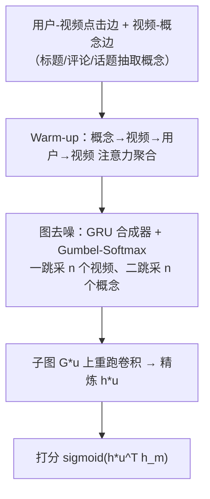
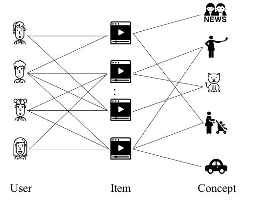
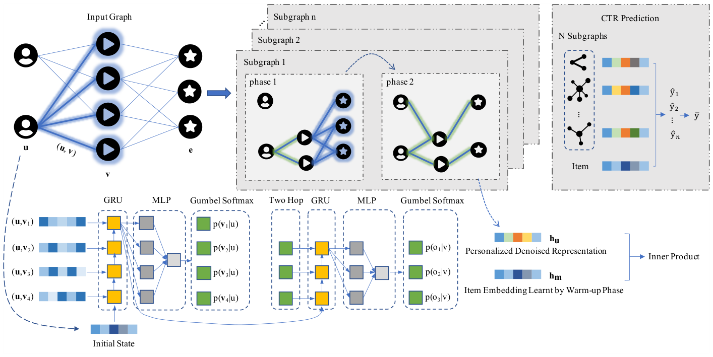

# Concept-Aware Denoising Graph Neural Network for Micro-Video Recommendation (概念感知去噪图神经网络用于微视频推荐)

- **会议/期刊**: CIKM 2021
- **作者与机构**: Yiyu Liu, Qian Liu, Yu Tian, Chenliang Li（武汉大学空天信息安全与可信计算教育部重点实验室）；Changping Wang, Yanan Niu, Yang Song（快手科技）
- **推荐链路定位**: 召回（用户/视频表征学习与粗排打分）
- **研究方向**: 图神经网络与知识图谱推荐 / 自监督对比学习与交互去噪
- **论文原文**: [https://arxiv.org/abs/2109.13527v1](https://arxiv.org/abs/2109.13527v1)
- **开源代码**: 暂未开源（文中仅引用 TextBlob / GloVe 等工具）

## TL;DR (1分钟核心速览)

微视频场景存在三重困境：视觉多模态特征抽取成本过高、上划行为带来大量假阳性交互、视频生命周期极短导致长尾占比 96%。CONDE 放弃视觉编码，转而从标题/评论/话题标签中抽取概念，构建"用户–视频–概念"三部异质图；并以 GRU 合成器 + Gumbel-Softmax 硬采样为每个用户抽取个性化去噪子图，再做表征精炼。在快手 945 万条交互数据上，UAUC 由最强基线 GAT 的 0.7345 提升至 0.7952（**+8.27%**），长尾桶 UAUC 提升 **+6.10%**。

## Background & Motivation (背景与核心矛盾)

- **主流范式**: MMGCN、ALPINE、THACIL 等微视频推荐模型依赖视觉/音频多模态特征构建模态专属二部图；PinSage、NIA-GCN、HAN 等则在用户–物品二部图（或元路径同质图）上做邻域聚合。
- **前人局限**: ① 视觉内容抽取在每日数十亿级流量的流式场景下算力不可承受，工业侧无法落地；② 用户绝大多数行为只是"上划"，用观看时长当隐式正反馈会引入大量假阳性边，纯二部图无法把噪声边与真实偏好区分开；③ 数据极度长尾（<10 次点击的视频占 85%，<50 次的占 96%），二部图聚合使长尾节点的邻域几乎全是噪声，马太效应被反馈回路进一步放大。
- **核心洞察 (Key Insight)**: 微视频的标题、评论、话题标签是视频内容的"廉价代理"，其中蕴含的命名实体与语义短语（如"经典港片""暖心"）足以表达内容语义；同一条视频对不同用户应只保留不同的概念侧面——去噪必须是**用户个性化**的，而非全局统一的边剪枝。
- **本文切入点**: 把语义概念作为三部图的骨架补足长尾物品的邻域，并在图卷积流程中间插入一次以用户偏好为条件的可微离散子图采样，让"脏边"在聚合前就被物理剔除。

## Method (核心方法设计)

### 1. 整体框架 (Overall Architecture)

输入为用户–视频点击边与视频–概念边构成的同质无向三部图（同类节点间不相邻）。模型分三阶段串行：**warm-up propagation** 按 概念→视频→用户 顺序先做语义注入，再反向沿 用户→视频 补一层协同信号；**graph denoising** 以 warm-up 得到的用户向量为 GRU 初始状态，逐跳（一跳视频、二跳概念）采样出定长子图；**preference refinement** 在子图上重跑同一套卷积得到精炼用户向量，与 warm-up 阶段的视频向量做内积 + sigmoid 打分。训练时对每个用户重复采样 $k$次得$k$ 个子图，各自计算交叉熵后求和；线上只做一次前向并把用户/视频向量常驻内存，无需在线重跑去噪。

<figure class="paper-figure" markdown="span">
  <figcaption>图2：由三个互不相交的顶点集（用户、物品和概念）组成的三部异质图，同一集合内的任意两个图顶点均不相邻。</figcaption>
</figure>
<figure class="paper-figure" markdown="span">
  <figcaption>图3：我们提出的CONDE的网络架构。</figcaption>
</figure>

### 2. 关键设计拆解 (Key Designs)

1. **概念桥接的三段式 warm-up 传播**：二部图在长尾物品上邻域过稀，作者先让概念向视频注入语义、再向用户汇聚，随后反向用用户邻居更新视频向量，使长尾视频借概念获得密集邻域。概念注意力沿用 GAT 形式 $\alpha_c=\frac{\exp(\sigma(\mathbf{a}^\top[\mathbf{e}_m\|\mathbf{e}_c]))}{\sum_{i\in C_m}\exp(\sigma(\mathbf{a}^\top[\mathbf{e}_m\|\mathbf{e}_i]))}$，$\mathbf{h}_m=\sigma(\sum_{c\in C_m}\alpha_c\mathbf{W}\mathbf{e}_c)$。直觉：概念是跨视频共享的语义锚点，能把稀疏共现"摊平"成稠密语义邻域。
2. **用户导向的可微离散去噪**：注意力只能软加权，噪声边仍参与聚合。CONDE 用 GRU 以 $\mathbf{h}_u$为初始状态编码边相关性$\mathbf{f}_{u,m}=\mathrm{GRU}(\mathbf{h}_u,\mathbf{h}_m)$，再经 softmax 得保留概率$s_{u,m}$，并用 Gumbel-Softmax 做**无放回定长采样**：$\pi_{u,m}=\frac{\exp((\log s_{u,m}+\epsilon_m)/\tau)}{\sum_{i}\exp((\log s_{u,i}+\epsilon_i)/\tau)}$，其中$\epsilon=-\log(-\log x)$，温度$\tau$随 minibatch 退火（$\tau=\tau_0e^{-\eta x}$）。硬采样不可导，Gumbel 重参数化让"删边"这一离散决策进入梯度回传；退火则等价于先宽后窄的邻域探索。
3. **训练目标、负采样与推理效率**：对每个用户采 $k$个子图，$\mathcal{L}=\sum_{u}\sum_{m}\sum_{i}\left[y_{u,m}\log\hat{y}_{u,m,i}+(1-y_{u,m})\log(1-\hat{y}_{u,m,i})\right]+\lambda\|\Theta\|_2^2$，训练负样本按线上真实比例 1:1 采样；线上只需一次前向，$\mathbf{h}_m$ 可离线预计算复用，去噪与精炼结果按用户缓存，边际子图变化被作者判定为可忽略。

## Experimental Setup & Evaluation Protocol (实验设置与评估协议)

- **数据集与预处理**:

| 数据集 | #Users | #Items | #Interactions | 稀疏度/密度 | 特征/场景说明 |
| :--- | :---: | :---: | :---: | :---: | :--- |
| Micro-Video（快手） | 82,193 | 784,863 | 9,455,804 | 1.47e-4 | 415,796 个概念，来自 2.32M 概念库（标题/评论/标签最长匹配 + TF-IDF 过滤） |
| Amazon Electronics | 192,403 | 63,001 | 1,612,381 | 1.33e-4 | 185,894 个概念，用 TextBlob 抽名词短语，英文评论 |

- **数据划分与防穿越 (Splitting Strategy)**: Micro-Video 取连续两天采样数据，**第一天全量训练**，第二天打乱后均分作验证/测试（近似时间切分 + 随机划分）；Amazon 按交互序列**比例划分** 70%/20%/10%（前 70% 训练、末 10% 测试）。
- **排名评测协议 (Ranking Protocol)**: 显式声明为 `Sampled Ranking`——**为每个用户采样等量未观测物品作负例（正负比 1:1）**，未做全库 Full-Ranking；同时报告 UAUC（逐用户 AUC 取均值）以保证指标口径一致，Top-N 指标为 HIT@5 / NDCG@5 / MAP@5。
- **对比基线与超参设置**: 基线含 GraphSage、PinSage、GAT、HAN（四类元路径：U-I-U、U-I-C-I-U、I-C-I、I-U-I）、NIA-GCN；所有模型统一用 $\hat{y}=\mathrm{sigmoid}(\mathbf{h}_u^\top\mathbf{h}_m)$打分，embedding 与隐层维度在 Micro-Video 上取 128、Amazon 上取 50；每模型跑 5 次取均值；边采样$p=40$（Micro-Video）/$p=100$（Amazon）；$\tau_0=10$，$\eta=2e^{-4}$/$1e^{-3}$。

## Key Experimental Results (实验关键数据)

### 1. 主实验对比 (Main Results)

| Method | Micro-Video AUC | NDCG@5 | HIT@5 | MAP@5 | Amazon AUC | NDCG@5 | HIT@5 | MAP@5 |
| :--- | :---: | :---: | :---: | :---: | :---: | :---: | :---: | :---: |
| PinSage | 0.7254 | 0.8922 | 0.2772 | 0.2610 | 0.6957 | 0.7688 | 0.7185 | 0.6109 |
| GraphSage | 0.7139 | 0.8847 | 0.2750 | 0.2580 | 0.6961 | 0.7703 | 0.7204 | 0.6125 |
| NIA-GCN | 0.7203 | 0.8657 | 0.2717 | 0.2517 | 0.6903 | 0.7647 | 0.7174 | 0.6049 |
| GAT | 0.7345* | 0.9102* | 0.2811* | 0.2668* | 0.7009* | 0.7734* | 0.7210* | 0.6162* |
| HAN | 0.7251 | 0.8988 | 0.2782 | 0.2630 | 0.6984 | 0.7724 | 0.7204 | 0.6144 |
| **CONDE** | **0.7952** | **0.9140** | **0.2890** | **0.2747** | **0.7064** | **0.7792** | **0.7266** | **0.6226** |
| Improv.% | +8.27% | +0.42% | +2.81% | +2.96% | +0.78% | +0.75% | +0.78% | +1.04% |

长尾分桶（阈值 clicks=50，长尾占物品空间 96.0%、测试集记录 34.48%）：

| Method | Hot AUC | Long-tail AUC | Hot NDCG@2 | Long-tail NDCG@2 | Long-tail MAP@2 |
| :--- | :---: | :---: | :---: | :---: | :---: |
| GraphSage | 0.7662 | 0.6436 | 0.9234 | 0.7298 | 0.2985 |
| GAT | 0.7710 | 0.6526 | 0.9409 | 0.7134 | 0.3018 |
| **CONDE** | **0.8331** | **0.6924** | **0.9445** | **0.7587** | **0.3122** |
| Improv.% | +8.05% | +6.10% | +0.38% | +3.96% | +3.45% |

### 2. 消融实验 (Ablation Study)

| Setting（Micro-Video） | AUC | NDCG@5 | HIT@5 | MAP@5 |
| :--- | :---: | :---: | :---: | :---: |
| 两跳均随机采样（w/o 去噪） | 0.7780 | 0.9087 | 0.2856 | 0.2704 |
| 仅一跳去噪（二跳随机） | 0.7854 | 0.9090 | 0.2866 | 0.2714 |
| 仅二跳去噪（一跳随机） | 0.7870 | 0.9106 | 0.2877 | 0.2729 |
| **两跳全去噪（完整 CONDE）** | **0.7952** | **0.9140** | **0.2890** | **0.2747** |

其余敏感性：保留概念数 $n\in\{6,10,20,30\}$（从 40 中选）以$n=10$最优（AUC 0.7952，$n=6$掉至 0.7942，$n=30$为 0.7924）；子图数$G\in\{2,4,6\}$以$G=4$性价比最高（0.7952 vs$G=2$的 0.7898，$G=6$仅 0.7941）；起始温度$\tau_0=10,\eta=2e^{-4}$优于$\tau_0=100/1000$（0.7952 vs 0.7875/0.7859）。

### 3. 关键实验发现 (Key Findings)

1. **语义概念是 AUC 增长的主引擎，而非更强的卷积**：同为注意力聚合，HAN 用了四条含概念元路径仍只有 0.7251，落后 CONDE 约 7 个点；而 CONDE 与 GAT 的网络层几乎同构，差距全部来自"三部图语义邻域 + 去噪"，说明瓶颈在邻域质量而非聚合算子。
2. **去噪二阶段不可偏废，且概念跳更关键**：去掉两跳去噪 AUC 掉 1.72 个点（0.7952→0.7780）；只保留二跳（概念）去噪 0.7870 高于只保留一跳（视频）去噪 0.7854，印证"噪声边主要来自上划误触的视频边、语义侧面主要由概念跳筛出"这一设计假设。
3. **长尾收益大于热门收益，对反馈回路有抑制**：热门桶 AUC 相对 GAT +8.05%，长尾桶 +6.10%，长尾 NDCG@2 相对 GraphSage +3.96%，说明概念骨架确实为低曝光物品补出了可聚合的稠密邻域；在 Amazon 这种完全不同的品类/语言上仍有 +0.78% AUC，泛化性得到跨域佐证。

## Highlights & Limitations (亮点、对比与审稿批判)

- **与代表作对比 (vs. Prior Work)**: MMGCN/ALPINE 走视觉多模态路线，精度上限高但工业侧算力不可承受，CONDE 用"文本概念"做廉价替代；PinSage/NIA-GCN 只在二部图上做邻域聚合，无法剔除假阳性边；HAN 虽引入概念元路径，但元路径是全局固定的语义通道，缺少"按用户定制的删边"能力——这正是 CONDE 相对 HAN 的最大增量。
- **可迁移亮点**: ① "软注意力 → 可微硬采样"的两段式去噪范式可直接移植到任何含噪声隐式反馈的异质图（如电商 review 构图、新闻实体图）；② 用 GRU 以中心节点表示为初始状态生成边相关性，再交给 Gumbel-Softmax 定长采样，天然支持"每用户保留不同邻域"，比全局 DropEdge/随机游走更具个性化；③ 离线预计算 $\mathbf{h}_m$ + 用户向量常驻内存的推理部署方案，对流式短视频场景极具工程参考价值。
- **审稿级局限批判**: ① 评估采用 **1:1 采样排序**而非 Full-Ranking，Top-N 指标（HIT@5/MAP@5）绝对值偏高且对全库排序的区分度有限，AUC 的 +8% 也可能被负例采样比例放大；② 概念抽取依赖 2.32M 私有概念库与内部打标系统，Amazon 侧又切换到 TextBlob + GloVe + 不同语言，可复现性与跨语言一致性存疑，且未给出随机种子/显著性检验（仅 5 次均值）；③ 去噪以"每用户"为单位做两跳 GRU 编码，训练复杂度随用户数×邻居数线性增长，文中未给出训练时长与显存开销，$G=6$ 时代价换来的收益已趋平；④ 论文自称面向流式推荐，却完全没有对用户行为序列做时序建模，与"捕捉高度动态偏好"的宣称存在落差。

## Rating (四维评分)

- **方法创新性 (Novelty)**: ⭐⭐⭐⭐ （首次把异质三部图上的"用户定制可微离散去噪"引入推荐，Gumbel-Softmax 硬采样 + 温度退火的组合思路清晰且有物理直觉，但卷积算子本身沿用 GAT，属组合式创新）
- **评估协议与实验扎实度 (Protocol & Experiments)**: ⭐⭐⭐ （两个数据集跨语言验证 + 长尾分桶 + 四组超参敏感性，消融完整；但仅采样排序、无 Full-Ranking、无显著性检验，是主要扣分项）
- **写作与数学规范度 (Clarity & Rigor)**: ⭐⭐⭐⭐ （三阶段流程与公式符号定义一致、可读性强，去噪采样与退火策略描述明确；缺复杂度分析与训练开销统计）
- **工业落地与复现价值 (Industrial & Practical Value)**: ⭐⭐⭐⭐ （来自快手真实流量、9.45M 交互规模，离线预计算 + 内存缓存推理方案可直接复用，对短视频推荐有强参考价值；但未开源、概念库私有，复现门槛高）

