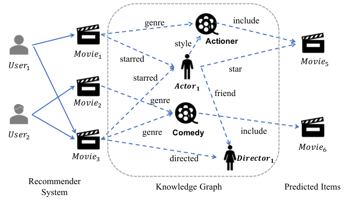
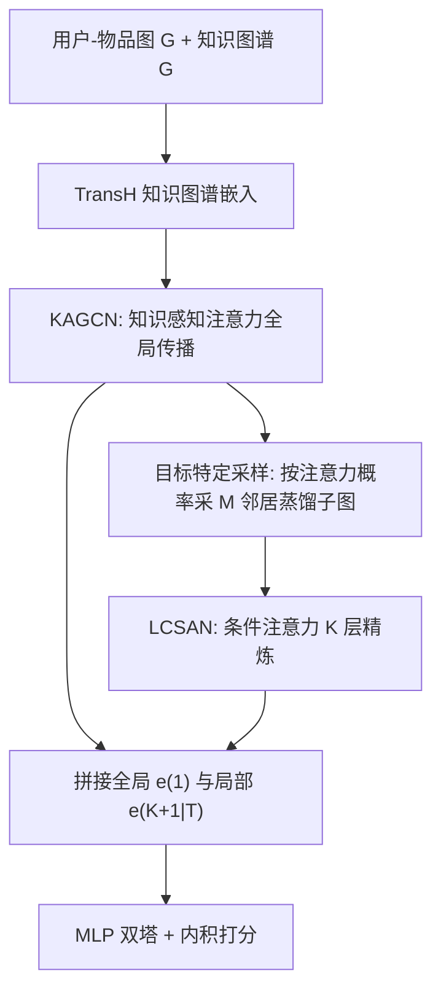
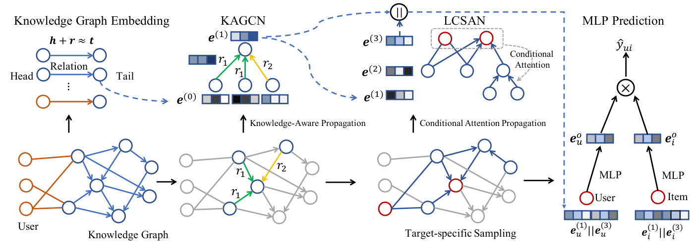

# Conditional Graph Attention Networks for Distilling and Refining Knowledge Graphs in Recommendation (面向推荐的知识图谱蒸馏与精炼条件图注意力网络)

- **会议/期刊**: CIKM 2021 (30th ACM International Conference on Information and Knowledge Management)
- **作者与机构**: Ke Tu, Daixin Wang, Zhiqiang Zhang, Jun Zhou, Yuan Qi (蚂蚁集团)；Peng Cui, Wenwu Zhu (清华大学)
- **推荐链路定位**: 召回 (用户-物品匹配打分)
- **研究方向**: 图神经网络与知识图谱推荐 / CTR 预估
- **论文原文**: [https://arxiv.org/abs/2111.02100v1](https://arxiv.org/abs/2111.02100v1)
- **开源代码**: 暂未开源

## TL;DR (1分钟核心速览)

知识图谱 (KG) 规模巨大且充满与当前预测无关的噪声边，而现有 KG 增强推荐（KGAT 等）的边注意力只取决于两端实体、与查询目标 (user, item) 无关。本文提出 KCAN：先用知识感知注意力在 KG 与用户-物品图上做全局传播，再按注意力概率采样出**目标特定子图**完成"蒸馏"，最后在该子图上施加**依赖目标的条件注意力**（边重要度 × 实体-目标相似度）做"精炼"。在 MovieLens / Last-FM / Yelp 上按 Leave-One-Out + 100 负采样排序评测，Hit@10 相对最强基线提升 1.4%~10.3%，NDCG@10 提升 5.0%~23.4%。

## Background & Motivation (背景与核心矛盾)

- **主流范式**: KG 增强推荐分两支——嵌入式（CKE、NFM，把 KGE 当正则/特征）与图卷积式（KGAT、KGNN，在 KG 上递归传播高阶协同信号），另有基于元路径的路径式方法（RippleNet、meta-path2vec）。
- **前人局限**: ① 嵌入式仅把 KG 三元的隐向量拼入模型，丢失 KG 的拓扑结构；② GCN 式方法在全图上无差别传播，而 KG 中绝大多数关系对某个具体 user-item 预测毫无帮助，全图传播既慢又引入噪声；③ 路径式依赖手工元路径，且"多条独立路径"难以表达用户对同一关系边权重的**个性化差异**。
- **核心洞察 (Key Insight)**: 同一知识边对不同的目标应有不同权重。论文图 3 的实例显示，边 $u_0 \xrightarrow{r_{12}} i_{1687}$在预测$(u_0, i_{2466})$时权重 0.105，而在预测$(u_0, i_{780})$ 时仅 0.026——KGAT 式目标无关边注意力根本无法刻画这种差异。
- **本文切入点**: 把"全图 → 目标相关子图"的缩减定义为**知识蒸馏**，把"子图内按目标重加权"定义为**知识精炼**，用一个端到端网络同时完成。

<figure class="paper-figure" markdown="span">
  <figcaption>图1：知识感知推荐系统示意图。</figcaption>
</figure>

## Method (核心方法设计)

### 1. 整体框架 (Overall Architecture)

模型输入为用户-物品二部图 $G$与外 knowledge graph$\mathcal{G}$。流程为四步：① 用 TransH 预训练实体/关系嵌入，并把$G$中的点击边视作单一关系$r_G$并入 KG 统一编码；② KAGCN 以关系投影空间中的余弦注意力在 KG 上做一跳邻域聚合，得到刻画**全局语义相似度**的$\mathbf{e}_v^{(1)}$；③ 以该注意力为采样概率，对目标$\mathcal{T}=\{u,i\}$的 K-hop 邻域各采样$M$个邻居并取并集，得到目标特定子图$\hat{S}_K(\mathcal{T})$；④ LCSAN 在子图上用条件注意力堆叠$K$层传播得到$\mathbf{e}_v^{(K+1)|\mathcal{T}}$，与全局表示拼接后过 MLP 双塔，内积输出预测分。

<figure class="paper-figure" markdown="span">
  <figcaption>图2：所提出的KGAN框架。该框架由四个模块组成：知识图谱嵌入层、知识图谱蒸馏模块（KAGCN层与目标特定采样）、知识图谱精炼模块（LCSAN层）以及多层感知机（MLP）双塔预测层。</figcaption>
</figure>

### 2. 关键设计拆解 (Key Designs)

1. **知识感知图卷积 KAGCN（全局语义传播）**：Pain point 是普通 GCN 对不同关系一视同仁。作者借 TransH 的关系超平面投影 $\mathbf{e}_{v\perp}=\mathbf{e}_v-\mathbf{w}_r^\top\mathbf{e}_v\mathbf{w}_r$，让注意力在关系$r$ 专属空间内比较头尾实体：
   $\hat{\pi}_r(v,t)=\mathrm{softmax}\big(\cos(\mathbf{e}_{v\perp}+\mathbf{d}_r,\ \mathbf{e}_{t\perp})\big)$即"经关系平移后越接近，传递越多信息"，聚合$\mathbf{e}_{\mathcal{N}(v)}=\sum_{(r,t)\in\mathcal{N}(v)}\pi_r(v,t)\mathbf{e}_t$ 后与自身拼接过 LeakyReLU。直觉：把关系的语义差异显式编码进权重，避免多关系互相污染。
2. **目标特定子图蒸馏（Distillation）**：全图太贵且噪声多，均匀采样（GraphSAGE）又会采到大量无关边。本文直接用上一步已算出的 $\hat{\pi}_r(v,t)$作为采样概率，对每个目标实体取固定大小$M$的邻域并按并集合成感受野$\hat{S}_K(\mathcal{T})=\bigcup_{v\in\mathcal{T}}\hat{S}_K(v)$。这样保留的是"语义上最相关"的邻居，且采样规模与 KG 总量解耦，复杂度对边数线性。
3. **局部条件子图注意力 LCSAN（Refinement）**：这是与 KGAT 的本质分野——注意力显式条件化于目标。分解为两项相乘：
   $\alpha(v,r,t|\mathcal{T})=\mathrm{softmax}\Big(\mathrm{LeakyReLU}\big(\alpha_1(v,r,t)\cdot\alpha_2(t|\mathcal{T})\big)\Big),\quad \alpha_2(t|\mathcal{T})=\mathbf{a}^\top[\mathbf{W}_t\mathbf{e}_{\mathcal{T}}\ \|\ \mathbf{W}_e\mathbf{e}_t^{(1)}]$其中$\alpha_1$复用$\hat{\pi}_r(v,t)$（边本身的任务重要度，起降噪作用），$\alpha_2$度量尾实体与目标向量$\mathbf{e}_{\mathcal{T}}=\|_{v\in\mathcal{T}}\mathbf{e}_v^{(1)}$ 的匹配度。两者相乘实现"既过滤噪声边、又贴合当前用户偏好"的双重加权。

- **训练目标、负采样与推理效率**: 总损失 $\mathcal{L}=\mathcal{L}_{kg}+\mathcal{L}_{\mathcal{T}}+\lambda\|\Theta\|_2^2$；$\mathcal{L}_{kg}$为 KGE 的 BPR 损失（负例为随机替换尾实体的均匀采样），$\mathcal{L}_{\mathcal{T}}$为推荐 BPR（负例从用户未交互物品中均匀采样），两损失**交替优化**、Adam、初始学习率 0.025、200 epoch。总复杂度$O((|E|+|E_{kg}|)F_1^2+|E_{kg}|M\prod F_iF_{i+1})$，其中$M$、$F_i$ 为小常数，整体对图规模线性；推理时需为每个候选 (u,i) 采样并前传一次子图，代价高于纯双塔内积检索，更适合当精排/小候选集打分器。

## Experimental Setup & Evaluation Protocol (实验设置与评估协议)

- **数据集与预处理**: MovieLens 将评分 $\ge 4$ 视为正交互；Last-FM 与 Yelp 均用 **10-core** 过滤；KG 分别来自 Microsoft Satori（MovieLens）、Freebase（Last-FM）与 Yelp 本地商户属性网络。

| 数据集 | #Users | #Items | #Interactions | #KG 实体 / 关系 / 三元组 | 特征/场景说明 |
| :--- | :---: | :---: | :---: | :---: | :--- |
| MovieLens | 6,036 | 2,445 | 376,886 | 182,011 / 12 / 1,241,995 | 电影，KG 远大于交互图（极稀疏） |
| Last-FM | 23,566 | 48,123 | 3,034,796 | 58,266 / 9 / 464,567 | 音乐收听 |
| Yelp | 45,919 | 45,538 | 1,185,068 | 90,961 / 42 / 1,853,704 | 本地商户（餐厅/酒吧） |

- **数据划分与防穿越 (Splitting Strategy)**: Top-K 任务采用 `Leave-One-Out`（每用户留最后一次交互作测试）。
- **排名评测协议 (Ranking Protocol)**: `Sampled Ranking`——测试正例与 **100 个随机未交互负例**共同排序，报告 Hit@10 与 NDCG@10；CTR 任务用随机采样负例计算 AUC。注意未使用 Full-Ranking，指标存在乐观偏差。
- **对比基线与超参设置**: 基线覆盖四类代表——正则式 CKE、因子分解 NFM、路径式 RippleNet、GCN 式 KGAT。所有方法 embedding 维度统一 $d=16$；本文与 KGAT 的塔结构为 16-8-8，dropout 0.1，跳数$K=2$，采样邻居数$M=20$，$\lambda$在$\{10^{-1},\dots,10^{-5}\}$ 网格搜索。

## Key Experimental Results (实验关键数据)

### 1. 主实验对比 (Main Results)

| 数据集 | 指标 | CKE | NFM | RippleNet | KGAT | **KCAN** | Improv.% (vs 最优基线) |
| :--- | :--- | :---: | :---: | :---: | :---: | :---: | :---: |
| MovieLens | Hit@10 | 0.293 | 0.384 | 0.607 | 0.467 | **0.668** | +10.0% |
| MovieLens | NDCG@10 | 0.158 | 0.204 | 0.324 | 0.252 | **0.365** | +12.7% |
| Last-FM | Hit@10 | 0.606 | 0.697 | 0.650 | 0.699 | **0.771** | +10.3% |
| Last-FM | NDCG@10 | 0.383 | 0.421 | 0.367 | 0.437 | **0.506** | +15.8% |
| Yelp | Hit@10 | 0.741 | 0.775 | 0.721 | 0.799 | **0.810** | +1.4% |
| Yelp | NDCG@10 | 0.480 | 0.491 | 0.410 | 0.502 | **0.527** | +5.0% |
| MovieLens | AUC | 0.530 | 0.809 | 0.903 | 0.841 | **0.907** | +0.4% |
| Last-FM | AUC | 0.850 | 0.904 | 0.889 | 0.905 | **0.923** | +2.0% |
| Yelp | AUC | 0.915 | 0.908 | 0.917 | 0.922 | **0.937** | +1.6% |

### 2. 消融实验 (Ablation Study)

| 变体 | MovieLens Hit@10 / NDCG@10 | Last-FM Hit@10 / NDCG@10 | Yelp Hit@10 / NDCG@10 |
| :--- | :---: | :---: | :---: |
| KCAN w/o both | 0.632 / 0.348 | 0.698 / 0.433 | 0.735 / 0.469 |
| KCAN w/o LC (去 LCSAN) | 0.648 / 0.355 | 0.712 / 0.442 | 0.772 / 0.497 |
| KCAN w/o GK (去 KAGCN) | 0.654 / 0.364 | 0.750 / 0.478 | 0.785 / 0.503 |
| **KCAN (full)** | **0.668 / 0.365** | **0.771 / 0.506** | **0.810 / 0.527** |

### 3. 关键实验发现 (Key Findings)

1. **两个模块缺一不可但贡献不均**：去掉 LCSAN 后 Last-FM Hit@10 从 0.771 掉到 0.712（-7.7%），去掉 KAGCN 掉到 0.750（-2.7%），说明"条件注意力的目标个性化"比"全局高阶传播"更关键；但两者同时移除时跌至 0.698，低于任一单模块变体，证明全局语义与局部偏好是互补而非冗余。
2. **KG 越大、交互越稀疏，蒸馏收益越大**：MovieLens 交互图最小（2,445 物品）却挂载 124 万条三元组，KGAT 在此仅 0.467，反而低于路径式 RippleNet 的 0.607；KCAN 进一步提升到 0.668（+10.0%），说明全图无差别传播在"大 KG + 小交互图"的极端不匹配场景下会严重退化，而子图蒸馏恰好对症。
3. **超参不敏感，工程代价可控**：$M$从 5 增至 20 时 AUC 单调上升，超过 20 后曲线基本平坦（Last-FM 约 0.923），说明只需很小的子图即可覆盖有效知识；$\lambda$在$10^{-3}$处最优，过大（$10^{-1}$）时正则压倒主损失导致性能回落；两条损失曲线在约 100 epoch 内收敛，交替优化稳定。

## Highlights & Limitations (亮点、对比与审稿批判)

- **与代表作对比 (vs. Prior Work)**: 与 KGAT 的本质差异在于注意力是否**条件化于目标**——KGAT 的边权只由两端实体决定，KCAN 用 $\alpha_2(t|\mathcal{T})$ 引入目标向量，使同一子图对不同 (u,i) 呈现不同权重；与 RippleNet 相比，KCAN 用可学习注意力采样的**子图**替代手工元路径，兼具多样性与端到端训练；与同为子图思路的 KGNN 类工作相比，KCAN 保留了 KAGCN 的全局语义而不是只在预先算好的局部子图上学习。
- **可迁移亮点**: ①"用已有的注意力分数当作子图采样概率"是一个几乎零额外开销的蒸馏技巧，可直接迁移到任何带边权的 GNN 采样器（如 PinSage 式随机游走）；②将边权分解为"任务级 × 目标级"两项相乘的条件注意力范式，可移植到会话推荐或序列推荐的 item-item 图建模。
- **审稿级局限批判**: ① 评测只用 `100 负例采样排序`，未报告 Full-Ranking，负例数变化会显著影响 Hit@10 的绝对值，与 KGAT 等原论文的全库排序结果不可直接比较；② 推理需对每个候选 (u,i) 动态采样子图并前传 LCSAN，无法像双塔那样离线建 ANN 索引，线上大规模召回成本高，论文也未给出延迟/吞吐测量；③ 仅报告单一随机种子下的点估计，无方差或显著性检验；④ LCSAN 固定 $K=2$ 层，未讨论更深子图传播的过平滑风险。

## Rating (四维评分)

- **方法创新性 (Novelty)**: ⭐⭐⭐⭐ （将"蒸馏+精炼"两阶段诉求转译为子图采样与条件注意力的具体算子，条件化边权是清晰且有说服力的增量）
- **评估协议与实验扎实度 (Protocol & Experiments)**: ⭐⭐⭐ （三数据集、Top-K 与 CTR 双任务、消融与超参分析齐备，但仅用 100 负例采样排序、无显著性检验与多随机种子）
- **写作与数学规范度 (Clarity & Rigor)**: ⭐⭐⭐⭐ （注意力公式与 TransH 投影结合自然、符号统一，复杂度分析明确；但 Fig.2 出现 KGAN/KCAN 命名不一致，且条件注意力中 $\alpha_1$ 直接复用全局注意力的合理性缺少论证）
- **工业落地与复现价值 (Industrial & Practical Value)**: ⭐⭐⭐ （采样规模 $M$ 小、复杂度对图规模线性，易于落地为精排打分器；但逐候选子图前传的推理开销与未开源限制了直接复现与召回级部署）

