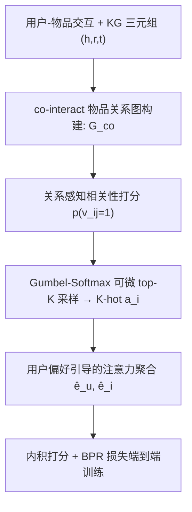
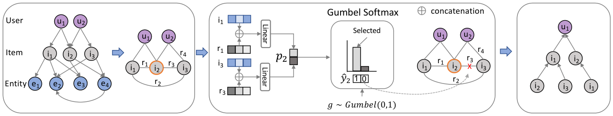
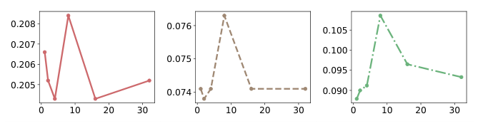

# DSKReG: Differentiable Sampling on Knowledge Graph for Recommendation with Relational GNN (基于可微采样的关系图神经网络知识图谱推荐)

- **会议/期刊**: CIKM 2021 (Short Paper, 5 页)
- **作者与机构**: Yu Wang, Zhiwei Liu, Ziwei Fan, Lichao Sun, Philip S. Yu（University of Illinois at Chicago / Lehigh University）
- **推荐链路定位**: 召回（KG 增强的物品表征与 Top-N 排序）
- **研究方向**: 图神经网络与知识图谱推荐 / 自监督对比学习与交互去噪
- **论文原文**: [https://arxiv.org/abs/2108.11883v1](https://arxiv.org/abs/2108.11883v1)
- **开源代码**: [https://github.com/YuWang-1024/DSKReG](https://github.com/YuWang-1024/DSKReG)

## TL;DR (1分钟核心速览)

KG 增强推荐的痛点在于：KG 节点度呈幂律分布（低度节点需高阶聚合、高度节点感受野爆炸致过平滑），且大量三元组与推荐目标无关。DSKReG 先把共享中间实体的物品显式连成 "co-relation" 物品图，再用关系感知打分 + Gumbel-Softmax 构成**可微 top-K 邻居采样**，与 BPR 目标端到端联合优化，最后以用户偏好引导的注意力聚合。在 Last.FM / BookCrossing / MovieLens-Sub 上以全库排序评估，NDCG@20 相对最优基线分别提升 14.2% / 32.0% / 37.5%。

## Background & Motivation (背景与核心矛盾)

- **主流范式**: KGCN / KGNN-LS / KGAT / ATBRG 将 KG 视为异构图，用 GCN 或图注意力把实体邻居聚合进物品表征以缓解物品侧冷启动。
- **前人局限 1（度偏斜）**: KG 度数服从幂律——低度物品邻居不足需多层聚合，高度物品（如热门导演）感受野指数膨胀，多层堆叠触发过平滑，二者无法用同一聚合深度兼顾。
- **前人局限 2（噪声交互）**: 现有方法无条件聚合全部相连实体；大量三元组（如 co-director 之外的弱属性）与用户偏好无关，直接入模既增开销又稀释表征。
- **核心洞察 (Key Insight)**: 不同关系对推荐的贡献是**用户相关且不均衡**的（同类型 > co-director），因此"邻居是否该保留"应按关系与用户偏好学习出一个分布，而非均匀采样；且既有采样（RippleNet 固定采样、KGPolicy 独立 RL 代理）与训练目标解耦，只能得到次优选择。
- **本文切入点**: 用 Gumbel-Softmax 重参数化把"离散选邻居"变成可反向传播的算子，使采样策略与推荐损失联合优化。

## Method (核心方法设计)

### 1. 整体框架 (Overall Architecture)

输入用户-物品二部图与 KG；先从中抽取 co-interact 模式构建物品-物品关系图（含用户-物品边统一为一张关系图 $\mathcal{G}_{co}$），把高阶物品邻居直接相连以压缩感受野；随后对每个节点按关系感知分布打分、经 Gumbel-Softmax 迭代$K$次得到$K$-hot 选择向量$a_i$；聚合阶段用用户嵌入对关系做注意力加权，仅传播被选中邻居的消息；最后内积打分 + BPR 训练。推理时同一套采样器直接复用（无需外部 RL 代理），单节点开销为$O(Kd)$。

<figure class="paper-figure" markdown="span">
  <figcaption>图 1：体现 DSKReG 框架的玩具示例。a) 根据用户协同交互构建用户-物品图，并通过连接高阶邻居物品构建物品-物品图。b) 对物品 𝑖2，计算由邻居物品 𝑖1 和 𝑖3 得分组成的相关性得分向量 𝑝2；随后对 𝑝2 应用 Gumbel-Softmax 得到近似独热编码 ˆ𝑦2，其值表明邻居物品 𝑖3 应被忽略。c) 在用户偏好引导下对关系图进行注意力聚合。</figcaption>
</figure>

### 2. 关键设计拆解 (Key Designs)

1. **Co-interact 关系图构造（缩短路径、抑制感受野爆炸）**：痛点在于稀疏物品缺邻居、而高阶聚合又使高度节点爆炸。做法是凡两物品被同一实体 $t$以同一关系$r$连接，即新建 "co-$r$" 边：$\mathcal{G}_{co}=\{(i_1,r',i_2)\mid (i_1,r,t)\in\mathcal{G}_K,\ (i_2,r,t)\in\mathcal{G}_K\}$。直觉是把二阶语义路径压缩为一跳显式关系，既给低度物品补上语义邻居，又避免多层 GCN 的过平滑。

2. **关系感知可微采样（把去噪选择变成可学习算子）**：以关系嵌入与邻居嵌入拼接后过 softmax 定义相关性分布
$p(v_{ij}=1\mid w,b)=\dfrac{\exp(w[r_{ij}\|e_j]+b)}{\sum_{m\in\mathcal{N}(i)}\exp(w[r_{im}\|e_m]+b)}$，
再注入 Gumbel 噪声采样近似 one-hot：
$\hat{y}_i=\mathrm{Softmax}\big((\log p_i+g)/\tau\big),\quad g\sim\mathrm{Gumbel}(0,1)$，
重复 $K$次并把已选项分值置 0，得到$K$-hot 向量$a_i$。$\tau\to 0$ 时逼近硬采样，梯度经 softmax 回传，采样器因此能被推荐损失直接"纠偏"；同时 top-K 天然把无关邻居概率压低，等效于一次性可学习的边去噪。

3. **偏好感知聚合与训练目标**：同一关系对不同用户权重不同，故注意力用用户嵌入与关系嵌入的内积门控：
$\phi_{ij}=a_{ij}\cdot\dfrac{\exp(\langle e_u,r_{ij}\rangle)}{\sum_{m\in\mathcal{N}(i)}\exp(\langle e_u,r_{im}\rangle)},\quad \hat{e}_i=\sigma\Big(W\big(e_i+\sum_{j\in\mathcal{N}(i)}\phi_{ij}e_j\big)+b\Big)$。
总损失 $\mathcal{L}_{bpr}=\sum_{(u,i,j)\in\mathcal{D}}-\log\sigma(\hat{y}_{ui}-\hat{y}_{uj})+\lambda\|\Theta\|_2^2$，负样本为均匀采样的未交互物品；无额外采样网络，推理只做一次 top-K 采样 + 一层聚合。

## Experimental Setup & Evaluation Protocol (实验设置与评估协议)

| 数据集 | #Users | #Items | #Interactions | 密度(每用户评分数) | 特征/场景说明 |
| :--- | :---: | :---: | :---: | :---: | :--- |
| Last.FM | 1,872 | 3,846 | 21,173 | 11.3 | 音乐收听；9,366 实体 / 60 关系 / 15,518 三元组 |
| BookCrossing | 17,860 | 14,967 | 69,873 | 3.9 | 图书评分；77,903 实体 / 25 关系 / 151,500 三元组 |
| MovieLens-Sub | 5,423 | 2,445 | 37,858 | 7.0 | 从 ML-1M 随机抽 10% 评分以构造稀疏冷启动场景；125,061 实体 / 12 关系 / 539,350 三元组 |

- **数据划分 (Splitting)**: 非时间切分；每数据集**随机抽取一部分用户作为测试用户**（Last.FM 363、BookCrossing 497、MovieLens-Sub 563），其余用户交互作训练，属"随机用户留出 + 训练集内全量交互"的 leave-users-out 设定，未做严格冷启动物品划分。
- **排名评测协议 (Ranking Protocol)**: 无偏 **Full-Ranking**——对每个测试用户，在**除训练交互外的全部物品**上排序打分，报告 Recall / Precision / NDCG @5、@10、@20。
- **对比基线与超参**: 基线为 CFKG、KGAT、KGNN-LS、RippleNet（含知识表示、图注意力、个性化关系打分、涟漪传播四类代表）；邻居采样数 $K$经网格搜索定为 **8**，$\tau$ 退火至近 0；未报告显著性检验（短论文）。

## Key Experimental Results (实验关键数据)

### 1. 主实验对比 (Main Results)

| 数据集 | 模型 | R@10 | R@20 | N@10 | N@20 |
| :--- | :--- | :---: | :---: | :---: | :---: |
| Last.FM | CFKG | 0.0069 | 0.0069 | 0.0042 | 0.0042 |
| | KGAT | 0.0996 | 0.1483 | 0.0781 | 0.0951 |
| | KGNN-LS | 0.1297 | **0.2073** | 0.0705 | 0.0929 |
| | RippleNet | 0.0962 | 0.1313 | 0.0672 | 0.0776 |
| | **DSKReG** | **0.1481** | **0.2084** | **0.0889** | **0.1086** |
| | Improv. | +14.1% | +0.5% | +13.8% | +14.2% |
| BookCrossing | CFKG | 0.0403 | 0.0406 | 0.0661 | 0.0668 |
| | KGAT | 0.0141 | 0.0321 | 0.0170 | 0.0242 |
| | KGNN-LS | 0.0528 | 0.0761 | 0.0455 | 0.0519 |
| | RippleNet | 0.0457 | 0.0596 | 0.0442 | 0.0485 |
| | **DSKReG** | **0.0593** | **0.0763** | **0.0782** | **0.0882** |
| | Improv. | +12.3% | +0.2% | +18.3% | +32.0% |
| MovieLens-Sub | CFKG | 0.0057 | 0.0086 | 0.0059 | 0.0076 |
| | KGAT | 0.0361 | 0.0699 | 0.0254 | 0.0386 |
| | KGNN-LS | 0.0325 | 0.0678 | 0.0205 | 0.0313 |
| | RippleNet | 0.0535 | **0.1097** | 0.0289 | 0.0450 |
| | **DSKReG** | **0.0618** | 0.1086 | **0.0432** | **0.0619** |
| | Improv. | +15.5% | -1.0% | +49.5% | +37.5% |

### 2. 消融实验 (Ablation Study)

| 采样策略（Last.FM / BookCrossing / MovieLens-Sub, R@20） | 相对表现 | 说明 |
| :--- | :--- | :--- |
| Uniform（随机 K 邻居，等价 KGCN/KGNN-LS 做法） | 三数据集均最差 | 无法区分推荐相关关系 |
| L2（关系-物品嵌入 L2 距离作分布） | 中游，BookCrossing 接近最优 | 关系简单时已够用 |
| Inner（关系-物品内积作分布，无可微重参数） | 中上游，Last.FM/ML-Sub 逊于 GS | 有打分但采样与损失解耦 |
| **GS（本文，Gumbel-Softmax 端到端）** | **Last.FM、ML-Sub 最优** | 关系复杂时收益放大 |

| 邻居采样数 $K$ | 5 | 8 | 10 | 20 | 30 |
| :--- | :---: | :---: | :---: | :---: | :---: |
| R@20 趋势（三数据集一致） | 次优 | **最优** | 平台/微降 | 下降 | 下降 |

<figure class="paper-figure" markdown="span">
  <figcaption>图 3：不同邻居数量下的 Recall@20</figcaption>
</figure>

### 3. 关键实验发现 (Key Findings)

1. **收益集中在排序质量而非召回广度**：Last.FM R@20 仅 +0.5%、MovieLens-Sub R@20 甚至 -1.0%，但 NDCG@20 分别 +14.2% / +37.5%。说明噪声邻居主要污染**头部位置**——把相关物品挤到中低排名，可微采样主要修复了位置敏感度，而非扩大命中集合。
2. **仅 8 个邻居即可饱和**：$K=8$时为三数据集共同最优点，$K\ge 20$ 性能回落。这直接佐证了"KG 中大量交互与推荐无关"的论断：相关邻居是极稀疏子集，盲目扩大采样的前作（KGAT 全邻居注意力）必然引入噪声。
3. **关系越复杂，可微采样越不可替代**：Last.FM（60 种关系，最少三元组）与 MovieLens-Sub（539K 三元组）上 GS 显著优于 Inner/L2；而 BookCrossing 仅 25 种关系，L2/Inner 已可匹敌。说明关系异质度是"学采样分布 vs 用固定相似度"的分水岭。

## Highlights & Limitations (亮点、对比与审稿批判)

- **与代表作对比 (vs. Prior Work)**: KGNN-LS 做用户个性化的**关系打分**但仍**均匀采样全部邻居**，打分只影响聚合权重、无法剔除噪声边；KGAT 用图注意力在完整 KG 上传播，高度节点感受野爆炸且无采样；RippleNet 固定大小涟漪采样但采样过程**脱离优化**（本文明确指出其"detached"缺陷）；ATBRG 需先构建子图 + 关系感知注意力，采样仍非可微。DSKReG 的本质差异是把"选边"从预处理/外部代理搬进损失函数内部。
- **可迁移亮点**: (1) Gumbel-Softmax top-K 硬选择算子可平移到多模态/序列推荐的特征选择与行为序列去噪，实现"选择即训练"；(2) co-interact 关系图构造把二阶元路径压缩为一跳边，是降低 KG 推理深度、缓解过平滑的通用轻量技巧。
- **审稿级局限批判**: ① co-interact 图构建的复杂度为 $\sum_t \deg(t)^2$，对极高度的公共实体（如热门导演/类目）会引发组合爆炸，论文未给复杂度与内存分析；② 评估仅随机留出少量用户做 Full-Ranking，**未做严格冷启动物品划分**，与"缓解冷启动"的核心动机不完全对齐，且无显著性检验、基线仅 4 个；③ Gumbel 温度$\tau$退火策略与$K$ 的敏感性未给消融曲线，复现时超参成本偏高。

## Rating (四维评分)

- **方法创新性 (Novelty)**: ⭐⭐⭐⭐ （把 Gumbel-Softmax 可微 top-K 采样嵌入 KG 关系图聚合，明确区别于均匀采样与 RL 外挂采样，思路干净但组件本身非全新）
- **评估协议与实验扎实度 (Protocol & Experiments)**: ⭐⭐⭐ （Full-Ranking 全库排序值得肯定，但仅 4 个基线、无显著性检验、冷启动场景未严格构造，短论文体量受限）
- **写作与数学规范度 (Clarity & Rigor)**: ⭐⭐⭐⭐ （打分分布、Gumbel 重参数化与注意力聚合公式链条完整、符号一致，但缺少复杂度与 $\tau$/$K$ 退火细节）
- **工业落地与复现价值 (Industrial & Practical Value)**: ⭐⭐⭐⭐ （代码开源，采样数仅 8、单层聚合，推理开销远低于全邻居 KGAT，易于在 KG 召回通道落地）

