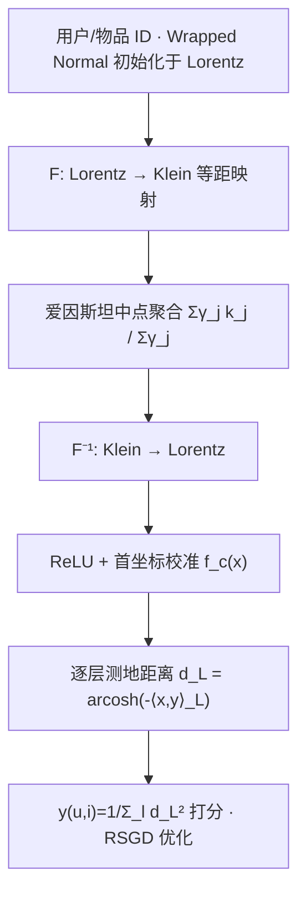
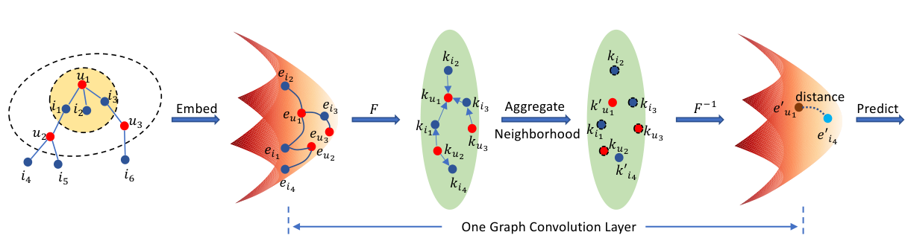

# Fully Hyperbolic Graph Convolution Network for Recommendation (面向推荐的完全双曲图卷积网络)

- **会议/期刊**: CIKM 2021 (Short Paper)
- **作者与机构**: Liping Wang, Fenyu Hu, Shu Wu, Liang Wang（中科院自动化所 CRIPAC / 中国科学院大学）
- **推荐链路定位**: 召回（协同过滤召回表征学习）
- **研究方向**: 图神经网络与知识图谱推荐 / 协同过滤与双塔召回
- **论文原文**: [https://arxiv.org/abs/2108.04607v1](https://arxiv.org/abs/2108.04607v1)
- **开源代码**: 暂未开源

## TL;DR (1分钟核心速览)

真实用户-物品二部图呈树状层次结构，而欧氏球体积仅多项式增长，导致"跳数-距离"关系失真。本文提出 LGCF：把**嵌入初始化、邻域聚合、激活校准、打分**四步全部在 Lorentz 双曲模型内实现，用 Klein 模型作中转桥接爱因斯坦中点以规避非向量空间的线性变换问题，彻底摆脱 HGCF 借切空间近似导致的误差沿图累积。在 Amazon-CD/Book、Yelp2020 的 80/20 划分全库排序下，R@20 相对 LightGCN 提升 7.05%–9.24%，NDCG@10 在 Amazon-Book 上提升 16.15%，且低维（d=20）即可追平欧氏 d=50 的效果。

## Background & Motivation (背景与核心矛盾)

- **主流范式**: NGCF/LightGCN 在欧氏空间做邻居聚合，LightGCN 进一步证明去掉特征变换与非线性后最优；HGCF 是唯一尝试引入双曲几何的对照方案。
- **前人局限一**: 欧氏空间球体积随半径多项式增长，无法容纳指数膨胀的邻居规模，嵌入距离难以准确反映图上的跳数，即"失真 (distortion)"。
- **前人局限二**: HGCF 借用切空间（本质是欧氏空间）做卷积，仅是对双曲空间的局部线性近似，消息传播中近似误差逐层累积并扩散到全图，高阶邻居影响刻画不准。
- **核心洞察 (Key Insight)**: 双曲空间是树图的连续类比，球体积随半径指数增长，与二部图的层次结构天然匹配，因此应在双曲空间内部完成全部算子而非往返切空间。
- **本文切入点**: 选定数值稳定的 Lorentz 模型作为唯一"主场"，只在聚合瞬间用等距映射切到 Klein 模型，算完立刻映回。

## Method (核心方法设计)

### 1. 整体框架 (Overall Architecture)

模型仅含三个部件：Lorentz 嵌入层（用 Wrapped Normal 分布初始化，替代欧氏高斯）、$L$层图卷积（无特征变换、无参数）、基于测地距离的预测层。每一层内部流程为：Lorentz 嵌入经$F$映射到 Klein 模型 → 在 Klein 模型内做加权爱因斯坦中点聚合 → 经$F^{-1}$映回 Lorentz → 施加 ReLU 后用校准函数拉回双曲流形。第$l$ 层输出保留，最终由各层测地距离的调和平均打分。训练参数仅为初始嵌入矩阵，用黎曼随机梯度下降 RSGD 优化，推理时对候选物品计算测地距离排序。

<figure class="paper-figure" markdown="span">
  <figcaption>图1：LGCF 示意图。首先，将用户和物品嵌入双曲空间的 Lorentz 模型中。然后，采用多个图卷积层（为简洁起见，图中仅展示一层）聚合邻居信息。在每一层中，嵌入首先由 𝐹 映射到 Klein 模型，并在其中执行图卷积。之后，𝐹−1 将精炼后的嵌入映射回 Lorentz 模型。最后，LGCF 根据用户与物品嵌入之间的距离推断用户对物品的偏好。</figcaption>
</figure>

### 2. 关键设计拆解 (Key Designs)

1. **Klein 中转的爱因斯坦中点聚合**：双曲空间非向量空间，均值不能直接定义，而欧氏加权和会越界。作者用等距映射 $F(\boldsymbol{x})=[x_1,\dots,x_d]/x_0$、$F^{-1}(\boldsymbol{k})=\frac{1}{1-\|\boldsymbol{k}\|^2}[1,\boldsymbol{k}]$把嵌入搬到 Klein 模型，再以洛伦兹因子加权求中点：$\gamma_j = 1/\sqrt{1-\|\boldsymbol{k}_j\|^2}$，$\boldsymbol{k}'_i=\sum_{j\in\hat{N}(i)}\gamma_j\boldsymbol{k}_j/\sum_{j\in\hat{N}(i)}\gamma_j$。直觉上$\gamma_j$ 让靠近球心的点权重更小、靠近边界的点权重更大，符合双曲几何"边界即无穷远"的度量结构，规避了切空间近似。

2. **激活后的流形校准**：ReLU 等逐元素激活会破坏 Lorentz 内积约束 $\langle\boldsymbol{x},\boldsymbol{x}\rangle_{\mathcal{L}}=-1$。作者固定后$d$个分量不变，仅用$x_0\leftarrow\sqrt{1+\sum_{j=1}^d x_j^2}$重算时间坐标，即$\boldsymbol{e}'_i=f_c(\boldsymbol{x}_i)$，保证结果精确落回流形；同时显式舍弃特征变换，因为交互图节点只有 one-hot ID，且矩阵-向量乘在双曲空间无定义。

3. **测地距离打分与间隔损失**：打分用 $d_{\mathcal{L}}(\boldsymbol{x},\boldsymbol{y})=\operatorname{arcosh}(-\langle\boldsymbol{x},\boldsymbol{y}\rangle_{\mathcal{L}})$，多层融合取$y(u,i)=1/\sum_{l=1}^{L}d_{\mathcal{L}}^2(\boldsymbol{e}_u^{(l)},\boldsymbol{e}_i^{(l)})$，距离越小分越高。损失将间隔排序损失双曲化：$\ell_g=\sum_{l=1}^{L}\min\big(d_{\mathcal{L}}^2(\boldsymbol{e}_u^{(l)},\boldsymbol{e}_j^{(l)})-d_{\mathcal{L}}^2(\boldsymbol{e}_u^{(l)},\boldsymbol{e}_i^{(l)})-m,\,0\big)$，负采样为常规均匀采样（沿用 HGCF 同款策略），逐层残差式累加降低优化难度。推理开销与 LightGCN 同阶，仅多出双曲映射与$\operatorname{arcosh}$ 的标量运算。

## Experimental Setup & Evaluation Protocol (实验设置与评估协议)

- **数据集与预处理**: 沿用 HGCF 的三份公开数据，未额外做 k-core 过滤（原始交互已较稠密）：

| 数据集 | #Users | #Items | #Interactions | 稀疏度/密度 | 特征/场景说明 |
| :--- | :---: | :---: | :---: | :---: | :--- |
| Amazon-CD | 22,947 | 18,395 | 422,301 | 密度 ≈ 0.10% | 亚马逊音乐 CD 评分交互 |
| Amazon-Book | 52,406 | 41,264 | 1,861,118 | 密度 ≈ 0.086% | 图书类目，规模中等 |
| Yelp2020 | 91,174 | 45,063 | 1,940,014 | 密度 ≈ 0.047% | 本地商户签到，最稀疏最大 |

- **数据划分与防穿越 (Splitting Strategy)**: `比例划分`——每份数据随机 80% 训练 / 20% 测试，**未采用** leave-one-out 或全局时间戳切分，存在一定时间穿越风险。
- **排名评测协议 (Ranking Protocol)**: 沿用 HGCF 的评测脚本，测试阶段对全库未交互物品打分排序（`Full-Ranking`），报告 Recall@{10,20} 与 NDCG@{10,20}；原文未显式声明测试负样本采样比，属复现需注意的模糊点。
- **对比基线与超参设置**: 5 个基线覆盖三类——欧氏矩阵分解 BPRMF、欧氏 GNN（NGCF、LightGCN）、双曲方案（HVAE、HGCF）。所有方法统一 $d=50$、同一负采样策略；LGCF 层数$L=3$、学习率 0.001、权重衰减 0.005、训练 1000 epochs、间隔$m\in[0.01,2]$网格搜索。未报告显著性检验（无$p$ 值）。

## Key Experimental Results (实验关键数据)

### 1. 主实验对比 (Main Results)

| 方法 | CD R@20 | CD N@20 | Book R@20 | Book N@20 | Yelp R@20 | Yelp N@20 |
| :--- | :---: | :---: | :---: | :---: | :---: | :---: |
| BPRMF | 0.1200 | 0.0974 | 0.0794 | 0.0971 | 0.0556 | 0.0512 |
| NGCF | 0.1150 | 0.0718 | 0.1050 | 0.0791 | 0.0764 | 0.0513 |
| LightGCN | 0.1404 | 0.0881 | 0.1248 | 0.0938 | 0.0866 | 0.0582 |
| HVAE | 0.1147 | 0.0749 | 0.1125 | 0.0901 | 0.0691 | 0.0465 |
| HGCF | 0.1455 | 0.0909 | 0.1318 | 0.1022 | 0.0884 | 0.0585 |
| **LGCF** | **0.1503** | **0.0945** | **0.1360** | **0.1063** | **0.0946** | **0.0612** |
| Improv. vs LightGCN | +7.05% | +7.26% | +8.97% | +13.33% | +9.24% | +5.15% |
| Improv. vs HGCF | +3.30% | +3.96% | +3.19% | +4.01% | +7.01% | +4.62% |

（R@10 / N@10 趋势一致：Amazon-Book 上 LGCF N@10 = 0.0906，相对 LightGCN 0.0780 提升 16.15%，为全文最大单项增益。）

### 2. 消融实验 (Ablation Study)

在最大数据集 Yelp2020 上，将聚合搬到切空间（即复刻 HGCF 式近似）得 LGCF-tangent：

| 变体 | R@10 | R@20 | N@10 | N@20 | 相对退化 |
| :--- | :---: | :---: | :---: | :---: | :---: |
| LGCF (完全双曲) | **0.0573** | **0.0946** | **0.0485** | **0.0612** | — |
| LGCF-tangent | 0.0545 | 0.0895 | 0.0463 | 0.0586 | R@10 −4.89% / R@20 −5.39% / N@20 −4.25% |

### 3. 关键实验发现 (Key Findings)

1. **"完全双曲"本身就是主要增益来源**：仅把聚合换成切空间近似，R@20 就从 0.0946 掉到 0.0895（−5.39%），说明 HGCF 与 LGCF 的差距（Yelp R@20 0.0884 vs 0.0946，+7.01%）确由近似误差沿图累积造成，而非嵌入层或损失函数的差异。
2. **增益在稀疏大数据上更大**：Yelp2020 密度最低（0.047%），LGCF 相对 LightGCN 的 R@10 提升 9.77%、R@20 提升 9.24%，高于 Amazon-CD 的对应幅度，印证双曲容量优势在邻居指数膨胀、连接稀疏时更明显。
3. **低维下的压缩红利**：图 2 显示 d 从 20 到 50 变化时 LGCF 始终优于 LightGCN，且**差距在低维处最大**——LGCF 用远低于欧氏对照的维度即可追平，对存储/时延受限的召回场景有直接工程意义。

## Highlights & Limitations (亮点、对比与审稿批判)

- **与代表作对比 (vs. Prior Work)**: 相比 LightGCN，本文不改卷积范式而改"几何底座"，是可插拔的几何替换；相比 NGCF，延续了"去特征变换、去非线性"的轻量化结论；相比 HGCF，本质区别在于是否容忍切空间近似——LGCF 用 Klein 模型中转把爱因斯坦中点严格实现，把"双曲"从嵌入层扩展到算子层。
- **可迁移亮点**: (1) "先等距映射到另一模型算均值再映回"的中转范式，可迁移到 Poincaré/Klein 混合建模及双曲知识图谱聚合；(2) 激活后仅校准时间坐标 $x_0$ 的 `f_c` 技巧，几乎是零成本把任意欧氏算子接在双曲层后。
- **审稿级局限批判**: (1) **效率与数值风险未量化**：每层需 $F$/$F^{-1}$往返与$\operatorname{arcosh}$，双曲函数在边界附近梯度敏感，文中未给训练/推理耗时、显存对比，也未讨论 float32 下$\langle\boldsymbol{x},\boldsymbol{x}\rangle_{\mathcal{L}}=-1$的漂移；(2) **评估协议偏薄弱**：仅 80/20 单次随机划分、无时间切分、无显著性检验，三数据集且维度固定 50，缺少对层数$L$与间隔$m$ 的敏感性分析，测试候选打分是否全库亦未明说，复现存在歧义。

## Rating (四维评分)

- **方法创新性 (Novelty)**: ⭐⭐⭐⭐ （把双曲几何从"嵌入层装饰"推进到"全算子严格实现"，Klein 中转与激活校准两个小算子解决了非向量空间的真问题，但整体仍是几何替换而非新范式）
- **评估协议与实验扎实度 (Protocol & Experiments)**: ⭐⭐⭐ （三数据集 + 5 基线 + 切空间消融 + 维度扫描较完整，但缺时间切分、显著性检验与超参敏感性，测试协议描述含糊）
- **写作与数学规范度 (Clarity & Rigor)**: ⭐⭐⭐⭐ （Lorentz/Klein 符号与三类算子的公式定义清晰、推导紧凑，可惜未给出复杂度与数值稳定性分析，ACM 模板占位符残留）
- **工业落地与复现价值 (Industrial & Practical Value)**: ⭐⭐⭐⭐ （参数仅为嵌入矩阵、结构与 LightGCN 同构、低维即可追平欧氏模型，落地成本低；但无开源代码、RSGD 训练 1000 epochs 的收敛成本与双曲数值稳定性仍需线上验证）

