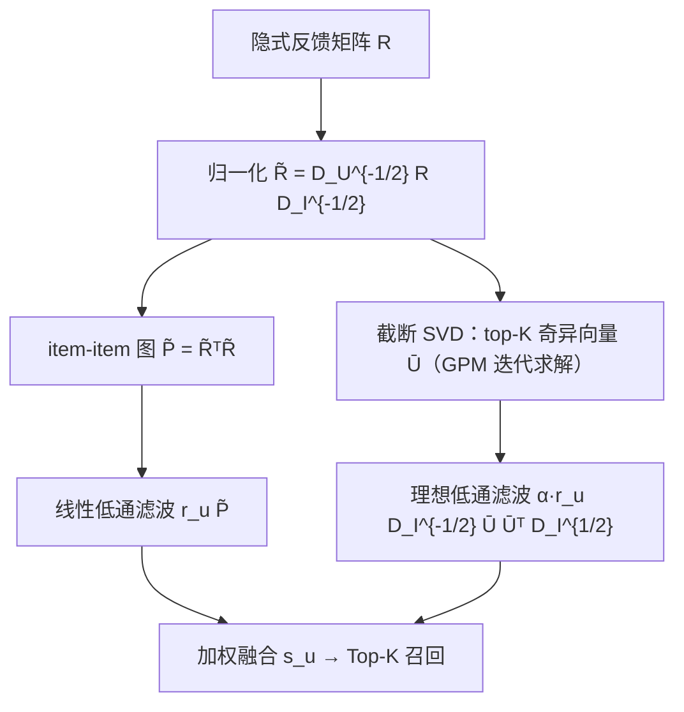

# How Powerful is Graph Convolution for Recommendation? (图卷积对推荐究竟有多强？)

- **会议/期刊**: CIKM 2021
- **作者与机构**: Yifei Shen, Yongji Wu, Yao Zhang, Caihua Shan, Jun Zhang, Khaled B. Letaief, Dongsheng Li（HKUST / Duke / 复旦 / 微软亚洲研究院）
- **推荐链路定位**: 召回（全库打分）
- **研究方向**: 图神经网络与知识图谱推荐 / 协同过滤
- **论文原文**: [https://arxiv.org/abs/2108.07567v1](https://arxiv.org/abs/2108.07567v1)
- **开源代码**: [https://github.com/yshenaw/GF_CF](https://github.com/yshenaw/GF_CF)

## TL;DR (1分钟核心速览)

本文不复述"GCN 更强"，而是追问 **GCN 为何有效**：从图信号处理视角指出 LightGCN 的图卷积本质是一个**低通滤波器**，其唯一作用是提升用户-物品嵌入在交互图上的**平滑度**。由此证明：当嵌入维度足够大时**完全未训练的 LightGCN** 即可逼近甚至超越训练版本，并在 $d\to\infty$时导出闭式解 LGCN-IDE。据此提出融合「线性低通 + 理想低通」的免训练基线 GF-CF，在 LightGCN 的 leave-one-out / Full-Ranking 协议下，Amazon-book 的 Recall@20 达 0.0710，较 LightGCN（0.0411）**提升 72.7%**，训练耗时从$1.27\times10^5$ s 降至 **65.8 s**。

## Background & Motivation (背景与核心矛盾)

- **主流范式**: 以 NGCF / LightGCN 为代表的 GCN 类方法通过多层邻域传播捕获多跳协同信号，是隐式反馈 CF 的 SOTA；另一支是邻域相似度（ItemKNN）与低秩 MF / 线性自编码器（EASE、SLIM）。
- **前人局限**: ①LightGCN 只保留"可训练初始嵌入 + 图卷积"，但**为何去掉特征变换与非线性反而更好，一直只有经验解释而无理论支撑**；②图卷积的传播本身是确定性的、不含可学参数，若它才是关键，则昂贵的 BPR 反向传播训练可能大部分是冗余开销，但此前无人量化这一冗余。
- **核心洞察 (Key Insight)**: 若 $R_{ui}=1$则$e_u$与$e_i$应相似——这正是图信号处理中的**平滑度**$S_2(\boldsymbol{x})=\frac{1}{2}\sum_{i,j}A_{ij}\|\boldsymbol{x}_i-\boldsymbol{x}_j\|^2$。因此 BPR 损失与"提升嵌入平滑度"**目标同构**；而 LightGCN 的多层传播$E^{(k+1)}=\tilde{A}E^{(k)}$ 正是一个多项式形式的低通滤波器。
- **本文切入点**: 用低通滤波统一解释全部线性 CF 方法，并把"滤波器设计"直接当作模型设计，绕开梯度训练。

## Method (核心方法设计)

### 1. 整体框架 (Overall Architecture)

输入隐式反馈矩阵 $R$，先做对称归一化得到$\tilde{R}=D_U^{-1/2}RD_I^{-1/2}$，并构造 item-item 图$\tilde{P}=\tilde{R}^{\top}\tilde{R}$（其拉普拉斯$\tilde{L}=I-\tilde{P}$，特征值落在$[0,1]$，天然适配低通分析）。将用户的观测评分$\boldsymbol{r}_u$视为图信号，依次经过两级低通滤波：(i) **线性/多项式滤波器**（$\tilde{P}$的低阶幂，负责保留局部多跳协同信号）；(ii) **理想低通滤波器**（$\tilde{P}$的 top-$K$谱投影，负责截断高频噪声）。两者加权求和得到全库打分向量$\boldsymbol{s}_u$，直接 Top-$K$ 截断即为召回结果。全流程**无参数、无反向传播**，仅需一次截断 SVD。

### 2. 关键设计拆解 (Key Designs)

**创新设计一：平滑度定理与无限维闭式解（LGCN-IDE）**
前人只知 LightGCN 有效，却不知训练贡献多少。作者证明：若初始嵌入 $E^{(0)}$ 在单位球面 i.i.d. 均匀采样且
$d > C\,N_{\max}^{3}\log(|I|+|U|)/N_{\min}$，
则**单层未训练** LightGCN 对任意正负样本对满足 $\boldsymbol{e}_u^{(1)\top}\boldsymbol{e}_i^{(0)}>\boldsymbol{e}_u^{(1)\top}\boldsymbol{e}_j^{(0)}$的概率$\geq 3/4$，即天然获得低 BPR 损失。直觉是：随机高维向量经低通滤波后被"抹平"，交互对自动变得相似；这也解释了未训练模型在稀疏数据上更有效（所需维度随稀疏度下降）。进一步令$d\to\infty$，随机初始化在期望意义下消失，得到**闭式解**
$\boldsymbol{s}_u=\sum_{k=0}^{K-1}\beta_k\,\tilde{\boldsymbol{r}}_u(\tilde{R}^{\top}\tilde{R})^k$，
即完全由评分矩阵与多项式滤波器系数 $\beta_k$ 决定，无需任何学习。

**创新设计二：统一低通滤波框架与经典方法的谱系归位**
一般形式为 $\bar{\boldsymbol{s}}_u=\bar{\boldsymbol{r}}_u U\,\mathrm{Diag}(h(\lambda_1),\dots,h(\lambda_n))\,U^{\top}$。作者证明多类经典方法只是$h(\cdot)$的不同选取：邻域法（ItemKNN）对应$h(\lambda)=1-\lambda$（一阶线性，单层 GCN）；低秩 MF 对应**理想低通**$h(\lambda)=\mathbb{I}[\lambda\leq\bar{\lambda}]$（等价于带卷积归一化的无限层 GCN，故受过度平滑所害）；线性自编码器（EASE/SLIM）对应 opinion dynamics 扩散滤波$h(\lambda)=(1-\lambda)/(1+\mu-\lambda)$。这一归位说明"图卷积"本身并不神秘，**关键是滤波器形状**。

**创新设计三：GF-CF 双滤波器集成与推理复杂度**
单一线性滤波缺高阶信息、单一理想低通缺低阶信息且过度平滑，故二者互补相加：
$\boldsymbol{s}_u=\boldsymbol{r}_u\big(\tilde{R}^{\top}\tilde{R}+\alpha\,D_I^{-1/2}\bar{U}\bar{U}^{\top}D_I^{1/2}\big)$，
其中 $\bar{U}$为$\tilde{R}$的 top-$K$奇异向量，$\alpha$为唯一超参。$\bar{U}$不直接对稠密的$\tilde{P}$做特征分解，而用广义幂法（GPM）交替执行$\hat{E}^{(k)}=\tilde{P}E^{(k-1)}$与 Stiefel 正交化$E^{(k)}=\hat{E}^{(k)}(\hat{E}^{(k)\top}\hat{E}^{(k)})^{-1/2}$，复杂度$O((d\eta+d^3)\log(1/\epsilon))$，$\eta$为$R$非零元数，仅需存储稀疏$R$。总目标即上式的**闭式打分**，无损失函数、无负采样（BPR 的负采样训练被整体绕过）；推理即一次矩阵乘法，与 LightGCN 单轮前向同阶$O(\eta d)$。

## Experimental Setup & Evaluation Protocol (实验设置与评估协议)

- **数据集与预处理**（完全沿用 LightGCN 的过滤与划分）：

| 数据集 | #Users | #Items | #Interactions | 稀疏度/密度 | 特征/场景说明 |
| :--- | :---: | :---: | :---: | :---: | :--- |
| Gowalla | 29,858 | 40,981 | 1,027,370 | 0.00084 | LBS 签到，稠密小图 |
| Yelp2018 | 31,668 | 38,048 | 1,561,406 | 0.00130 | 本地商户点评 |
| Amazon-book | 52,643 | 91,599 | 2,984,108 | 0.00062 | 图书电商，大而稀疏 |

- **数据划分与防穿越**: `Leave-One-Out`（每用户最后一次交互作测试、倒数第二次作验证，其余训练），与 [13] 完全一致以保证可比。
- **排名评测协议**: 无偏 `Full-Ranking`（对全部未交互物品打分排序），指标 Recall@20 / NDCG@20，不采样负例。
- **对比基线与超参设置**: NGCF（非线性 GCN）、LightGCN（SOTA）、GRMF / GRMF-norm（图拉普拉斯正则 MF）、Mult-VAE（变分自编码器）；另设 LightGCN-$d$（$d=64\sim512$）与 LGCN-IDE。LightGCN 训练 1000 epoch，超参与 [13] 一致。原文未报告显著性检验（$p$ 值）。

## Key Experimental Results (实验关键数据)

### 1. 主实验对比 (Main Results)

| 数据集 | Gowalla | | Yelp2018 | | Amazon-book | |
| :--- | :---: | :---: | :---: | :---: | :---: | :---: |
| 方法 | Recall@20 | NDCG@20 | Recall@20 | NDCG@20 | Recall@20 | NDCG@20 |
| NGCF | 0.1570 | 0.1327 | 0.0579 | 0.0477 | 0.0344 | 0.0263 |
| Mult-VAE | 0.1641 | 0.1335 | 0.0584 | 0.0450 | 0.0407 | 0.0315 |
| GRMF | 0.1477 | 0.1205 | 0.0571 | 0.0462 | 0.0354 | 0.0270 |
| GRMF-norm | 0.1557 | 0.1261 | 0.0561 | 0.0454 | 0.0352 | 0.0269 |
| LightGCN | 0.1830 | **0.1554** | 0.0649 | 0.0530 | 0.0411 | 0.0315 |
| LGCN-IDE | 0.1682 | 0.1347 | 0.0609 | 0.0505 | 0.0612 | 0.0514 |
| **GF-CF** | **0.1849** | 0.1518 | **0.0697** | **0.0571** | **0.0710** | **0.0584** |
| Improv. vs LightGCN | +1.0% | −2.3% | +7.4% | +7.7% | **+72.7%** | **+85.4%** |

### 2. 消融/组件与维度分析 (Ablation & Dimension Study)

| 变体（滤波器组合） | Gowalla R@20 | Yelp2018 R@20 | Amazon R@20 | 训练耗时 |
| :--- | :---: | :---: | :---: | :---: |
| LightGCN-64（训练 + 线性滤波，$d{=}64$) | 0.1830 | 0.0649 | 0.0411 |$2.77\times10^4$s /$1.27\times10^5$ s |
| LightGCN-512（$d{=}512$） | 0.1892 | 0.0689 | 0.0485 |$7.28\times10^4$s /$5.26\times10^5$ s |
| LGCN-IDE（免训练，线性滤波，$d\to\infty$） | 0.1682 | 0.0609 | 0.0612 | ≈0（闭式） |
| **GF-CF**（线性 + 理想低通） | **0.1849** | **0.0697** | **0.0710** | **30.5 s / 65.8 s** |

### 3. 关键实验发现 (Key Findings)

1. **大稀疏图上"训练"是主要瓶颈而非模型容量**：Amazon-book 上免训练的 LGCN-IDE（0.0612）已超训练版 LightGCN-64（0.0411）约 **49%**，再叠加理想低通后 GF-CF 升至 0.0710（**+72.7%**）——说明在 $|I|$大、数据极稀疏时，SGD 的优化难度与$d$ 维压缩损失比滤波器设计更致命。
2. **维度扩张对训练版 GCN 收益迅速饱和**：LightGCN 从 $d{=}64$ 扩到 512，Gowalla 仅 0.1830→0.1892（+3.4%）、Amazon 0.0411→0.0485（+18%），远不及无限维闭式解的 Amazon 增益，印证"嵌入压缩"是性能闸门。
3. **效率收益达 3 个数量级且不牺牲精度**：GF-CF 全流程 30.5 s（Gowalla）/65.8 s（Amazon），甚至短于 LightGCN 的**单轮 epoch**；同时 Gowalla 上 NDCG 反低于 LightGCN（0.1518 vs 0.1554），提示理想低通的全库谱投影在稠密小图上会削弱中间频段排序能力——这是滤波器组合的边界条件。

## Highlights & Limitations (亮点、对比与审稿批判)

- **与代表作对比 (vs. Prior Work)**: 相比 LightGCN（[13]，只做经验性组件裁剪），本文给出**为何可裁剪**的谱域证明；相比 EASE/SLIM 类线性自编码器（仅等价于一种扩散滤波，需存储 $|I|\times|I|$稠密矩阵$B$），GF-CF 只存稀疏$R$与 top-$K$ 奇异向量；相比谱域 CF（SpectralCF/LCF，需全特征分解而不可扩展），本文用 GPM 把谱方法拉到工业规模。
- **可迁移亮点**: ①"先用幂法截断 SVD、再与低阶多项式滤波相加"的双滤波器组合可低成本嫁接进任何 GCN 召回模型作为残差分支；②"未训练模型 + 大维度 ≈ 训练模型"可作为判断某 GCN 是否真有可学习增量的快速 sanity check。
- **审稿级局限批判**: ①**离线静态协议**：仅 leave-one-out + Full-Ranking 三个公开数据集，无时间切分、无冷启动分桶、无线上 A/B，工业价值仍是推断性的；②**超参与边界敏感**：$K$（截断秩）与$\alpha$均需网格搜索，且 Gowalla NDCG 反降说明其在稠密图上的排序质量不稳定，论文对此未做频段分析或自适应$K$ 方案。

## Rating (四维评分)

- **方法创新性 (Novelty)**: ⭐⭐⭐⭐⭐ （把 GCN-for-CF 统一到低通滤波谱系并给出无限维闭式解，是少见的"降维打击式"理论贡献）
- **评估协议与实验扎实度 (Protocol & Experiments)**: ⭐⭐⭐⭐ （沿用 LightGCN 的 Full-Ranking 与三数据集保证可比，并有维度/耗时多维对照，但缺显著性检验与时间切分验证）
- **写作与数学规范度 (Clarity & Rigor)**: ⭐⭐⭐⭐ （定理—统一框架—算法的推导链条清晰，附录给出完整证明；表 1 的滤波器对应关系可再显式标注适用前提）
- **工业落地与复现价值 (Industrial & Practical Value)**: ⭐⭐⭐⭐⭐ （代码开源、无训练、秒级闭式解、仅需稀疏矩阵与一次截断 SVD，可直接作为强基线替换训练型 GCN 召回）

