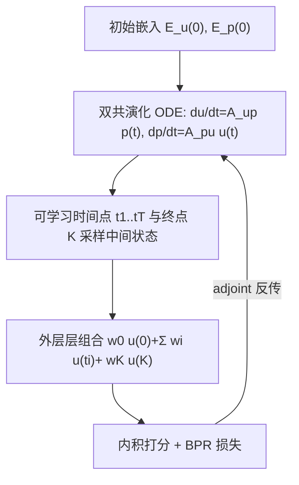

# LT-OCF: Learnable-Time ODE-based Collaborative Filtering (可学习时间的 ODE 协同过滤)

- **会议/期刊**: CIKM 2021
- **作者与机构**: Jeongwhan Choi, Jinsung Jeon, Noseong Park（延世大学 Yonsei University）
- **推荐链路定位**: 召回（图协同过滤表征学习）
- **研究方向**: 图神经网络与知识图谱推荐 / 协同过滤与双塔召回
- **论文原文**: [https://arxiv.org/abs/2108.06208v3](https://arxiv.org/abs/2108.06208v3)
- **开源代码**: [https://github.com/jeongwhanchoi/LT-OCF](https://github.com/jeongwhanchoi/LT-OCF)

## TL;DR (1分钟核心速览)

LightGCN 的"线性传播 + 手动层组合"本质上是热传导方程的一次离散欧拉近似，层数 $K$与组合系数全靠人工试错；本文把用户/商品嵌入建模为**相互耦合并共同演化的双 ODE**，把"层"连续化为**可训练的时间点**$t_i$，再用高阶求解器（RK4）隐式构建稠密连接。在 Gowalla/Yelp2018/Amazon-Book 的 Full-Ranking 协议下 Recall@20 全线超越 LightGCN（Amazon-Book 0.0411$\to$0.0442，NDCG@20 0.0315$\to$0.0341，约 +8~10%）。

## Background & Motivation (背景与核心矛盾)

- **主流范式**: NGCF 类非线性 GCN 因缺少节点特征、二分图稀疏而迅速过拟合；LightGCN 用"线性传播 + 层加权和"成为 SOTA，并被证明等价于 Newton 冷却定律的离散形式 $\frac{d\boldsymbol{H}_t}{dt}=-\Delta \boldsymbol{H}_t$。
- **前人局限**: ① 层数 $K$与组合系数$w_i$ 是**离散且人工给定**的超参，无法在连续空间搜索最优感受野；② 每层只是一次步长固定为 1 的显式欧拉迭代，本质上等价于残差连接，表达力被"单步一阶"锁死。
- **核心洞察 (Key Insight)**: 若把式 (5) 视作热扩散方程，则"层"只是时间轴的离散采样点；而 ODE 求解器天然等价于不同网络连接方式（显式欧拉 = 残差连接，RK4 = DenseNet/FractalNet，隐式 Adams–Moulton = 多步稠密连接），因此**换求解器就等于换架构**。
- **本文切入点**: 在 NODE 框架下重建线性 GCN，使时间点可学习、解连续且光滑（同胚映射，符合 CF 稀疏场景所需的平滑表征），并用 RK4 验证"稠密连接优于线性连接"。

## Method (核心方法设计)

### 1. 整体框架 (Overall Architecture)

初始嵌入 $\boldsymbol{E}^u_0,\boldsymbol{E}^p_0$直接作为 ODE 初值送入两条互相耦合的积分流：用户嵌入的导数由商品嵌入经$\bar{\boldsymbol{A}}_{u\to p}$变换给出，反之亦然，二者沿时间共同演化。训练时在可学习时间点$\{t_1,\dots,t_T\}\cup\{K\}$ 上取出中间状态，做外层层组合得到最终嵌入，再用 BPR 损失优化；嵌入与时间点**交替更新**，梯度由定制化的伴随敏感度（adjoint）反向积分求得。推理仅需一次前向积分 + 内积检索，开销随求解器阶数线性放大。

### 2. 关键设计拆解 (Key Designs)

1. **双共演化 ODE 与可学习时间点**：LightGCN 的层组合系数固定、层数整数化，作者改写为连续积分并让采样时刻自由浮动：
$\boldsymbol{u}(K)=\boldsymbol{u}(0)+\int_0^K f(\boldsymbol{p}(t))dt,\ \boldsymbol{p}(K)=\boldsymbol{p}(0)+\int_0^K g(\boldsymbol{u}(t))dt$，其中$f(\boldsymbol{p}(t))=\bar{\boldsymbol{A}}_{u\to p}\boldsymbol{p}(t)$，$g(\boldsymbol{u}(t))=\bar{\boldsymbol{A}}_{p\to u}\boldsymbol{u}(t)$，二者均**无参数、不显含$t$**。最终嵌入为$\boldsymbol{E}^{final}_u=w_0\boldsymbol{u}(0)+\sum_{i=1}^{T}w_i\boldsymbol{u}(t_i)+w_K\boldsymbol{u}(K)$。直觉：$t_i$可训练意味着模型自动决定"看几跳邻居、以何种间隔聚合"，而非网格搜索$K$。
2. **ODE 求解器即架构搜索**：内部积分用显式欧拉得残差连接、用 RK4 得稠密连接（$\boldsymbol{h}(t+s)=\boldsymbol{h}(t)+\frac{s}{6}(f_1+2f_2+2f_3+f_4)$），外部层组合再叠加一层"跳连"。作者进一步证明：若令$t_i=i$、步长$s=1$、且去掉 ODE 内部残差项，则整个 LT-OCF **严格退化为 LightGCN**，故本文是线性 GCN 的连续泛化。这一等价性既是理论卖点，也解释了 RK4 优于欧拉的原因——稠密连接比单残差更接近真实积分轨迹。
3. **训练目标与推理开销**：损失沿用 BPR $\mathcal{L}=-\sum_u\sum_{i\in\mathcal{N}_u}\sum_{j\notin\mathcal{N}_u}\ln\sigma(\hat{r}_{ui}-\hat{r}_{uj})+\lambda\|\boldsymbol{E}^u_0\odot\boldsymbol{E}^p_0\|^2$（$\sigma$取 softplus），负采样为 uniform 单负样本。时间点梯度$\frac{dL}{dt_i}=\boldsymbol{a}_u(t_i)^{\top}g(\boldsymbol{u}(t_i))+\boldsymbol{a}_p(t_i)^{\top}f(\boldsymbol{p}(t_i))$直接解析求导，复杂度$O(T)$；嵌入梯度由伴随法给出，空间$O(1)$、时间$O(1/s)$。另一优点是 Cauchy–Kowalevski 定理保证（矩阵乘为解析算子）解存在且唯一，问题良定。

## Experimental Setup & Evaluation Protocol (实验设置与评估协议)

- **数据集与预处理**: 沿用 NGCF/LightGCN 官方版本，未做额外过滤：

| 数据集 | #Users | #Items | #Interactions | 稀疏度/密度 | 特征/场景说明 |
| :--- | :---: | :---: | :---: | :---: | :--- |
| Gowalla | 29,858 | 40,981 | 1,027,370 | 密度 8.4e-4 | LBS 签到二分图 |
| Yelp2018 | 31,668 | 38,048 | 1,561,406 | 密度 1.3e-3 | 本地生活商户评论 |
| Amazon-Book | 52,643 | 91,599 | 2,984,108 | 密度 6.2e-4 | 电商图书，最稀疏 |

- **数据划分与防穿越 (Splitting Strategy)**: 沿用 LightGCN 的 **Leave-One-Out 式固定训练/测试集划分**（每位用户留最后一次交互作 test，其余为 train），无验证集穿越问题。
- **排名评测协议 (Ranking Protocol)**: 无偏 **Full-Ranking**——所有未与该用户交互过的商品均参与打分排序，报告 Recall@20 与 NDCG@20，杜绝负采样排序的高估。
- **对比基线与超参设置**: 覆盖 MF/NeuMF/CMN/HOP-Rec/GC-MC/PinSage/Mult-VAE/GRMF/NGCF/LR-GCCF/LightGCN 共 11 个基线；嵌入维度 $d=64$，$\mathcal{N}(0,0.1)$初始化，$\lambda\in\{10^{-4},10^{-3},10^{-2}\}$，$K\in\{2,3,4\}$，$T\in\{1,2,3\}$，Adam + NGCF 同款 early stopping。

## Key Experimental Results (实验关键数据)

### 1. 主实验对比 (Main Results)

| 数据集 | \multicolumn{2}{c|}{Gowalla} | \multicolumn{2}{c|}{Yelp2018} | \multicolumn{2}{c|}{Amazon-Book} |
| :--- | :---: | :---: | :---: | :---: | :---: | :---: |
| 方法 | R@20 | N@20 | R@20 | N@20 | R@20 | N@20 |
| MF | 0.1291 | 0.1109 | 0.0433 | 0.0354 | 0.0250 | 0.0196 |
| NeuMF | 0.1399 | 0.1212 | 0.0451 | 0.0363 | 0.0258 | 0.0200 |
| HOP-Rec | 0.1399 | 0.1214 | 0.0517 | 0.0428 | 0.0309 | 0.0232 |
| Mult-VAE | 0.1641 | 0.1335 | 0.0584 | 0.0450 | 0.0407 | 0.0315 |
| NGCF | 0.1570 | 0.1327 | 0.0579 | 0.0477 | 0.0344 | 0.0263 |
| LR-GCCF | 0.1518 | 0.1259 | 0.0574 | 0.0349 | 0.0341 | 0.0258 |
| LightGCN | 0.1830 | 0.1554 | 0.0649 | 0.0530 | 0.0411 | 0.0315 |
| **LT-OCF** | **0.1875** | **0.1574** | **0.0671** | **0.0549** | **0.0442** | **0.0341** |
| Improv. (vs. LightGCN) | +2.5% | +1.3% | +3.4% | +3.6% | **+7.5%** | **+8.3%** |

### 2. 消融实验 (Ablation Study)

| 变体 (Gowalla) | Recall@20 | NDCG@20 | 说明 |
| :--- | :---: | :---: | :--- |
| LightGCN ($K{=}4$, 手工层组合) | 0.1830 | 0.1554 | 离散欧拉基准 |
| LT-OCF (Euler, 可学习 $t_i$) | 0.1834 | 0.1548 | 仅换框架，提升微弱 |
| LT-OCF (RK4, 固定 $t_i$) | 0.1859 | 0.1558 | 稠密连接贡献 +1.6% R |
| LT-OCF (RK4, 可学习 $t_i$) | **0.1875** | **0.1574** | 默认配置 |
| – $K{=}3$ | 0.1833 | 0.1545 | 层数不足掉点 |
| – $K{=}2$ | 0.1823 | 0.1543 | 掉点更明显 |

### 3. 关键实验发现 (Key Findings)

1. **稠密连接 > 线性连接**：RK4（内部 DenseNet 式连接）比显式欧拉高 0.0041 Recall（0.1875 vs. 0.1834），这是本文最有价值的反直觉结论——它直接质疑了"CF 只需线性残差"的 LightGCN 共识；DOPRI 精度与 RK4 持平但算力多 33%，故 RK4 为最优折中。
2. **可学习时间点的增益在"浅层"最显著**：$K{=}2$时固定时间点表现很差，可学习$t_i$能显著补救；训练曲线中$t_1,t_2,t_3$单调上升且$t_1$ 被训练得最活跃，说明**早期层的可靠性对层组合贡献最大**，与"深层过平滑"的既有认知互补。
3. **稀疏度放大收益**：Amazon-Book 最稀疏（密度 6.2e-4），相对 LightGCN 的 Recall/NDCG 提升达 +7.5%/+8.3%，而最稠密的 Gowalla 仅 +2.5%/+1.3%，印证"信息越少、连续光滑解的平滑先验越值钱"；同时 LT-OCF 的 loss 曲线下降更快、达到同等 Recall 所需 epoch 更少。

## Highlights & Limitations (亮点、对比与审稿批判)

- **与代表作对比 (vs. Prior Work)**: 相比 NGCF 的非线性 + 特征变换，本文继承了 LightGCN"去非线性"的路线；相比 LightGCN 的离散定点传播，本文把"层数 / 组合权重"从超参变成可微变量；相比通用 NODE 工作（如 Neural ODE、ACE-NODE），本文首次指出 CF 场景下解析算子带来的良定性（Cauchy–Kowalevski），并给出与 LightGCN 的严格等价性证明。
- **可迁移亮点**: ① "求解器即架构"的思路可直接迁移到任何层堆叠式推荐骨干（如序列推荐的多层注意力、LightGCN 变体），只需把层索引换成连续时间；② 交替训练（嵌入 / 时间点分步优化）配合伴随法，可在 $O(1)$ 空间下训练任意深度隐式模型，适合显存受限的工业召回训练。
- **审稿级局限批判**: ① **精度-开销权衡不佳**：Amazon-Book 上 RK4 训练耗时约 LightGCN 的 **5.7×**、推理 3.8×，即使欧拉版也需 1.5×/1.3×，在线召回的毫秒级预算难以承受；② **表达能力有理论天花板**：NODE 的解是同胚映射（Proposition 2.1），拓扑结构不可改变，交叉轨迹（图 2 中黄蓝点互换）无法学习，而推荐中"用户兴趣反转/跨类目漂移"恰恰需要非拓扑保持的映射；③ 时间点 $t_i$ 仅 3 个、且实验只覆盖 3 个静态二分图数据集，缺少序列/动态图与冷启动验证。

## Rating (四维评分)

- **方法创新性 (Novelty)**: ⭐⭐⭐⭐ （把线性 GCN 精确解释为热方程离散化并做连续泛化，附等价性证明与良定性分析，视角新颖但组件均为已有工具的巧妙组合）
- **评估协议与实验扎实度 (Protocol & Experiments)**: ⭐⭐⭐⭐ （三数据集 Full-Ranking + 11 基线 + 求解器/$T$/$K$/固定 vs 可学习四组消融完整，扣分在于缺少显著性检验与方差报告）
- **写作与数学规范度 (Clarity & Rigor)**: ⭐⭐⭐⭐ （ODE 与 LightGCN 的等价推导清晰，Cauchy–Kowalevski 论证到位；部分公式维度标注含糊，$T$与$K$ 记号易混）
- **工业落地与复现价值 (Industrial & Practical Value)**: ⭐⭐⭐ （代码已开源且实现简洁，但 5.7× 训练开销与伴随法实现复杂度限制了大规模线上部署，更适合作为离线蒸馏教师模型）

