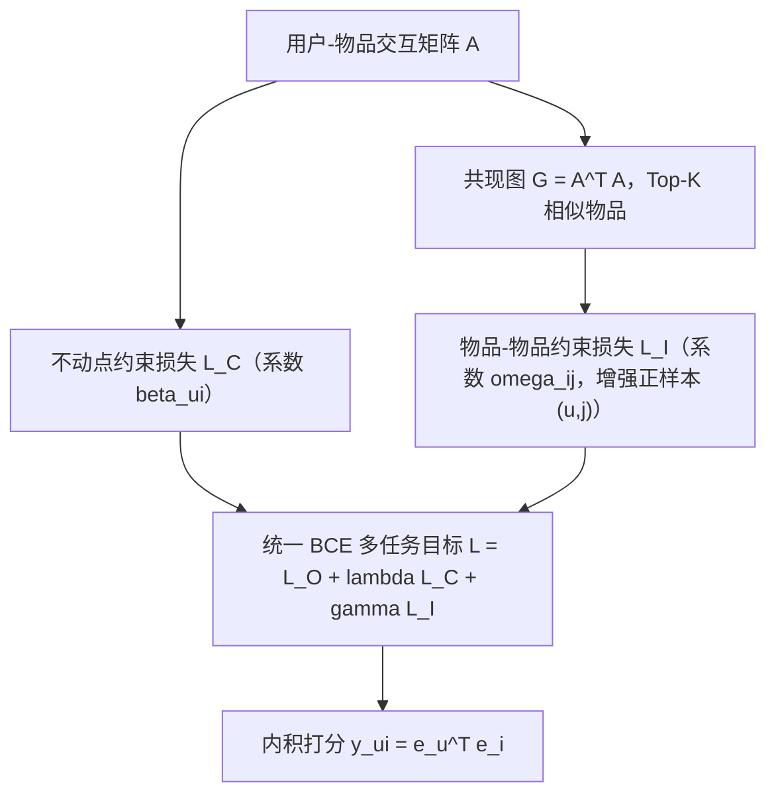
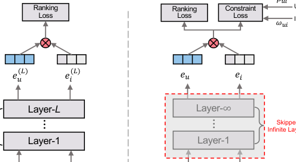

# UltraGCN: Ultra Simplification of Graph Convolutional Networks for Recommendation (面向推荐的图卷积网络极致简化)

- **会议/期刊**: CIKM 2021
- **作者与机构**: Kelong Mao、Xi Xiao（清华/鹏城实验室）、Jieming Zhu、Biao Lu、Zhaowei Wang、Xiuqiang He（华为诺亚方舟实验室）
- **推荐链路定位**: 召回（用户-物品二分图协同过滤表征学习）
- **研究方向**: 图神经网络与知识图谱推荐 / 协同过滤与双塔召回
- **论文原文**: [https://arxiv.org/abs/2110.15114v2](https://arxiv.org/abs/2110.15114v2)
- **开源代码**: [https://reczoo.github.io/UltraGCN](https://reczoo.github.io/UltraGCN)

## TL;DR (1分钟核心速览)

LightGCN 的瓶颈不在表达力而在**训练效率**：显式多层消息传递使 Amazon-Books 上需 780 个 epoch、11 小时才收敛。UltraGCN 抛弃显式传播，用**约束损失直接拟合无穷层图卷积的闭式极限**，并把物品-物品共现关系拆成独立的 Top-$K$ 正样本增强项。在沿用 LightGCN 数据划分与 **Full-Ranking** 协议下，Amazon-Books 上 Recall@20 相对最强 GNN 基线 DGCF 提升 **61.4%**、NDCG@20 提升 **71.6%**，训练时间从 11h3m 降至 45m（约 **14×** 加速）。

## Background & Motivation (背景与核心矛盾)

- **主流范式**: 以 NGCF / LightGCN / DGCF 为代表的 GCN 协同过滤，通过堆叠 $L$ 层邻域聚合获得高阶协同信号，再取各层嵌入加权和作最终表征。
- **前人局限**: 作者对 LightGCN 的逐层传播公式作点积展开，发现三类硬伤：①边权不对称——物品 $i$与物品$k$分别被赋$\frac{1}{d_i+1}$与$\frac{1}{\sqrt{d_k+1}}$，同为用户$u$的邻居却待遇不同（用户-用户关系同理），缺乏协同过滤语义；②多类关系（$u$-$i$、$i$-$i$、$u$-$u$）被递归混在同一条传播链中，无法调节相对重要性，且引入大量低置信噪声边；③过度平滑使层数被锁死在 2–3 层，高阶信号实际取不到。
- **核心洞察 (Key Insight)**: 由于 $\lim_{l\to\infty}(\hat{D}^{-\frac{1}{2}}\hat{A}\hat{D}^{-\frac{1}{2}})^l_{i,j}=\frac{\sqrt{(d_i+1)(d_j+1)}}{2m+n}$ 存在，无穷层传播必然收敛到一个可解析的不动点——既然如此，就没必要真的去"传"。
- **本文切入点**: 把"传播到收敛"改写为"用损失函数约束嵌入满足不动点方程"，用一次前向的嵌入直接训练，彻底跳过传播。

## Method (核心方法设计)

### 1. 整体框架 (Overall Architecture)

模型只保留用户/物品两组自由嵌入（与 MF 同参数规模）。用户-物品图部分：由不动点方程导出约束损失 $\mathcal{L}_C$，令相连的$(u,i)$余弦相似度逼近结构系数$\beta_{u,i}$；物品-物品图部分：由$G=A^\top A$构建共现图，为每个正样本$(u,i)$选出$K$个最相似物品$j\in S(i)$作加权正样本增强$\mathcal{L}_I$；主目标为 BCE 链接预测$\mathcal{L}_O$。三者同构为 BCE 形式，多任务一次反向传播即可，推理时仅做内积$\hat{y}_{ui}=e_u^\top e_i$。

<figure class="paper-figure" markdown="span">
  <figcaption>图1：LightGCN（左）和UltraGCN（右）的训练示意图。LightGCN需要反复执行𝐿层消息传递以得到用于训练的最终嵌入，而UltraGCN可以“跳过”这种消息传递，使嵌入被直接训练，从而大幅提升训练效率并有助于实际部署。</figcaption>
</figure>

### 2. 关键设计拆解 (Key Designs)

1. **不动点约束损失 $\mathcal{L}_C$（替代全部用户-物品传播层）**：痛点是不动点方程$e_u=\sum_{i\in\mathcal{N}(u)}\beta_{u,i}e_i$无法直接闭式求解。作者改为单位向量化后最大化两侧余弦，并套 sigmoid + 负对数似然，得到$\beta_{u,i}=\frac{1}{d_u}\sqrt{\frac{d_u+1}{d_i+1}}$、$\mathcal{L}_C=-\sum_{(u,i)\in N^+}\beta_{u,i}\log\sigma(e_u^\top e_i)-\sum_{(u,j)\in N^-}\beta_{u,j}\log\sigma(-e_u^\top e_j)$。直觉：$\beta$与$d_u,d_i$近似反比，即"高频用户/热门物品的单条交互影响应被削弱"，这正是协同过滤想要的软去噪；而负采样项（$R=300$）在损失层面替代了"层数上限"来抑制过度平滑。
2. **物品-物品关系的解耦与硬筛选 $\mathcal{L}_I$**：共现图$G$远比交互矩阵稠密，全量学习会灌入噪声。作者先算$\omega_{i,j}=\frac{G_{i,j}}{g_i-G_{i,i}}\sqrt{\frac{g_i}{g_j}}$度量相似度，只保留每个物品的 Top-$K$（$K=10$）邻居，并且**不直接优化$e_i^\top e_j$**，而是把$(u,i)$的正样本扩展为$(u,j)$，即$\mathcal{L}_I=-\sum_{(u,i)\in N^+}\sum_{j\in S(i)}\omega_{i,j}\log\sigma(e_u^\top e_j)$。这样三项损失形式完全统一，训练更稳、收敛更快；实验也证明该"增强式"写法优于直接$i$-$i$对比的$\mathcal{L}'_I$。
3. **训练目标、负采样与推理效率**：$\mathcal{L}=\mathcal{L}_O+\lambda\mathcal{L}_C+\gamma\mathcal{L}_I$，负样本为 Uniform 随机采样（比例 300），$d=64$、$\lambda\approx1.0$、$\gamma\approx2.5$。时间复杂度$\mathcal{O}((K+R+1)|A^+|(d^2+1))$，与 MF 同阶；$\beta$、$\omega$ 均可离线预计算，推理只需一次内积召回。

## Experimental Setup & Evaluation Protocol (实验设置与评估协议)

- **数据集与预处理**: 沿用 GCN-CF 通用版本（已按交互阈值过滤的公开划分），统计如下：

| 数据集 | #Users | #Items | #Interactions | 密度 | 特征/场景说明 |
| :--- | :---: | :---: | :---: | :---: | :--- |
| Amazon-Book | 52,643 | 91,599 | 2,984,108 | 0.062% | 极稀疏电商图书，长尾最重 |
| Yelp2018 | 31,668 | 38,048 | 1,561,406 | 0.130% | 本地生活商户 |
| Gowalla | 29,858 | 40,981 | 1,027,370 | 0.084% | LBS 签到 |
| MovieLens-1M | 6,022 | 3,043 | 995,154 | 5.431% | 稠密电影评分 |

- **数据划分与防穿越 (Splitting Strategy)**: 严格对齐 LightGCN 系列的 **per-user 随机 8:1:1 比例划分**（训练/验证/测试），非全局时间戳切分。
- **排名评测协议 (Ranking Protocol)**: **Full-Ranking**——把所有未交互物品作为候选，对全体用户取平均，不做负采样排序，因此指标绝对值低于采样协议但可比性强。
- **对比基线与超参设置**: 覆盖 MF-BPR、ENMF、CML、DeepWalk/LINE/Node2Vec、NGCF、NIA-GCN、LR-GCCF、LightGCN、DGCF；$d=64$、batch 1024、$K=10$、$R=300$、学习率$10^{-4}$、$L_2=10^{-4}$；改进经显著性检验$p<0.05$（多数$p<10^{-4}$）。

## Key Experimental Results (实验关键数据)

### 1. 主实验对比 (Main Results)

| 模型 | Amazon-Book R@20 | Amazon N@20 | Yelp R@20 | Yelp N@20 | Gowalla F1@20 | Gowalla N@20 | ML-1M R@20 | ML-1M N@20 |
| :--- | :---: | :---: | :---: | :---: | :---: | :---: | :---: | :---: |
| MF-BPR | 0.0338 | 0.0261 | 0.0549 | 0.0445 | 0.1616 | 0.1366 | 0.2153 | 0.2175 |
| ENMF | 0.0359 | 0.0281 | 0.0624 | 0.0515 | 0.1523 | 0.1315 | 0.2315 | 0.2069 |
| NGCF | 0.0344 | 0.0263 | 0.0579 | 0.0477 | 0.1570 | 0.1327 | 0.2513 | 0.2511 |
| LightGCN | 0.0411 | 0.0315 | 0.0649 | 0.0530 | 0.1830 | 0.1554 | 0.2576 | 0.2427 |
| DGCF | 0.0422 | 0.0324 | 0.0654 | 0.0534 | 0.1842 | 0.1561 | 0.2640 | 0.2504 |
| UltraGCN_Base | 0.0504 | 0.0393 | 0.0667 | 0.0552 | 0.1845 | 0.1566 | 0.2671 | 0.2539 |
| **UltraGCN** | **0.0681** | **0.0556** | **0.0683** | **0.0561** | **0.1862** | **0.1580** | **0.2787** | **0.2642** |
| Improv. | +61.37% | +71.60% | +4.43% | +5.06% | +1.09% | +1.22% | +5.57% | +5.51% |

训练效率（Amazon-Book，同一 RTX 2080 环境）：UltraGCN 每 epoch 36s、**75 轮**收敛、总计 **45m**；LightGCN 51s、780 轮、11h3m；LR-GCCF 3h5m；ENMF 2h54m；MF-BPR 仅 12m 但精度最低。若统一只训 75 轮，LightGCN 仅 0.0342/0.0262，差距进一步拉大。

### 2. 消融实验 (Ablation Study)

| 变体 (Amazon-Book) | Recall@20 | NDCG@20 | 说明 |
| :--- | :---: | :---: | :--- |
| $\lambda=0,\gamma=0$（退化为 MF+BCE） | ≈0.036 | ≈0.028 | 完全丢弃图信息 |
| $\lambda=0$（去掉$\mathcal{L}_C$） | 0.0472 | 0.0364 | 仅剩物品侧约束 |
| $\gamma=0$（UltraGCN_Base，去掉$\mathcal{L}_I$） | 0.0504 | 0.0393 | 仅剩用户-物品约束 |
| **UltraGCN（完整）** | **0.0681** | **0.0556** | $\mathcal{L}_O+\lambda\mathcal{L}_C+\gamma\mathcal{L}_I$ |
| UltraGCN + $\mathcal{L}_U$（用户-用户图） | 0.0683 | 0.0559 | 几乎无增益，故不采用 |
| $\mathcal{L}'_I$替代$\mathcal{L}_I$（直接$i$-$i$ 对比） | 明显更低（图 3） | 明显更低 | 统一 BCE 形式更优 |

### 3. 关键实验发现 (Key Findings)

1. **增益与稀疏度强正相关**：Amazon-Book（密度 0.062%）上 Recall@20 从 DGCF 的 0.0422 跃至 0.0681（+61.4%），而稠密的 ML-1M 仅 +5.6%、Gowalla 仅 +1.1%——说明"无穷层极限约束 + 软边权"主要在**极端稀疏、高阶信号难以通过 2–3 层传播触达**的场景兑现价值。
2. **效率不是靠牺牲精度换的**：UltraGCN 45 分钟即达 0.0681，而 LightGCN 在同等 75 轮时仅 0.0342、跑满 780 轮（11 倍时间）也只有 0.0411，即精度与速度**同时**占优，根因是每 epoch 成本被压到 MF 量级且收敛轮数少一个数量级。
3. **两类关系的贡献可加且量级不同**：去掉 $\mathcal{L}_C$掉至 0.0472（−30.7%），去掉$\mathcal{L}_I$掉至 0.0504（−26.0%），叠加后 0.0681，验证"解耦后分别建模"优于混在传播链中；而$\mathcal{L}_U$ 只带来 0.0002 的噪声级波动，佐证用户兴趣比物品属性更难从共现结构刻画。

## Highlights & Limitations (亮点、对比与审稿批判)

- **与代表作对比 (vs. Prior Work)**: 相对 LightGCN（去掉特征变换/非线性但仍需 $L$层显式传播），本文连传播本身也去掉，把"层数"换成"损失权重 + 负采样"两个连续可控旋钮；相对 DGCF（意图解耦但架构更重），UltraGCN 参数规模等同 MF 却精度更高；相对 DeepWalk/LINE/Node2Vec 这类可归入 MF 框架的网嵌入方法，差别在于边权$\beta,\omega$ 有明确协同过滤语义且经硬筛选去噪，因而在 Gowalla 等数据集上领先明显。
- **可迁移亮点**: ①"把迭代算子写成不动点方程 → 转成约束损失"这一范式可迁移到任意多层传播模型（如社交扩散、KG 多跳推理）的加速；②用 $\beta\propto 1/\sqrt{d_ud_i}$ 式的度反比权重做**软去噪**，比阈值过滤更平滑；③将关系图学习统一成 BCE 正样本增强，避免多目标量纲冲突。
- **审稿级局限批判**: ①理论推导依赖"嵌入单位化 + sigmoid-NLL 替代余弦最大化"，与真实不动点仅近似等价，缺少收敛性误差界；②Gowalla/Yelp 增益仅 1%–5%，接近显著性边缘，且缺少大规模工业在线 A/B 与冷启动物品分桶评估；③$\gamma$在 2.5 附近最优、对稀疏度敏感，且$G=A^\top A$的共现图预计算与 Top-$K$ 检索在千万级物品库上的开销未讨论，工程可扩展性论证不足。

## Rating (四维评分)

- **方法创新性 (Novelty)**: ⭐⭐⭐⭐ （把无穷层消息传递的解析极限转写为可训练约束损失，并用负采样替代层数上限对抗过平滑，思路干净且有谱分析依据）
- **评估协议与实验扎实度 (Protocol & Experiments)**: ⭐⭐⭐⭐ （4 个数据集 + Full-Ranking + $p$ 值检验 + 效率双视角对比齐备，但缺少分桶/冷启动与线上验证）
- **写作与数学规范度 (Clarity & Rigor)**: ⭐⭐⭐⭐ （从 LightGCN 点积展开逐项指出三类边权缺陷、再导出 $\beta,\omega$，推导链清晰；不动点近似的误差分析略欠）
- **工业落地与复现价值 (Industrial & Practical Value)**: ⭐⭐⭐⭐⭐ （代码开源、参数量等同 MF、训练 14× 加速且精度更高，是极易替换现有 GCN 召回层的工业级方案）

