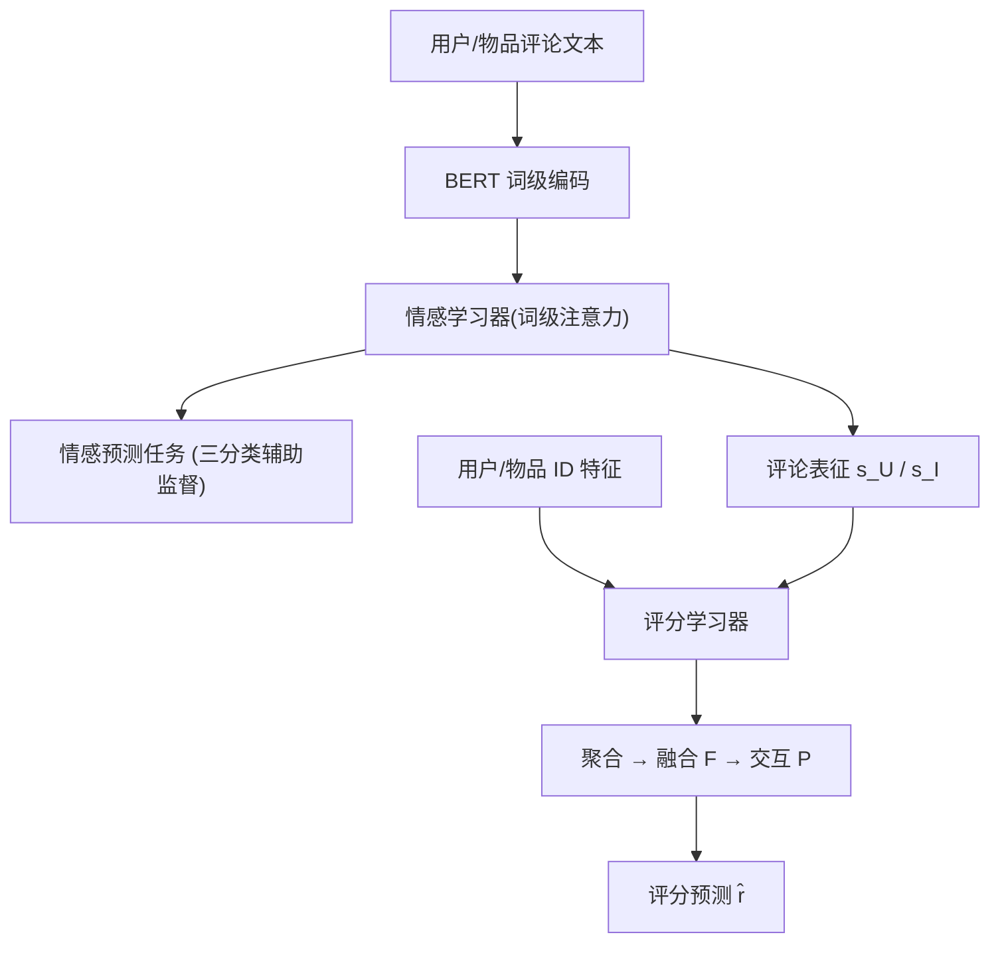
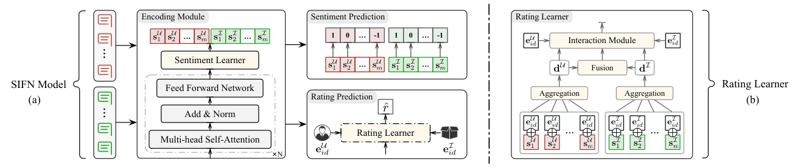

# SIFN: A Sentiment-aware Interactive Fusion Network for Review-based Item Recommendation (情感感知交互融合网络：基于评论的物品推荐)

- **会议/期刊**: CIKM 2021
- **作者与机构**: Kai Zhang, Hao Qian, Qi Liu 等；中国科学技术大学、蚂蚁集团
- **推荐链路定位**: 精排（评分预测，评分回归任务）
- **研究方向**: 多模态推荐与内容理解（文本评论内容理解）
- **论文原文**: [https://arxiv.org/abs/2108.08022v1](https://arxiv.org/abs/2108.08022v1)
- **开源代码**: 暂未开源

## TL;DR (1分钟核心速览)

基于评论的评分预测存在两大痛点：评论情感极性仅被隐式建模、不可解释，且每条评论与用户/物品身份特征的个性化交互被忽略。SIFN 用预训练 BERT 编码评论，设计轻量情感学习器并引入**显式三分类情感预测任务**做辅助监督，再用**融合网络** $f=d_U W_f d_I$与**交互网络**$p=(d_U+e^{id}_U)\odot(d_I+e^{id}_I)+Wf+b$ 耦合身份与评论表征。在 5 个 Amazon 数据集上采用随机 80:10:10 划分与 MSE 评估，平均 MSE 从 CARP 的 0.872 降至 **0.851**（相对提升 2.4%），最多相对提升 3.41%。

## Background & Motivation (背景与核心矛盾)

- **主流范式**: 评分预测中 MF 仅用稀疏评分矩阵（PMF、ConvMF+），神经方法（DeepCoNN、D-Attn、NARRE、CARP）用 CNN/注意力从评论文本抽取语义表征。
- **前人局限**: ① 大多数工作直接编码评论抽取**隐式**语义，忽略评论的显式情感极性，缺少情感标签监督导致次优；② 不同评论对用户/物品偏好贡献不同（一条负向评论的影响可能远大于正向评论），但现有方法未对「评论×身份」做个性化加权与交互融合。
- **核心洞察 (Key Insight)**: 情感词（如 “hated”“cheap”“love”）直接决定评分方向；显式情感监督能使注意力对齐这些词，提升可解释性与预测精度。
- **本文切入点**: 引入情感预测作为多任务辅助监督，并用融合+交互双模块把身份特征与评论表征在共享空间内耦合。

## Method (核心方法设计)

### 1. 整体框架 (Overall Architecture)

SIFN 由编码模块、情感预测与评分预测三部分组成。用户评论文本经预训练 BERT 得词级表征 $\mathbf{R}_U$，情感学习器用词级注意力池化为评论表征$s_U$；物品同流程得$s_I$。情感预测任务用三分类交叉熵（正/中/负，以 3 星为阈值）显式监督情感学习器，迫使注意力关注情感词。评分学习器先把身份特征$e^{id}$与每条评论表征 concat 投影后再做注意力聚合，得$d_U,d_I$；融合网络计算双线性交互，交互网络再以逐元素乘积+残差合成偏好向量$p$，线性映射得预测评分。训练用联合损失端到端优化。

<figure class="paper-figure" markdown="span">
  <figcaption>图1：(a) SIFN模型的整体架构；(b) 可利用交互融合知识的评分学习器。</figcaption>
</figure>

### 2. 关键设计拆解 (Key Designs)

1. **情感学习器 + 情感预测显式监督**：痛点—前人隐式抽取语义、情感无监督。词级注意力 $\alpha_i=\frac{\exp(\tanh(W_a\boldsymbol{e}_i+b_a))}{\sum_{i'}\exp(\tanh(W_a\boldsymbol{e}_{i'}+b_a))}$，$s_U=\sum_i\alpha_i\boldsymbol{e}_i$；三分类标签（>3 正、=3 中、<3 负）用$\mathcal{L}_s=-\frac{1}{|O|}\sum_{(U,I)\in O}\frac{1}{m}\sum_j\sum_{t=1}^{C}y_{tj}\log\hat{y}_{tj}$ 监督。直觉：显式情感标签把注意力“拉向”情感词，既提升精度又提供词级可解释性。

2. **融合网络 + 交互网络双模块**：痛点—用户与物品特征处于不同隐空间、身份与评论特征交互不足。融合投影 $f=d_U W_f d_I$将二者映射到共享空间学习二阶交互；交互网络$p=(d_U+e^{id}_U)\odot(d_I+e^{id}_I)+Wf+b$ 以逐元素乘积+残差保留身份/评论的非线性耦合。直觉：融合负责跨空间对齐，交互负责高阶非线性表达，二者互补。

3. **训练目标与推理开销**：总损失 $\mathcal{L}=\mathcal{L}_r+\lambda\mathcal{L}_s$，$\mathcal{L}_r$为 MSE、$\mathcal{L}_s$为情感交叉熵，$\lambda\in[0.1,1,10]$调参。评分回归任务**无需负采样**；但推理需对每个用户/物品的全部$m$ 条评论过 BERT，是主要开销点（轻量注意力本身可忽略）。

## Experimental Setup & Evaluation Protocol (实验设置与评估协议)

- **数据集与预处理**: 5 个 Amazon 数据集，按原设置要求每位用户/物品至少 1 条评分且 5 条评论：

| 数据集 | #Users | #Items | #Ratings | 密度 |
| :--- | :---: | :---: | :---: | :---: |
| Music Instruments | 1,429 | 900 | 10,261 | 0.798% |
| Office Products | 4,905 | 2,420 | 53,228 | 0.448% |
| Digital Music | 5,540 | 3,568 | 64,664 | 0.327% |
| Tools | 16,638 | 10,217 | 134,345 | 0.079% |
| Video Games | 24,303 | 10,672 | 213,577 | 0.089% |

- **数据划分与防穿越**: **随机 80:10:10 训练/测试/验证划分**（非时间切分，存在同用户/物品跨集泄漏风险）。
- **排名评测协议**: 本文为**评分回归**任务，非 Top-N 排序；指标为 **MSE**（越低越好），不做全库或采样负例排序。
- **对比基线与超参**: 基线含 MF 类（PMF、ConvMF+）与神经类（DeepCoNN、D-Attn、NARRE、CARP）；嵌入维度 16、batch=100、lr=0.001、dropout=0.2，配对 t 检验显著性 $p<0.01$。

## Key Experimental Results (实验关键数据)

### 1. 主实验对比 (Main Results)

| 方法 | Music Inst. | Office Prod. | Digital Music | Tools | Video Games | 平均 |
| :--- | :---: | :---: | :---: | :---: | :---: | :---: |
| PMF | 1.398 | 1.092 | 1.206 | 1.566 | 1.672 | 1.386 |
| ConvMF+ | 0.991 | 0.960 | 1.084 | 1.240 | 1.449 | 1.145 |
| DeepCoNN | 0.814 | 0.860 | 1.058 | 1.061 | 1.145 | 0.988 |
| D-Attn | 0.982 | 0.825 | 0.911 | 1.043 | 1.144 | 0.981 |
| NARRE | 0.803 | 0.848 | 0.898 | 1.029 | 1.129 | 0.941 |
| CARP | 0.773 | 0.719 | 0.820 | 0.960 | 1.084 | 0.872 |
| **SIFN** | **0.759** | **0.702** | **0.799** | **0.950** | **1.047** | **0.851** |
| *Improv. vs CARP* | +1.81% | +2.36% | +2.56% | +1.04% | +3.41% | **+2.40%** |

### 2. 消融实验 (Ablation Study)

（原文具体损失值仅以图 2 柱状图呈现，下表为方向性归纳，↑ 越多表示退化越大）

| 变体 | 移除/替换组件 | MSE 变化 |
| :--- | :--- | :---: |
| SIFN_sa | 句子注意力 → 平均池化 | ↑ |
| SIFN_fn | 去掉融合网络 | ↑ |
| SIFN_in | 交互网络 → FM | ↑ |
| SIFN_w2v | BERT → GloVe | ↑↑ |
| SIFN_sp | 去掉情感预测任务 | ↑↑ |

### 3. 关键实验发现 (Key Findings)

1. **神经文本建模远胜纯 MF**：CARP 在 Music Instruments 上 0.773 vs PMF 1.398（相对 44.7%），说明稠密文本表征能有效缓解稀疏评分矩阵的语义缺失问题。
2. **显式情感监督是可解释性与精度的双重来源**：去掉情感预测的 SIFN_sp 退化最明显之一；案例研究中 SIFN 对含 “hated/cheap” 评论预测 1.08，而 SIFN_sp 忽略这些词给出更高分。
3. **融合+交互双模块贡献稳定但幅度有限**：相对最强基线 CARP 平均仅提升 2.4%，在 Tools 上仅 1.04%，说明在稀疏度较低/评论质量参差的数据集上收益被摊薄，且随机划分可能放大了基线表现。

## Highlights & Limitations (亮点、对比与审稿批判)

- **与代表作对比**: DeepCoNN/NARRE 仅聚合评论语义、无情感监督；CARP 用情感胶囊获取细粒度可解释性但不融合身份与评论的交互；SIFN 的增量在于「显式情感分类辅助监督 + 融合/交互双模块耦合身份」，实现评论情感与用户/物品偏好的联合建模。
- **可迁移亮点**: ① 把情感分类作为辅助任务对齐注意力权重，可直接迁移到多任务评论/摘要推荐；② 身份特征与文本表征的 concat+注意力加权是通用的内容-协同融合范式。
- **审稿级局限批判**: ① 对每位用户/物品的 $m$ 条评论逐一过 BERT，在线推理成本高，工业部署需预计算或蒸馏；② 情感标签由评分阈值 3 派生，仅评分代理且类别分布不均，真实场景需独立情感标注；③ 随机划分未按时间/冷启动切分，存在同用户/物品泄漏，可能高估泛化性。

## Rating (四维评分)

- **方法创新性 (Novelty)**: ⭐⭐⭐ （将显式情感监督作为辅助任务并与交互融合结合，思路清晰但算子本身较常规）
- **评估协议与实验扎实度 (Protocol & Experiments)**: ⭐⭐⭐ （5 数据集+6 基线充分，但仅用随机划分与 MSE、缺排序与在线验证，消融仅以图呈现）
- **写作与数学规范度 (Clarity & Rigor)**: ⭐⭐⭐⭐ （变量定义与模块串联清楚、公式简洁，5 页短文略显紧凑）
- **工业落地与复现价值 (Industrial & Practical Value)**: ⭐⭐⭐ （BERT 逐评论编码推理开销大、暂未开源，情感监督可迁移但工程成本需评估）

