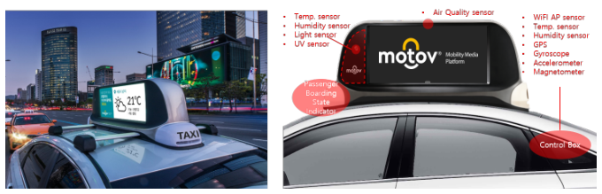
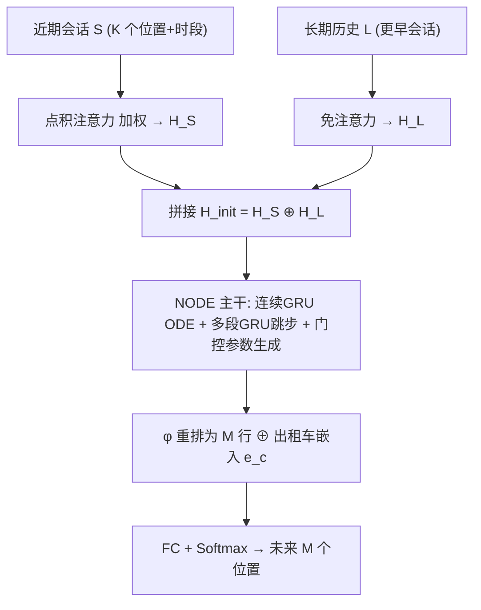

# LightMove: A Lightweight Next-POI Recommendation for Taxicab Rooftop Advertising (面向出租车车顶广告的轻量级下一兴趣点推荐)

- **会议/期刊**: CIKM 2021
- **作者与机构**: Jinsung Jeon, Soyoung Kang, Minju Jo, Seunghyeon Cho, Noseong Park (延世大学 / NAVER Clova), Seonghoon Kim, Chiyoung Song (Motov Inc.)
- **推荐链路定位**: 端到端序列预测（服务端预取广告的精排式打分）
- **研究方向**: 时空轨迹与 POI 本地生活推荐 / 序列与会话推荐
- **论文原文**: [https://arxiv.org/abs/2108.04993v3](https://arxiv.org/abs/2108.04993v3)
- **开源代码**: [https://github.com/Jinsung-Jeon/LightMove](https://github.com/Jinsung-Jeon/LightMove)

## TL;DR (1分钟核心速览)

出租车车顶数字广告需提前数分钟预判车辆的下一批位置，以便在 4G 盲区前把定向素材推送上车；而 Next-POI 轨迹数据极度稀疏、缺少天气/事件等辅助信息。本文提出 LightMove：短期会话做点积注意力、长期历史免注意力，主干用**连续 GRU 形式的 Neural ODE + 多段状态跳变 + 门控参数自适应生成**演化隐状态，一次前向输出未来 $M$个位置的完整分布。在逐车时序 70/15/15 切分、全库$|X|$ 类 softmax 的协议下，Taxi Hits@1 达 0.9985，Foursquare Hits@1 较最佳基线提升 23.6% 而参数仅为 DeepMove 的 22%。

## Background & Motivation (背景与核心矛盾)

- **主流范式**: Next-POI 以 RNN/LSTM/GRU 序列模型为主，SOTA 为带注意力的 DeepMove 与隐状态回放的 Flashback；二者均以"高容量建模"取胜。
- **前人局限**: ① 真实轨迹数据只含位置序列、无辅助上下文，高容量非线性模型在稀疏输入下极易过拟合、难正则；② 出租车业务要求**毫秒级批量推理 + 小模型**（月曝光量百万级），DeepMove 动辄 2000 万参数，端侧/边缘部署不经济。
- **核心洞察 (Key Insight)**: NODE 学习的映射是**同胚 (homeomorphic)** 的——在局部 Lipschitz 条件下解唯一且拓扑保持，相似的输入轨迹必然映射到相近的末态隐向量，天然抗稀疏与异常输入；这与 LightGCN "信息稀缺时用简单算子优于过容量非线性"的设计哲学同构（位置-出租车 ≈ 物品-用户的地理版 CF）。
- **本文切入点**: 用 NODE 作为唯一的隐状态加工主干（参数占比最大），配合跳步与门控参数自适应，在"平滑可靠"与"足够容量"之间取平衡。

<figure class="paper-figure" markdown="span">
  <figcaption>图1：我们的设备与预测模型。(a) 带有车顶显示屏的出租车 (b) 我们的方法包含：i) 对一组 𝐾 个最近位置的嵌入进行点积注意力，即最近会话；ii) 对其他过去会话的嵌入不使用注意力；iii) 一个 NODE，用于演化短期与长期嵌入的拼接（记为 𝒉(0)），以得到隐藏向量 𝒉(1)，该向量将与出租车嵌入拼接；iv) 一个分类器。</figcaption>
</figure>

## Method (核心方法设计)

### 1. 整体框架 (Overall Architecture)

输入一辆出租车 $c$的近期会话$S=\{x_{t_1},\dots,x_{t_K}\}$与其余全部历史$L$；两者分别查表得到位置/时段嵌入，短期经点积注意力加权、长期不加注意力但共享同一嵌入空间，二者拼接为初始矩阵$\boldsymbol{H}_{init}$（每行即一个位置的初态$\boldsymbol{h}_i(0)$）。每行独立送入 NODE 层，在$[0,1]$区间内被积分为$\boldsymbol{h}_i(1)$；再经 resize 算子$\phi$堆叠为$M$行、与出租车嵌入$\boldsymbol{e}_c$拼接，最后由全连接 + softmax 一次输出$M\times|X|$的联合预测。训练用交叉熵 +$L_2$，推理仅需一次积分前向。

### 2. 关键设计拆解 (Key Designs)

1. **短期注意力 + 长期免注意力（Info-scarce 的分层处理）**：痛点在于会话内位置互为上下文、而长期历史 $|L|\gg|S|$若也做注意力则开销爆炸且难训。做法是对$S$用可训练成对注意力$\boldsymbol{A}_S=\sigma(\boldsymbol{E}_S\boldsymbol{E}_S^{\top})$、$\boldsymbol{H}_S=\boldsymbol{A}_S\boldsymbol{E}_S$，对$L$ 直接取嵌入而不加权；直觉是短期内的共现构成"由同一出行目的串联的团 (clique)"，而长期历史只需提供粗粒度的出行习惯先验。

2. **连续 GRU 的 ODE 函数 + 跳步（把 RNN 平滑化）**：普通 NODE 的 $f$若是任意 MLP，容易在稀疏轨迹上产生不稳定积分。本文把$f$写成 GRU 的连续极限：$\boldsymbol{r}_i,\boldsymbol{z}_i=\Phi(\boldsymbol{W}\boldsymbol{h}_i+\boldsymbol{U}\boldsymbol{h}_i+\boldsymbol{b})$、$\boldsymbol{m}_i=\tanh(\boldsymbol{W}_m\boldsymbol{h}_i+\boldsymbol{U}_m(\boldsymbol{r}_i\odot\boldsymbol{h}_i)+\boldsymbol{b}_m)$，$\frac{\mathrm{d}\boldsymbol{h}_i}{\mathrm{d}t}=(1-\boldsymbol{z}_i)\odot(\boldsymbol{m}_i-\boldsymbol{h}_i)$，并在$[0,1]$内插入$J$个跳变点，每跳后接一次 GRU 单元重置：$\boldsymbol{h}_i(t_{j+1})=\mathrm{GRU}(\boldsymbol{j}_i(t_{j+1}))$，其中$\boldsymbol{j}_i(t_{j+1})=\boldsymbol{h}_i(t_j)+\int_{t_j}^{t_{j+1}}f\,\mathrm{d}t$。跳步提供了 NODE 单靠平滑流无法表示的"轨迹交叉/突变"，从而兼容走走停停的真实行车模式。

3. **门控参数自适应生成与训练/推理开销**：为应对复杂数据集（如 Foursquare），只对更新门 $\boldsymbol{z}$的权重做输入条件化：$\boldsymbol{\theta}_{adaptive}=g(\boldsymbol{\theta}_{fixed},\boldsymbol{h}_i(0);\boldsymbol{\theta}_g)$，具体为$\boldsymbol{W}_z'=\mathrm{resize}(\mathrm{FC}_W(\mathrm{vec}(\boldsymbol{W}_z)\oplus\boldsymbol{h}_i(0)))$（$\boldsymbol{U}_z',\boldsymbol{b}_z'$同理），其余门保持固定，以尽量贴近原同胚映射。总损失$\mathcal{L}=-\sum_{m}\log \boldsymbol{P}[m,x_m]+\beta\|\boldsymbol{\theta}\|_2^2$，其中$\boldsymbol{P}=\mathrm{softmax}(\mathrm{FC}(\phi(\boldsymbol{H}\oplus\boldsymbol{e}_c)))\in\mathbb{R}^{M\times|X|}$；**无负采样**（全库$|X|$ 分类），ODE 用 adjoint 法反传，默认 Euler 求解器、2 次跳步。

## Experimental Setup & Evaluation Protocol (实验设置与评估协议)

- **数据集与预处理**: Foursquare 沿用 DeepMove 预处理（剔除低频用户、连续会话间隔 ≥72h）；LA 为 Twitter 洛杉矶 500m×500m 网格化签到（会话间隔 ≥10h）；Taxi 为 Motov 自采（177 辆车、5 分钟 GPS、会话 45 分钟、约 100m×100m 兴趣格）。

| 数据集 | #Users(车辆) | #Items(POI) | #Interactions | 密度 | 场景说明 |
| :--- | :---: | :---: | :---: | :---: | :--- |
| Taxi | 177 | 584 | 353,419 | 3.4 | 首尔都市圈实车轨迹，稀疏但路线高度重复 |
| Foursquare | 15,639 | 43,380 | 293,559 | 0.00043 | 纽约，POI 密集、同楼多点，最难 |
| LA | 153,626 | 734,559 | 1,192,572 | 0.000011 | 网格化城市，用户移动模式平缓 |

- **数据划分与防穿越 (Splitting Strategy)**: 对每辆车/用户的完整轨迹按**时间顺序 70/15/15** 切分训练/验证/测试；测试时再取该段前 70% 位置作为输入、预测后 30% 位置（$M\le K$）。作者强调：不使用验证集而直接取训练期最高分（该领域常见做法）会显著虚高 Foursquare 结果，故严格报告验证选模后的分数。
- **排名评测协议 (Ranking Protocol)**: **Full-Ranking（全库 $|X|$ 类）**，即所有 POI 参与 softmax 竞争，不做采样负例；指标为 Hits@1/5/10 与 MRR，同时报告参数量与测试推理时长。
- **对比基线与超参设置**: 基线含 RNN/LSTM/BiLSTM/GRU、DRCF（MF 类）、SERM（无长期历史）、DeepMove、Flashback（RNN/LSTM/GRU 三版）；嵌入维度 $D_{loc}\in\{50,\dots,700\}$、$D_{taxi}\in\{20,\dots,80\}$、$D_{time}\in\{5,\dots,40\}$，Adam，初始学习率$\{0.005,0.05,0.1\}$每轮衰减 0.9（下限 5e-4），$L_2$权重 1e-5，dropout$\{0.3,0.5\}$。**原文未报告显著性检验**。

## Key Experimental Results (实验关键数据)

### 1. 主实验对比 (Main Results)

| 方法 | Taxi Hits@1 / MRR | Foursquare Hits@1 / MRR | LA Hits@1 / MRR | #Params (FSQ) |
| :--- | :---: | :---: | :---: | :---: |
| GRU | 0.2272 / 0.3768 | 0.0677 / 0.1146 | 0.1625 / 0.2179 | 1.11M |
| DRCF | 0.9581 / 0.9880 | 0.0654 / 0.1025 | 0.2243 / 0.2803 | 2.43M |
| SERM | 0.8958 / 0.9422 | 0.0564 / 0.1049 | 0.3173 / 0.3938 | 11.11M |
| DeepMove | 0.9435 / 0.9575 | 0.1250 / 0.1836 | 0.3030 / 0.3615 | 20.05M |
| Flashback(GRU) | 0.9934 / 0.9959 | 0.1224 / 0.2008 | 0.2938 / 0.3607 | 10.26M |
| Flashback(LSTM) | 0.9913 / 0.9946 | 0.1253 / 0.2007 | 0.2811 / 0.3492 | 10.44M |
| LightMove(G2E) | **0.9985** / **0.9993** | 0.1390 / 0.2121 | 0.3025 / 0.3625 | 3.18M |
| LightMove(L2EF) | – | **0.1545** / **0.2288** | – | 4.29M |
| LightMove(G0E) | – | – | **0.3207** / 0.3700 | 0.98M |
| **Improv. (Hits@1)** | **+0.51%** vs Flashback(GRU) | **+23.3%** vs Flashback(LSTM) | **+1.07%** vs SERM | **−78%** vs DeepMove |

推理开销方面，Taxi 上 DeepMove 需 568s、Flashback 349s，LightMove 约 359s（G2E 与 Flashback 同量级）；Foursquare 上 DeepMove 65s、LightMove 约 65–91s——**轻量优势主要体现在参数量，而非所有场景的绝对延迟**。

### 2. 消融实验 (Ablation Study)

| 变体（跳步/求解器/参数生成） | Taxi Hits@1 | Foursquare Hits@1 | LA Hits@1 | 参数量 |
| :--- | :---: | :---: | :---: | :---: |
| G0E（0 跳，Euler） | 0.4762 | 0.1402 | **0.3207** | 0.98M(LA) |
| L2E（FC 跳步×2） | 0.5008 | 0.1537 | 0.3167 | 1.95M(LA) |
| G2E（GRU 跳步×2） | **0.9985** | 0.1390 | 0.3025 | 3.18M(FSQ) |
| G5E（GRU 跳步×5） | 0.9960 | 0.1380 | 0.2954 | 20.6M(FSQ) |
| G2R / L2R（RK4 替代 Euler） | 0.9983 | 0.1542 | 0.3165(G0R) | 3.18M / 2.96M |
| G2EF / L2EF（+ 门控参数生成） | 0.9988 | **0.1545** | 0.3209(G0EF) | 135.9M / 4.29M / 173.8M |

### 3. 关键实验发现 (Key Findings)

1. **NODE 跳步是 Taxi 上的决定性增益**：0 跳（G0E）仅 0.4762，加到 2 跳（G2E）跃至 0.9985（+110%），说明纯平滑 ODE 流无法表达交叉/折返轨迹，必须依赖状态跳变提供非拓扑保持的突变能力。
2. **容量应与数据复杂度匹配而非越大越好**：LA 轨迹平缓，0.98M 的 G0E（0.3207）反而优于 6.27M 的 G2E（0.3025）；Foursquare 同楼多点最难，需 FC 跳步 + 参数生成（L2EF 0.1545），此时参数仍只有 DeepMove 的 21%。
3. **求解器与参数生成的性价比极低**：RK4 与 Euler 精度几乎无差别（Taxi 0.9991 vs 0.9993），但 RK4 计算量更高；G2EF 相对 G2E 仅 +0.03 个百分点，参数却从 3.2M 膨胀到 135.9M（42 倍），与"lightweight"卖点自相矛盾。

## Highlights & Limitations (亮点、对比与审稿批判)

- **与代表作对比 (vs. Prior Work)**: DeepMove 用注意力 + 高容量 RNN 建模长期/短期联合历史，Flashback 在隐状态层做相似子序列回放，二者均为"堆容量"路线；LightMove 反其道而行，用同胚平滑算子替代非线性堆叠，并在相同全库排序协议下以 1/5 参数反超，思路接近 LightGCN 对 NGCF 的简化。
- **可迁移亮点**: ① 长期历史"免注意力、只保留嵌入"的策略，在长历史场景下是极划算的效率换精度操作；② 只对门控 $\boldsymbol{z}$做参数自适应（$g$ 从固定权重生成微扰而非从头生成），可作为任何条件化超网络的正则技巧。
- **审稿级局限批判**: ① **评估乐观偏差**：Taxi 仅 584 个 POI 且路线高度重复，Hits@10 已达 1.0000，近乎退化为"记忆固定线路"，且同一车辆同时出现在训练与测试中，缺少跨车辆冷启动 / 跨城市迁移的严格 zero-shot 验证；② 全文无显著性检验，LA 上 MRR 仍落后 SERM（0.3700 vs 0.3938），Foursquare 上推理时长并非最优，作者宣称的"更小推理时间"不具普适性。

## Rating (四维评分)

- **方法创新性 (Novelty)**: ⭐⭐⭐⭐ （首次把 NODE 的同胚可靠性论证系统迁移到 Next-POI，连续 GRU + 跳步 + 门控条件化的组合设计有清晰动机）
- **评估协议与实验扎实度 (Protocol & Experiments)**: ⭐⭐⭐ （坚持 70/15/15 时序验证与全库排序值得肯定，但仅 3 个数据集、无显著性检验、Taxi 场景近乎饱和）
- **写作与数学规范度 (Clarity & Rigor)**: ⭐⭐⭐⭐ （ODE 适定性、同胚与 LightGCN 类比讲得清楚，公式与复杂度分析完整，个别正负号/记号略可精简）
- **工业落地与复现价值 (Industrial & Practical Value)**: ⭐⭐⭐⭐⭐ （来自真实车顶广告业务，代码与数据全开源，G0E/L2E 变体参数量低于 2M，可直接部署于边缘车机）

