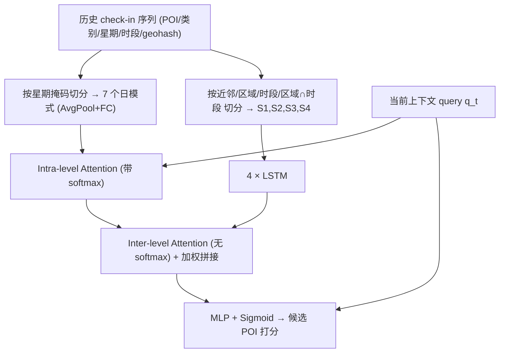
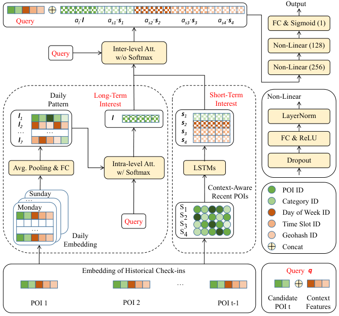

# ST-PIL: Spatial-Temporal Periodic Interest Learning for Next Point-of-Interest Recommendation (时空周期兴趣学习的下一个 POI 推荐)

- **会议/期刊**: CIKM 2021 (Applied Research Track, short paper)
- **作者与机构**: Qiang Cui, Chenrui Zhang, Yafeng Zhang, Jinpeng Wang(通讯), Mingchen Cai — 美团 (Meituan)
- **推荐链路定位**: 精排（候选 POI 打分与排序）
- **研究方向**: 时空轨迹与 POI 本地生活推荐 / 序列与会话推荐
- **论文原文**: [https://arxiv.org/abs/2104.02262v2](https://arxiv.org/abs/2104.02262v2)
- **开源代码**: 暂未开源

## TL;DR (1分钟核心速览)

现有长短兴趣 POI 模型把历史 check-in 当作**单一连续序列**送入 RNN，当历史很长时，与"下一次访问"真正相关的少数 check-in 被无关轨迹淹没；DeepMove/LSTPM 试图用 mobility status 或 time slot 刻画周期性，粒度仍然单一。ST-PIL 的核心是**用时空上下文把同一份历史轨迹切成多条并行子序列**：长期侧按"星期几"切出 7 个日模式并用 intra-level attention 聚合，短期侧按时段、geohash 区域、以及二者交集切出 4 条序列、分别过 4 个 LSTM，最后用**去掉 softmax 的 inter-level attention** 加权拼接。在 NYC / TKY 上采用 Leave-One-Out + 全库排序，Acc@1 相对最强基线 PLSPL 提升 74.0% / 71.5%。

## Background & Motivation (背景与核心矛盾)

- **主流范式**: 以 LSPL/PLSPL、STGN、LSTPM 为代表，用"全历史建模长期兴趣 + 近期 check-in 建模短期兴趣"的双分支结构，长期侧多用 attention 汇总全体 check-in，短期侧用 LSTM/geo-dilated LSTM 编码。
- **前人局限一（信号稀释）**: 用户 check-in 多达数百条，而 PLSPL 类模型对全部历史共用一个 encoder，真正与下一次访问强相关的只是极小子集，连续序列把相关信号压平。
- **前人局限二（周期粒度单一）**: DeepMove 依赖当前 mobility status、LSTPM 依赖 time slot 计算时间相似度，只能刻画出"小时级"一种周期，无法覆盖"每周固定去的场所""在某片区才去的场所"这类空间与时空耦合的周期模式。
- **核心洞察 (Key Insight)**: 人的移动是**多重周期叠加**的——日粒度（工作日/周末差异）、小时粒度（晚饭时段去餐厅）、区域粒度（在景区只逛景点）、以及小时×区域粒度（早 8 点去公司）。这些周期无法由单一序列统一表达，只能通过**按上下文检索（retrieve）相关历史片段**来显式分离。
- **本文切入点**: 不再设计新 RNN 算子，而是把"如何组织输入序列"本身当作建模对象，用时空上下文做多次条件切分，再用注意力在多个兴趣之间自适应选择。

## Method (核心方法设计)

### 1. 整体框架 (Overall Architecture)

一次 check-in 表示为 $h_t=(p_t,c_t,w_t,m_t,g_t)$（POI、类别、星期、时段、geohash-5 区域），各字段独立 embedding 后拼接。给定用户全历史$H=\{h_1,\dots,h_{t-1}\}$与当前上下文$(w_t,m_t,g_t)$，模型分两路：长期路按星期掩码切出 7 条日模式序列，平均池化 + FC 得到$L=[l_1;\dots;l_7]$，再以$q_t=[p_t,c_t,w_t,m_t,g_t]$为 query 做 intra-level attention 得长期兴趣$l_t$；短期路按近期、同区域、同时段、同时段∩同区域构造 4 条序列，各过一个 LSTM 得$s_{t1..t4}$。随后 inter-level attention 为 5 个兴趣打分（**不接 softmax**），加权拼接为$x_t$，与$q_t$ 拼接后送入 MLP + Sigmoid，输出候选 POI 概率，交叉熵训练。

<figure class="paper-figure" markdown="span">
  <figcaption>图1：ST-PIL 的整体架构。</figcaption>
</figure>

### 2. 关键设计拆解 (Key Designs)

1. **日模式掩码 + Intra-level Attention（让长期兴趣"按星期对齐"）**: 早期做法把全历史平均池化成一个向量，抹平了工作日/周末的语义差异。ST-PIL 先用 0/1 掩码 $d^{(j)}\in\{0,1\}^{|H|}$抽出属于星期$j$的 check-in，累加求和后除以掩码和得到$l_j$，从而把"用户周一通常会去哪"变成 7 个独立槽位。再以候选感知的 query$q_t$ 做 Bahdanau attention：

$$e_{tj}=\boldsymbol{v}_e^{\top}\tanh(\boldsymbol{V}_1 q_t+\boldsymbol{V}_2 l_j),\quad \alpha_{tj}=\mathrm{softmax}_j(e_{tj}),\quad l_t=\sum_{j=1}^{7}\alpha_{tj}l_j$$

物理直觉：若候选是酒吧，attention 会自动上调周五/周六日模式的权重，长期分支不再是"平均口味"，而是"当日语境下的口味"。

2. **时空上下文切分出的 4 条短期序列（把周期从"时间"扩到"时空"）**: 以当前 $t$为锚，$S_1$取最近若干 check-in 捕获序列转移；$S_2$取历史上落在同一 geohash$g_t$的 check-in 捕获**区域周期**；$S_3$取落在相似时段$\{m_t-1,m_t,m_t+1\}$的 check-in 捕获**小时周期**；$S_4=S_2\cap S_3$捕获**小时×区域周期**。每条序列用**独立** LSTM 编码$s_{tk}=\mathrm{LSTM}_k(S_{tk})$，以避免四种移动模式在共享参数下互相污染。

<figure class="paper-figure" markdown="span">
  ![图2：通过时空上下文获取某一时间步的多种短期序列的示意图。其中每个 POI 均可作为候选，但只有一个为正样本，且每个特征 ID 均由稠密向量嵌入。然后，我们采用广泛使用的 Bahdanau attention2 \[1\] 聚合日模式 𝑳𝑡：](../../../../assets/papers/2104.02262v2/figure_2.png)<figcaption>图2：通过时空上下文获取某一时间步的多种短期序列的示意图。其中每个 POI 均可作为候选，但只有一个为正样本，且每个特征 ID 均由稠密向量嵌入。然后，我们采用广泛使用的 Bahdanau attention2 [1] 聚合日模式 𝑳𝑡：</figcaption>
</figure>

3. **去 softmax 的 Inter-level Attention 与训练目标**: intra-level 里 7 个日模式是同质的，适合 softmax 归一化；但长期兴趣与 4 个短期兴趣是**异构模式**，softmax 会强制权重和为 1、相互挤压，模型不得不在"区域周期"和"时段周期"之间二选一。因此改为逐兴趣独立打分、保留原始幅值：

$$a_{tl}=\boldsymbol{v}_a^{\top}\tanh(\boldsymbol{V}_3 q_t+\boldsymbol{V}_4 l_t),\quad x_t=[a_{tl}l_t,\,a_{ts_1}s_{t1},\,\dots,\,a_{ts_4}s_{t4}]$$

并在此处对 $q_t$与各兴趣加 dropout 抑制过拟合。最终$[q_t,x_t]$过 MLP（256→128→1）输出概率，损失为候选集上的交叉熵$\mathcal{L}=-\sum_{i=1}^{N}[y_i\log p(y_i)+(1-y_i)\log(1-p(y_i))]$；训练时每正样本配 20 个负样本，推理时对全库 POI 打分排序。多个 LSTM 与池化操作可完全并行，在线开销相当于一次 5 分支前向。

## Experimental Setup & Evaluation Protocol (实验设置与评估协议)

- **数据集与预处理**: 采用 NYC / TKY 两个公开 LBSN 数据集（源自 Yang et al. 2014 的 Foursquare 全球 check-in 集），**过滤 check-in 少于 5 次的 POI**（类 5-core 物品过滤），并**每个用户只保留最近 500 条 check-in**。

| 数据集 | #Users | #Items | #Interactions | 稀疏度/密度 | 特征/场景说明 |
| :--- | :---: | :---: | :---: | :---: | :--- |
| NYC (New York) | 原文未披露 | 原文未披露（已滤 <5 次） | 原文未披露（每用户 ≤500） | — | 用户/POI/类别/经纬度(→geohash-5)/UTC 时间戳 |
| TKY (Tokyo) | 原文未披露 | 同上 | 同上 | — | 同上 |

（说明：该 short paper 正文未列出精确统计表，仅给出上述过滤规则；密度与规模需回溯原数据集文献。）

- **数据划分与防穿越 (Splitting Strategy)**: `Leave-One-Out` —— 每个用户的**最后一条 check-in 作为测试真值**，其之前的全部历史作为输入，无跨用户时间泄漏。
- **排名评测协议 (Ranking Protocol)**: `Full-Ranking`——测试阶段对**全部 POI 计算概率并排序**（非采样排序），因此指标数值偏低但可信；训练阶段则采用 1:20 的负采样。
- **对比基线与超参设置**: 基线含 LSTM、STGN、LSTPM、PLSPL 四类长短兴趣代表模型；embedding 维度按 ID 基数对数比例设置（POI 64 / 类别 32 / 星期 8 / 时段 16 / geohash 32），各兴趣向量 64 维，dropout 在 $\{0.0,0.1,0.2\}$ 网格搜索（inter-level 在 NYC 取 0.0、TKY 取 0.1，MLP 取 0.1）；指标为 Acc@k 与 MRR@k。原文未报告显著性检验。

## Key Experimental Results (实验关键数据)

### 1. 主实验对比 (Main Results)

| Model | NYC Acc@1 | NYC Acc@5 | NYC Acc@10 | NYC MRR@10 | TKY Acc@1 | TKY Acc@5 | TKY Acc@10 | TKY MRR@10 |
| :--- | :---: | :---: | :---: | :---: | :---: | :---: | :---: | :---: |
| LSTM | 0.1816 | 0.3991 | 0.4663 | 0.2701 | 0.1506 | 0.3553 | 0.4511 | 0.2384 |
| STGN | 0.2071 | 0.4051 | 0.4645 | 0.2909 | 0.2134 | 0.4352 | 0.5161 | 0.3066 |
| LSTPM | 0.1846 | 0.3693 | 0.4484 | 0.2660 | 0.1928 | 0.3889 | 0.4622 | 0.2746 |
| PLSPL (runner-up) | 0.2188 | 0.4367 | 0.5162 | 0.3109 | 0.2134 | 0.4252 | 0.5225 | 0.2983 |
| ST-PIL$_L$ (仅长期) | 0.3135 | 0.5543 | 0.6243 | 0.4151 | 0.2842 | 0.5340 | 0.6287 | 0.3900 |
| ST-PIL$_S$ (仅短期) | 0.3790 | 0.5798 | 0.6363 | 0.4619 | 0.3464 | 0.5872 | 0.6708 | 0.4498 |
| **ST-PIL (full)** | **0.3807** | **0.5850** | **0.6454** | **0.4666** | **0.3523** | **0.5963** | **0.6772** | **0.4564** |
| **Improv.% vs best baseline** | **+74.00** | **+33.96** | **+25.03** | **+50.08** | **+71.52** | **+37.02** | **+29.61** | **+48.86** |

### 2. 消融实验 (Ablation Study)

原文以柱状图（Fig. 3 / Fig. 4）报告，未给数值表，此处按趋势归纳：

| 变体 | 考察对象 | Acc@10 趋势 (NYC / TKY) | 结论 |
| :--- | :--- | :---: | :--- |
| att-qk (完整长期模块) | query-based intra-attention | 最优 | 候选感知的 query 是长期兴趣有效的关键 |
| att-k (去掉 query) | 无 query 的日模式聚合 | 次之 | 无候选条件时退化为"平均作息" |
| seq-avg (全序列平均) | 朴素长期编码 | 最差 | 证实日模式切分本身有效 |
| $S_2$/$S_4$单独 | 空间 / 时空周期 | 优于$S_1,S_3$ | 空间与时空周期强于纯序列转移与纯时段周期 |
| 逐步累加 $S_1\!\to\!S_4$ | 短期兴趣增量 | 单调上升且均优于单条 | 四种模式互补，inter-level 融合有效 |
| ST-PIL$_L$vs ST-PIL$_S$vs full | 分支重要性 |$L < L+S$，$S <$ full | 短期分支贡献更大，融合再获增益 |

### 3. 关键实验发现 (Key Findings)

- **提升主要来自排序头部而非整体分布**：NYC 上 Acc@1 相对提升 74.0%，但 Acc@10 仅提升 25.0%；TKY 同为 71.5% vs 29.6%。说明时空周期切分主要解决"第一名是否命中"的置信度问题，而不是简单扩大命中集合。
- **短期分支比长期分支更关键，但二者不可替代**：仅长期 ST-PIL$_L$的 NYC Acc@1 为 0.3135，已显著超过最好基线 PLSPL 的 0.2188；仅短期 ST-PIL$_S$进一步升到 0.3790；融合后 0.3807。区域($S_2$)与区域×时段($S_4$)两条序列贡献高于纯序列($S_1$)与纯时段($S_3$)，印证"用户在某片区内会重复自己的行为"这一强假设。
- **去掉 softmax 的融合权重是必要设计**：inter-level 若做归一化，异构模式被迫竞争同一份权重预算，而 $L+L{+}S$ 的增益（0.3790→0.3807 NYC）与消融中的"逐步累加单调上升"共同表明：保留幅值让模型可以"同时启用"多个周期，而非在周期之间做互斥选择。

## Highlights & Limitations (亮点、对比与审稿批判)

- **与代表作对比**: 相比 DeepMove 用 mobility status 做历史 attention、LSTPM 用 time slot 算时间相似度，ST-PIL 把周期从"一维时间"扩到"星期 / 时段 / geohash / 时段×geohash"四维，并直接用切分后的子序列替代"软加权检索"，信号更干净；相比 PLSPL 的双注意力结构，本文的差异在于用**异构兴趣 + 非归一化权重**取代同质兴趣 + softmax，允许模式并存。
- **可迁移亮点**: (1) "按上下文掩码切多条子序列 + 每路独立 encoder"是一种极低成本的多兴趣解耦手段，可平移到电商复购（按品类/时段切分）与会话推荐；(2) 异构兴趣融合时**放弃 softmax 的加权拼接**，在需要"并存而非竞争"的融合场景（如多场景推荐、多目标精排）中值得复用。
- **审稿级局限批判**: (1) 切序列规则（星期 7 分、时段窗口 $\pm1$、geohash-5 粒度、每路序列截断长度）全部人工设定且未对粒度做敏感性分析，跨城市/跨业务的可迁移性存疑；(2) 评测为 short paper 规模，仅两个城市、无冷启动或长尾分桶实验，且测试用全库排序而训练用 1:20 采样，存在训练-评测分布偏移；(3) 5 路分支（7 次掩码池化 + 4 个 LSTM + 两级 attention）在工业级 POI 库上的推理延迟与显存开销未讨论。

## Rating (四维评分)

- **方法创新性 (Novelty)**: ⭐⭐⭐ （不引入新网络算子，"用时空上下文多次切分历史"的思路朴素但切中周期兴趣的信号稀释问题，非归一化融合是真正有洞察的小改进）
- **评估协议与实验扎实度 (Protocol & Experiments)**: ⭐⭐⭐ （Leave-One-Out + Full-Ranking 协议干净、提升幅度大，但仅两数据集、消融只给柱状图无具体数值、无显著性检验）
- **写作与数学规范度 (Clarity & Rigor)**: ⭐⭐⭐⭐ （五页短文把 5 路兴趣、两级 attention 讲得清晰，公式完整；但对为何去 softmax 仅给直觉而无数值或理论论证，切分规则缺少伪代码）
- **工业落地与复现价值 (Industrial & Practical Value)**: ⭐⭐⭐⭐ （来自美团业务场景，切序列与多 LSTM 均可并行、改造成本低；但未开源、geohash 粒度等超参需在自有数据上重调）

