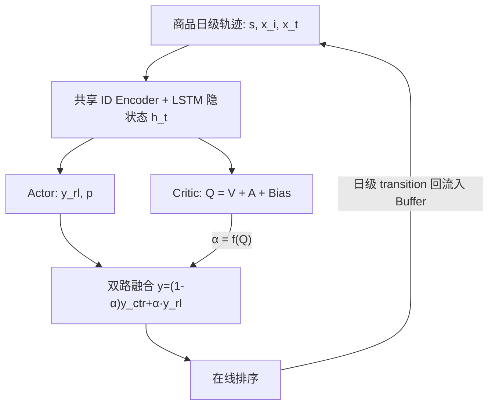
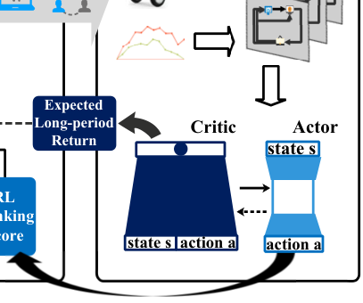
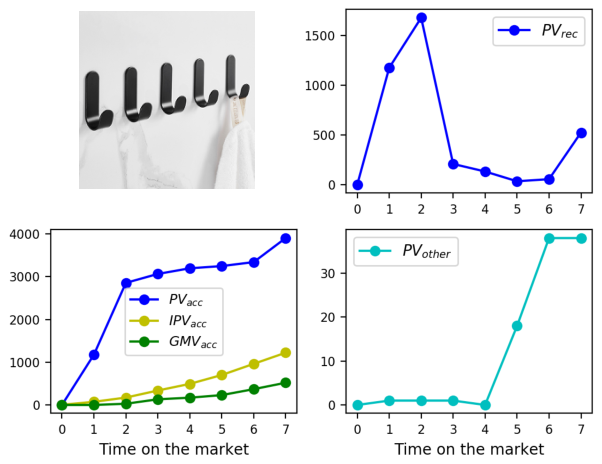

# Reinforcement Learning to Optimize Lifetime Value in Cold-Start Recommendation (面向冷启动推荐的终身价值强化学习优化)

- **会议/期刊**: CIKM 2021
- **作者与机构**: Luo Ji, Bingqing Han, Hongxia Yang (阿里巴巴达摩院)；Qi Qin (北京大学 AAIS 数据科学中心)
- **推荐链路定位**: 精排 / 排序融合（item 级离线策略 + 在线 pointwise 打分融合）
- **研究方向**: 强化学习与动态探索推荐 / 冷启动与长尾推荐
- **论文原文**: [https://arxiv.org/abs/2108.09141v1](https://arxiv.org/abs/2108.09141v1)
- **开源代码**: 暂未开源

## TL;DR (1分钟核心速览)

冷启动推荐长期依赖内容/异构/跨域辅助特征，但都假设商品表现随时间平稳、只优化单期 CTR，导致新品因缺历史行为被低排（马太效应）。本文把商品生命周期建成 **POC-MDP**（含不可观测生命阶段与不可控趋势因子），用共享 LSTM 编码器的 Actor-Critic（IE-RDPG）预测商品未来 LTV，Actor 输出的 $y_{rl}$与 CTR 分$y_{ctr}$按 critic 的$Q$ 值自适应加权融合排序。在淘宝一周线上 A/B（冷启商品按物品级指标统计）中，IPV 与 GMV 相对强基线分别提升 **8.67%** 与 **18.03%**，而全局 PV/IPV 仅降 0.55%/0.60%。

## Background & Motivation (背景与核心矛盾)

- **主流范式**: 冷启动主要靠内容特征、异构信息网络与跨域迁移补足缺失的 user-item 交互；排序阶段统一用 pointwise CTR 模型（如 DIN 类）打分。
- **前人局限**: 其一，上述方法假设商品在生命周期内表现**平稳**，而电商新品普遍经历引入-成长-成熟-衰退的强动态；其二，已有长期收益优化几乎都从**用户侧**（留存、参与度）出发，物品侧 LTV 被完全忽略。
- **核心洞察 (Key Insight)**: 即时 CTR 排序对无历史的新品存在系统性曝光偏置，而部分新品只需少量曝光投入即可进入"曝光→点击→成交→搜索加权"的正反馈闭环。同时，商品状态的演化时间尺度是**天级**，远慢于在线推荐（毫秒级），因此完全可以在物品级、日粒度上做 off-policy 学习，规避 RL 在线试错的风险与开销。
- **本文切入点**: 把"给多少排序权重"建模为物品级 POC-MDP 的连续动作，用 critic 预测的多期回报决定 CTR 与 LTV 的融合比例。

## Method (核心方法设计)

### 1. 整体框架 (Overall Architecture)

输入为单个商品按天聚合的轨迹：名义状态 $s$（在架天数、当期与累计 PV/IPV/SLS、当前兴趣人群的数量与平均购买力）、不可控状态$x=[x_i,x_t]$（$x_i$为不变的商品固有特征：128 维图文多模态向量 + 类目/品牌/店铺 ID；$x_t$为各类趋势源的 PV/IPV/SLS 滑动平均增长率）。Actor 与 Critic 共享 ID Encoder 与 LSTM，LSTM 隐状态$h_t$隐式编码商品所处生命阶段，Actor 输出动作$a=[y_{rl},p]$（排序偏好分与定价折扣），Critic 输出$Q$预估未来累计收益。线上用$Q$生成融合权重$\alpha$，将$y_{rl}$与 CTR 分$y_{ctr}$ 线性合成最终排序分。训练采用按物品成 episode、沿时间前推的 IE-RDPG，日更上线。

<figure class="paper-figure" markdown="span">
  <figcaption>图1：RL-LTV算法框架示意图。采用RL求解物品级MDP，并提供优化物品长期奖励（LTV）的策略。策略得分与CTR排序得分相结合，其组合权重由critic期望调整。最终排序得分用于在线排序。</figcaption>
</figure>

### 2. 关键设计拆解 (Key Designs)

1. **POC-MDP 与 ROI 型奖励（解决奖励尺度失配）**: 若直接以 PV/IPV/GMV 绝对值作奖励，在 listwise 竞争环境下 RL 会把所有商品的 $y_{rl}$ 都推向最大，策略退化。作者把奖励归一化为"投入产出比"，与曝光位置解耦：

$$r_t=\frac{\mathrm{IPV}_{t+1}}{\mathrm{PV}_{rec,t}},\qquad J_t=\sum_{i=0}^{T}\gamma^{i}r_{t+i}$$

并取 $\gamma=0.5$（而非接近 1），刻意让策略"既看长期也尽快把新品推起来"，避免冷启窗口被过度拉长。直觉上，该奖励衡量的是"每单位推荐曝光能换来多少后续点击"，天然对齐平台流量再分配的目标。

2. **共享编码 + 双网络结构（解决成熟→新品的知识迁移）**: 新品自身轨迹过短，无法单独学出可靠 LTV，必须迁移成熟商品知识。Actor 用 wide&deep + LSTM，并以 softmax 注意力对商品固有特征做池化后再 sigmoid，使输出与 CTR 分同量纲：

$$S=\mathrm{softmax}(W_s^{\top}[o_{deep},o_{wide}]),\qquad y_{rl}=\sigma(x_{e,i}\cdot S)$$

Critic 采用 dueling 分解，并把趋势偏置作为**独立加项**而非混入共享隐层，防止不可控因子污染状态价值估计：

$$Q(o_t,a_t,h_t)=V(o_{e,t},h_t)+A(s_t,a_t)+\mathrm{Bias}(s_t,x_t,a_t)$$

3. **Q 值驱动的双路融合与 IE-RDPG 训练**: 固定 $\alpha$无法区分商品潜力，作者用 critic 预估的$Q$归一化后指数映射到$[\alpha_{\min},\alpha_{\max}]=[0,0.2]$，高潜商品获得更大 LTV 权重（式 7–8）。训练上，因 LSTM 需连续隐状态，vanilla DDPG 的随机 transition 采样会截断时序，故改为按 episode（单商品的按天序列）采样$N=50$条后沿时间前推更新（Bootstrapped Sequential Updates），损失为标准 double-Q MSE + 确定性策略梯度，target 软更新$\tau=0.001$，Adam 学习率$1e{-4}$，隐状态 4 维、item encoder 8 维。推理侧仅需一次前向，无额外候选扩展，在线开销可忽略。

## Experimental Setup & Evaluation Protocol (实验设置与评估协议)

- **数据集与预处理**: 论文明确指出公开数据集不具备商品生命周期动态，故**无公开 benchmark**，全部实验在淘宝生产环境完成。商品状态按"物品 × 天"聚合，等待 $T$天新 transition 形成一条 episode；$\gamma=0.5$ 使 5 天窗口即可覆盖主要折扣权重。

| 数据集 | #Users | #Items | #Interactions | 稀疏度/密度 | 特征/场景说明 |
| :--- | :---: | :---: | :---: | :---: | :--- |
| Taobao (Offline) | 未披露 | 未披露（全量商品池） | 5 天日级聚合轨迹 | 未披露 | 商品生命轨迹 + 128 维图文向量 + 类目/品牌/店铺 ID |
| Taobao (Online A/B) | 十亿级 | 十亿级 | 1 周（2021-01-26 起） | 未披露 | 冷启商品：上市 < 1 月，随机分组、每组仅由单一策略推荐 |

- **数据划分与防穿越 (Splitting Strategy)**: 无传统 train/test 划分；采用**时间前向**的在线滚动：用历史 episode 训练 → 次日在线更新（日级增量），离线评估用未来 5 天真实 $J_{actual}$ 作标签，天然避免穿越。
- **排名评测协议 (Ranking Protocol)**: **非 Full-Ranking**。NDCG@K 在线上召回系统返回的候选列表 top-K（K=10/20/50）上计算，相关性标签为 $J_{actual}$；另用 RMSE/MAE 评估 critic 的$Q$与$J_{actual}$ 的回归一致性。线上则以物品级 PV/IPV/GMV 相对变化衡量（同组商品仅被一个策略曝光，保证 item 级指标可比）。
- **对比基线与超参设置**: `Vanilla-CTR`（线上 SOTA pointwise CTR 模型）、`Empirical`（按类目/卖家/品牌的 $J_{actual}$分位数加权的人工规则）、`LSTM`（同结构监督回归$J_{actual}$）。线上显著性未给出$p$ 值，仅报告一周 A/B 的相对百分比。

## Key Experimental Results (实验关键数据)

### 1. 主实验对比 (Main Results)

离线 LTV 识别（表 2，NDCG 越高越好，RMSE/MAE 越低越好）：

| Model | RMSE | MAE | NDCG@10 | NDCG@20 | NDCG@50 |
| :--- | :---: | :---: | :---: | :---: | :---: |
| Vanilla-CTR | — | — | 0.746 | 0.662 | 0.582 |
| Empirical | — | — | 0.765 | 0.678 | 0.581 |
| LSTM | 7.900 | 4.761 | 0.772 | 0.684 | 0.600 |
| **RL-LTV** | **7.873** | **4.067** | **0.782** | **0.705** | **0.625** |

线上 A/B（表 3，冷启商品相对 Vanilla-CTR 的百分比差异）：

| Model | PV | IPV | GMV |
| :--- | :---: | :---: | :---: |
| RL-LTV (w/o R) | +1.01% | +6.25% | +12.31% |
| **RL-LTV** | −1.19% | **+8.67%** | **+18.03%** |

### 2. 消融实验 (Ablation Study)

| Model | RMSE | MAE | NDCG@10 | NDCG@20 | NDCG@50 |
| :--- | :---: | :---: | :---: | :---: | :---: |
| RL-LTV (w/o $x_s$) | 7.947 | 4.135 | 0.771 | 0.686 | 0.613 |
| RL-LTV (w/o $x_t$) | 8.146 | 4.351 | 0.763 | 0.680 | 0.611 |
| RL-LTV (w/o R) | 7.931 | 4.133 | 0.754 | 0.672 | 0.592 |
| **RL-LTV (full)** | **7.873** | **4.067** | **0.782** | **0.705** | **0.625** |

### 3. 关键实验发现 (Key Findings)

1. **收益来自流量再分配而非流量扩张**：RL-LTV 冷启商品的 PV 几乎不变（−1.19%）却换来 IPV +8.67%、GMV +18.03%；全局 PV/IPV 仅 −0.55%/−0.60%，说明 RL 只是把曝光从低潜商品挪给高潜新品，并通过搜索侧溢出（案例中 $PV_{other}$ 上升）实现闭环放大。
2. **不可控趋势因子 $x_t$是回归精度第一贡献项**：去掉后 MAE 从 4.067 恶化到 4.351（+7.0%），大于去掉$x_s$（4.135）与去掉 LSTM（4.133）；但 LSTM 隐状态主导头部排序——去掉后 NDCG@10 由 0.782 掉到 0.754（−3.6%），NDCG@50 掉到 0.592（−5.3%），印证"隐状态编码生命阶段、显式因子编码外部冲击"的分工是必要的。
3. **小比例融合即拿到主要 LTV 收益**：$\alpha$从 0 增至 1 时 AUC 单调下降、LTV NDCG 单调上升，拐点在均值$\alpha\approx0.1$，故取$[\alpha_{\min},\alpha_{\max}]=[0,0.2]$；这意味着仅 10% 量级的权重扰动即可获得大部分长期收益，CTR 损失可控，是工业可接受的风险配置。

<figure class="paper-figure" markdown="span">
  <figcaption>图5：典型冷启动推荐物品（一个挂钩手柄作为平台的新物品）的时间轨迹。右上：RL-LTV投入的𝑃𝑉rec。右下：LTV投入后被激发的𝑃𝑉other（主要来自搜索渠道）。左下：累计PV、IPV和GMV，表明该物品迅速成为明星物品。</figcaption>
</figure>

## Highlights & Limitations (亮点、对比与审稿批判)

- **与代表作对比 (vs. Prior Work)**: 相较 Zou et al. (KDD'19) 从**用户侧**优化长期参与度，本文将长期目标搬到**物品侧**并改造奖励为 ROI 形式；相较 He et al. (ECML-PKDD'18) 用数学模型**显式判别**商品生命阶段再分配曝光，本文不显式分阶段，改由 LSTM 隐状态端到端编码，且动作为连续打分而非离散曝光额度，可直接嵌入现有 pointwise LTR 排序器而无需重写分配逻辑。
- **可迁移亮点**: (1) 奖励除以"投入量"的归一化技巧，可通用于任何 listwise 竞争下的 RL 打分膨胀问题；(2) 用 critic 的 $Q$ 归一化后映射为融合权重，是把长期价值"温和注入"现有排序系统的通用范式，几乎不改在线链路。
- **审稿级局限批判**: (1) 动作中的定价 $p$因组织分工在线为 read-only，POC-MDP 宣称的两级 agent 实际只验证了一半；(2) 仅单一平台线上 A/B，无公开数据集/可复现代码，NDCG 在稀疏正样本的召回候选集上计算且未给显著性检验，结论外推性弱；(3) 按 episode 顺序前推的 LSTM 训练吞吐受限，$\alpha$上下界与$\gamma$ 均手工设定，对上新节奏快或品类结构差异大的场景敏感度未讨论。

## Rating (四维评分)

- **方法创新性 (Novelty)**: ⭐⭐⭐⭐ （首次将物品侧 LTV 引入冷启排序，POC-MDP 对"不可观测 + 不可控"状态的双重刻画与 ROI 奖励设计有实质新意，但底层仍是 DDPG 的组合改造）
- **评估协议与实验扎实度 (Protocol & Experiments)**: ⭐⭐⭐ （真实十亿级平台一周 A/B + 物品级隔离分组颇具说服力，但缺公开基准、缺显著性检验、离线 NDCG 仅在召回候选集上评估）
- **写作与数学规范度 (Clarity & Rigor)**: ⭐⭐⭐⭐ （符号表与 POC-MDP 定义清晰、公式推导简洁，但 LSTM 门控等标准结构冗余展开，线上/离线指标口径切换处交代略粗）
- **工业落地与复现价值 (Industrial & Practical Value)**: ⭐⭐⭐⭐⭐ （日级 off-policy 训练完全规避在线试错，融合模块对现有排序链路零侵入，已生产部署并有明确 GMV 收益，工程参考价值高）

