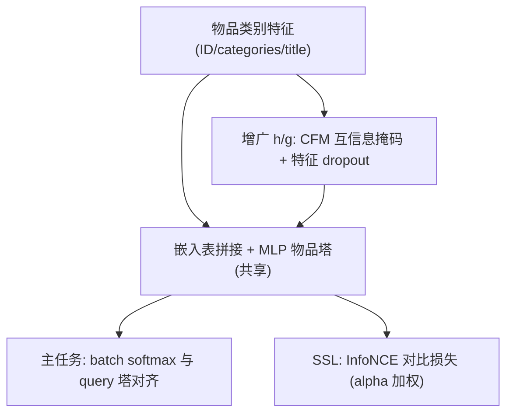
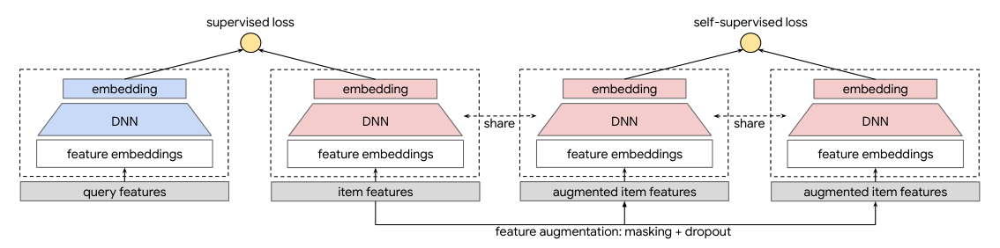
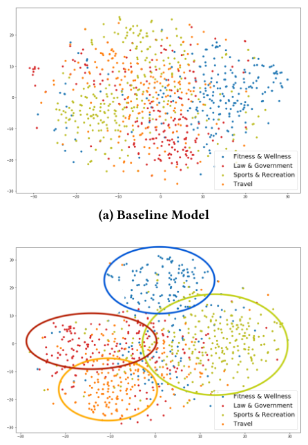

# Self-supervised Learning for Large-scale Item Recommendations (面向大规模物品推荐的自监督学习)

- **会议/期刊**: CIKM 2021
- **作者与机构**: Tiansheng Yao, Xinyang Yi, Derek Zhiyuan Cheng, Felix Yu, Ting Chen, Aditya Menon, Lichan Hong, Ed H. Chi 等（Google）
- **推荐链路定位**: 召回（两阶段架构中的 Item Retrieval / 双塔 MIPS 检索）
- **研究方向**: 自监督对比学习与交互去噪 / 冷启动与长尾推荐
- **论文原文**: [https://arxiv.org/abs/2007.12865v4](https://arxiv.org/abs/2007.12865v4)
- **开源代码**: 暂未开源

## TL;DR (1分钟核心速览)

面向亿级物品库中长尾物品监督信号极度稀疏（幂律分布、Top-50 物品即占 AAI 10% 曝光）的痛点，本文将 SimCLR 式对比学习改造为**双塔召回的辅助任务**：在物品塔上对高基数类别特征做「互信息引导的相关特征掩码 + 特征 dropout」双阶段增广，用 InfoNCE 拉近同一物品两视图、推远批内其他物品，并以多任务损失与主任务联合优化。在 Wikipedia(490M)/AAI(1B) 上采用**全库 Full-Ranking** 评测，AAI 上 Recall@10 相对提升 10.2%、MAP@10 提升 12.4%，10% 稀疏数据下 Recall@10 相对提升 25.7%，线上 A/B 冷启切片用户活跃度 +4.5%。

## Background & Motivation (背景与核心矛盾)

- **主流范式**: 双塔 DNN 以 batch softmax（sampled softmax）学习 query/item 联合嵌入空间，物品塔输入 ID + 类别/标题等多字段 one-hot/multi-hot 稀疏特征，服务端退化为 MIPS 亚线性检索。
- **前人局限一**: 数据幂律分布使长尾物品交互近乎为零，纯监督信号无法约束其嵌入，导致长尾切片泛化差、冷启物品嵌入漂移。
- **前人局限二**: 现有替代方案是 spread-out 正则（拉大随机样本间余弦距离）与 feature dropout，前者不含显式自监督任务、后者只作用于监督任务输入，均未真正挖掘特征内部语义关系；而 CV/NLU 的增广（裁剪、旋转、token mask）无法直接套用到无序、异构、超大基数的类别特征。
- **核心洞察 (Key Insight)**: 类别特征之间存在强相关（如 app 的 title unigram 与 categories），随机掩码会让两视图通过"相关特征捷径"轻易互认，使对比任务过易、表征冗余；因此**应按互信息成组掩码**，迫使模型从互补语义分区重建表示。
- **本文切入点**: 把"掩码即增广"的对比任务作为正则项挂到共享物品塔上，不改动主任务与线上服务结构。

## Method (核心方法设计)

### 1. 整体框架 (Overall Architecture)

输入为物品的多字段类别特征（ID / developer / categories / title unigram），经嵌入表拼接后送入 MLP 物品塔得到 $\mathbf{x}_i$。主任务分支将 query 塔输出$\mathbf{q}_i$与$\mathbf{x}_i$做 batch softmax 交叉熵；辅助分支对同一批物品施加两次独立增广$h,g$（CFM 掩码 + 特征 dropout），得到$\mathbf{z}_i=H(y_i)$、$\mathbf{z}'_i=G(y'_i)$，其中$H,G$**完全共享嵌入表与物品塔参数**（红色塔共享），仅以 InfoNCE 对比损失约束。训练时两损失按$\alpha$ 加权联合优化；**推理时直接丢弃 SSL 分支**，物品塔输出即线上索引向量，服务开销零增加，MIPS 检索流程不变。

<figure class="paper-figure" markdown="span">
  <figcaption>图 3：模型架构：带 SSL 的双塔模型。在 SSL 任务中，我们对物品特征应用特征掩码和 dropout 以学习物品嵌入。整个物品塔（红色）与监督任务共享。</figcaption>
</figure>

### 2. 关键设计拆解 (Key Designs)

1. **相关特征掩码 CFM（让对比任务不塌陷为捷径学习）**: 均匀采样种子特征 $f_{seed}$，按互信息取 Top-$n$ 最相关特征组成掩码集：
$F_m=\{f_{seed},f_{c,1},\dots,f_{c,n}\},\quad n=\lfloor k/2\rfloor,\quad MI(V_i,V_j)=\sum_{v_i,v_j}P(v_i,v_j)\log\frac{P(v_i,v_j)}{P(v_i)P(v_j)}$两视图使用**互补掩码**（视图 A 遮$F_m$、视图 B 遮$F\setminus F_m$），每 batch 更换种子。直觉：把强相关特征组整体遮掉，模型只能靠另一个语义分区推断身份，从而使两视图互信息真正来自语义而非冗余副本；$n\approx k/2$ 保证两侧信息量对等、任务不至于不可解。

2. **两阶段增广与异构采样分布（决定 SSL 是否正收益）**: 掩码（等价 100% dropout）后，对 multi-hot 特征逐值以 $d_r$丢弃，进一步削减输入、提升任务难度（$d_r$过大则信息不足，见实验）。更关键的是**采样分布解耦**：主任务物品服从幂律$\mathcal{D}_{train}$，而 SSL 物品从全库**均匀采样**$\mathcal{D}_{item}$——否则对比目标被头部物品主导，长尾表征依旧得不到梯度。

3. **训练目标、负采样与推理效率**: 总损失
$\mathcal{L}=\mathcal{L}_{main}(\{(q_i,x_i)\})+\alpha\,\mathcal{L}_{self}(\{x_i\}),\quad \mathcal{L}_{self}=-\frac{1}{N}\sum_{i}\log\frac{\exp(s(\mathbf{z}_i,\mathbf{z}'_i)/\tau)}{\sum_{j}\exp(s(\mathbf{z}_i,\mathbf{z}'_j)/\tau)}$负样本即 **in-batch 负采样**（无额外负采样器，batch=1024/4096 决定负样本量），温度$\tau=0.07/0.06$。理论上当$h=g$且$H=G$时$\mathcal{L}_{self}$ 退化为 spread-out 正则的 softmax 版本，说明**增广本身才是增益来源**；训练仅多一次前向，推理零成本。

## Experimental Setup & Evaluation Protocol (实验设置与评估协议)

- **数据集与预处理**: 全部为 item-to-item 推荐，仅保留正样本对（曝光未点击视为弱正例而剔除），无需 5-core 过滤。

| 数据集 | #Queries | #Items | #Interactions | 稀疏度/密度 | 特征/场景说明 |
| :--- | :---: | :---: | :---: | :---: | :--- |
| Wikipedia | 5.3M | 5.3M | 490M | 极稀疏（Top-50 占 ~5%） | 页面链接预测；URL-ID + 标题 n-gram + 类目 |
| AAI | 2.4M | 2.4M | 1B | 极稀疏（Top-50 占 ~10%） | 应用商店 app-to-app 安装；ID + 开发者 + 类目 + 标题 unigram |

- **数据划分与防穿越 (Splitting Strategy)**: `比例划分`，Wikipedia 与 AAI 均按 $(90\%,10\%)$ 训练/测试随机切分（沿用 Krichene 2019 / Yi 2019 设定）；另做 10% 均匀下采样训练集实验考察稀疏鲁棒性。
- **排名评测协议 (Ranking Protocol)**: 无偏 `Full-Ranking`——对每个种子物品在**全库**计算余弦相似度取 Top-$K$（非采样排序），指标 `Recall@10/50`、`MAP@10/50`，每个配置跑 5 次取均值。TopPopular 参照 Recall@50≈0.10(AAI)/0.05(Wiki)。
- **对比基线与超参设置**: Baseline（双塔 DNN）、FD（监督任务上特征 dropout）、SO（spread-out 正则，无增广）；两塔隐层 [1024,128]（Wiki，$\tau=0.07$）与 [1024,256]（AAI，$\tau=0.06$），Adagrad lr=0.01，$\alpha\in\{0.1,0.3,1.0,3.0\}$，$d_r\in\{0.1,\dots,0.9\}$ 网格搜索。

## Key Experimental Results (实验关键数据)

### 1. 主实验对比 (Main Results)

| 数据集 | 方法 | MAP@10 | MAP@50 | Recall@10 | Recall@50 |
| :--- | :--- | :---: | :---: | :---: | :---: |
| Wikipedia | Baseline | 0.0171 | 0.0229 | 0.0537 | 0.1930 |
| Wikipedia | FD (DropoutNet) | 0.0172 | 0.0229 | 0.0535 | 0.1912 |
| Wikipedia | SO (Spread-out) | 0.0176 | 0.0235 | 0.0549 | 0.1956 |
| Wikipedia | **Ours (CFM+dropout)** | **0.0183** | **0.0243** | **0.0570** | **0.2009** |
| Wikipedia | Improv. | +7.02% | +6.11% | +6.15% | +4.09% |
| AAI | Baseline | 0.1257 | 0.1363 | 0.2793 | 0.4983 |
| AAI | FD (DropoutNet) | 0.1278 | 0.1384 | 0.2840 | 0.5058 |
| AAI | SO (Spread-out) | 0.1300 | 0.1406 | 0.2870 | 0.5076 |
| AAI | **Ours (CFM+dropout)** | **0.1413** | **0.1522** | **0.3078** | **0.5355** |
| AAI | Improv. | +12.41% | +11.67% | +10.20% | +7.47% |

### 2. 消融实验 (Ablation Study)

AAI 数据集上增广组件逐项拆解（Recall 指标）：

| 变体 | MAP@10 | MAP@50 | Recall@10 | Recall@50 |
| :--- | :---: | :---: | :---: | :---: |
| Baseline（无 SSL） | 0.1257 | 0.1363 | 0.2793 | 0.4983 |
| w/o 互信息（RFM 随机掩码+互补） | 0.1281 | 0.1389 | 0.2851 | 0.5104 |
| w/o 互补性（RFM_no_compl 独立掩码） | 0.1363 | 0.1472 | 0.3007 | 0.5290 |
| w/o dropout（仅 CFM 掩码） | 0.1309 | 0.1417 | 0.2898 | 0.5150 |
| w/o masking（仅 dropout 增广） | 0.1303 | 0.1408 | 0.2868 | 0.5053 |
| **CFM + dropout（完整）** | **0.1413** | **0.1522** | **0.3078** | **0.5355** |

### 3. 关键实验发现 (Key Findings)

1. **稀疏度越高增益越大，验证"补监督"机理**: 训练数据下采样至 10% 后，CFM 的 Recall@10 相对提升由 Wikipedia 6.1% 升至 **20.6%**、AAI 10.2% 升至 **25.7%**，且与 FD 的差距随数据变稀而拉大——说明增益并非简单正则，而是对缺失标签的信息补偿。
2. **增益集中在长尾头尾分桶**：AAI 长尾切片 Recall@10 由 0.0475 提升至 0.0720（**+51.5%**），头部仅 +8.57%（0.2846→0.3090）；线上 14 天 A/B 同样呈结构性一致：整体核心指标 +1.5%、冷启新 app 活跃度 **+4.5%**、数据更稀疏的国际市场 **+5.47%**。
3. **两个增广缺一不可，且互信息是关键**: 去掉互信息引导（RFM）造成最大回落（Recall@10 0.3078→0.2851）；保留掩码但去掉互补性（0.3007）或去掉 dropout（0.2898）均明显劣化，说明"相关成组 + 视图互补 + 逐值扰动"三者共同抵抗捷径学习；t-SNE 可视化亦显示 SSL 嵌入按 app 类目形成更清晰簇结构。

<figure class="paper-figure" markdown="span">
  <figcaption>图 4：基线模型和我们最佳 SSL 模型的应用嵌入 t-SNE 图对比。</figcaption>
</figure>

## Highlights & Limitations (亮点、对比与审稿批判)

- **与代表作对比 (vs. Prior Work)**: 相对 spread-out 正则（Zhang et al. ICCV'17），本文把"无增广的实例分离"升级为"有增广的实例判别"，AAI Recall@50 高出 5.5%（0.5355 vs 0.5076）；相对 FD/DropoutNet（Volkovs et al. NIPS'17），增广被搬到辅助任务而非直接扰动监督输入，同样预算下更优且可叠加；相对 S3-Rec 等序列 SSL，本文不建模序列，而针对异构类别特征的物品表征，可迁移到精排/多任务模型。
- **可迁移亮点**: ①互信息成组掩码可直接复用到任何多字段稀疏特征塔（短视频标签、电商类目+标题）作为免费正则；②主任务/自监督任务**采样分布解耦**（幂律 vs. 均匀）是长尾场景防止对比目标被头部淹没的通用 trick。
- **审稿级局限批判**: ①互信息矩阵需离线在全量语料上预计算，特征基数大或在线高频新增特征时维护成本高、且 $\lfloor k/2\rfloor$的掩码比例与$d_r$需各自网格搜索（$d_r=0.3$ 峰值、过大即退化），超参敏感；②评测只有 item-to-item 两类数据集、单目标 batch softmax，缺少个性化 query 与多目标排序验证，也未与 SGL/SimGCL 等同期图对比方法或更晚的序列 SSL 基线对比，可比性受限。

## Rating (四维评分)

- **方法创新性 (Novelty)**: ⭐⭐⭐⭐ （把 CV 对比学习适配到无序异构类别特征，互信息引导成组掩码 + 互补视图设计有清晰机理，但框架本体沿用 SimCLR）
- **评估协议与实验扎实度 (Protocol & Experiments)**: ⭐⭐⭐⭐⭐ （490M/1B 工业级数据、全库 Full-Ranking、5 次重复、稀疏/头尾分桶消融与线上 A/B 三层验证齐备，罕见地形成证据链闭环）
- **写作与数学规范度 (Clarity & Rigor)**: ⭐⭐⭐⭐ （损失与增广公式简洁、明确指出 h=g 时退化为 spread-out 的理论联系，复杂度与推理开销说明清楚，缺互信息估计方差讨论）
- **工业落地与复现价值 (Industrial & Practical Value)**: ⭐⭐⭐⭐⭐ （推理零额外开销、塔结构完全共享、已上线 web-scale 系统并有 A/B 收益，工程落地门槛极低，但无开源代码略降复现便利性）

