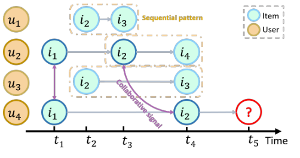
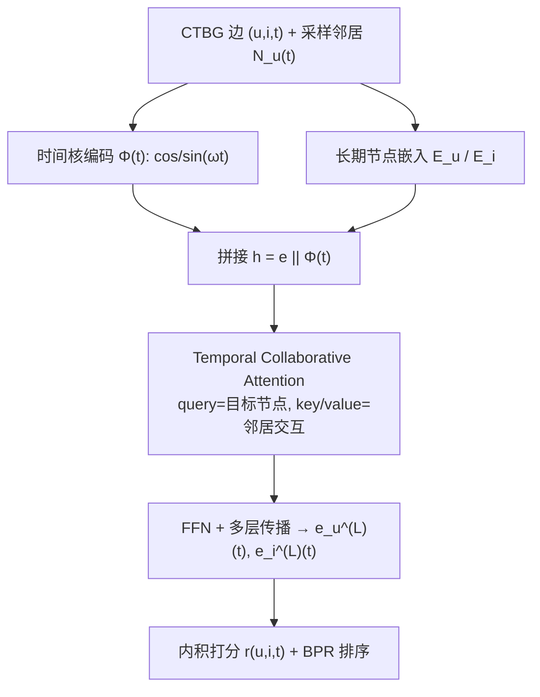
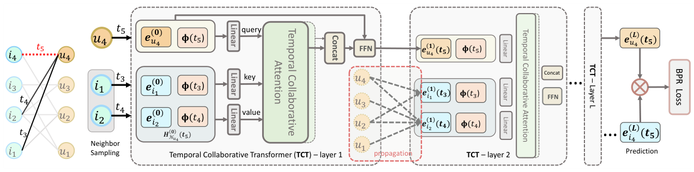

# Continuous-Time Sequential Recommendation with Temporal Graph Collaborative Transformer (连续时间序列推荐与时间图协同 Transformer)

- **会议/期刊**: CIKM 2021
- **作者与机构**: Ziwei Fan, Zhiwei Liu, Philip S. Yu (UIUC)；Jiawei Zhang (UC Davis)；Yun Xiong (复旦大学)；Lei Zheng (Pinterest)
- **推荐链路定位**: 召回 (Next-Item 序列召回)
- **研究方向**: 序列与会话推荐 / 图神经网络与知识图谱推荐
- **论文原文**: [https://arxiv.org/abs/2108.06625v2](https://arxiv.org/abs/2108.06625v2)
- **开源代码**: [https://github.com/DyGRec/TGSRec](https://github.com/DyGRec/TGSRec)

## TL;DR (1分钟核心速览)

现有序列推荐只建模「同一用户序列内的 item 转移」，忽略了跨用户、随时间演化的**时序协同信号**。TGSRec 把全部交互重构为带真实时间戳的**连续时间二分图 (CTBG)**，用可学习频率的三角时间核把标量时间映射为向量，并提出**时间协同注意力 (TCT)**：query 取自目标节点、key/value 取自采样邻居交互，使拼接后的点积自动分解为「用户-物品协同项 + 时间核项」。在 5 个数据集、按时间戳 80/10/10 切分、1000 负采样排序协议下，Recall@10 与 MRR 相对次优基线平均绝对提升 **22.5% / 22.1%**。

## Background & Motivation (背景与核心矛盾)

- **主流范式**: 以 SASRec / BERT4Rec 为代表的自注意力序列模型，在单条用户序列内按位置分配注意力权重，聚合历史 item 得到序列表征。
- **前人局限**: ① 自注意力只能刻画 item-item 转移，缺乏跨序列的 user-item 协同建模（SSE-PT 仅把同一 user 向量硬加到序列上，无法表达交互关系）；② 时间被当作离散位置或固定间隔桶（TiSASRec），既无法表达真实时间差，也无法外推到训练中未出现的时间戳/时间跨度。
- **核心洞察 (Key Insight)**: 图 1 的玩具例子里，若只看序列转移，$i_3$因在$u_1,u_3$中出现 2 次会被推荐；但$u_2$与$u_4$都交互过$i_1$、$i_2$，协同相似度极高，因此$u_2$的序列模式应获更大权重，正确答案是$i_4$。**协同信号与序列模式并存，且其贡献随时间间隔衰减**。
- **本文切入点**: 用「连续时间核 + 邻居交互作 key/value 的协同注意力」在图上同时编码两类信号。

<figure class="paper-figure" markdown="span">
  <figcaption>图1：时间协同信号的一个简单示例。给定用户𝑢1、𝑢2、𝑢3和𝑢4在过去时间戳𝑡1、𝑡2、𝑡3和𝑡4喜欢的物品，目标是在𝑡5向𝑢4推荐一个物品，作为𝑖2之后的下一个物品。</figcaption>
</figure>

## Method (核心方法设计)

### 1. 整体框架 (Overall Architecture)

输入为连续时间二分图 $\mathcal{B}=\{\mathcal{U},\mathcal{I},\mathcal{E}_T\}$，边$e=(u,i,t)$携带实值时间戳。模型分三层：① 嵌入层同时维护长期节点嵌入$\boldsymbol{E}=[\boldsymbol{E}_U;\boldsymbol{E}_I]$与时间编码函数$\Phi(t)$；② 堆叠$L$层 TCT 层，每层先对节点$u$在时刻$t$之前随机采样$S$个历史交互$\mathcal{N}_u(t)=\{(i,t_s)\mid t_s<t\}$，再以目标节点信息为 query、邻居【item 嵌入$\|$时间向量】为 key/value 做时间协同注意力聚合，经 FFN 输出时刻$t$的动态嵌入$\boldsymbol{e}_u^{(l)}(t)$；③ 预测层用最后一层双端时序嵌入内积打分并排序。训练用 BPR  pairwise 损失，推理时对任意给定未来时间戳现算嵌入，故可做多步（非单步）推荐。

<figure class="paper-figure" markdown="span">
  <figcaption>图3：TGSRec的框架。查询节点为𝑢4，其在𝑡5时的最终时间嵌入为𝒉(2)。</figcaption>
</figure>

### 2. 关键设计拆解 (Key Designs)

1. **可外推的连续时间核 (Temporal Kernel)**：痛点是把时间当位置编号无法表达真实间隔、也无法泛化到未见时间戳。本文把时间效应定义为平移不变核 $\psi(t_1-t_2)=\mathcal{K}(t_1,t_2)=\Phi(t_1)\cdot\Phi(t_2)$，由 Bochner 定理取$\Phi(t)=\sqrt{1/d_T}\,[\cos(\omega_1 t),\sin(\omega_1 t),\dots,\cos(\omega_{d_T}t),\sin(\omega_{d_T}t)]^{\top}$，频率$\boldsymbol{\omega}$ 可学习。直觉：任意时间差都可由两个时间向量的内积平滑表达，且对训练中未出现的时间戳天然可归纳。
2. **时间协同注意力 (Temporal Collaborative Attention)**：痛点在于自注意力的 Q/K/V 全来自 item，天然排斥跨用户协同。TCT 改为 query 来自目标节点、key/value 来自邻居交互，注意力权重（拼接后点积）为
$\pi_{ut}(i,t_s)=\tfrac{1}{\sqrt{d+d_T}}\big(\boldsymbol{W}_k\boldsymbol{h}_i^{(l-1)}(t_s)\big)^{\top}\boldsymbol{W}_q\boldsymbol{h}_u^{(l-1)}(t)$，
忽略变换矩阵后右端恰好展开为 $\boldsymbol{e}_u^{(l-1)}(t)\cdot\boldsymbol{e}_i^{(l-1)}(t_s)+\Phi(t)\cdot\Phi(t_s)$——**第一项是协同信号，第二项是时间核效应**，一次点积同时建模两者，因此可直接套用多头注意力与 FFN：
$\boldsymbol{e}^{(l)}_u(t)=\mathrm{FFN}\big(\boldsymbol{e}^{(l)}_{\mathcal{N}_u}(t)\,\|\,\boldsymbol{h}^{(l-1)}_u(t)\big)$。
3. **训练目标、负采样与推理效率**：$\mathcal{L}_{bpr}=\sum_{(u,i,j,t)\in\mathcal{O}_T}-\log\sigma\big(r(u,i,t)-r(u,j,t)\big)+\lambda\|\Theta\|_2^2$，负样本$j$从$u$在$t$时刻前未交互集合$\mathcal{I}\setminus\mathcal{I}_u(t)$中均匀采样（另对比 BCE 损失）。推理时对每个候选$i$现算$\boldsymbol{e}_i^{(L)}(t)$，开销与$L\times S$ 成正比，需逐候选前向，是其主要在线成本来源。

## Experimental Setup & Evaluation Protocol (实验设置与评估协议)

- **数据集与预处理**: 4 个 Amazon 子域（无需 5-core 过滤，原始时间跨度 1996-05 至 2014-07）+ ML-100K：

| 数据集 | #Users | #Items | #Interactions | 密度 | 平均交互间隔 |
| :--- | :---: | :---: | :---: | :---: | :--- |
| Toys | 17,946 | 11,639 | 154,793 | 0.07% | 85 天 |
| Baby | 17,739 | 6,876 | 146,775 | 0.12% | 61 天 |
| Tools | 15,920 | 10,043 | 127,784 | 0.08% | 123 天 |
| Music | 4,652 | 3,051 | 54,932 | 0.38% | 104 天 |
| ML-100K | 943 | 1,682 | 48,569 | 6.30% | 4.8 小时 |

- **数据划分与防穿越 (Splitting Strategy)**: 严格按交互时间戳**全局时间序**切分 train/valid/test = 80%/10%/10%（非 Leave-One-Out）。允许预测时使用 $t<t_{test}$ 的全部历史交互（含验证/测试段），但参数仅由训练段学习。
- **排名评测协议 (Ranking Protocol)**: **Sampled Ranking**——为加速评估，每个测试交互只采 **1,000 个负样本**（$t$ 前未交互物品），并套用 [16] 的无偏估计器校正采样偏差；指标为 Recall@{10,20}、NDCG@10、MRR。
- **对比基线与超参设置**: 三类基线——静态类 BPR-MF、LightGCN；时序类 CTDNE、TiSASRec（JODIE 因 OOM 未报）；序列类 GRU4Rec、Caser、SR-GNN、SASRec、BERT4Rec、SSE-PT。嵌入维度 $d\in\{8,16,32,64\}$，层数$L\in\{0,1,2\}$，邻居数$S\in\{5,10,20\}$，多头$\{1,2,4\}$，学习率$\{10^{-2},10^{-3},10^{-4}\}$，L2$\{5\!\times\!10^{-1},\dots,10^{-3}\}$，PyTorch + 1080Ti。

## Key Experimental Results (实验关键数据)

### 1. 主实验对比 (Main Results)

| Model | Toys R@10 | Toys MRR | Baby R@10 | Baby MRR | Music R@10 | Music MRR | ML100K R@10 | ML100K MRR |
| :--- | :---: | :---: | :---: | :---: | :---: | :---: | :---: | :---: |
| BPR-MF | 0.0021 | 0.0024 | 0.0028 | 0.0019 | 0.0122 | 0.0057 | 0.0461 | 0.0213 |
| LightGCN | 0.0016 | 0.0018 | 0.0036 | 0.0024 | 0.0142 | 0.0064 | 0.0565 | 0.0252 |
| GRU4Rec | 0.0274 | 0.0277 | 0.0036 | 0.0028 | 0.0549 | 0.0540 | 0.0996 | 0.0938 |
| Caser | 0.0138 | 0.0082 | 0.0077 | 0.0071 | 0.0183 | 0.0106 | 0.0246 | 0.0147 |
| SSE-PT | 0.1213 | 0.0595 | 0.0911 | 0.0434 | 0.0915 | 0.0423 | 0.1079 | 0.0519 |
| BERT4Rec | 0.1273 | 0.0643 | 0.0884 | 0.0511 | 0.1352 | 0.0824 | 0.1116 | 0.0600 |
| SASRec | 0.1452 | 0.0732 | 0.0975 | 0.0455 | 0.1372 | 0.0768 | 0.0945 | 0.0448 |
| TiSASRec | 0.1361 | 0.0671 | **0.1040** | 0.0521 | **0.1372** | 0.0681 | **0.1332** | 0.0605 |
| **TGSRec** | **0.3650** | **0.3661** | **0.2235** | **0.2147** | **0.5935** | **0.3820** | **0.3118** | **0.2416** |
| Improv. | +21.98% | +29.29% | +11.95% | +16.26% | +45.63% | +29.96% | +17.86% | +14.78% |

（Tools 数据集 TGSRec Recall@10 = 0.2457 / MRR = 0.2468，Improv. +11.61% / +18.40%，为全文最大相对差距之一。）

### 2. 消融实验 (Ablation Study)

| 变体 (Recall@10) | Toys | Baby | Tools | Music | ML100K |
| :--- | :---: | :---: | :---: | :---: | :---: |
| (0) Default TGSRec | **0.3649** | **0.2235** | **0.3623** | **0.5935** | 0.3118 |
| (1) 协同注意力 → Mean Pooling | 0.0027 | 0.0210 | 0.0055 | 0.0051 | 0.0647 |
| (2) 协同注意力 → LSTM | 0.0991 | 0.1237 | 0.1266 | 0.3740 | 0.3088 |
| (3) $\boldsymbol{\omega}$ 固定为高斯采样 | 0.0854 | 0.0944 | 0.0910 | 0.3679 | 0.2789 |
| (4) 时间核 → 可学习位置编码 | 0.0380 | 0.0243 | 0.0209 | 0.0742 | 0.0878 |
| (5) 时间向量置零 | 0.0139 | 0.0240 | 0.0018 | 0.0346 | 0.0603 |
| (6) BPR → BCE | 0.2200 | 0.1916 | 0.1763 | 0.4624 | **0.3542** |
| (7) 用户侧移除时间向量 | 0.0103 | 0.0138 | 0.0106 | 0.0112 | 0.1555 |
| (8) 物品侧移除时间向量 | 0.1013 | 0.0961 | 0.0836 | 0.2785 | 0.2336 |

### 3. 关键实验发现 (Key Findings)

1. **增益来源是协同信号而非时间戳本身**：同为引入时间信息，TiSASRec 相对 SASRec 在 Toys 上反而从 0.1452 掉到 0.1361，而 TGSRec 直接跃至 0.3650；在 Music 上更从 0.1372 提升到 0.5935（+45.6% 绝对），说明边际收益来自「跨序列协同 + 连续时间核」的联合建模，单靠间隔特征无效。
2. **协同注意力是不可替代的骨架**：换成 Mean Pooling 后 Toys 崩至 0.0027（跌幅 >99%），换 LSTM 也只到 0.0991（保留序列转移但仍远差），证明价值不在「编码序列」这一动作，而在「以邻居交互为 key/value、显式度量 user-item 交互重要性」这一算子结构。
3. **时间核的连续性比位置/固定频率更关键**：$\boldsymbol{\omega}$训练可学 (0.3649) ≫ 固定$\omega$ (0.0854) ≫ 位置编码 (0.0380) ≫ 置零 (0.0139)，且表 4 中「用户侧去时间」(0.0103) 比「物品侧去时间」(0.1013) 损失大近 10 倍——印证用户偏好高度动态、物品相对静态，与直觉一致。

## Highlights & Limitations (亮点、对比与审稿批判)

- **与代表作对比 (vs. Prior Work)**: vs. SASRec/BERT4Rec——后者注意力只在单序列内做 item-item，无跨用户协同；vs. TiSASRec——只把时间间隔塞进位置偏置，无法表达真实时间差、更无法外推到未见时间戳；vs. JODIE/CDTNE——RNN/随机游走只能压成单一隐向量，丢失全序列的历史交互影响。
- **可迁移亮点**: ①「拼接 $[\text{node}\| \text{time}]$ 后点积自动分解为协同项 + 时间核项」是一个极轻量的注入技巧，可无痛移植到任意 attention 型召回/精排；② 用 Bochner 平移不变核替代离散时间桶，天然支持未来时间戳外推，适合发布/上新场景的时间对齐。
- **审稿级局限批判**: ① 评估只做 **1,000 负采样**而非 Full-Ranking，静态基线（BPR/LightGCN 低至 0.002）在长尾稀疏 Amazon 数据上被严重压制，绝对提升幅度有被协议放大的风险；② 推理需为每个候选物品现算多跳采样的时序嵌入，代价远高于 SASRec 的一次性序列编码，论文未报告任何延迟/显存数据；③ 表 2 与表 3 中 Tools 的 Default Recall@10 分别为 0.2457 与 0.3623，数值口径不自洽，削弱了消融的可信度；④ 时间核频率 $\omega$与层数$L$、邻居数$S$均需网格搜索，$L$ 上限仅取到 2，高阶协同未被充分探索。

## Rating (四维评分)

- **方法创新性 (Novelty)**: ⭐⭐⭐⭐ （把 SR 从序列范式迁到连续时间二分图，协同注意力 + 可外推时间核的双重改造有新意，但「图上注意力做时序建模」在 TGAT 等工作中已有雏形）
- **评估协议与实验扎实度 (Protocol & Experiments)**: ⭐⭐⭐ （5 数据集 + 全局时间切分 + 无偏估计器校正值得肯定，但仅采样 1000 负评、无显著性检验、无全库排序，且表 2/表 3 数值互斥）
- **写作与数学规范度 (Clarity & Rigor)**: ⭐⭐⭐⭐ （时间核从 Bochner 定理到 cos/sin 展开、注意力点积分解为两项的推导清晰，公式组织紧凑；缺陷是层数上标 $\pi_{ut}$的$l$ 省略说明与部分表号不一致）
- **工业落地与复现价值 (Industrial & Practical Value)**: ⭐⭐⭐ （代码开源、构图思路可复用；但每候选多跳现算嵌入的在线成本与 $S$ 采样带来的训练方差，使大规模部署需额外工程折中）

