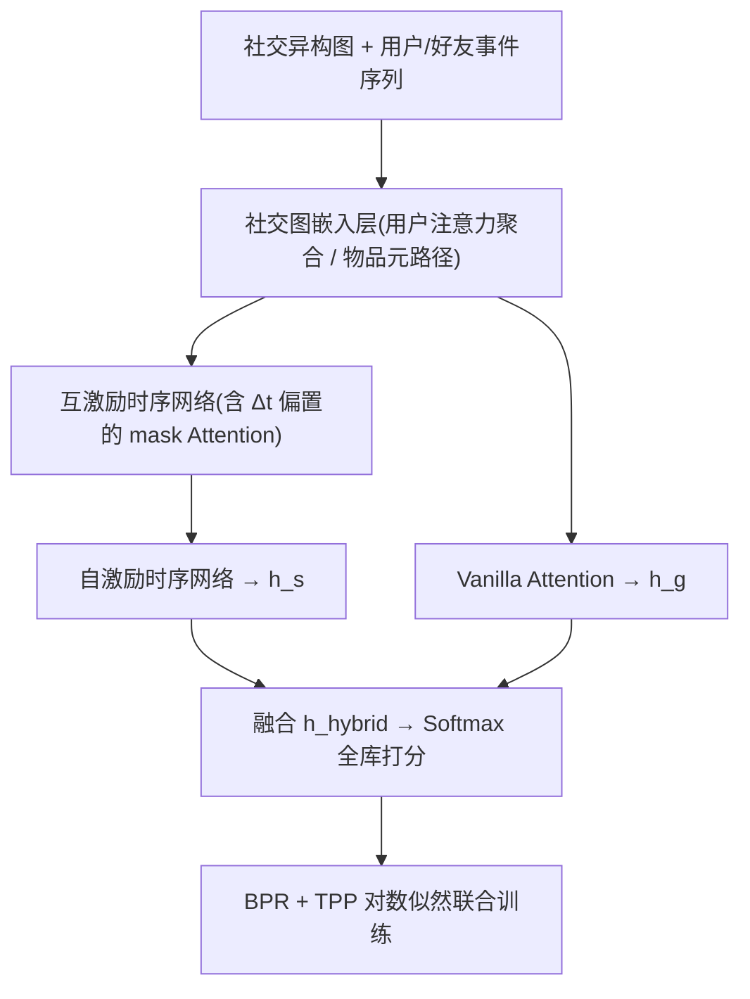
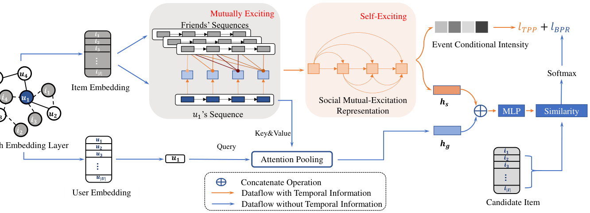

# Extracting Attentive Social Temporal Excitation for Sequential Recommendation (提取注意力式社交时序激励的序列推荐)

- **会议/期刊**: CIKM 2021
- **作者与机构**: Yunzhe Li, Yue Ding, Bo Chen, Xin Xin, Yule Wang, Yuxiang Shi, Ruiming Tang, Dong Wang（上海交通大学、华为诺亚方舟实验室、格拉斯哥大学）
- **推荐链路定位**: 召回（Next-Item 序列召回打分）
- **研究方向**: 序列与会话推荐 / 社交与群组推荐
- **论文原文**: [https://arxiv.org/abs/2109.13539v1](https://arxiv.org/abs/2109.13539v1)
- **开源代码**: 暂未开源

## TL;DR (1分钟核心速览)

现有社交序列推荐把好友序列先编码成用户向量再聚合（用户级间接范式），丢失了跨用户行为事件之间的时间先后关系。STEN 引入时序点过程，把"好友事件如何激励当前事件"改写为带时间间隔偏置的注意力强度函数，在事件级直接建模社交互助激励与自我激励，并用社交异构图精修节点表示。在三数据集 Leave-One-Out 全库排序下，Recall@10/NDCG@10/MRR@10 全面最优，最高相对提升 5.79%/6.29%/7.58%。

## Background & Motivation (背景与核心矛盾)

- **主流范式**: 社交推荐用 GNN 在用户级传播好友偏好（Diffnet、DANSER），时序推荐用 SASRec/TiSASRec 或 THP 建模单用户序列与时间间隔，两者基本各自为战。
- **前人局限**: ① 间接范式需先把好友整条序列压缩为一个向量，事件粒度信息在聚合时被不可逆地丢弃；② 跨用户事件序列是**异步**的，若 Alice 在 Bob 买鞋后极短时间内买高跟鞋（$t_3\le t_6$），激励应强，若$t_3\gg t_6$或$t_3>t_6$ 则激励应趋零，而纯顺序建模无法区分。
- **核心洞察**: 好友影响力本质是"事件对事件"的条件强度激发，恰可由 Hawkes 过程的互助激励（mutually exciting）形式刻画；而用户自身兴趣演化对应自我激励（self-exciting）过程。
- **本文切入点**: 用注意力参数化的累积互激励强度函数替代积分近似，实现可反向传播、可 mask 防穿越的事件级社交时序建模。

## Method (核心方法设计)

### 1. 整体框架 (Overall Architecture)

输入为用户自身事件序列 $\mathbf{s}_n$、其好友事件序列集合、以及用户-用户 / 用户-物品构成的社交异构图。先由社交异构图嵌入层产出用户与物品节点表示（好友事件与目标事件均用图精修后的物品向量表示）；一路用 vanilla attention 以用户向量为 query 汇聚自身序列得一般兴趣$h_g$；另一路将好友事件送入互激励时序网络，逐目标事件算出社交互助时序强度$\lambda^{m}_{n,i}$，再将该强度序列送入自激励时序网络得到动态兴趣$h_s$；两者拼接线性融合为$h_{hybrid}$ 后对全物品做 softmax，训练时 BPR 与点过程对数似然联合优化。

<figure class="paper-figure" markdown="span">
  <figcaption>图 2：STEN 的架构。首先，通过社交图嵌入层，利用事件序列和社会关系生成用户与物品的节点表示。然后，将事件嵌入送入相互激励注意力网络，以获得社会相互时间表示。接着，在自激励时间网络中融合相互时间表示，以捕捉时间动态表示 ℎ𝑠。此外，采用普通注意力获得一般兴趣 ℎ𝑔。之后，融合 ℎ𝑠、ℎ𝑔 以进行推荐。在</figcaption>
</figure>

### 2. 关键设计拆解 (Key Designs)

1. **累积互激励强度函数（把 Hawkes 积分换成可学习 softplus 映射）**：痛点是对条件强度 $\lambda_{n,j}(t_i,t)$做积分需要昂贵的数值近似。作者改为直接建模"事件$e_{j,t_w}$对事件$e_{n,t_i}$的累积激励"：$\Phi(e_{n,t_i},e_{j,t_w})=\mathrm{softplus}\big(\mathrm{corr}(e_{n,t_i},e_{j,t_w})+\beta(t_i-t_w)+\mu\big)$，三项分别承担内容相关性、时间衰减/增强与基础激励；softplus 保证强度恒正，符合点过程约束，同时全式可微、免积分近似。直觉上，$\beta<0$时学过"久远事件影响弱"，$\beta>0$ 则允许"预热型"激励。

2. **带时间间隔偏置的互助激励注意力（事件级直接范式的落地算子）**：把好友全部事件拼成 $S_F\in\mathbb{R}^{d_F\times d}$，以目标事件表示$h_{n,i}$ 为 query，在标准点积注意力上直接加时间项并对未来事件 mask：
$A_m=\mathrm{softmax}\big(\mathrm{mask}(\frac{Q_mK_m^{T}}{\sqrt{d}}+\beta_m\Delta t+\mu_m)\big),\quad \lambda^{m}_{n,i}=\sum_{k=1}^{d_F}\alpha_{m,k}W^{V}_{m}h_{F,k}$其中$\Delta t$为好友事件与目标事件的时间间隔。相比 RNN 式神经点过程，注意力避免了长程依赖衰减，且 mask 严格禁止使用$t_i$ 之后的好友事件，从机制上杜绝穿越。

3. **自我激励网络与训练目标**：将互助强度序列 $T^m_n$作为 query/key/value 输入同构的带$\Delta t$偏置注意力，取末位输出即$h_s$（公式结构同上式，仅输入换成$T^m_n$）。总损失$\mathcal{L}=\mathcal{L}_{BPR}+\mathcal{L}_{P_n}+\gamma\|\Theta\|_2^{2}$，其中点过程负对数似然用梯形法近似积分：$\mathcal{L}_{P_n}=-\sum_i\log\lambda^{S}_{n,i}+\frac{1}{2}\sum_i\Delta t_i(\lambda^{S}_{n,i}+\lambda^{S}_{n,i+1})$。负采样沿用 BPR 的随机未交互负例（每正例 1 负例），推理时以$h_{hybrid}$ 对全物品内积做 softmax，无额外检索结构开销。

## Experimental Setup & Evaluation Protocol (实验设置与评估协议)

- **数据集与预处理**（评分/评论统一二值化为隐式反馈）：

| 数据集 | #Users | #Items | #Interactions | 密度 | 特征/场景说明 |
| :--- | :---: | :---: | :---: | :---: | :--- |
| Delicious | 1,867 | 24,052 | 437,593 | 0.97% | 书签打标序列 + 社交关系，人均 234 事件 |
| Yelp | 74,982 | 59,692 | 811,503 | 0.018% | 商户评论（取前 10% 时段），社交边极稠密 |
| Ciao | 6,596 | 107,320 | 274,065 | 0.039% | 评分 + 信任关系，物品数远多于用户 |

- **过滤规则**: 用户交互 $<5$剔除；物品出现次数 Yelp$<10$、其余$<5$ 剔除（近似 5-core）。
- **数据划分与防穿越**: `Leave-One-Out`——每用户最后 1 个交互为测试、倒数第 2 个为验证，其余训练；模型内部对好友与自身事件均加时间 mask 防未来信息泄漏。
- **排名评测协议**: `Full-Ranking`（对全部 $|\mathcal{I}|$个物品做 softmax 全库排序，非采样排序），指标 Recall@$\{10,20\}$、NDCG@$\{10,20\}$、MRR@$\{10,20\}$。
- **对比基线与超参**: 常规 BPR-MF；序列 FPMC/SR-GNN/SASRec/BERT4Rec；时序 THP/TiSASRec；社交 SBPR/DANSER/Diffnet。嵌入维度 $d\in\{40,\dots,140\}$、学习率$\{0.001,0.005,0.01\}$网格搜索，同构最大图阶 2、采样好友数$M=10$、序列长$\{300,30,50\}$，最优基线结果均以单尾 t 检验$p\le0.05$ 报告显著性。

## Key Experimental Results (实验关键数据)

### 1. 主实验对比 (Main Results)

| 方法 | Delicious R@10 | N@10 | MRR@10 | Yelp R@10 | N@10 | MRR@10 | Ciao R@10 | N@10 | MRR@10 |
| :--- | :---: | :---: | :---: | :---: | :---: | :---: | :---: | :---: | :---: |
| BPR-MF | 0.1935 | 0.1343 | 0.1161 | 0.0353 | 0.0177 | 0.0124 | 0.0591 | 0.0304 | 0.0217 |
| FPMC | 0.2784 | 0.2317 | 0.2170 | 0.0436 | 0.0212 | 0.0145 | 0.0593 | 0.0309 | 0.0223 |
| SASRec | 0.2857 | 0.2145 | 0.1918 | 0.0461 | 0.0233 | 0.0165 | 0.0624 | 0.0325 | 0.0235 |
| BERT4Rec | 0.3125 | 0.2583 | 0.2353 | 0.0452 | 0.0226 | 0.0158 | 0.0832 | 0.0523 | 0.0384 |
| TiSASRec | 0.3362 | 0.2702 | 0.2528 | **0.0493** | **0.0247** | **0.0172** | 0.0960 | 0.0564 | 0.0427 |
| DANSER | 0.2969 | 0.1809 | 0.1535 | 0.0451 | 0.0227 | 0.0160 | 0.0815 | 0.0455 | 0.0344 |
| Diffnet | 0.3016 | 0.1963 | 0.1563 | 0.0453 | 0.0226 | 0.0161 | 0.0897 | 0.0508 | 0.0389 |
| **STEN** | **0.3492** | **0.2833** | **0.2673** | **0.0512** | **0.0262** | **0.0185** | **0.1019** | **0.0596** | **0.0462** |
| **Improv.%** | +3.87% | +4.83% | +5.74% | +3.80% | +6.29% | +7.32% | +5.79% | +5.37% | +7.58% |

### 2. 消融实验 (Ablation Study)

| 变体 | Delicious R@10 | N@10 | Yelp R@10 | N@10 | Ciao R@10 | N@10 |
| :--- | :---: | :---: | :---: | :---: | :---: | :---: |
| w/o GE（图嵌入→lookup） | 0.3355 | 0.2722 | 0.0468 | 0.0229 | 0.0976 | 0.0582 |
| w/o MT（去互激励网络） | 0.3201 | 0.2646 | 0.0431 | 0.0215 | 0.0833 | 0.0490 |
| w/o ST（自激励→均值池化） | 0.3075 | 0.2529 | 0.0447 | 0.0221 | 0.0815 | 0.0482 |
| w/o TC（去时间项与 $\mathcal{L}_{P_n}$） | 0.3163 | 0.2617 | 0.0463 | 0.0232 | 0.0826 | 0.0484 |
| **STEN (Default)** | **0.3492** | **0.2833** | **0.0512** | **0.0262** | **0.1019** | **0.0596** |

### 3. 关键实验发现 (Key Findings)

1. **事件级直接范式确实优于图式用户级聚合**：去掉互激励网络的损失（Delicious R@10 $0.3201$）比去掉图嵌入层的损失（$0.3355$）更大，说明"好友事件逐事件激励"承载的信息量高于社交图结构精修本身，直接验证了论文的核心范式主张。
2. **自身序列的时序关联贡献最大**：w/o ST 在三数据集均垫底（Delicious $-11.9\%$、Ciao$-20.0\%$ R@10），即真实增益的来源是"自我激励 + 时间间隔"，好友信息是增益的补充项而非主项；这也解释了社交边稀疏、TEF 仅 59.16% 的 Delicious 上 Recall@20 相对提升仅 +0.98% 的疲态。
3. **时间项对稀疏场景最敏感**：去掉 $\Delta t$偏置与$\mathcal{L}_{P_n}$后，Yelp R@10 由 0.0512 掉到 0.0463（$-9.6\%$），为三数据集中降幅最大；但 Yelp 的 TEF 比例高达 97.75%，说明稠密异步流中时间间隔是区分"有效激励"与"噪声共现"的关键判别信号。同时图阶敏感性显示$k=2$最优、$k\ge3$ 因过平滑与噪声而退化，好友序列窗口与采样好友数均"先升后收敛"。

## Highlights & Limitations (亮点、对比与审稿批判)

- **与代表作对比 (vs. Prior Work)**: 与 DGRec/DANSER 相比，STEN 把社交影响从用户级向量聚合下沉到事件级强度函数；与 TiSASRec 相比，不仅把时间间隔当作位置偏置，还把间隔放进点过程强度的物理形式中（$\beta\Delta t+\mu$ 参与强度而非仅注意力打分）；与 THP 相比，用注意力替代 RNN 隐状态，规避长序列衰减且强度函数免数值积分。
- **可迁移亮点**: ① "点积注意力 + $\beta\Delta t+\mu$偏置 + softplus 正性约束"这一强度头可低成本替换任意序列模型的时间编码；② 联合 TPP 对数似然（梯形法近似）作为辅助损失，可给注意力权重赋予事件级可解释性（图 6 的$\mathbf{H}_2$ 权重为 0 严格对应未来事件，天然可视化审计）。
- **审稿级局限批判**: ① 事件级建模带来额外开销（Ciao 推理 4.08s、参数 +7.74%），且好友数超 $M$ 时随机采样 10 人，稠密社交网络上信息损失与结果方差未被量化；② 只建模事件时间戳、不区分事件类型（作者亦承认），且未开源代码、未报告多随机种子方差；③ 评测为 LOO 单正例全库排序，未报告采样排序或时间切分下的稳健性，也未讨论流行度偏置。

## Rating (四维评分)

- **方法创新性 (Novelty)**: ⭐⭐⭐⭐ （首次将 Hawkes 互激励 / 自激励分解落到事件级直接范式，用免积分 softplus 累积强度 + 时间偏置注意力实现，机制清晰有物理直觉）
- **评估协议与实验扎实度 (Protocol & Experiments)**: ⭐⭐⭐⭐ （三数据集 LOO + 全库排序、10 个跨类别基线、显著性检验与四组消融齐备，缺多 seed 方差与采样排序对照）
- **写作与数学规范度 (Clarity & Rigor)**: ⭐⭐⭐⭐ （强度函数推导与 mask 规则交代明确，但 $\lambda^S$作为$d$ 维向量却代入标量似然的处理略欠说明）
- **工业落地与复现价值 (Industrial & Practical Value)**: ⭐⭐⭐ （推理仅增 11%、结构可插拔，但无开源代码、好友采样与图阶超参需按数据调优，落地需额外工程验证）

