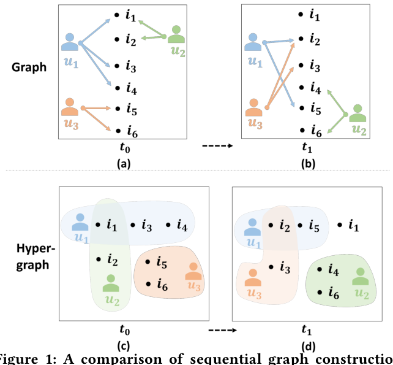
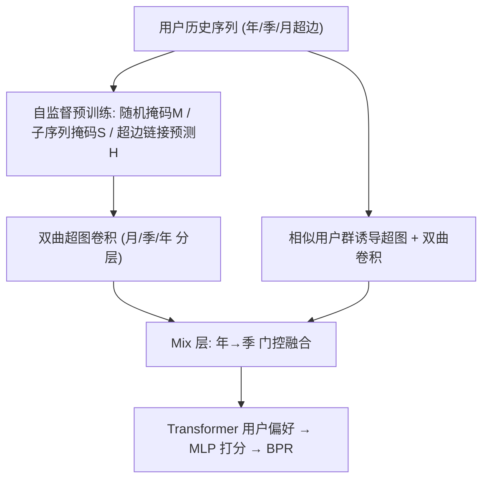
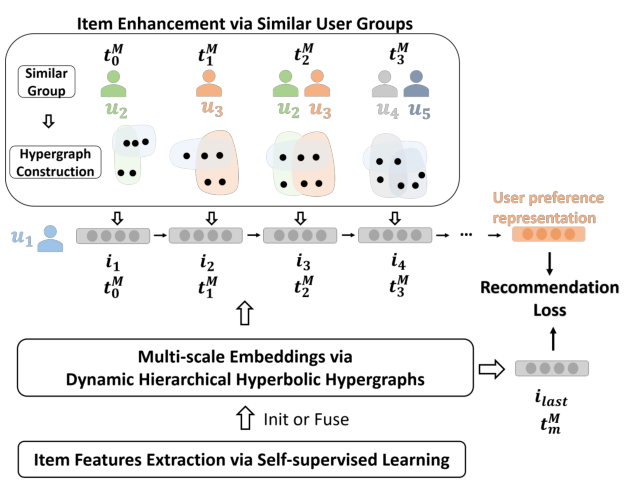

# Hyperbolic Hypergraphs for Sequential Recommendation (面向序列推荐的双曲超图表示学习)

- **会议/期刊**: CIKM 2021
- **作者与机构**: Yicong Li, Hongxu Chen, Xiangguo Sun, Zhenchao Sun, Lin Li, Lizhen Cui, Philip S. Yu, Guandong Xu（UTS / 东南大学 / 山东大学 / 武汉理工 / UIC）
- **推荐链路定位**: 召回（Next-Item 序列打分）
- **研究方向**: 序列与会话推荐 / 图神经网络与知识图谱推荐
- **论文原文**: [https://arxiv.org/abs/2108.08134v1](https://arxiv.org/abs/2108.08134v1)
- **开源代码**: [https://github.com/Abigale001/h2seqrec](https://github.com/Abigale001/h2seqrec)

## TL;DR (1分钟核心速览)

超图序列推荐（如 HyperRec）把用户历史拆成超边后，超边数远少于原始 user-item 边，稀疏与长尾被进一步放大；且忽略用户侧隐式社交/共购信号。本文提出 H2SeqRec：先用三项自监督任务（随机物品掩码、短子序列掩码、**超边链接预测**）预训练物品表征；再将月度/季度/年度超图送入**双曲空间超图卷积**（负曲率流形天然容纳长尾层次结构），经 Mix 层融合多时间尺度，并用“相似用户群诱导超图”增强物品表征，最后 Transformer + MLP 打分。在 AMT/Goodreads 的 100/500 负采样排序协议下，NDCG@1 相对最强基线提升 31.61% / 10.43%。

## Background & Motivation (背景与核心矛盾)

- **主流范式**: 序列推荐从 GRU4Rec / SASRec / BERT4Rec 的自回归或双向注意力，转向以超图刻画高阶（非成对）共现关系，代表作为 HyperRec 的时序超图 + Transformer。
- **前人局限 1（稀疏放大）**: 原二部图若按时间戳切成超边，节点数不变而“边”数骤降，Amazon 类长尾数据上超图比原图更稀疏，训练样本严重不足。
- **前人局限 2（用户侧信号缺失）**: 现有超图序列模型只沿时间轴建模单用户购买史，未利用“同一时间戳购买重叠物品”所隐含的相似用户群/共购群信号。
- **核心洞察 (Key Insight)**: 用户购买行为并非纯时序，而带**周期性规律**（圣诞树年年复购、夏裙冬衣），故可用年/季/月多时间尺度切分超图，既捕获语义层次，也因时间窗变宽而缓解稀疏；同时长尾 + 层次结构在欧氏空间易表征失真，双曲空间（指数级容量）更适配。
- **本文切入点**: 多尺度超图构造 + 双曲超图卷积 + 群组诱导超图增强 + 三任务自监督预训练，四者组合破局。

<figure class="paper-figure" markdown="span">
  <figcaption>图1：序列图构建与超图构建的比较。(c)和(d)中单色区域表示超边。</figcaption>
</figure>

## Method (核心方法设计)

### 1. 整体框架 (Overall Architecture)

输入为按年/季/月切分的用户历史超边集合。先离线预训练：三个对比任务共享 Transformer 序列编码器，得到物品初始表征，可作初始化（H2SeqRec-init）或与下游动态表征融合（H2SeqRec-fuse）。下游先用双曲超图卷积在月→季→年三个视图上学多尺度物品嵌入，由 Mix 层按“先年、后季”的顺序逐级门控融合；再对每个用户在时间戳 $t_m$ 上，用“同时间戳购买重叠物品”的相似用户超边构造诱导超图，经同一双曲卷积得到群组级表征，与动态表征逐元素相乘增强；最后将用户全序列的动态物品嵌入送入 Transformer 得偏好向量，两层 MLP 打分，BPR 成对损失端到端训练。

<figure class="paper-figure" markdown="span">
  <figcaption>图3：H2SeqRec总体架构包含三个模块：通过动态分层双曲超图的多尺度嵌入、通过相似用户群的物品增强，以及为序列推荐学习用户偏好。预训练模块可作为H2SeqRec的初始嵌入（H2SeqRec-init）；也可融合进H2SeqRec（H2SeqRec-fuse）。</figcaption>
</figure>

### 2. 关键设计拆解 (Key Designs)

1. **超边链接预测驱动的三任务预训练**：痛点在于序列推荐只学“单用户先后顺序”，缺少跨用户共现监督。做法是把每个用户在时间戳 $t$ 的历史物品连成超边，若两条超边共享物品即视为正对，用对比损失拉近；三项任务统一写作
   $\mathcal{L}=-\log\frac{\exp(\mathrm{sim}(\mathbf{h}_{s_u},\mathbf{h}_{s'_u})/\tau)}{\exp(\mathrm{sim}(\mathbf{h}_{s_u},\mathbf{h}_{s'_u})/\tau)+\sum_{s^-_u}\exp(\mathrm{sim}(\mathbf{h}_{s_u},\mathbf{h}_{s^-_u})/\tau)}$，损失权重$M{:}S{:}H=\{0.1,1,1\}$。直觉：掩码不变“长期偏好/短期兴趣”，超边预测则直接把共购结构注入表征，等价于结构化数据增广。
2. **双曲空间超图卷积 + 分层 Mix**：欧氏空间难以嵌入长尾树状层次。先在双曲流形（负曲率 $-1/c$，北极点$\mathbf{o}$）上做指数映射$\mathbf{h}^{0,\mathcal{H}}=\exp^c_{\mathbf{o}}((0,\mathbf{h}^{0,E}))$，把线性层改写为 Möbius 版$\mathbf{x}^{L,\mathcal{H}}_i=(W^L\otimes_c\mathbf{h}^{L-1,\mathcal{H}}_i)\oplus_c\mathbf{b}^L$，聚合则先把邻居用$\log^c_{\mathbf{o}}$拉回切空间加权求和再映射回去：$\mathbf{y}^{L,\mathcal{H}}_i=\exp^c_{\mathbf{x}^{L,\mathcal{H}}_i}\big(\sum_{j\in N(i)\cup N(i^+)}M_{ij}\log^c_{\mathbf{o}}(\mathbf{x}^{L,\mathcal{H}}_j)\big)$，权重$M_{ij}$由 MLP 对节点对相似度 softmax 得到。多尺度融合$\mathbf{h}^{t_m}_{ie}=\mathrm{ReLU}(W_{MQ}\mathbf{h}^{t_q}_Q+\mathbf{b}_{MQ})\odot\mathbf{h}^{t_m}_{MY}$，先融年再融季，避免最终嵌入被过粗的“年”语义淹没。
3. **群组诱导超图增强 + 训练目标**：为每个用户在 $t_m$找到分享重叠物品的相似用户，各自成超边构成诱导超图，双曲卷积后按$\mathbf{h}^{t_m}_{iu}=\mathrm{ReLU}(W\mathbf{h}^{t_m,User}_{iu}+\mathbf{b})\odot\mathbf{h}^{t_m,Hie}_{i}$与动态嵌入相乘（起到软门控降噪作用，对冷启动尤有价值）。最终目标$\mathcal{L}=\sum_{(u,i,t,j)}-\ln\sigma(r_{u,i}-r_{u,j})+\alpha\|\delta\|_2^2$，训练时每正样本采样 1 个负样本；预训练与双曲卷积均可离线完成后增量更新，在线仅需 Transformer 前向，复杂度约$\max(O(U),O(I))$。

## Experimental Setup & Evaluation Protocol (实验设置与评估协议)

- **数据集与预处理**: AMT 取 Amazon 的 Automotive/Musical Instruments/Toys 三类合并（原始 user-item 二部图上做 5-core 过滤）；Goodreads 取 2013–2015 用户-书交互。

| 数据集 | #Users | #Items | #Interactions | 稀疏度/密度 | 特征/场景说明 |
| :--- | :---: | :---: | :---: | :---: | :--- |
| AMT | 5,352 | 11,672 | 59,495 | 0.095% | 跨 3 类目、2014–2018，强长尾 |
| Goodreads | 16,701 | 20,823 | 1,084,781 | 0.312% | 图书社区，交互稠密得多 |

- **数据划分与防穿越 (Splitting Strategy)**: 类 `Leave-One-Out` 时序切分——AMT 以 2018 年最早的 2 个交互分别作为 valid / test；Goodreads 以最后 2 个交互分别作为 valid / test；其余作训练，序列最大长度 50。
- **排名评测协议 (Ranking Protocol)**: `Sampled Ranking`，对每个正样本随机采样 100 与 500 个负样本，在 101 / 501 候选中排序，指标为 HR@{1,5,10,20} 与 NDCG@{1,5,10,20}。作者明确指出 HyperRec 原设定仅采 100 负样本“不足以反映真实效果”，故同时报告 500 负样本的更难设定（BERT4Rec/SRGNN 因全量评测过慢而未做全库排序，此为协议上的妥协）。
- **对比基线与超参设置**: GRU4Rec、SASRec、BERT4Rec、SRGNN、HGN、HyperRec 六类；统一 $d=100$、dropout 0.5、lr 0.001、AMT batch 512（Goodreads 4096）；双曲超图卷积 2 层、曲率$-1$、Transformer 2 头 1 块；Goodreads 因过稠密仅采样 1/100 用户构建相似群组。

## Key Experimental Results (实验关键数据)

### 1. 主实验对比 (Main Results)

| 数据集 (NEG) | 指标 | GRU4Rec | SASRec | BERT4Rec | SRGNN | HGN | HyperRec | H2SeqRec | H2SeqRec-fuse | Improv. |
| :--- | :--- | :---: | :---: | :---: | :---: | :---: | :---: | :---: | :---: | :---: |
| AMT (100) | NDCG@1 | 0.0820 | 0.0878 | 0.0691 | 0.0889 | 0.0856 | 0.0871 | 0.1110 | **0.1170** | 31.61% |
| AMT (100) | NDCG@5 | 0.1725 | 0.1722 | 0.1530 | 0.1894 | 0.1672 | 0.1765 | 0.2107 | **0.2135** | 12.72% |
| AMT (100) | NDCG@10 | 0.2187 | 0.2159 | 0.1978 | 0.2390 | 0.2019 | 0.2216 | 0.2568 | **0.2589** | 8.33% |
| AMT (500) | NDCG@1 | 0.0247 | 0.0291 | 0.0349 | 0.0245 | 0.0284 | 0.0372 | 0.0413 | **0.0435** | 16.94% |
| AMT (500) | NDCG@10 | 0.0745 | 0.0766 | 0.0965 | 0.0830 | 0.0775 | 0.0968 | 0.0973 | **0.1050** | 8.47% |
| Goodreads (100) | NDCG@1 | 0.2496 | 0.2407 | 0.2639 | 0.2856 | 0.2325 | 0.2792 | **0.3154** | 0.3070 | 10.43% |
| Goodreads (100) | NDCG@5 | 0.4302 | 0.4124 | 0.4376 | 0.4588 | 0.3848 | 0.4576 | **0.4866** | 0.4810 | 6.06% |
| Goodreads (100) | NDCG@10 | 0.4803 | 0.4637 | 0.4869 | 0.5057 | 0.4312 | 0.5044 | **0.5311** | 0.5257 | 5.02% |
| Goodreads (500) | NDCG@1 | 0.0924 | 0.0894 | 0.1021 | 0.1298 | 0.1026 | 0.1212 | **0.1476** | 0.1370 | 13.71% |
| Goodreads (500) | NDCG@10 | 0.2320 | 0.2240 | 0.2431 | 0.2703 | 0.2243 | 0.2676 | **0.2971** | 0.2854 | 9.91% |

### 2. 消融实验 (Ablation Study)

AMT 数据集、100 负采样、指标 NDCG@K：

| 变体 | K=1 | K=5 | K=10 | K=20 | NDCG@10 降幅 |
| :--- | :---: | :---: | :---: | :---: | :---: |
| H2SeqRec (full) | **0.1110** | **0.2107** | **0.2568** | **0.3013** | – |
| w/o 群组增强 (¬U) | 0.1102 | 0.2083 | 0.2519 | 0.3011 | 1.91% |
| w/o 分层多尺度 (¬Hie) | 0.1084 | 0.2028 | 0.2466 | 0.2927 | 3.96% |
| w/o 双曲空间 (¬HB, 退欧氏) | 0.1099 | 0.2048 | 0.2486 | 0.2961 | 3.19% |
| 融合顺序改 月→季→年 | 0.1095 | 0.2057 | 0.2509 | 0.2977 | 2.30% |

预训练任务消融（H2SeqRec-fuse 为满配，减号为“仅保留该任务”）：

| 变体 | NDCG@1 | NDCG@5 | NDCG@10 | NDCG@20 |
| :--- | :---: | :---: | :---: | :---: |
| fuse (M+S+H) | **0.1170** | **0.2135** | **0.2589** | **0.3054** |
| 仅 S+H | 0.1149 | 0.2103 | 0.2568 | 0.3014 |
| 仅 M+H | 0.1158 | 0.2102 | 0.2544 | 0.3036 |
| 仅 M+S | 0.1138 | 0.2130 | 0.2584 | 0.3043 |
| 仅 M | 0.1123 | 0.2111 | 0.2541 | 0.3015 |
| 仅 S | 0.1117 | 0.2080 | 0.2533 | 0.3006 |
| 仅 H | 0.1140 | 0.2129 | 0.2572 | 0.3020 |

### 3. 关键实验发现 (Key Findings)

1. **分层与双曲是主力，群组增强最弱**：去掉分层（−3.96%）与退回欧氏空间（−3.19%）的损失均显著大于去掉群组增强（−1.91%），说明“多时间尺度 + 双曲几何”才是稀疏长尾场景的核心收益源；群组模块在 AMT 上偏弱正是因其极端稀疏使相似用户难以匹配。
2. **预训练是“稀疏增益、稠密负担”**：AMT 上 fuse 相对无预训练基线 NDCG@1 提升 5.41%（100 neg）/5.33%（500 neg），但 Goodreads 上无预训练的 H2SeqRec 反超 fuse 2.74%/7.74%——稠密数据本身样本充足，对比式增广反而引入噪声，这与“所有场景默认上预训练”的惯例形成直接反驳。
3. **超边链接预测是最有效的单任务**：单任务对比中仅 H 达 NDCG@1 = 0.1140，优于仅 M（0.1123）与仅 S（0.1117），且缺 H 的 M+S 组合（0.1138）也低于任一含 H 组合，证明跨用户共现结构比单纯时序掩码提供更强的自监督信号；此外融合顺序改“月→季→年”掉 2.30%，印证年粒度语义过粗、只能先融。

## Highlights & Limitations (亮点、对比与审稿批判)

- **与代表作对比 (vs. Prior Work)**: 相比 HyperRec（时序超图 + Transformer，未处理超图稀疏、无预训练、欧氏空间），本文引入分层超图 + 双曲卷积 + 三任务预训练；相比 S3-Rec 的纯时序自监督（M/I/C 任务），本文新增**超边链接预测**这一结构化增广任务；相比 SRGNN/HGN 的成对图建模，本文以非成对超边刻画高阶共现。
- **可迁移亮点**: ①“多粒度时间窗切超边”同时缓解稀疏与注入周期先验，可直接搬到电商复购、内容季节性场景；②对比损失权重设置为 $M{:}S{:}H=0.1{:}1{:}1$，说明弱监督任务需主动降权，值得在自监督召回中复用。
- **审稿级局限批判**: ①评测只用 100/500 的**采样排序**，未做 Full-Ranking，且 BERT4Rec/SRGNN 无法全量评测导致协议不对齐，Top-1 提升幅度可能被采样偏置放大；②模型链路含预训练、双曲卷积、诱导超图与 Transformer 四大离线阶段，虽论文称可增量更新，但双曲流形上的 Möbius 算子与相似用户检索的工程开销、以及曲率 $c$、时间粒度划分等超参敏感性均未充分评估（仅给了维度与 epoch 曲线）。

## Rating (四维评分)

- **方法创新性 (Novelty)**: ⭐⭐⭐⭐ （双曲超图卷积 + 超边链接预测预训练 + 层次时间跨度三件套组合新颖，但各组件均有前作影子，属“有效集成式创新”）
- **评估协议与实验扎实度 (Protocol & Experiments)**: ⭐⭐⭐ （6 基线 + 双负采样设定较规范、消融维度齐全，但缺 Full-Ranking 与显著性检验，稠密数据集实验受限）
- **写作与数学规范度 (Clarity & Rigor)**: ⭐⭐⭐⭐ （双曲映射与 Möbius 算子符号交代清楚，复杂度分析逐模块展开，但部分公式排版与 $M_{ij}$ 归一化细节略含混）
- **工业落地与复现价值 (Industrial & Practical Value)**: ⭐⭐⭐⭐ （代码已开源、预训练与图卷积可离线增量，在线仅 Transformer 前向；但多阶段流水线与双曲算子部署成本需额外工程投入）

