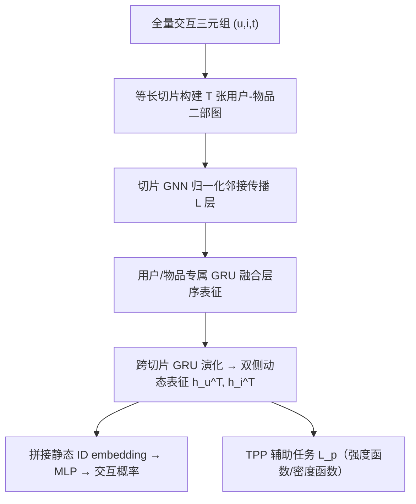
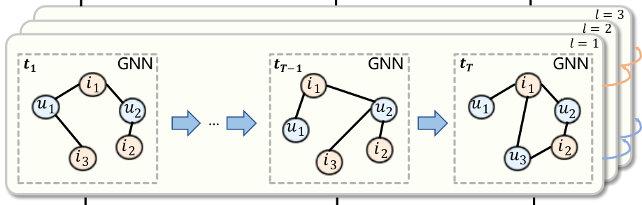

# Learning Dual Dynamic Representations on Time-Sliced User-Item Interaction Graphs for Sequential Recommendation (基于时间切片用户-物品交互图的双重动态表征学习用于序列推荐)

- **会议/期刊**: CIKM 2021
- **作者与机构**: Zeyuan Chen, Wei Zhang (华东师范大学), Junchi Yan (上海交通大学), Gang Wang (北京理工大学), Jianyong Wang (清华大学)
- **推荐链路定位**: 端到端召回/排序（Next-Item 预测）
- **研究方向**: 序列与会话推荐 / 图神经网络与知识图谱推荐
- **论文原文**: [arXiv:2109.11790v1](https://arxiv.org/abs/2109.11790v1)
- **开源代码**: [weizhangltt/dual-recommend](https://github.com/weizhangltt/dual-recommend)

## TL;DR (1分钟核心速览)

现有序列推荐只建模用户侧动态，少数双侧模型把用户/物品序列各自用 RNN 独立编码，**丢弃了同一时间窗口内全量用户-物品交互的高阶共现信息**。本文提出 DRL-SRe：把时间轴切成等长切片、每片构建全局二部图做切片 GNN 传播，再用两层 GRU（层内融合 + 跨片演化）得到双侧动态表征，并加一个**时序点过程辅助损失**补偿切片离散化的细粒度时间损失。在 Baby/Yelp/Netflix 三个数据集、1:100 负采样排序下，NDCG@10 相对 SCoRe 提升 3.39% / 10.22% / 9.62%。

## Background & Motivation (背景与核心矛盾)

- **主流范式**: GRU4Rec / Caser / SASRec / TiSASRec 等仅对用户行为序列建模，物品表征视为静态；RRN、DEEMS、SCoRe 引入双侧序列，但用户侧与物品侧各自跑一条 RNN。
- **前人局限 (1)**: 双侧序列模型是"松耦合"的，用户序列与物品序列之间只在最终打分处相连接，历史交互中大量**跨用户-物品的二阶共现（同一时间段里谁还买了什么）完全未被利用**；SCoRe 虽引入交互，但只看目标用户-物品对的直接邻居。
- **前人局限 (2)**: 连续时间模型（如基于 TPP 的实时表征）要求预先知道下一次交互时刻才能出表征，且每条交互只能被建模一次，**无法通过反复传播捕获高阶关系**。
- **核心洞察 (Key Insight)**: 若把时间轴切成窗口，每个窗口内的用户-物品交互构成一张快照二部图——既保留全局高阶共现，又天然给出"同一节点在不同窗口的动态状态序列"。
- **本文切入点**: 用"时间切片图 + 切片 GNN + 切片间 GRU"把全局交互结构与双侧时序演化统一进一个模型，再用 TPP 辅助任务把被切掉的连续时间间隔重新注回表征。

## Method (核心方法设计)

### 1. 整体框架 (Overall Architecture)

输入全体交互三元组 $(u,i,t)$，按等长$\Delta_T$切成$T$个切片，每个切片$s$用该窗口内所有交互构建用户-物品二部图$\mathcal{G}_s$（仅窗口内出现过的节点入图，未出现节点表征保持不变）。对每张图做$L$层归一化邻接传播得到层序表征$\tilde{\mathbf{X}}_s$，交由**用户专属 GRU / 物品专属 GRU** 按层融合为$\bar{\mathbf{X}}_s^U,\bar{\mathbf{X}}_s^I$；再把跨切片的$\bar{\mathbf{X}}^U,\bar{\mathbf{X}}^I$序列分别送入**跨片 GRU** 得到$\mathbf{H}_U,\mathbf{H}_I$。预测时取最后切片双侧动态表征与静态 ID embedding 拼接过 MLP 打分，训练端用推荐交叉熵损失$\mathcal{L}_c$与时序点过程辅助损失$\mathcal{L}_p$ 联合优化。

<figure class="paper-figure" markdown="span">
  <figcaption>图2：模型 DRL-SRe 的架构，其中红色标记的损失函数为新增项。</figcaption>
</figure>

### 2. 关键设计拆解 (Key Designs)

1. **时间切片图与切片 GNN（把全局共现注入动态表征）**: 前人要么用一张全局静态图（无时序），要么只看局部邻居（无全局）。本文对每片做 $\mathbf{X}_s^{l+1} = \hat{\mathbf{A}}_s \mathbf{X}_s^{l},\ \hat{\mathbf{A}}_s = \mathbf{D}^{-0.5}\mathbf{A}_s\mathbf{D}^{-0.5}$（无自环），得到$\tilde{\mathbf{X}}_s=[\mathbf{X}_s^0;\dots;\mathbf{X}_s^L]$。直觉：一层传播即"同窗口共现平滑"，多层即高阶共现；切片保证平滑只在同一时间语义下发生，避免跨季节偏好串味。层间用 GRU 而非 mean/concat 融合，是因为不同层的表征语义异质，门控能自适应挑选；实验（表 4）证明 user/item-specific GRU 优于 last-layer / mean-pooling / 单一共享 GRU。

2. **时序点过程辅助任务（把被切掉的时间间隔注回表征）**: 切片操作必然丢失精确时间间隔。本文对用户 $u$在第$s$片定义条件强度$\lambda_u^*(t)=\exp(\mathbf{w}_U \mathbf{h}_u^s + \omega_U (t-t_u^s)+b_U)$（物品侧同构），由此解析推出密度函数并构造负对数似然

$$\mathcal{L}_p = -\sum_{s=1}^{T-1}\log f_u^*(t_u^{s+1}\mid \mathbf{h}_u^s) - \sum_{s=1}^{T-1}\log f_i^*(t_i^{s+1}\mid \mathbf{h}_i^s)$$

其中 $\mathbf{h}_u^s$直接来自切片 GRU 输出——这一项相当于**强制当前切片的表征去预测"下一次交互还有多久发生"**，从而把连续时间间隔信息压进$\mathbf{h}_u^s$，弥补$L_c$ 只看"下一个是谁"的盲区。物理直觉：越活跃的用户/越热的物品强度越高、期望间隔越短。

3. **训练目标、负采样与推理开销**: 总损失 $\mathcal{L}=\mathcal{L}_c+\beta\mathcal{L}_p$，$\mathcal{L}_c$为交叉熵$\mathcal{L}_c=-[y_{ui}\log\hat{y}_{ui}+(1-y_{ui})\log(1-\hat{y}_{ui})]$，$\hat{y}_{ui}=\sigma(\mathrm{MLPs}(\mathbf{h}_u^T\oplus\mathbf{h}_i^T\oplus\mathbf{e}_u\oplus\mathbf{e}_i))$；实验采用随机负采样（每正样本 100 负例），无 in-batch hard negative 设计。复杂度上，各切片边数之和与一张全局图同阶，稀疏矩阵乘开销不随$T$ 线性膨胀，推理只需一次前向传播（不需要未来时间戳）。

## Experimental Setup & Evaluation Protocol (实验设置与评估协议)

- **数据集与预处理**: 全部采用 **5-core** 过滤（交互数 < 5 的用户/物品剔除），隐式反馈；Yelp 仅保留评分 > 3 为正反馈。

| 数据集 | #Users | #Items | #Interactions | 稀疏度 | 时间切片数 / 间隔 |
| :--- | :---: | :---: | :---: | :---: | :--- |
| Baby (Amazon) | 11,860 | 11,314 | 699,254 | 99.48% | 21 / 60 天 |
| Yelp | 22,886 | 28,091 | 4,402,067 | 99.32% | 12 / 30 天 |
| Netflix | 314,201 | 17,276 | 10,971,024 | 99.80% | 8 / 15 天 |

- **数据划分与防穿越 (Splitting Strategy)**: **全局时间戳切片切分**——前 $T-2$个切片作训练、第$T-1$ 片作验证、最后一片作测试，严格按时间先后，无未来信息穿越。
- **排名评测协议 (Ranking Protocol)**: `Sampled Ranking`，每个 ground-truth 正样本随机采 100 个负样本排序（正负比 1:100），报告 HR@10、NDCG@10、MRR；未做全库 Full-Ranking。
- **对比基线与超参设置**: 单侧基线 GRU4Rec、Caser、SASRec、TiSASRec、ARNPP、LESSR；双侧基线 RRN、DEEMS、SCoRe。统一 embedding 维度 $d=16$，MLP 3 层，Adam 学习率 5e-4，batch=100，L2=1e-4；改进显著性$p<0.01$。

## Key Experimental Results (实验关键数据)

### 1. 主实验对比 (Main Results)

| Method | Baby HR@10 | Baby NDCG@10 | Baby MRR | Yelp HR@10 | Yelp NDCG@10 | Yelp MRR | Netflix HR@10 | Netflix NDCG@10 | Netflix MRR |
| :--- | :---: | :---: | :---: | :---: | :---: | :---: | :---: | :---: | :---: |
| GRU4Rec | 0.7964 | 0.7530 | 0.7466 | 0.5677 | 0.4696 | 0.4505 | 0.3514 | 0.2239 | 0.2047 |
| SASRec | 0.7996 | 0.7846 | 0.7866 | 0.6012 | 0.5148 | 0.5034 | 0.3508 | 0.2450 | 0.2306 |
| TiSASRec | 0.8084 | 0.7963 | 0.8005 | 0.6323 | 0.5407 | 0.5228 | 0.3887 | 0.2642 | 0.2417 |
| ARNPP | 0.8061 | 0.7829 | 0.7705 | 0.6135 | 0.4904 | 0.4646 | 0.3378 | 0.2319 | 0.2230 |
| LESSR | 0.8104 | 0.7796 | 0.7772 | 0.6581 | 0.5784 | 0.5628 | 0.3663 | 0.2560 | 0.2444 |
| RRN | 0.8163 | 0.7604 | 0.7452 | 0.6258 | 0.5584 | 0.5490 | 0.4084 | 0.2808 | 0.2698 |
| DEEMS | 0.8141 | 0.7894 | 0.7879 | 0.6000 | 0.5593 | 0.5563 | 0.4515 | 0.3117 | 0.3012 |
| SCoRe | 0.8133 | 0.7951 | 0.7913 | 0.6494 | 0.5871 | 0.5781 | 0.5339 | 0.3659 | 0.3295 |
| **DRL-SRe (Ours)** | **0.8423** | **0.8233** | **0.8237** | **0.6960** | **0.6471** | **0.6435** | **0.5742** | **0.4011** | **0.3607** |
| Improv. | +3.19% | +3.39% | +2.90% | +5.76% | +10.22% | +11.31% | +7.55% | +9.62% | +9.47% |

### 2. 消融实验 (Ablation Study)

| Variant | Baby HR@10 | Baby NDCG@10 | Yelp HR@10 | Yelp NDCG@10 | Netflix HR@10 | Netflix NDCG@10 |
| :--- | :---: | :---: | :---: | :---: | :---: | :---: |
| **Full DRL-SRe** | **0.8423** | **0.8233** | **0.6960** | **0.6471** | **0.5742** | **0.4011** |
| w/o graph (mean-pool 邻居) | 0.8204 | 0.8118 | 0.6774 | 0.6358 | 0.5430 | 0.3766 |
| w/o RNN (切片间) | 0.8123 | 0.8055 | 0.6439 | 0.6213 | 0.5419 | 0.3674 |
| w/o concat ID embedding | 0.8343 | 0.8178 | 0.6796 | 0.6355 | 0.5582 | 0.3879 |
| w/o auxiliary task ($\beta=0$) | 0.8230 | 0.8157 | 0.6646 | 0.6328 | 0.5575 | 0.3729 |
| w/ time embedding 替代辅助任务 | 0.8245 | 0.8102 | 0.6623 | 0.6359 | 0.5640 | 0.3912 |
| w/ global graph（单张静态图） | 0.7784 | 0.7373 | 0.6042 | 0.5528 | 0.5252 | 0.3473 |
| w/ last graph（仅最后一片） | 0.7625 | 0.6798 | 0.6022 | 0.5107 | 0.3676 | 0.2469 |
| w/ single GRU（双侧共享） | 0.8325 | 0.8189 | 0.6753 | 0.6348 | 0.5658 | 0.3837 |

### 3. 关键实验发现 (Key Findings)

1. **时间切片图是最大的增益来源**：把多切片图换成单张 global graph，Baby Yelp Netflix 的 NDCG@10 分别暴跌 8.6 / 9.4 / 5.4 个绝对点（0.8233→0.7373 / 0.6471→0.5528 / 0.4011→0.3473），远大于其他消融；而 `w/o graph` 改用 mean-pooling 但仍保留切片时序，跌幅反而更小——说明"结构 + 时序"两部分各自必要，且时序切片不可省。
2. **双侧动态显著优于单侧**：`w/ user slices`（只保留用户动态）在 Netflix 上 HR@10 从 0.5742 跌至 0.3529，跌幅 38.6%，比丢掉整个图模块还严重；说明在长周期、物品流行度漂移大的 Netflix 数据上，物品侧动态是瓶颈所在。
3. **TPP 辅助任务优于"时间 embedding"式补偿**：`w/ time embedding` 把离散时间槽编码拼进输入，Baby 上 NDCG@10 仅 0.8102，仍低于 `w/o auxiliary task` 之外所有变体；而完整模型通过 $\mathcal{L}_p$把连续间隔注入表征，Baby NDCG@10 提到 0.8233，证明"预测间隔"比"喂时间戳"更能提取有效时序信号。$\beta$与 GNN 层数均有最优区间：$\beta$在$10^{-3}\sim10^{-1}$ 最好，过大反伤；传播层数 1→2 稳定提升，≥3 因过平滑/过拟合回落。

## Highlights & Limitations (亮点、对比与审稿批判)

- **与代表作对比 (vs. Prior Work)**: 相对 SCoRe（仅用目标用户-物品对的直接邻居做交互注意力），本文在每片内利用**全量**交互做多跳传播，NDCG@10 平均再提 7.7%；相对 RRN/DEEMS（两条独立 RNN，无交互结构），本文把双侧序列通过共享二部图耦合，在 Netflix 上 HR@10 高出 12.6 个绝对点；相对 TiSASRec（连续时间 attention 但仅用户侧），本文多出物品侧动态与全局结构。
- **可迁移亮点**: (1) "快照图 + 跨快照 RNN"可套用到任何带时间戳的序列建模（如 POI 签到、短视频观看），对物品流行度漂移场景尤其有效；(2) TPP 辅助头是一个轻量、几乎零额外推理开销的正则项，可挂到任何已输出切片表征的模型上。
- **审稿级局限批判**: (1) 仅做 1:100 采样排序，未给 Full-Ranking，且采样负例的随机性可能夸大绝对数值（HR@10 高达 0.84 的 Baby 结果需谨慎解读）；(2) 切片数 $T$与间隔$\Delta_T$ 是硬编码超参，未给自适应切分策略，在交互密度差异极大的场景（如冷启动物品）中，窗口内节点缺失会退化——表 4 中 `w/ last graph` 的暴跌正暴露这一敏感性；(3) 负采样策略仅为 uniform，缺少 hard negative 对比实验。

## Rating (四维评分)

- **方法创新性 (Novelty)**: ⭐⭐⭐⭐ （首个把时间切片快照 GNN 用于序列推荐，并与双侧动态、TPP 辅助任务自洽地拼成一个端到端框架，机制组合有新意但单点算子均为已有组件的合理改造）
- **评估协议与实验扎实度 (Protocol & Experiments)**: ⭐⭐⭐⭐ （3 个跨域数据集 + 9 个基线 + 8 个变体消融 + $\beta$/层数敏感性分析，$p<0.01$ 显著；扣分在于仅 1:100 采样排序、未做 Full-Ranking 与更细的分桶实验）
- **写作与数学规范度 (Clarity & Rigor)**: ⭐⭐⭐⭐⭐ （问题建模、切片定义、TPP 强度与密度函数推导清晰，复杂度分析明确交代"切片边数与全局图同阶"，符号一致无歧义）
- **工业落地与复现价值 (Industrial & Practical Value)**: ⭐⭐⭐⭐ （代码开源、推理只需单次前向且不需未来时间戳，切片图可离线预构建；但按切片重建全量二部图在超大规模场景的存储/更新成本仍待工程验证）

