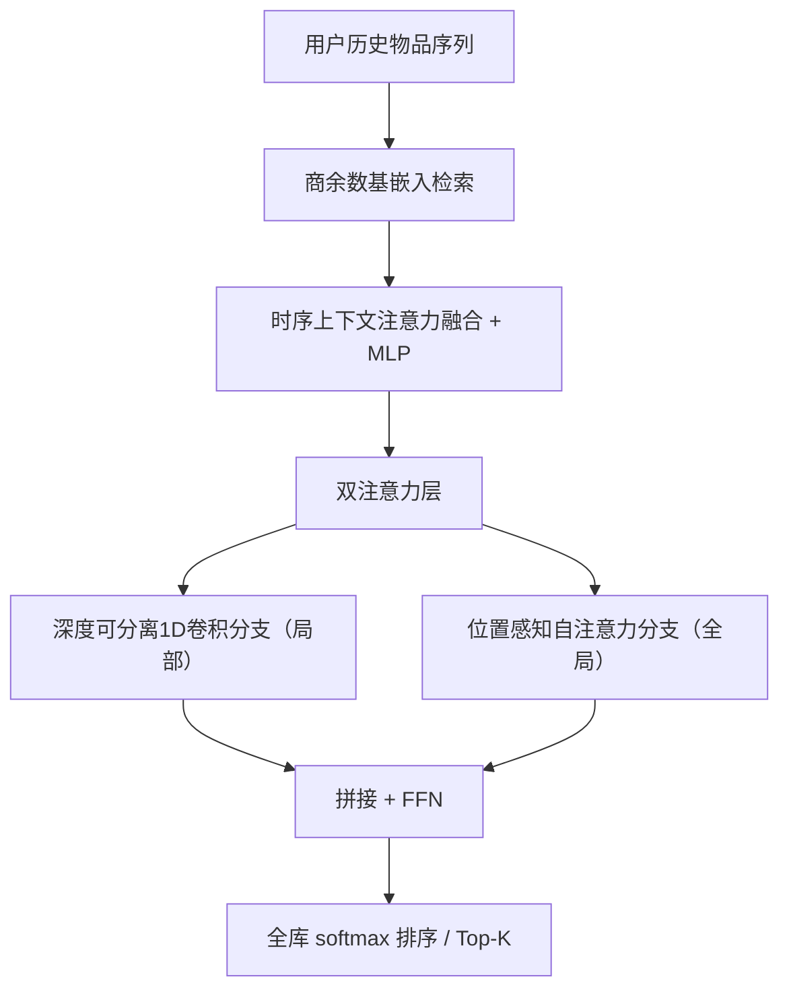

# Lightweight Self-Attentive Sequential Recommendation (轻量级自注意力序列推荐)

- **会议/期刊**: CIKM 2021
- **作者与机构**: Yang Li, Tong Chen, Peng-Fei Zhang, Hongzhi Yin（The University of Queensland）
- **推荐链路定位**: 精排 / Next-Item 全库排序
- **研究方向**: 序列与会话推荐
- **论文原文**: [https://arxiv.org/abs/2108.11333v1](https://arxiv.org/abs/2108.11333v1)
- **开源代码**: 暂未开源

## TL;DR (1分钟核心速览)

针对序列推荐中物品嵌入表内存过大、多头自注意力冗余的问题，LSAN 以商余数组合嵌入压缩物品表，并用时序上下文注意力恢复物品动态性；同时用深度卷积建模局部转移、自注意力建模全局依赖。在 4 个 Amazon/Yelp 数据集上采用 Leave-One-Out + Full-Ranking，HR@20 相对 SASRec 最高提升 99.65%，参数约为 SASRec 的 63%–74%。

## Background & Motivation (背景与核心矛盾)

- **主流范式**: SASRec/BERT4Rec 等以唯一物品嵌入 + 多头自注意力建模序列，在 next-item 推荐上效果领先。
- **前人局限**: 一方面，$|V|\times D$ 的物品嵌入是端侧部署的内存瓶颈；另一方面，自注意力偏重相邻物品局部关系，需堆叠多头弥补全局建模，造成结构与参数冗余。
- **核心洞察**: 商余数组合嵌入可用少量基表唯一表示全量物品且无需额外离散码；若将局部转移显式交给卷积，自注意力可专注长程依赖。
- **本文切入点**: 动态上下文感知组合嵌入 + 双注意力（twin-attention）分支，同时压缩内存并降低注意力冗余。

## Method (核心方法设计)

### 1. 整体框架 (Overall Architecture)

LSAN 先由商余数从 $N$ 个基嵌入表中检索每个物品的基向量，再用序列上下文注意力动态融合为组合物品嵌入；随后送入双注意力层：深度可分离 1D 卷积分支抽取局部共现模式，位置感知自注意力分支抽取全局依赖；两分支拼接后经 FFN 与全库 softmax 输出 next-item 排序。训练端到端，推理一次前向完成全库打分。

### 2. 关键设计拆解 (Key Designs)

1. **动态上下文感知组合嵌入**：将 $E\in\mathbb{R}^{|V|\times D}$替换为$N$个基表$\tilde{E}_n\in\mathbb{R}^{m_n\times D}$，用商余数保证唯一性：$q_i=\operatorname{index}(v_i)\boldsymbol{o}d m_1$，$\tilde{\boldsymbol e}_i^n=\tilde{E}_n^{\top}R_n\boldsymbol f_i$，且$\prod_n m_n\ge|V|$。上下文$r_i=(c_{i-1},c_i,\text{time}(i))$经注意力$\alpha_n=\operatorname{softmax}(\boldsymbol r_i^{\top}\operatorname{SiLU}(W_a\tilde{\boldsymbol e}_i^n))$融合，$\boldsymbol h_i=\sum_n\alpha_n\tilde{\boldsymbol e}_i^n$，再$\tilde{\boldsymbol h}_i=\operatorname{MLP}([\boldsymbol h_i;\boldsymbol r_i])$。直觉是小基表共享压缩内存，动态加权保留季节、类别与邻接语义。

2. **Twin-Attention 双分支**：针对自注意力局部偏置，卷积分支用逐通道共享的深度可分离 1D 卷积，参数从 $O(LD^2)$降至$O(LD)$：$H^{\text{conv}}_{i,d}=\sum_{j=1}^{L}W^{\text{conv}}_{j}H_{(i+j-\lceil(L+1)/2\rceil),d}$。自注意力分支加入位置嵌入$P$，计算$\hat H=\operatorname{softmax}(QK^{\top}/\sqrt{D/H})V$。两分支各$H$头拼接为$2H$头，参数$O(H(LD+3D^2))$，低于同头数自注意力的$O(6HD^2)$，且局部分支显式建模短时共现，自注意力可专注长程依赖。

3. **训练目标、负采样与推理效率**：采用全库 softmax 与交叉熵，无负采样：$\mathcal{L}=-\frac{1}{S}\sum_{s=1}^{S}\boldsymbol y_s^{\top}\log(\hat{\boldsymbol y}_s)+\lambda\|\Psi\|_2^2$。组合嵌入检索为查表级开销，双注意力复杂度约$O(T^2D+TLD)$；推理仅一次前向全库打分，适合资源受限端侧。

## Experimental Setup & Evaluation Protocol (实验设置与评估协议)

- **数据集与预处理**: 过滤交互数少于 5 的用户/物品（5-core）；Beauty/Toys/Sports 为 Amazon 评论，Yelp 为 2019 年签到数据。

| 数据集 | #Users | #Items | #Interactions | 稀疏度 | 特征/场景说明 |
| :--- | :---: | :---: | :---: | :---: | :--- |
| Beauty | 22,363 | 12,101 | 198,502 | 99.93% | Amazon，6 类别 |
| Toys | 19,412 | 11,924 | 167,597 | 99.93% | Amazon，24 类别 |
| Sports | 35,598 | 18,357 | 296,337 | 99.95% | Amazon，35 类别 |
| Yelp | 22,845 | 16,552 | 243,703 | 99.94% | Yelp 签到，22 类别 |

- **数据划分与防穿越**: `Leave-One-Out`：每用户最后一条为测试，倒数第二条为验证，其余训练。
- **排名评测协议**: `Full-Ranking`，对全部未交互物品排序，报告 HR@{5,10,20} 与 nDCG@{5,10,20}，用户级平均。
- **对比基线与超参**: FPMC、GRU4Rec、Caser、SASRec、BERT4Rec；$D=128$，卷积核$L=5$，每分支$H=2$，1 层 twin-attention，Adam，lr=0.001，batch=256，$\lambda=1e-5$，$N=2$、$m_1=2$。原文未报告显著性检验，按均值比较。

## Key Experimental Results (实验关键数据)

### 1. 主实验对比 (Main Results)

下表保留 HR@20 与 nDCG@20；**Improv.%** 为 LSAN 相对最佳基线 SASRec 的提升。

| 数据集 | 指标 | FPMC | GRU4Rec | Caser | SASRec | BERT4Rec | LSAN_full.emb | **LSAN** | Improv.% |
| :--- | :--- | ---: | ---: | ---: | ---: | ---: | ---: | ---: | ---: |
| Beauty | HR@20 | 0.0438 | 0.0479 | 0.0556 | 0.0872 | 0.0737 | 0.0992 | **0.1201** | 37.73% |
| Beauty | nDCG@20 | 0.0173 | 0.0187 | 0.0229 | 0.0372 | 0.0340 | 0.0433 | **0.0515** | 38.44% |
| Toys | HR@20 | 0.0273 | 0.0301 | 0.0420 | 0.0925 | 0.0333 | 0.0970 | **0.1181** | 27.68% |
| Toys | nDCG@20 | 0.0112 | 0.0116 | 0.0179 | 0.0436 | 0.0130 | 0.0452 | **0.0488** | 11.93% |
| Sports | HR@20 | 0.0259 | 0.0333 | 0.0314 | 0.0486 | 0.0438 | 0.0578 | **0.0759** | 56.17% |
| Sports | nDCG@20 | 0.0100 | 0.0142 | 0.0126 | 0.0208 | 0.0162 | 0.0244 | **0.0334** | 60.58% |
| Yelp | HR@20 | 0.0352 | 0.0439 | 0.0422 | 0.0575 | 0.0430 | 0.0744 | **0.1148** | 99.65% |
| Yelp | nDCG@20 | 0.0137 | 0.0178 | 0.0171 | 0.0230 | 0.0181 | 0.0294 | **0.0417** | 81.30% |

LSAN 参数量分别为 1.11M / 1.28M / 1.73M / 1.53M，SASRec 为 1.75M / 1.73M / 2.55M / 2.32M。

### 2. 消融实验 (Ablation Study)

| 变体 | Beauty nDCG@20 | Toys HR@20 | Sports nDCG@20 |
| :--- | ---: | ---: | ---: |
| w/o 动态组合嵌入 | 0.038 | 0.094 | 0.033 |
| 自注意力替换双分支 | 0.045 | 0.063 | 0.030 |
| **LSAN** | **0.051** | **0.118** | **0.033** |

### 3. 关键实验发现 (Key Findings)

- 主实验中 LSAN 在全部数据集的 HR@20/nDCG@20 上超过 SASRec，Yelp HR@20 从 0.0575 升至 0.1148（+99.65%），Sports nDCG@20 从 0.0208 升至 0.0334（+60.58%），且参数仅为 SASRec 的 63%–74%。
- 动态组合嵌入贡献显著：移除后 Beauty nDCG@20 由 0.051 降至 0.038（−25.5%），Toys HR@20 由 0.118 降至 0.094（−20.3%），说明时序上下文对物品表示不可缺。
- Twin-attention 替换为普通自注意力后 Toys HR@20 由 0.118 降至 0.063（−46.6%），Beauty nDCG@20 由 0.051 降至 0.045；压缩率 $m_1=2$时 Beauty 仅 63.4% 参数仍提升 HR@20 37.73%，但$m_1>3$ 后性能明显下降。

## Highlights & Limitations (亮点、对比与审稿批判)

- **与代表作对比**: 相比 SASRec/BERT4Rec，LSAN 以组合嵌入替代全物品表，并以卷积/自注意力分工替代冗余多头；相比静态 QR 组合嵌入，LSAN 引入上下文动态加权；相比 Caser，补充了全局自注意力分支。
- **可迁移亮点**: “商余数基表 + 上下文注意力”可用于大规模物品/特征压缩；局部卷积 + 全局注意力的双分支结构可迁移到长序列轻量编码。
- **审稿级局限批判**: 输出层仍为 $|V|$维全库 softmax，若权重不共享，内存收益主要限于输入嵌入；且未报告端侧延迟、能耗与显著性检验。上下文三元组依赖类别/时间侧信息，缺失侧信息的数据集上泛化性待验证；压缩率$m_1>3$ 后性能快速退化。

## Rating (四维评分)

- **方法创新性 (Novelty)**: ⭐⭐⭐⭐ （动态上下文组合嵌入与双注意力分工结合自然，但两者均可视为已有模块的序列化重组。）
- **评估协议与实验扎实度 (Protocol & Experiments)**: ⭐⭐⭐⭐ （4 个稀疏数据集 + Full-Ranking + 消融与压缩率分析较完整；缺少显著性检验，个别表格数值存在量纲瑕疵。）
- **写作与数学规范度 (Clarity & Rigor)**: ⭐⭐⭐⭐ （核心公式与复杂度对比清楚；符号与消融表转写略有不够统一之处。）
- **工业落地与复现价值 (Industrial & Practical Value)**: ⭐⭐⭐⭐ （内存压缩对端侧推荐有直接价值；但全库 softmax、缺少线上延迟验证与开源代码限制了工程复现。）

