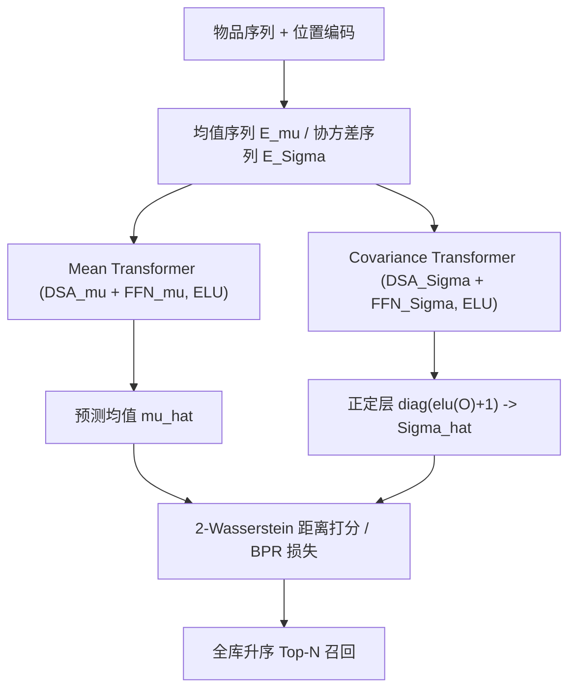

# Modeling Sequences as Distributions with Uncertainty for Sequential Recommendation (面向序列推荐的不确定性分布序列建模)

- **会议/期刊**: CIKM 2021
- **作者与机构**: Ziwei Fan, Zhiwei Liu, Lei Zheng (Pinterest), Shen Wang, Philip S. Yu — University of Illinois at Chicago
- **推荐链路定位**: 召回（下一物品全库打分排序）
- **研究方向**: 序列与会话推荐 / 冷启动与长尾推荐
- **论文原文**: [https://arxiv.org/abs/2106.06165v1](https://arxiv.org/abs/2106.06165v1)
- **开源代码**: [https://github.com/DyGRec/DT4SR](https://github.com/DyGRec/DT4SR)

## TL;DR (1分钟核心速览)

现有序列推荐把用户视为"确定性"点向量，但真实观影/购物序列中存在大量无法解释的随机跳转（题材、年份同时突变）。DT4SR 将每个物品表示为椭圆高斯分布 $\mathcal{N}(\mu_i,\Sigma_i)$，用 Mean Transformer 与 Covariance Transformer 分别演化均值与协方差，并加一层$\mathrm{diag}(\mathrm{elu}(\cdot)+\mathbf{1})$ 保证正定；打分改用 2-Wasserstein 距离做 BPR 式度量学习。在 Amazon Toys/Beauty/Games 三个高稀疏数据集、Leave-One-Out + 1:1000 采样排序协议下，Recall@1 相对最优基线提升 11.4%–32.4%。

## Background & Motivation (背景与核心矛盾)

- **主流范式**: SASRec 类工作以自注意力编码物品序列，每物品一个确定性 embedding，用内积衡量下一物品亲和度。
- **前人局限**: ①物品间转移在多个属性维度上剧烈波动（图 1 的 "Scent of a Woman"→"The Boss Baby"），点向量被迫把所有跳转压进同一表示，无法表达"兴趣的随机性"；②稀疏/冷启动物品只有一个点，交互空间极小，难以被检索到。
- **核心洞察 (Key Insight)**: 分布覆盖的体积远大于点，把物品与序列建模为分布等价于扩张用户-物品交互空间，天然具备泛化到冷启动物品的余地；且协方差的迹可直接读出"兴趣不确定性大小"。
- **本文切入点**: 用椭圆高斯 + 双流 Transformer + Wasserstein 度量，把"不确定性"变成可学习、可排序的一等公民。

## Method (核心方法设计)

### 1. 整体框架 (Overall Architecture)

每个物品配两张表：均值表 $E_\mu\in\mathbb{R}^{|\mathcal{V}|\times d}$与协方差表$E_\Sigma\in\mathbb{R}^{|\mathcal{V}|\times d}$（对角协方差，故只需$d$维向量存对角元），各自叠加独立位置编码得到两条序列。两条序列分别通过堆叠的 DSA$_\mu$/FFN$_\mu$与 DSA$_\Sigma$/FFN$_\Sigma$分支，在每一位置$t$输出下一时刻的$\hat{\mu}_{t+1},\hat{\Sigma}_{t+1}$；协方差支路末端经正定输出层得到合法协方差。训练用 2-Wasserstein 距离的 BPR 损失；推理时对全库候选按与末位置预测分布的$W_2$ 距离升序排列取 Top-N。

### 2. 关键设计拆解 (Key Designs)

1. **分布自注意力 DSA（保数值稳定的分布版 Attention）**: 直接把分布嵌入喂进标准 softmax-attention 会因负值/大跨度导致 QK 内积震荡。作者在 $Q,K,V$ 线性变换后统一插入 ELU（负半轴有下界、正半轴近似线性），得
$\mathrm{DSA}=\sigma\!\left(\frac{\mathrm{elu}(E_*^S W_Q)^\top \mathrm{elu}(E_*^S W_K)}{\sqrt{d}}\right)\mathrm{elu}(E_*^S W_V)$，
FFN 同样以 ELU 替换 ReLU。直觉：均值/协方差两套嵌入的尺度差异大，ELU 的平滑负饱和避免了两支路训练时互相"踩踏"。

2. **协方差正定输出层（让学出来的矩阵真的是协方差）**: FFN$\Sigma$的原始输出可为负，直接$d_{W2}$会算出虚数。作者令$\Sigma_i=\mathrm{diag}\!\left(\mathrm{elu}(O_i^{(L)})+\mathbf{1}\right)$，用 "+1" 把对角元抬到$(0,+\infty)$。由于强制对角化，Wasserstein 的 trace 项退化为逐元素运算，打分复杂度仍是$O(d)$，与内积同阶——这是能上工业召回的前提。

3. **Wasserstein-BPR 损失与推理**: 以 2-Wasserstein 距离替代内积：
$d_{W2}(i_1,i_2)=\|\mu_{i_1}-\mu_{i_2}\|_2^2+\mathrm{tr}\!\left(\Sigma_{i_1}+\Sigma_{i_2}-2(\Sigma_{i_2}^{1/2}\Sigma_{i_1}\Sigma_{i_2}^{1/2})^{1/2}\right)$，
损失为 $-\sum_{S_u}\sum_t \log\sigma\!\left(d_{W2}(i'_t,\hat{t})-d_{W2}(i_t,\hat{t})\right)+\lambda\|\Theta\|_2^2$，其中$i'_t$为均匀采样的未交互负例（非难负例、非 in-batch）。选 Wasserstein 而非 KL 的关键理由：冷启动物品分布与目标分布常无重叠，KL 会发散，$W_2$ 仍有梯度。

## Experimental Setup & Evaluation Protocol (实验设置与评估协议)

- **数据集与预处理**: Amazon 三域，评分存在即视为隐式正反馈，按时间戳排序成序列（未显式声明 5-core 过滤）。

| 数据集 | #Users | #Items | #Interactions | 稀疏度/密度 | 特征/场景说明 |
| :--- | :---: | :---: | :---: | :---: | :--- |
| Amazon Toys | 57,617 | 69,147 | 410,920 | 0.010% | 玩具，极稀疏、长尾严重 |
| Amazon Beauty | 52,204 | 57,289 | 394,908 | 0.013% | 美妆，重复购买多 |
| Amazon Games | 31,013 | 23,715 | 287,107 | 0.039% | 电子游戏，密度相对最高 |

- **数据划分与防穿越 (Splitting Strategy)**: `Leave-One-Out`——每用户最后 1 次交互为测试、倒数第 2 次为验证，其余训练；序列右对齐截断/零填充至长度 $n$。
- **排名评测协议 (Ranking Protocol)**: `Sampled Ranking`，每用户随机采 1000 个未交互物品与 1 个正例组成候选（正负比 1:1000），指标 Recall@1/5、NDCG@5、MRR；**未做 Full-Ranking**，属本文主要协议短板。
- **对比基线与超参设置**: LightGCN（图/点向量强基线）、BPRMF（数值过低未列表）、TransRec（度量学习+序列）、DDN 与 SML（静态度量学习）、SASRec（Transformer 序列）。嵌入维度：基线搜 $\{32,64,128\}$，DT4SR 因均值+协方差双表仅搜$\{16,32,64\}$以示公平；$L_2$权重$\{0,0.001,0.005,0.01,0.05,0.1\}$；层数$\{1,2\}$。

## Key Experimental Results (实验关键数据)

### 1. 主实验对比 (Main Results)

| 数据集 | 指标 | LightGCN | TransRec | DDN | SML | SASRec | **DT4SR** | Improv. |
| :--- | :--- | :---: | :---: | :---: | :---: | :---: | :---: | :---: |
| Toys | R@1 | 0.0603 | 0.0622 | 0.0657 | 0.0666 | 0.0669 | **0.0886** | +32.4% |
| Toys | R@5 | 0.1494 | 0.1566 | 0.1423 | 0.1435 | 0.1661 | **0.1762** | +6.1% |
| Toys | NDCG@5 | 0.1060 | 0.1085 | 0.0951 | 0.0933 | 0.1179 | **0.1341** | +14.5% |
| Toys | MRR | 0.1084 | 0.1096 | 0.0954 | 0.0938 | 0.1187 | **0.1348** | +13.5% |
| Beauty | R@1 | 0.0592 | 0.0404 | 0.0464 | 0.0412 | 0.0667 | **0.0774** | +16.0% |
| Beauty | R@5 | 0.1510 | 0.1144 | 0.1232 | 0.1258 | 0.1541 | **0.1652** | +7.2% |
| Beauty | NDCG@5 | 0.1060 | 0.0781 | 0.0840 | 0.0788 | 0.1121 | **0.1230** | +9.7% |
| Games | R@1 | 0.0825 | 0.0809 | 0.0722 | 0.0776 | 0.1111 | **0.1238** | +11.4% |
| Games | R@5 | 0.2313 | 0.2106 | 0.2218 | 0.2061 | 0.2870 | **0.3064** | +6.7% |
| Games | NDCG@5 | 0.1584 | 0.1474 | 0.1422 | 0.1437 | 0.2014 | **0.2183** | +8.3% |
| Games | MRR | 0.1610 | 0.1513 | 0.1423 | 0.1439 | 0.1984 | **0.2152** | +8.4% |

### 2. 消融与分组分析 (Ablation / Subgroup)

原文**未提供组件级消融表**（无 `w/o Covariance`、`w/o Wasserstein` 变体），仅给出序列长度与物品频次分桶曲线，此处以作者报告的分桶结论汇总：

| 分组维度 | 子桶 | 对比设置 | 结论（相对 SASRec） |
| :--- | :--- | :--- | :--- |
| 用户序列长度 | $=1$ 交互 | Toys, R@5 | 相对增益约 9% |
| 用户序列长度 | $>20$ 交互 | Toys, R@5 | 增益最显著（长序列兴趣更发散） |
| 物品频次 | $=1$ 交互（极冷） | Toys, R@5 | 相对提升 ~100% |
| 物品频次 | $=1$ 交互（极冷） | Games, R@5 | 提升 >50% |
| 物品频次 | 高频段 | 全数据集 | 与基线基本持平，无回退 |

### 3. 关键实验发现 (Key Findings)

1. **收益集中在头部精度而非尾部长尾召回**：R@1 提升（11.4%–32.4%）显著高于 R@5（6.1%–7.2%），说明分布+$W_2$ 主要改善的是"最相似的那一个"的判别边界，把排名靠前的歧义项压了下去。
2. **不确定性建模对"极冷物品"的收益是量级级的**：Toys 上仅 1 次交互的物品 R@5 相对提升约 100%，与作者"分布体积扩张交互空间"的动机严格一致——协方差提供了除均值之外的额外可分性维度。
3. **对长序列用户增益最大**：序列越长、兴趣漂移越剧烈，确定性点向量越难拟合；DT4SR 在 $>20$ 交互桶的优势说明协方差确实学到了"漂移幅度"，而非仅作为正则噪声存在。

## Highlights & Limitations (亮点、对比与审稿批判)

- **与代表作对比 (vs. Prior Work)**: 相对 SASRec，本文把"一个点"换成"一个分布 + 一条协方差演化链"，是表示层的替换而非编码器堆叠；相对 DDN/SML 等静态度量学习，本文首次让分布的均值与协方差**随序列位置动态演化**；相对 TransRec，把翻译向量距离升级为分布距离，且解决了 KL 在无重叠支撑时的发散问题。
- **可迁移亮点**: ①对角线协方差 + `diag(elu(·)+1)` 正定层，是任何需要"分布输出"的推荐模型的即插即用模块，训练与推理开销仅翻倍常数项；②以 $W_2$ 替代内积作为度量学习距离，可用于冷启动物品/长尾物品的召回打分。
- **审稿级局限批判**: ①评测仅用 1:1000 采样排序，且负例为均匀采样，未做 Full-Ranking 与难负例，实际工业收益可能被高估；②缺少组件级消融（无协方差支路、无 $W_2$ 的对照），且三数据集同源（Amazon review），泛化证据偏弱；③双 Transformer 参数与显存约翻倍，论文未报告训练/推理时延，在线部署成本需重新评估。

## Rating (四维评分)

- **方法创新性 (Novelty)**: ⭐⭐⭐⭐ （把物品/序列升级为椭圆高斯分布并让均值与协方差随序列演化，是序列推荐表示层少见的范式替换，正定层设计干净利落）
- **评估协议与实验扎实度 (Protocol & Experiments)**: ⭐⭐⭐ （三数据集 + 五类强基线覆盖完整，但仅 1:1000 采样排序、缺组件级消融、无显著性检验，说服力打了折扣）
- **写作与数学规范度 (Clarity & Rigor)**: ⭐⭐⭐⭐ （$W_2$ 公式、正定层与 DSA 推导清晰，动机图直观；但协方差强制对角化带来的表达损失未做讨论）
- **工业落地与复现价值 (Industrial & Practical Value)**: ⭐⭐⭐⭐ （代码开源、对角协方差使打分仍为 $O(d)$ 可与 ANN 检索兼容，代价是嵌入表翻倍与冷启动语料不足时的协方差估计方差偏大）

