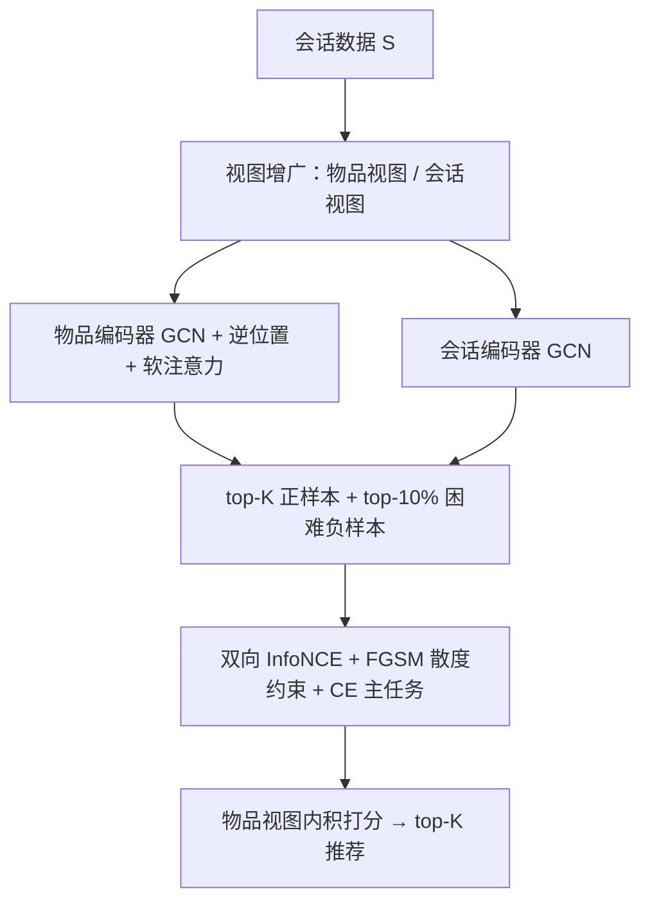
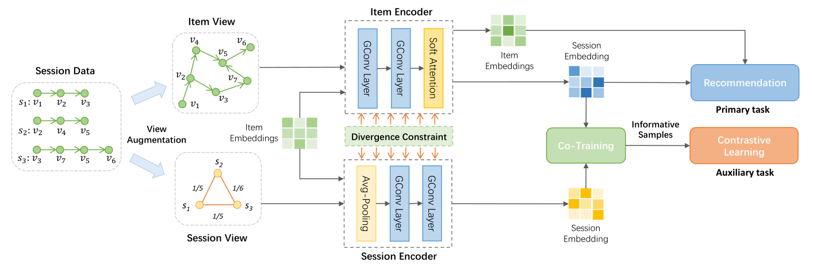

# Self-Supervised Graph Co-Training for Session-based Recommendation (面向会话推荐的自监督图协同训练)

- **会议/期刊**: CIKM 2021
- **作者与机构**: Xin Xia, Hongzhi Yin, Junliang Yu (昆士兰大学), Yingxia Shao (北邮), Lizhen Cui (山东大学)
- **推荐链路定位**: 召回（会话级 Next-Item 预测）
- **研究方向**: 序列与会话推荐 / 自监督对比学习与去噪
- **论文原文**: [https://arxiv.org/abs/2108.10560v1](https://arxiv.org/abs/2108.10560v1)
- **开源代码**: [https://github.com/xiaxin1998/COTREC](https://github.com/xiaxin1998/COTREC)

## TL;DR (1分钟核心速览)

会话推荐因仅有短期匿名交互而比一般推荐更受数据稀疏困扰；而已有自监督方法（BERT4Rec / S³-Rec / CL4SRec）依赖 item/segment dropout 造增广视图，在原本就极短的会话上只会让数据更稀疏、自监督信号不可用。本文提出 COTREC：用同一会话数据派生「物品视图（会话内相邻共现）」与「会话视图（会话间共享物品相似度）」两图，两个异质 GCN 编码器按协同训练互传 top-K 伪标签 + 困难负样本，并以 InfoNCE 对比目标互相监督，再用 FGSM 对抗扰动 + KL 散度约束防止双编码器模式坍缩。在 Tmall/RetailRocket/Diginetica 上全库排序评估，Tmall P@20 相对 GCE-GNN 提升 8.8%、相对自监督基线 S²-DHCN 提升 15.7%。

## Background & Motivation (背景与核心矛盾)

- **主流范式**: SR-GNN/GCE-GNN 类工作把会话建成 session graph（会话内转移）或 session-educed 全局图（跨会话共现），用 GCN + 软注意力聚合出会话表示；自监督侧则用 dropout/掩码/裁剪/重排构造正负对。
- **前人局限**: ① 会话平均长度仅 5–7，dropout 后序列信息进一步残缺，掩码恢复任务退化为噪声拟合（S²-DHCN 在 Tmall 上甚至弱于 GCE-GNN）；② 自判别（self-discrimination）式对比把同一会话的两个表征互为正例，ground-truth 是固定的，学不到对数据扰动不变的结构，增益有限。
- **核心洞察 (Key Insight)**: 会话数据本身含两种互补连接性——**物品级（会话内相邻转移）**与**会话级（会话间共享物品）**。二者近似满足 co-training 所需的“弱依赖”假设，可互相产生「哪些物品是下一跳」的伪标签，实现真正的标签增广而非特征丢弃。
- **本文切入点**: 把 SSL 与多视图半监督协同训练结合，让两个图编码器在训练中递归地为对方挖掘不断变难的伪标签。

## Method (核心方法设计)

### 1. 整体框架 (Overall Architecture)

输入为会话序列 $\{s\}$，先由会话数据构造两张图：物品视图（节点=物品，边权=跨会话相邻出现次数）与会话视图（节点=会话，边权=$|s_j\cap s_k|/|s_j\cup s_k|$的 Jaccard 相似度，无向）。物品视图上跑带逆位置嵌入 + 软注意力的 GCN 得到$\mathbf{X}_I$与会话表示$\boldsymbol{\theta}^I_p$（主编码器，用于最终推荐）；会话视图上跑会话级 GCN 得到$\boldsymbol{\theta}^S_p$（辅助编码器）。每个 batch 内，两视图各自对同一会话输出全物品打分，取 top-$K$ 作正样本、top-10% 内随机采样作困难负样本，交换给对方当作“增广 ground-truth”，用 InfoNCE 双向监督；同时施加对抗散度约束。三者联合优化，推理时只用物品视图打分。

<figure class="paper-figure" markdown="span">
  <figcaption>图 1：所提出的 COTREC 框架概述。</figcaption>
</figure>

### 2. 关键设计拆解 (Key Designs)

1. **双视图图增广（免 dropout 的完整信息保留）**：痛点是用丢弃造视图会让短会话更稀疏。本文改为两种连接性视图，二者共享同一数据源但特征空间不同，等价于视觉 SSL 中的 “patch clipping” 而非 “随机抹像素”，从而在保留完整会话的前提下满足 co-training 的弱依赖条件。

2. **协同训练伪标签互传 + 多层对比目标**：不同于 S²-DHCN 的单对自判别，本文对每个会话生成 $K$个正例与$K$ 个困难负例，构造多正例 InfoNCE：

$$\mathcal{L}_{ssl}=-\log\frac{\sum_{i\in c^+_I}\psi(\mathbf{x}_{last},\boldsymbol{\theta}_p,\mathbf{x}_i)}{\sum_{i\in c^+_I}\psi(\cdot)+\sum_{j\in c^-_I}\psi(\cdot)}+\text{(对称项 for }S\text{)}$$

其中 $\psi(\mathbf{x}_1,\mathbf{x}_2,\mathbf{x}_3)=\exp(f(\mathbf{x}_1+\mathbf{x}_2,\ \mathbf{x}_3+\mathbf{x}_2)/\tau)$，$f$为余弦判别器，$\tau=0.2$；负样本刻意不取最低分（易样本无信息、且易成假负例），而取 top-10% 内随机，兼顾硬度与可靠性。由于伪标签每轮重算而不写入邻接矩阵，避免了图重建开销与错误标签永久污染。

3. **对抗散度约束与总损失**：两视图同源易模式坍缩。用 FGSM 在物品嵌入上加扰动 $\Delta_{adv}=\epsilon\,\Gamma/\|\Gamma\|$，$\Gamma=\partial l_{adv}/\partial\Delta$，并要求编码器在对扰动的输出分布上互相对齐：

$$\mathcal{L}_{diff}=KL\big(Prob_I(\mathbf{X}_I)\,\|\,Prob_S(\mathbf{X}_I+\Delta^{adv}_I)\big)+KL\big(Prob_S(\mathbf{X}_I)\,\|\,Prob_I(\mathbf{X}_I+\Delta^{adv}_S)\big)$$

若编码器能免疫对方的破坏性扰动仍输出一致分布，则二者保持“不同但互补”。总体 $\mathcal{L}=\mathcal{L}_r+\beta\mathcal{L}_{ssl}+\alpha\mathcal{L}_{diff}$，$\beta=0.05$、$\alpha=0.005$（$\epsilon$ 为 0.5/0.2/0.2）。训练负采样即上述伪负例，无需额外均匀负采样；推理为单塔 GCN 内积全库打分，开销与 SR-GNN 同量级。

## Experimental Setup & Evaluation Protocol (实验设置与评估协议)

- **数据集与预处理**: 过滤长度为 1 的会话与出现次数 < 5 的物品（即 5-core 式过滤）。

| 数据集 | #Users | #Items | #Interactions(训练会话/测试会话) | 稀疏度/密度 | 特征/场景说明 |
| :--- | :---: | :---: | :---: | :---: | :--- |
| Tmall | 匿名会话 | 40,728 | 351,268 / 25,898 | 平均长度 6.69 | 阿里电商购物日志（IJCAI-15） |
| RetailRocket | 匿名会话 | 36,968 | 433,643 / 15,132 | 平均长度 5.43 | Kaggle 电商浏览行为 |
| Diginetica | 匿名会话 | 43,097 | 719,470 / 60,858 | 平均长度 5.12 | CIKM Cup 2016 音乐/电商点击 |

- **数据划分与防穿越 (Splitting Strategy)**: **全局时间戳切分** —— 最后一周数据作测试集，之前数据作训练集；并对两集做序列切分增广 $([i_{s,1}],i_{s,2}),\dots,([i_{s,1..m-1}],i_{s,m})$，标签恒为该前缀的末位点击，严格避免未来信息泄漏。
- **排名评测协议 (Ranking Protocol)**: **Full-Ranking（全库未交互物品排序）**，softmax 覆盖全部 $N$ 个物品，指标 P@10/20 与 MRR@10/20；无采样负例评测偏差。
- **对比基线与超参设置**: 基线含 FPMC（马尔可夫）、GRU4REC/NARM/STAMP（RNN+注意力）、SR-GNN/GCE-GNN（图）、S²-DHCN（自监督超图）。嵌入维度 $d=100$，batch 100，$L_2=10^{-5}$，Adam lr=0.001，图卷积 3 层；baseline 取原论文最优设置。

## Key Experimental Results (实验关键数据)

### 1. 主实验对比 (Main Results)

| Method | Tmall P@20 | Tmall M@20 | RR P@20 | RR M@20 | Digi P@20 | Digi M@20 |
| :--- | :---: | :---: | :---: | :---: | :---: | :---: |
| FPMC | 16.06 | 7.32 | 32.37 | 13.82 | 26.53 | 6.95 |
| GRU4REC | 10.93 | 5.89 | 44.01 | 23.67 | 29.45 | 8.33 |
| NARM | 23.30 | 10.70 | 50.22 | 24.59 | 49.70 | 16.17 |
| STAMP | 26.47 | 13.36 | 50.96 | 25.17 | 45.64 | 14.32 |
| SR-GNN | 27.57 | 13.72 | 50.32 | 26.57 | 50.73 | 17.59 |
| GCE-GNN | 33.42 | 15.42 | OOM | OOM | **54.22** | **19.04** |
| S²-DHCN | 31.42 | 15.05 | 53.66 | 27.30 | 53.18 | 18.44 |
| **COTREC** | **36.35** | **18.04** | **56.17** | **29.97** | 54.18 | 19.07 |
| Improv. | +8.8% | +17.0% | +4.7% | +9.8% | +1.9% | +3.4% |

（Improv. 为相对最强可用基线：Tmall/GCE-GNN，RR 与 Digi 对 S²-DHCN。）

### 2. 消融实验 (Ablation Study)

| 变体 | Tmall P@20 | Tmall M@20 | Digi P@20 | Digi M@20 |
| :--- | :---: | :---: | :---: | :---: |
| COTREC-base（仅物品视图，无 SSL） | 27.71 | 13.36 | 52.66 | 18.19 |
| base-DHCN（换成 S²-DHCN 式自判别 SSL） | 32.94 | 16.22 | 52.02 | 17.70 |
| base-MASK（换成 item 掩码 SSL） | 32.54 | 16.37 | 51.61 | 17.64 |
| COTREC-ND（去散度约束） | 显著下降 | 显著下降 | 低于 base | 低于 base |
| base-NP（去逆位置嵌入） | 略低于 base | 略低于 base | 下降 | 下降 |
| base-NA（软注意力换均值池化） | 下降 | 下降 | 下降 | 下降 |
| **COTREC** | **36.35** | **18.04** | **54.18** | **19.07** |

### 3. 关键实验发现 (Key Findings)

1. **协同训练是唯一稳定生效的 SSL 形式**：掩码式 SSL 在 Diginetica 上把 P@20 从 52.66 拉到 51.61（−2.0%），自判别式仅 52.02；而图协同训练带来 +2.9%/+13.1%（Tmall 27.71→36.35），证明短会话场景下 dropout 类增广确属负收益。
2. **散度约束不可省**：去掉后 COTREC-ND 在 Diginetica 上竟低于无 SSL 的 base，说明两同源视图若无对抗项会迅速坍缩为同一打分函数，SSL 退化为自我蒸馏；$\alpha>0.1$时性能亦骤降（监督信号被过度扰动破坏），最优点$\alpha=0.005$ 呈明显单峰。
3. **增益在短会话与真实电商数据上更大**：Diginetica 上相对 GCE-GNN 仅 +1.9%（P@20 甚至 −0.07%），但 Tmall 上 +8.8%；Short（≤5）分组普遍高于 Long 分组，且在 GCE-GNN 因显存不足无法运行的 RetailRocket 上仍达 56.17，说明方法本身开销可控、对稀疏短序列更友好；3 层 GCN 为最优，4–5 层受过平滑拖累。

## Highlights & Limitations (亮点、对比与审稿批判)

- **与代表作对比 (vs. Prior Work)**: 相对 S²-DHCN（双超图 + 自判别、ground-truth 固定）本文把“一对正例”扩为“top-K 多正例 + 困难负例”的互监督，标签随训练进化；相对 CL4SRec/S³-Rec 的裁剪-掩码-重排增广，本文不再破坏序列完整性，而是从图结构抽出两个正交视图；相对 GCE-GNN 的复杂双图注意力，COTREC 结构更轻（RetailRocket 不 OOM）。
- **可迁移亮点**: ① “top-10% 内随机采负例”这一兼顾硬度与假负例风险的采样策略，可直接用于任何全库 softmax 召回；② 用 FGSM 扰动 + KL 做双塔差异正则，可迁移到多视图/多模态融合中的表征坍缩治理。
- **审稿级局限批判**: ① Diginetica 上仅与 GCE-GNN 打平，且 P@20 微降，说明收益依赖数据集中物品共现的丰富度，缺乏对“增益条件”的理论刻画；② 训练需维护两张图、双编码器与对抗梯度回传（每 batch 多次前向），训练成本约为单塔基线 2–3 倍，论文未给出训练/推理时延对比；③ 伪标签未入训练集虽避污染，但也使协同训练退化为“在线蒸馏”，收敛性无保证；④ 仅在 3 个匿名会话数据集验证，无线上 A/B 与冷启动分桶分析。

## Rating (四维评分)

- **方法创新性 (Novelty)**: ⭐⭐⭐⭐ （首次把 co-training 与图 SSL 结合用于会话推荐，把 dropout 增广替换为结构视图互监督，思路清晰但组件均为已有技术的组合创新）
- **评估协议与实验扎实度 (Protocol & Experiments)**: ⭐⭐⭐⭐ （三数据集 Full-Ranking + 权威基线齐全，SSL 策略对照与超参/层数分析完备，扣分于无显著性检验细节与线上验证）
- **写作与数学规范度 (Clarity & Rigor)**: ⭐⭐⭐⭐ （公式链条完整、符号一致，但 Eq.8 分母书写有笔误、协同训练收敛性缺乏分析）
- **工业落地与复现价值 (Industrial & Practical Value)**: ⭐⭐⭐⭐ （代码开源、单塔推理、可插拔 model-agnostic 框架利于落地，训练双塔成本与图维护开销是主要工程负担）

