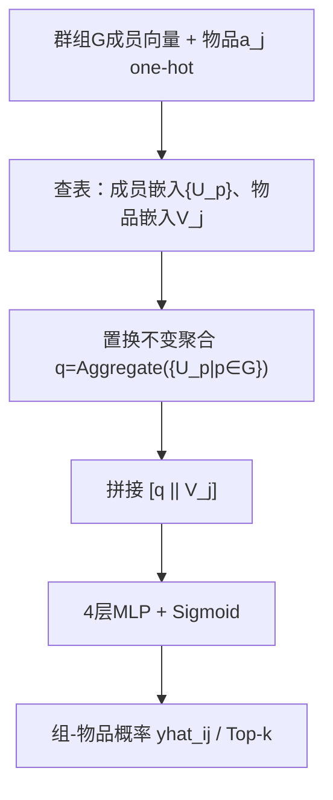
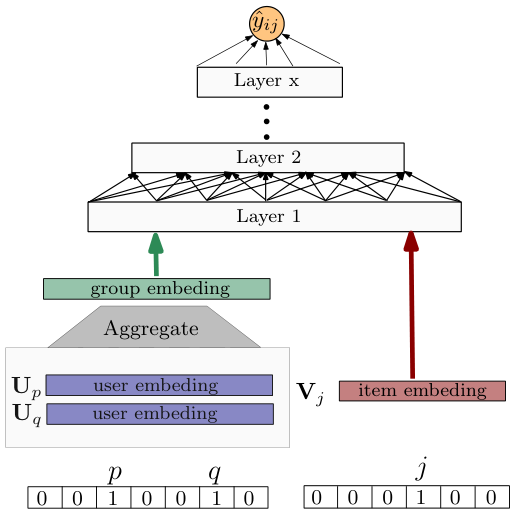

# DeepGroup: Representation Learning for Group Recommendation with Implicit Feedback (基于隐式反馈的群组推荐表征学习)

- **会议/期刊**: CIKM 2021（原文 arXiv:2103.07597）
- **作者与机构**: Sarina Sajadi Ghaemmaghami, Amirali Salehi-Abari；Ontario Tech University
- **推荐链路定位**: 端到端组决策预测 / 单物品Top-1与Top-k群组推荐
- **研究方向**: 社交与群组推荐 / 去偏公平、可信隐私
- **论文原文**: [https://arxiv.org/abs/2103.07597v1](https://arxiv.org/abs/2103.07597v1)
- **开源代码**: [DeepGroup](https://github.com/sarinasajadi/DeepGroup)（论文声明；AGREE基线仓库为 LianHaiMiao/Attentive-Group-Recommendation）

## TL;DR (1分钟核心速览)

本文研究“新群组成员的个人偏好未知、但可观测其参与过的其他群组及公开群组决策”的群组推荐。DeepGroup 用置换不变聚合器把成员嵌入汇成群嵌入，再与物品嵌入经 MLP 预测组-物品交互概率；同时支持群组决策预测与反向社会选择。在 Sushi 与三组爱尔兰选举偏好数据上，以合成群组、Borda/Plurality/混合规则和 Top-1 准确率评估，DeepGroup 显著优于 AGREE、Pop、RTCP、O-Sim；爱尔兰数据在 $\kappa=20$ 时约达最佳基线的 2 倍。

## Background & Motivation (背景与核心矛盾)

- **主流范式**: 群组推荐通常先做偏好评估（elicitation 或从历史交互学习），再用社会选择函数或深度网络把成员偏好聚合为群偏好。
- **前人局限**: 现有方法默认成员偏好/用户画像或群偏好可观测；当新组成员偏好缺失、仅有其参与的其他群组决策时，偏好评估与聚合链条直接断裂。且群组决策规则（Borda、Plurality 等）往往未知且异质。
- **核心洞察 (Key Insight)**: 群组成员关系与公开群组决策构成一种“群组隐式反馈”：群决策是成员集合的监督标签，可用于同时学习用户、群组与物品表征。
- **本文切入点**: 绕过“先估个人偏好再聚合”，直接学习群组-物品似然 $f(G,a\mid\theta)$，并反向用于推断个人偏好与隐私泄漏评估。

## Method (核心方法设计)

### 1. 整体框架 (Overall Architecture)

输入群组 $G$的稀疏成员向量与物品$a_j$的 one-hot 向量；查表得到成员嵌入$\{U_p\mid p\in G\}$与物品嵌入$V_j$。核心是用满足置换不变、定长输出性质的聚合器将成员嵌入压成群嵌入$\mathbf{q}$，再与$V_j$拼接送入 4 层 MLP，Sigmoid 输出组-物品交互概率$\hat{y}_{ij}$。训练以群组-物品矩阵$\mathbf{Y}$ 做二元交叉熵；推理对新群组计算全物品得分并取 Top-k。未见用户用已学用户嵌入均值初始化。

<figure class="paper-figure" markdown="span">
  <figcaption>图1：DeepGroup 模型的架构。</figcaption>
</figure>

### 2. 关键设计拆解 (Key Designs)

1. **置换不变群组聚合器**：群组成员无序且群规模可变，普通拼接或RNN会引入顺序/规模偏置。DeepGroup 要求 $\mathrm{Aggregate}$对成员排列不变且输出定长：$\mathbf{q}=\mathrm{Aggregate}(\{U_p\mid p\in G\})$。Mean 聚合为$q_i=\mathrm{mean}(\{u_{pi}\mid p\in G\})$；进一步提出 Mean-Max-Min 组合$\mathrm{MMM}(U_G)=\mathrm{Mean}(U_G)\Vert\mathrm{Max}(U_G)\Vert\mathrm{Min}(U_G)$。直觉是 min/max 给出成员嵌入最小包围盒的两个远角，能区分均值相同的不同成员集合。

2. **直接建模群组-物品似然**：不显式恢复个人偏好、也不预设投票规则，而把公开群决策当作群组对物品的隐式正反馈。MLP 输出 $\hat{y}_{ij}=\sigma(\mathbf{w}_o h^{(X)}+b_o)$，其中$h^{(X)}$由$[\mathbf{q}\Vert V_j]$ 逐层变换得到。这样群决策规则被吸收进监督信号，模型可在 Borda、Plurality 及其混合规则下学习。

3. **训练目标、负样本与推理**：采用全群组-物品矩阵上的 BCE：$\mathcal{L}=-\sum_{i=1}^{l}\sum_{j=1}^{m}[y_{ij}\log\hat{y}_{ij}+(1-y_{ij})\log(1-\hat{y}_{ij})]$。未选物品均视为负例，未做采样负采样或硬负采样；Adam、学习率$10^{-3}$、100 epochs、batch 4096。推理需对候选物品全打分，开销随群组数$l$、物品数$m$ 与嵌入维度线性增长；本文物品集仅 10–14，故全打分可行。

## Experimental Setup & Evaluation Protocol (实验设置与评估协议)

- **数据集与预处理**: 无真实群组数据，作者用四个偏好排序数据集按随机群组生成器合成群组。Sushi 为 5,000 条完整排名；爱尔兰选举数据为 top-$t$ 部分排名。

| 数据集 | 用户/偏好记录 | #Items | 交互/特征说明 |
| :--- | :---: | :---: | :--- |
| Sushi | 5,000 | 10 | 完整排名，寿司偏好 |
| Dublin West | 29,989 | 9 | 2002 爱尔兰选举 top-$t$ 排名 |
| Dublin North | 43,942 | 12 | 同上 |
| Meath | 64,081 | 14 | 同上 |

- **群组生成**: $\kappa$-participation (KPG) 先采样$n=5000$用户，再$\kappa$次随机划分成大小$[2,10]$的群组；$\kappa\in\{1,3,5,10,20\}$控制用户跨群参与度。另用 RSG/RDG 生成同质/异质群组，$\tau_{sim}=0.5$、$\tau_{dis}=-0.5$，RSG/RDG 固定$l=1000$。
- **决策规则**: Borda 分数 $g_B(a,r)=m-r(a)$；Plurality 分数$g_P(a,r)=\mathbb{I}[r(a)=1]$；以及每群随机选 Borda/Plurality 的混合规则。规则对推荐模型未知。
- **划分与防穿越**: 群组决策预测随机取 70% 群组训练、30% 群组测试；测试群组未在训练中出现，但成员可能出现在其他训练群组。反向社会选择用全部群组训练，测试集为训练中出现用户的 singleton 群组。
- **排名评测协议**: 非 Full-Ranking 排序指标，而是对全部候选物品打分后取 Top-1 的 Accuracy；即预测群组最终选择/用户 top choice 的命中率。每个随机设置生成 20 个群组数据实例并取平均。
- **对比基线与超参**: AGREE（去掉用户偏好，仅输入群组与 top choice）、Popularity、Random Top Choice Plurality (RTCP)、Overlap Similarity (O-Sim)。DeepGroup 隐层 64-32-16-8、ReLU、dropout keep 0.8、用户/物品嵌入 64、Mean 聚合；未报告显著性检验。

## Key Experimental Results (实验关键数据)

### 1. 主实验对比 (Main Results)

下表取图2中 $\kappa=20$、Plurality 规则下的 Top-1 Accuracy（%）。原文以图呈现，数值为目测近似；加粗为 DeepGroup 最优。

| 数据集 | DeepGroup | AGREE | Pop | RTCP | O-Sim | Improv. vs best |
| :--- | :---: | :---: | :---: | :---: | :---: | :---: |
| Sushi | **≈96** | ≈65 | ≈38 | ≈45 | ≈52 | +47.7% |
| Dublin West | **≈86** | ≈45 | ≈36 | ≈43 | ≈44 | +91.1% |
| Dublin North | **≈82** | ≈41 | ≈34 | ≈39 | ≈42 | +95.2% |
| Meath | **≈79** | ≈39 | ≈31 | ≈35 | ≈38 | +102.6% |

### 2. 消融实验 (Ablation Study)

原文未给标准 `w/o` 组件消融；以下为图5的群组同质性条件分析（组决策预测、Plurality、$l=1000$，目测近似）。同质群组 RSG 显著高于异质群组 RDG。

| 条件 | Sushi | Dublin West | Dublin North | Meath |
| :--- | :---: | :---: | :---: | :---: |
| 同质 RSG | ≈86 | ≈74 | ≈70 | ≈66 |
| 异质 RDG | ≈70 | ≈60 | ≈56 | ≈53 |
| Δ (pp) | +16 | +14 | +14 | +13 |

### 3. 关键实验发现 (Key Findings)

- **参与度是性能放大器**：$\kappa=1$时 DeepGroup 与基线相当；$\kappa=20$ 时爱尔兰数据上 DeepGroup≈79–86，而最佳基线≈39–45，约 2 倍提升，说明成员跨群参与越多，隐式反馈越能校准用户/群组嵌入。
- **规则未知仍鲁棒，且暴露隐私差异**：混合 Borda/Plurality 下 DeepGroup 仍领先，说明无需显式知道决策规则；反向社会选择中 Plurality 的可反推准确率最高、Borda 最低，表明“只用 top-1”的 Plurality 反而泄露更多个人偏好。
- **同质群组更易预测也更易泄露**：RSG 比 RDG 高约 13–16 个百分点；同质群组的公开决策更代表成员偏好，因此群决策预测更准，反向推断个人偏好的隐私风险也更高。

## Highlights & Limitations (亮点、对比与审稿批判)

- **与代表作对比 (vs. Prior Work)**: AGREE/GroupIM 等依赖成员评分或用户偏好聚合，DeepGroup 仅用群组成员关系与群组决策；与经典社会选择方向相反，本文从群决策反推个人偏好，形成“反向社会选择”隐私审计视角。
- **可迁移亮点**: 置换不变的 Mean-Max-Min 聚合可迁移到任意变长集合/会话群组建模；把未知投票规则当作隐监督、用混合规则训练，可提升规则漂移下的鲁棒性。
- **审稿级局限批判**: (1) 群组与标签均由投票规则合成，缺少真实群组决策与线上 A/B，隐私结论仅为经验性；(2) 全矩阵 BCE 把未选物品一律当负例，存在负例歧义与流行度偏置，且物品集仅 10–14、全打分推理难扩展到大目录；未给标准组件消融与显著性检验。

## Rating (四维评分)

- **方法创新性 (Novelty)**: ⭐⭐⭐⭐ （提出群组隐式反馈下的直接群组似然建模与反向社会选择，问题切分有新意；聚合器本身较朴素）
- **评估协议与实验扎实度 (Protocol & Experiments)**: ⭐⭐⭐ （覆盖多数据、多规则、多参与度与同/异质群组，但全为合成群组、Top-1 准确率、无显著性检验与标准消融）
- **写作与数学规范度 (Clarity & Rigor)**: ⭐⭐⭐⭐ （问题定义、聚合器性质与BCE目标清晰；复杂度、负例语义与理论分析不足）
- **工业落地与复现价值 (Industrial & Practical Value)**: ⭐⭐⭐ （代码可得、群组冷启动思路可复用；小候选集全打分与合成评估限制大规模线上部署价值）

