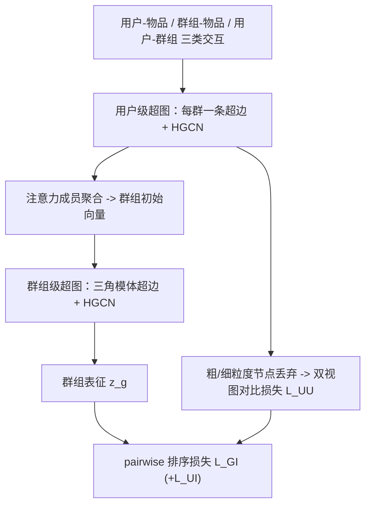
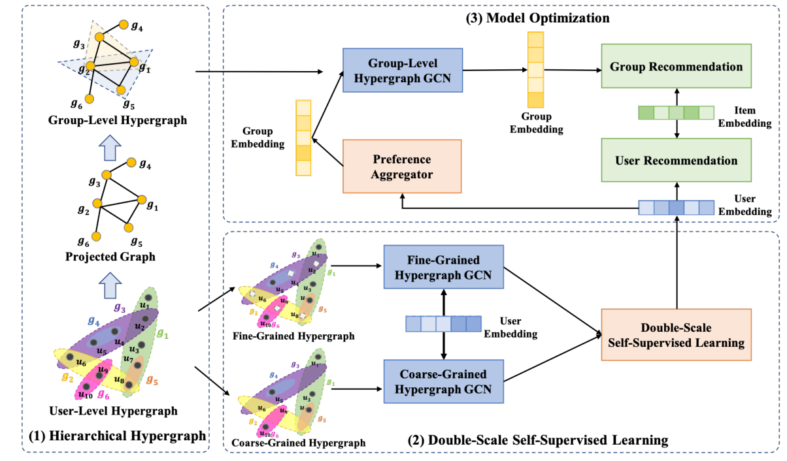
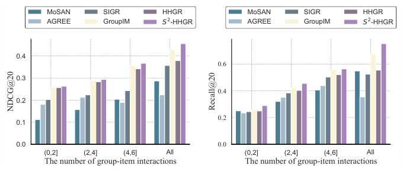

# Double-Scale Self-Supervised Hypergraph Learning for Group Recommendation (双尺度自监督超图学习用于群组推荐)

- **会议/期刊**: CIKM 2021（11 pages）
- **作者与机构**: Junwei Zhang、Min Gao（通讯，重庆大学）、Junliang Yu、Hongzhi Yin（昆士兰大学）、Lei Guo（山东师范大学）、Jundong Li（弗吉尼亚大学）
- **推荐链路定位**: 召回（群组级候选物品排序）
- **研究方向**: 社交与群组推荐 / 自监督对比与交互去噪
- **论文原文**: [https://arxiv.org/abs/2109.04200v2](https://arxiv.org/abs/2109.04200v2)
- **开源代码**: [https://github.com/0411tony/HHGR](https://github.com/0411tony/HHGR)

## TL;DR (1分钟核心速览)

群组推荐的两个痛点是：成员影响力随群组动态变化（需建模群内/跨群高阶 tuplewise 交互），以及 group-item 交互极度稀疏。本文提出 HHGR——用户级超图（每群一个超边）+ 群组级三角模体超图的分层超图卷积，并用粗粒度（节点在所有超边中消失）与细粒度（节点仅在某一超边中消失）双尺度节点丢弃生成两个增广视图，做对比学习正则；S²-HHGR 在 Weeplaces/CAMRa2011/Douban 上（群组 70/10/20 随机划分，NDCG@20/50、Recall@20/50）较最强基线 GroupIM 最高提升 8.6%（Douban N@20 0.279 vs 0.257）。

## Background & Motivation (背景与核心矛盾)

- **主流范式**: 早期用平均/Least Misery/最大满意度等启发式聚合成员打分；近年主流是注意力机制 + 用户-物品二部图（AGREE、MoSAN、SIGR、GroupIM），学习成员权重并合成群组向量。
- **前人局限**: (1) 全部建立在 **pairwise** 关系上，无法表达"一个群组同时由 3 个以上成员共同决定偏好"这类**元组级高阶交互**，且跨群组的用户共享结构被忽略；(2) 群组常为临时组建，group-item 记录极稀疏，而现有工作只借成员偏好来补，忽视了 user-item 侧同样稀疏。
- **核心洞察 (Key Insight)**: 超边天然可连接任意多节点，"同一群组的成员集合"就是一条超边；而跨群组的传递关系可用**三角模体**（triadic motif）筛选——三元闭环是社交中同质性最强的连接，能滤掉噪声性的跨群连接。
- **本文切入点**: 用双层超图分别承接"群内成员共现"与"跨群高阶关联"，再把图增广从"用户-物品图上的 node/edge dropout"改为**超图结构上两种粒度的节点丢弃**，让自监督信号与分层结构天然耦合。

## Method (核心方法设计)

### 1. 整体框架 (Overall Architecture)

框架分三步闭环：① **用户级超图** 以群组为超边聚合成员表征，得到动态用户向量；② 注意力聚合器对群内成员加权得到群组向量，作为**群组级超图**（三角模体超边）的初始输入，跨群传播后得最终群组表征；③ 训练上先用双尺度增广视图做对比预训练，再与用户侧、群组侧两组 pairwise 排序损失联合微调。推理解码即群组向量与物品向量的内积排序，无额外候选生成模块。

<figure class="paper-figure" markdown="span">
  <figcaption>图2：我们提出的群体推荐框架概览。</figcaption>
</figure>

### 2. 关键设计拆解 (Key Designs)

1. **分层超图卷积（User-level + Group-level）**：用户级上痛点是不存在"群"这一实体；作者把每个群组的成员集合定义为一条超边，用去非线性化的谱超图卷积传播（去掉 σ 避免过平滑）：
   $\boldsymbol{P}^{(l+1)}=\boldsymbol{D}_{ul}^{-1}\boldsymbol{H}_{ul}\boldsymbol{W}_{ul}\boldsymbol{B}_{ul}^{-1}\boldsymbol{H}_{ul}^{\top}\boldsymbol{P}^{(l)}\boldsymbol{\Theta}^{(l)}$，
   其中 $\boldsymbol{H}_{ul}$为用户-超边关联矩阵，$\boldsymbol{D}_{ul},\boldsymbol{B}_{ul}$ 分别为节点度与超边度对角阵，起归一化作用。直觉：一次卷积即完成"成员→群组→成员"的往返信息回流，等价于在群内做高阶平滑。
   **群组级**则先把用户级超图投影为"超边作节点"的图，取对称邻接 $\boldsymbol{C}$，用$\boldsymbol{H}_{gl}\boldsymbol{H}_{gl}^{\top}=(\boldsymbol{C}\boldsymbol{C})\odot\boldsymbol{C}$只保留三点闭环作为模体超边，再做$\boldsymbol{Z}^{(l+1)}=\boldsymbol{D}_{gl}^{-1}\boldsymbol{H}_{gl}\boldsymbol{H}_{gl}^{\top}\boldsymbol{Z}^{(l)}\boldsymbol{\Psi}^{(l)}$。$\odot\boldsymbol{C}$ 的物理意义是把开放的两跳路径"闭合"，从而只让相互共享成员的三个群组互相传递偏好。

2. **双尺度节点丢弃自监督（Double-Scale Node Dropout）**：常规 node/edge dropout 在极稀疏群组图上会删掉关键信息。本文改为两个粒度掩码：粗粒度 $\boldsymbol{h}_{c}=\boldsymbol{a}_{c}\odot\boldsymbol{h}_{ul}$，掩码$\boldsymbol{a}_{c}$对整个关联矩阵一致作用，节点一旦被删则在**所有**所属群组中消失（刻画"该用户整体缺席"）；细粒度$\boldsymbol{h}_{f}=\boldsymbol{a}_{f}\odot\boldsymbol{h}_{ul}$，$\boldsymbol{a}_{f}$每列重新采样，节点只在**某个特定群组**中被删（刻画"该用户在某次群体决策中未表态"）。两视图分别经独立 HGCN 编码后相加$\boldsymbol{P}=\boldsymbol{P}'+\boldsymbol{P}''$，既保留必需信息又构造出难负样本。

3. **训练目标、负采样与推理开销**：排序损失为带间隔的平方 hinge 而非 BPR-log：
   $\mathcal{L}_{UI}=\sum_{(u,i,j)\in O}(\hat{r}_{ui}-\hat{r}_{uj}-1)^{2},\ \hat{r}_{ui}=\sigma(\boldsymbol{p}_{u}\boldsymbol{q}_{i}^{\top})$，群组侧$\mathcal{L}_{GI}$同理；对比损失用判别器$\mathrm{f}_D(\boldsymbol{p}'_i,\boldsymbol{p}''_i)=\sigma(\boldsymbol{p}'_i\boldsymbol{W}_D\boldsymbol{p}''_i{}^{\top})$与交叉熵，负样本取同 batch 内其他用户（in-batch，$n=10$），总目标$\mathcal{L}=\beta\mathcal{L}_{UU}+\mathcal{L}_{UI}+\mathcal{L}_{GI}$，两阶段优化（先预训练后联合微调）。参数量约为$3ld^2+4d^2$，时间复杂度约$O(l^2|\boldsymbol{H}|^2d^2)$，主要开销在超图卷积；但模体超边构造需$O(M^2)$ 群组两两比较。

## Experimental Setup & Evaluation Protocol (实验设置与评估协议)

- **数据集与预处理**（无 5-core 过滤，沿用原始构造）：

| 数据集 | #Users | #Items | #Groups | #U-I Feedback | #G-I Feedback | 场景说明 |
| :--- | :---: | :---: | :---: | :---: | :---: | :--- |
| Douban | 2,964 | 39,694 | 2,630 | 823,851 | 463,040 | 豆瓣小组活动，按 SIGR 规则由共同参与活动的朋友抽取隐式群组 |
| Weeplaces | 8,643 | 25,081 | 22,733 | 1,358,458 | 180,229 | LBSN 签到，按 GroupIM 规则由签到+社交网构造群组 |
| CAMRa2011 | 602 | 7,710 | 290 | 116,344 | 145,068 | 家庭/户共享观影，显式评分按 AGREE 二值化为隐式 |

- **数据划分与防穿越 (Splitting Strategy)**: **比例划分**——对全部群组随机切分 70% 训练 / 10% 验证 / 20% 测试；非时间戳切分，因此存在未来交互泄漏风险。
- **排名评测协议 (Ranking Protocol)**: 未明确声明全库排序；训练时每正样本配 **10 个均匀负采样**，评测采用 Top-K 排序并报 `NDCG@{20,50}` 与 `Recall@{20,50}`。
- **对比基线与超参设置**: 基线含 Popular、NeuMF（群组当虚拟用户）、AGREE、MoSAN、SIGR、GroupIM（均为注意力/图范式 SOTA）；嵌入维度 $d=64$，batch=512，负样本数 10，用户级 HGCN 两层、群组级一层，学习率 SSL 阶段$5e^{-4}$、群组超图层$1e^{-4}$，Adam 优化；未报告显著性检验。

## Key Experimental Results (实验关键数据)

### 1. 主实验对比 (Main Results)

| 数据集 / 指标 | Weeplaces N@20 | Weeplaces R@50 | CAMRa N@20 | CAMRa R@50 | Douban N@20 | Douban R@50 |
| :--- | :---: | :---: | :---: | :---: | :---: | :---: |
| Popular | 0.063 | 0.176 | 0.099 | 0.226 | 0.003 | 0.018 |
| NeuMF | 0.193 | 0.295 | 0.305 | 0.450 | 0.124 | 0.316 |
| AGREE | 0.224 | 0.671 | 0.307 | 0.688 | 0.201 | 0.488 |
| MoSAN | 0.287 | 0.738 | 0.423 | 0.801 | 0.163 | 0.459 |
| SIGR | 0.357 | 0.756 | 0.499 | 0.825 | 0.217 | 0.560 |
| GroupIM | 0.431 | 0.773 | 0.637 | 0.874 | 0.257 | 0.696 |
| HHGR (vanilla) | 0.379 | 0.764 | 0.517 | 0.830 | 0.254 | 0.677 |
| **S²-HHGR** | **0.456** | **0.797** | **0.645** | **0.883** | **0.279** | **0.741** |
| Improv. vs 最强基线 | +5.80% | +3.11% | +1.26% | +1.03% | +8.56% | +6.47% |

### 2. 消融实验 (Ablation Study)

| 变体 | Weeplaces N@50 | Weeplaces R@50 | CAMRa N@50 | CAMRa R@50 | 说明 |
| :--- | :---: | :---: | :---: | :---: | :--- |
| HHGR-wu | 0.288 | 0.683 | 0.495 | 0.797 | 去掉用户级超图（仅群组级） |
| HHGR-wg | 0.378 | 0.751 | 0.511 | 0.815 | 去掉群组级超图（仅注意力聚合） |
| HHGR | 0.398 | 0.764 | 0.532 | 0.830 | 完整双层超图 |
| HHGR-C | 低于 S²-HHGR | — | — | — | 仅粗粒度节点丢弃 |
| HHGR-F | 略低于 S²-HHGR，但优于 HHGR-C | — | — | — | 仅细粒度节点丢弃 |
| **S²-HHGR** | **0.478** | **0.797** | **0.671** | **0.883** | 双尺度自监督 |

<figure class="paper-figure" markdown="span">
  <figcaption>图3：基于注意力的群体推荐模型在稀疏数据集上的性能比较。</figcaption>
</figure>

### 3. 关键实验发现 (Key Findings)

1. **自监督是主要增益来源而非超图本身**：vanilla HHGR 在 Weeplaces 上 N@20（0.379）反而低于 GroupIM（0.431），但叠加双尺度自监督后跃升至 0.456（+20.3% vs HHGR）；说明超图提供的是"可被增广的结构基底"，单靠高阶结构无法抵消稀疏性。
2. **用户级超图远比群组级关键**：去掉用户级超图后 Weeplaces N@50 从 0.398 跌至 0.288（-27.6%），而去掉群组级仅跌 5.0%（0.378）；群组级模体传播属"锦上添花"，且 CAMRa2011（更稠密）上两变体落差（0.495→0.511→0.532）明显更平缓，说明模体超边依赖足够密的群组共现才能选出可靠的三元闭环。
3. **稀疏分桶上优势最大、丢弃强度存在拐点**：按 item 的群组交互数分桶 (0,2]/(2,4]/(4,6] 时，所有模型性能随交互数单调上升，而 S²-HHGR 在各桶均最优，即在最稀疏桶上把 GroupIM 的相对优势放大；粒度超参上细粒度丢弃率 0.3、粗粒度 0.2 时达峰（图 5），层深超过 2 层即因过平滑下滑，印证"增广有效但过强会加剧稀疏"。

## Highlights & Limitations (亮点、对比与审稿批判)

- **与代表作对比 (vs. Prior Work)**: 相较 AGREE/MoSAN 的注意力聚合，本文将"成员共现"提升为超边，从 pairwise 走向 tuplewise；相较 SIGR 的二部图传播，本文额外建模跨群组的模体关联；相较最接近的 GroupIM（用户—群组互信息最大化），本文的对比发生在**同一超图的两个结构增广视图**之间，且增广粒度与分层设计一一对应，避免了 GroupIM 只在用户-群组层面做粗粒度对齐。
- **可迁移亮点**: (1) "全局一致掩码（粗）+ 逐超边重采样掩码（细）"这一双粒度增广可直接搬到会话超图、多行为超图等任何关联矩阵结构；(2) 用去非线性化的超图卷积 + 两视图表征相加（$\boldsymbol{P}=\boldsymbol{P}'+\boldsymbol{P}''$）替代动量编码器，工程实现极轻。
- **审稿级局限批判**: (1) 群组划分是随机 70/10/20 而非时间切分，且 Douban/Weeplaces 的群组本身由启发式规则反推，标签噪声与信息穿越均未讨论；(2) 需训练三套独立 HGCN（粗、细、主）+ 两阶段优化，模体构造 $O(M^2)$ 在 Weeplaces（22,733 群）上开销显著，论文只给渐近复杂度而无实测时延/显存；(3) 评测仅报 NDCG/Recall，未声明是否全库排序、无显著性检验，也未做冷启动群组（新组建群）实验，削弱了"缓解稀疏"主张的说服力。

## Rating (四维评分)

- **方法创新性 (Novelty)**: ⭐⭐⭐⭐ （超边=群组 + 三角模体跨群传播的组合自然且贴合群组语义，双尺度丢弃与分层结构的耦合是真正的增量设计；但超图卷积本体重用 HGNN/MHCN 谱范式，理论分析停留在直觉层面）
- **评估协议与实验扎实度 (Protocol & Experiments)**: ⭐⭐⭐ （三数据集 + 稀疏分桶 + 粒度/层深/批大小/负样本四组敏感性分析较完整，但随机划分无时间防穿越、未声明全库排序、缺显著性检验与冷启动群组实验）
- **写作与数学规范度 (Clarity & Rigor)**: ⭐⭐⭐ （两阶段训练与三套 HGCN 的符号 $g_c/g_f$、$\boldsymbol{\Gamma}/\boldsymbol{\Phi}$交代清楚，但式(1)与式(2)、式(6)与式(2)的"等价"论断未给证明，复杂度推导$O(l^2|\boldsymbol{H}|^2d^2)$ 的量纲可疑）
- **工业落地与复现价值 (Industrial & Practical Value)**: ⭐⭐⭐⭐ （代码开源、无额外特征依赖、只需三类交互即可构图，适合社交/家庭/拼单等既有群组场景的召回层；但模体构图与三网络训练在万级群组上需工程剪枝才能上线）

