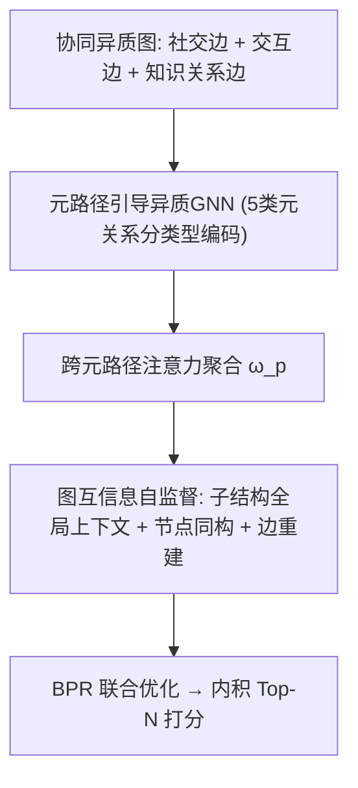
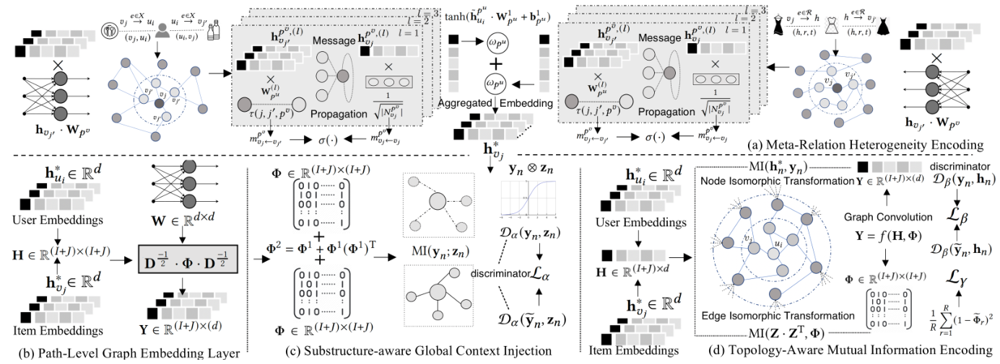

# Social Recommendation with Self-Supervised Metagraph Informax Network (自监督元图互信息网络的社会化推荐)

- **会议/期刊**: CIKM 2021 (Full Paper)
- **作者与机构**: Xiaoling Long, Chao Huang, Yong Xu, Huance Xu, Peng Dai, Lianghao Xia, Liefeng Bo（华南理工大学、香港大学、京东金融美国）
- **推荐链路定位**: 召回（用户/物品表征学习与 Top-N 排序）
- **研究方向**: 社交与群组推荐 / 图神经网络与知识图谱推荐
- **论文原文**: [https://arxiv.org/abs/2110.03958v1](https://arxiv.org/abs/2110.03958v1)
- **开源代码**: [https://github.com/SocialRecsys/SMIN](https://github.com/SocialRecsys/SMIN)

## TL;DR (1分钟核心速览)

现有社交推荐只挖用户侧社交同质性，忽略物品侧知识（品类、共交互）里的跨物品依赖，且仅靠局部邻域消息传递难以注入高阶协同信号。SMIN 构建用户-物品-知识实体的协同异质图，用元路径引导的异质 GNN 分类型编码五类元关系，再由跨元路径注意力融合；同时以"局部节点 vs 子结构全局上下文"的互信息最大化作为自监督辅助任务。在 Ciao/Epinions/Yelp 上采用 Leave-One-Out + 1:99 采样排序协议，HR@10 分别达 0.7108/0.8179/0.8478，较最强基线 NGCF+ 相对提升约 2.4%–2.6%。

## Background & Motivation (背景与核心矛盾)

- **主流范式**: 以社交影响理论为假设，将用户社交图作为正则项（SoReg/TrustMF）、注意力加权（SAMN/EATNN）或图卷积扩散层（DiffNet/GraphRec/DANSER）注入 MF 或 GNN 骨架。
- **前人局限**: ① 只建模 user-user 同质性，缺少物品侧知识语义（品类层级、共交互），无法刻画"物品-物品"语义相关性，长尾物品表征仍然贫弱；② 图模型普遍只做 1–2 跳局部邻居聚合，缺少全局子结构视角，高阶协同关系与图拓扑同构性质未被约束。
- **核心洞察 (Key Insight)**: 用户行为的多面性来自双侧——社交同质、行为级共交互、知识级实体桥接可以被统一为**不同类型的元路径实例**；而这些异构关系的语义强度不同，必须"分类型编码 + 学习式加权融合"，不能混池平均。
- **本文切入点**: 把社交图、物品知识图与交互图缝合成一张协同异质图 $\mathcal{G}$，在元路径层编码异质性，再用互信息自监督把"局部节点—全局子结构"的对齐信号蒸馏进交互表征。

## Method (核心方法设计)

### 1. 整体框架 (Overall Architecture)

输入是统一协同异质图 $\mathcal{G}=\{\mathcal{V},\mathcal{E}\}$，其中节点集$\mathcal{V}=U\cup\{h,t\}_{G_v}$、边集$\mathcal{E}=E_u\cup\mathcal{R}\cup\{Interact\}$。流程为三段式：首先对每个元路径$p$单独执行元路径引导的消息传递，得到类型专属的用户/物品表征；其次用跨元路径注意力为每个$p$学习归一化权重$\omega_p$，融合成$\mathbf{h}^*_{u_i},\mathbf{h}^*_{v_j}$；最后将该融合表征送入图互信息编码器，以$k$阶子结构全局上下文、节点级同构变换与边重建三路辅助损失约束交互表征，与 BPR 主损失联合训练，推理时以$\langle\mathbf{h}^*_{u_i},\mathbf{h}^*_{v_j}\rangle$ 全库打分。

<figure class="paper-figure" markdown="span">
  <figcaption>图2：(a) 元路径引导的异质神经网络与跨路径聚合网络的集成框架。(b-c) 将用户-物品高阶连通性注入嵌入空间的子结构感知全局上下文建模组件。(d) 通过捕获用户/物品特有特征的变换特性与潜在交互模式进行拓扑感知互信息学习。</figcaption>
</figure>

### 2. 关键设计拆解 (Key Designs)

1. **五类元关系与元路径引导编码（解决"异质性被抹平"）**：作者从用户域抽取三类元路径——纯社交 $u_i\xrightarrow{E_u}u_{i'}$、行为级$u_i\xrightarrow{X}v_j\xrightarrow{X}u_{i'}$、知识感知级$u_i\xrightarrow{X}v_j\xrightarrow{\mathcal{R}}r\xrightarrow{\mathcal{R}}v_{j'}\xrightarrow{X}u_{i'}$；物品域抽取行为级$v_j\xrightarrow{X}u_i\xrightarrow{X}v_{j'}$与知识级$v_j\xrightarrow{\mathcal{R}}r\xrightarrow{\mathcal{R}}v_{j'}$。对每个$p$ 独立做度归一化聚合：
$\mathbf{h}^{(l+1)}_{u_i,p}=\sigma\Big(\mathbf{h}^{(l)}_{u_i,p}\mathbf{W}^{(l)}_p\big(\tfrac{1}{|N^p_{u_i}|}+\sum_{u_{i'}\in N^p_{u_i}}\tfrac{\mathbf{h}^{(l)}_{u_{i'},p}}{\sqrt{|N^p_{u_i}||N^p_{u_{i'}}|}}\big)\Big)$，
并按层拼接。直觉是：不同元路径代表不同"语义通道"，共享变换矩阵会让社交同质信号被高频共交互信号淹没。

2. **跨元路径注意力聚合（解决"元关系重要性不可知"）**：第 $p$条路径的表征先投影打分$\hat\omega_p=\tanh(\tilde{\mathbf{h}}^p_{u_i}\mathbf{W}^1_p+\mathbf{b}^1_p)\cdot\mathbf{W}^2_p$，再 softmax 归一化$\omega_p=\exp(\hat\omega_p)/\sum_{p'\in P_u}\exp(\hat\omega_{p'})$，融合$\mathbf{h}^*_{u_i}=\sum_{p\in P_u}\omega_p\tilde{\mathbf{h}}^p_{u_i}$。物理直觉：Yelp 上品类知识关系稀疏、Ciao 上社交边稠密，权重需数据自适应而非固定均值。

3. **子结构感知互信息自监督与训练目标**：先构造 $k$阶子结构邻接$\boldsymbol{\Phi}^{(k)}=\boldsymbol{\Phi}^{(k-1)}+\boldsymbol{\Phi}^1(\boldsymbol{\Phi}^1)^\top\cdots\boldsymbol{\Phi}^1$（$k=2$最优），再得全局表征$\mathbf{Z}=\hat{\boldsymbol{\Phi}}^{(k)-1}\boldsymbol{\Phi}^{(k)}\mathbf{Y}$。三路辅助损失为局部-全局$\mathcal{L}_\alpha=-\frac{1}{I+J}\sum_n[\log D_\alpha(\mathbf{y}_n,\mathbf{z}_n)+\log(1-D_\alpha(\tilde{\mathbf{y}}_n,\mathbf{z}_n))]$、节点同构$\mathcal{L}_\beta$（式同构，判别器$\delta(\mathbf{y}_n\otimes\mathbf{h}_n)$）与边重建$\mathcal{L}_\gamma=\frac{1}{R}\sum_r(1-\tilde\Phi_r)^2,\ \tilde{\boldsymbol{\Phi}}=\mathbf{Z}\mathbf{Z}^\top$。总损失
$\mathcal{L}=\mathcal{L}_{BPR}+\lambda_0\|\Theta\|_2^2+\lambda_\alpha\mathcal{L}_\alpha+\lambda_\beta\mathcal{L}_\beta+\lambda_\gamma\mathcal{L}_\gamma$，
负采样为**均匀随机未交互采样**（每正样本配负例，无硬负采样），复杂度 $O((|\mathcal{E}|+|E_{u-v}|)\cdot L\cdot d)$，与主流社交 GNN 同阶。

## Experimental Setup & Evaluation Protocol (实验设置与评估协议)

- **数据集与预处理**: 三个真实平台，均只保留有社交连边且交互非空的用户；物品知识关系由**品类标签**抽取的 $(h,r,t)$ 三元组构成。

| 数据集 | #Users | #Items | #Interactions | 密度 | 特征/场景说明 |
| :--- | :---: | :---: | :---: | :---: | :--- |
| Ciao | 6,776 | 101,415 | 271,573 | 0.0395% | 消费点评 + 显式社交 |
| Epinions | 15,210 | 233,929 | 644,715 | 0.0181% | 信任网络 + 评论 |
| Yelp | 161,305 | 114,852 | 1,118,645 | 0.0060% | 本地商户 + 好友 + 品类知识 |

- **数据划分与防穿越**: `Leave-One-Out`（每用户留最后一次交互作测试，其余训练），沿用社交推荐经典设置。
- **排名评测协议**: `Sampled Ranking`——每个正样本配 **99 个未交互负例（1:99）**，报告 HR@N 与 NDCG@N（主表 N=10，另报 5/15）；**未做 Full-Ranking 全库排序**，这是本评估的主要局限。
- **对比基线与超参设置**: 15 个基线覆盖 MF（PMF/TrustMF）、注意力社交（EATNN/SAMN/DANSER）、GNN 社交（DiffNet/GraphRec/DGRec）、图 CF（NGCF+/KGAT）、知识感知（MKR）、异质网络（HERec/MCRec/HAN）。Adam，batch ∈ {1024, 2048, 4096, 8192}，lr=5e-2（每轮衰减 0.95），$\lambda_0=0.05$，$d$搜索 {8…128}，GNN 层数$L\in\{1,2,3\}$，$k=2$；未报告显著性检验。

## Key Experimental Results (实验关键数据)

### 1. 主实验对比 (Main Results)

| 数据集 | 指标 | PMF | TrustMF | DiffNet | GraphRec | DANSER | NGCF+ | KGAT | MKR | **SMIN** | Improv. vs best |
| :--- | :--- | :---: | :---: | :---: | :---: | :---: | :---: | :---: | :---: | :---: | :---: |
| Ciao | HR@10 | 0.6385 | 0.6560 | 0.6747 | 0.6825 | 0.6730 | 0.6945 | 0.6601 | 0.6793 | **0.7108** | +2.35% |
| Ciao | NDCG@10 | 0.4420 | 0.4532 | 0.4636 | 0.4730 | 0.4521 | 0.4894 | 0.4512 | 0.4589 | **0.5012** | +2.41% |
| Epinions | HR@10 | 0.7445 | 0.7502 | 0.7699 | 0.7723 | 0.7714 | 0.7984 | 0.7510 | 0.7647 | **0.8179** | +2.44% |
| Epinions | NDCG@10 | 0.5491 | 0.5551 | 0.5702 | 0.5751 | 0.5741 | 0.5945 | 0.5578 | 0.5669 | **0.6137** | +3.23% |
| Yelp | HR@10 | 0.7554 | 0.7791 | 0.8048 | 0.8098 | 0.8077 | 0.8265 | 0.7881 | 0.8005 | **0.8478** | +2.58% |
| Yelp | NDCG@10 | 0.5165 | 0.5424 | 0.5670 | 0.5679 | 0.5692 | 0.5854 | 0.5501 | 0.5635 | **0.5993** | +2.37% |

Top-N 稳健性（Epinions）：SMIN 在 HR@5/NDCG@5 = 0.7245/0.5871、HR@15/NDCG@15 = 0.8622/0.6241，全面优于 DANSER（0.6704/0.5297、0.8106/0.5562）与 NGCF+（0.7002/0.5619、0.8419/0.6014）。

### 2. 消融实验 (Ablation Study)

| 变体 | Ciao HR | Ciao NDCG | Epinions HR | Epinions NDCG | Yelp HR | Yelp NDCG |
| :--- | :---: | :---: | :---: | :---: | :---: | :---: |
| w/o 元路径异质编码 (SMIN-h) | 0.6864 | 0.4706 | 0.8024 | 0.5934 | 0.8362 | 0.5887 |
| w/o 自监督编码器 (SMIN-s) | 0.6800 | 0.4669 | 0.8034 | 0.5892 | 0.8422 | 0.5907 |
| w/o 全局上下文 MI (SMIN-g) | 0.6913 | 0.4769 | 0.8155 | 0.6114 | 0.8468 | 0.5903 |
| w/o 拓扑同构约束 (SMIN-t) | 0.6833 | 0.4743 | 0.8144 | 0.6069 | 0.8456 | 0.5982 |
| 均值替代跨路径注意力 (SMIN-a) | 0.6838 | 0.4645 | 0.8094 | 0.5909 | 0.8425 | 0.5894 |
| **SMIN (full)** | **0.6919** | **0.4751** | **0.8179** | **0.6137** | **0.8465** | **0.5989** |

元关系逐项剔除（图 3，HR@10）：SMIN-UU < SMIN-UIKIU < SMIN-IKI < SMIN-UIU&IUI < SMIN，说明**行为级用户-物品共交互元路径贡献最大**，知识感知用户依赖次之，纯社交同质性最弱。超参：$d=64$后过拟合下降；$L=2$最优，$L=3$掉点；$k=2$最优，$k=3$ 引入噪声掉点。

### 3. 关键实验发现 (Key Findings)

1. **自监督模块是最大增量来源**：移除多视图互信息编码器后 Ciao HR 从 0.6919 掉到 0.6800（−1.72%），大于去掉整套元路径异质编码的损失（−0.80%），说明在稀疏度 0.0395% 的 Ciao 上"全局子结构对齐"比"关系分类型"更关键。
2. **物品侧知识关系并非可选项**：去掉知识感知物品依赖（SMIN-IKI）与知识感知用户依赖（SMIN-UIKIU）均低于完整模型，且在密度最低的 Yelp（0.0060%）上知识元路径收益最明显，验证了品类语义对长尾物品的补位作用。
3. **知识感知推荐基线反而吃亏**：KGAT（Ciao HR 0.6601）与 MKR（0.6793）不如纯图 CF 的 NGCF+（0.6945），原因是它们把知识图当作独立嵌入传播任务而未与社交信号联合；SMIN 通过元路径把知识关系与行为关系放到同一表征空间，才转化为排序收益。此外 Yelp 上全模型 HR 略低于 SMIN-g（0.8465 vs 0.8468），显示 $\mathcal{L}_\alpha$ 在极稀疏场景存在轻微过约束风险。

## Highlights & Limitations (亮点、对比与审稿批判)

- **与代表作对比 (vs. Prior Work)**: 与 DiffNet/GraphRec 相比，本文把关系从"单一 user-user 社交边"扩展到"用户-物品-知识实体"五类元路径，异质性是结构性的而非加权式的；与 KGAT/MKR 相比，知识图不是辅助任务而是与社交同质、共交互信号同构地进入同一元路径编码器；与 NGCF+ 相比，差别在于把"局部邻居聚合"升级为"局部节点 ↔ 子结构全局上下文"的互信息约束。
- **可迁移亮点**: ① 用 $k$阶子结构邻接$\boldsymbol{\Phi}^{(k)}$近似全局上下文，避免构造全图长程连接，可直接搬到任意 user-item 二部图上做低成本自监督；② 边重建项$\|\mathbf{Z}\mathbf{Z}^\top-\boldsymbol{\Phi}\|^2$ 作为拓扑正则，可插件式加入 LightGCN 类模型。
- **审稿级局限批判**: ① 评估协议为 **1:99 采样排序**，负例仅 99 个，无法排除流行度偏置，结论在 Full-Ranking 下未必成立；② 消融表中 full 模型 Ciao HR（0.6919）与主表（0.7108）不一致，训练/评估配置交代不清；③ 五类元路径需人工设计与品类标注，元路径枚举开销随关系类型线性增长，工业级超大规模图上的采样与存储成本未讨论；④ 无显著性检验、无线上 A/B。

## Rating (四维评分)

- **方法创新性 (Novelty)**: ⭐⭐⭐⭐ （元路径异质编码 + 子结构互信息的组合在当时社交推荐中较新，但各模块均为已有技术重组，缺少理论支撑）
- **评估协议与实验扎实度 (Protocol & Experiments)**: ⭐⭐⭐ （三数据集 + 15 基线与 5 组消融较完整，但 1:99 采样协议偏弱、无显著性检验且主表与消融表数字不自洽）
- **写作与数学规范度 (Clarity & Rigor)**: ⭐⭐⭐⭐ （元关系定义与公式链条清晰，复杂度分析到位；部分符号如 $\mathbf{Y}$/$\mathbf{Z}$ 在多处复用易混淆）
- **工业落地与复现价值 (Industrial & Practical Value)**: ⭐⭐⭐⭐ （代码已开源，复杂度与 NGCF 同阶，元路径设计需业务知识，适合中型社交电商场景落地）

