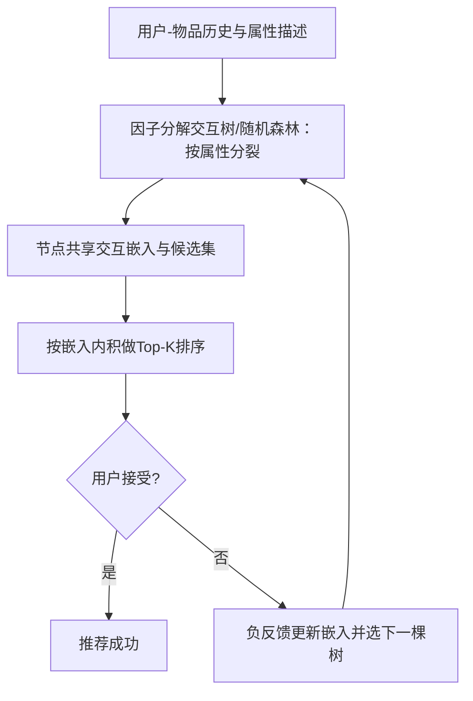
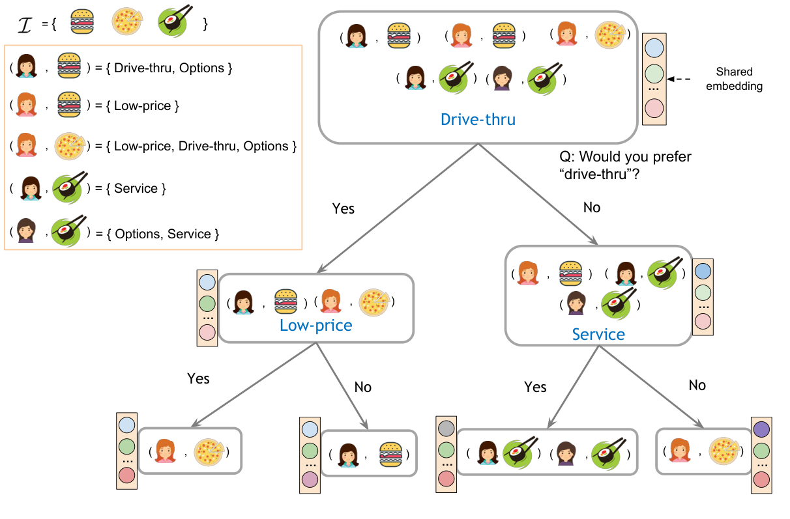

# Rethinking Conversational Recommendations: Is Decision Tree All You Need? (对话推荐再思考：决策树真的足够吗？)

- **会议/期刊**: CIKM 2022
- **作者与机构**: A S M Ahsan-Ul Haque, Hongning Wang（University of Virginia）
- **推荐链路定位**: 多轮对话交互（提问 + Top-K 排序）
- **研究方向**: 对话推荐与智能体仿真 / 决策树与集成学习
- **论文原文**: [https://arxiv.org/abs/2208.14614v1](https://arxiv.org/abs/2208.14614v1)
- **开源代码**: [https://github.com/HCDM/XRec](https://github.com/HCDM/XRec)

## TL;DR (1分钟核心速览)

本文针对多轮对话推荐中 RL 依赖用户嵌入、训练数据多且难解释的痛点，提出 FacT-CRS：把用户-物品交互而非物品空间建成因子分解决策树/随机森林，用节点共享嵌入提问、排序候选，并以 Gini 剪枝、候选集大小早停和拒绝反馈嵌入修正完成多轮闭环。在 LastFM/BookRec/MovieLens 的模拟器 SR@10 上最高较 SOTA 提升 41.5%，平均轮次下降 17.7%。

## Background & Motivation (背景与核心矛盾)

- **主流范式**: 多轮 CRS 主要由 deep RL 主导，智能体在“问属性”与“推荐物品”之间学习策略，并依赖预训练用户嵌入。
- **前人局限**: 其一，用户级嵌入对新测试用户泛化弱，测试时只能用训练用户均值；其二，决策树若直接划分物品空间，会因“同一物品被不同用户用不同属性描述”而把目标物品排除在正确分支外。
- **核心洞察 (Key Insight)**: 不应划分物品，而应划分“用户-物品交互描述”；同一物品可沿多条路径出现，路径即该用户对物品的描述上下文。
- **本文切入点**: 用因子分解交互树学习节点共享交互嵌入，并用随机森林突破单树深度限制，规则化解决提问、排序、早停与拒绝反馈。

## Method (核心方法设计)

### 1. 整体框架 (Overall Architecture)

输入用户-物品历史及属性描述，离线构建多棵交互树组成森林；在线从选定树根开始，按节点问题获得 yes/no，沿路径更新交互嵌入与候选物品集。满足早停条件则对候选集 Top-K 排序推荐，否则继续提问；若推荐被拒，则修正嵌入并选择下一棵树继续对话。训练阶段用交叉熵与 BPR 联合学习节点共享嵌入和物品嵌入。

### 2. 关键设计拆解 (Key Designs)

1. **交互树替代物品树（核心增量）**：痛点在于物品空间独占划分会丢失“同物品多描述”。本文对交互 $(u,i)$按属性$f_l$是否被提及分裂为$\mathcal{R}_z^{+|f_l}$与$\mathcal{R}_z^{-|f_l}$，每个节点共享一个嵌入$s_z$，候选集为$I_z=\{i|(u,i)\in\mathcal{R}_z\}$。分裂属性选损失最小者：$f_z=\arg\min_{f_l\in F}[\mathcal{L}_{CE}^{+}+\mathcal{L}_{CE}^{-}+\lambda_{BPR}\mathcal{L}_{BPR}+\lambda_s\|s\|_2^2]$；排序分为$w_t^I(i)=s_t^\top v_i$。直觉是“路径=描述上下文，节点=同描述交互簇”。

<figure class="paper-figure" markdown="span">
  <figcaption>图1：FacT-CRS中用户-物品交互树的概览。我们可以利用该交互树学习用户-物品交互的共享嵌入，并将其用于提问和推荐。</figcaption>
</figure>

2. **随机森林 + 双早停**：单树最多问 $H_{\max}$个问题，无法应对拒绝后的多轮追问；本文建$N$棵树，每棵仅随机考虑$f_{\max}$个属性。训练时用 Gini 剪枝：$G_z=1-(|I_z|/|\mathcal{R}_z|)^2$，大于阈值$0.996$即停止分裂。推理时若$|I_z|\le\eta$提前推荐；若$|I_z|\le K$则全量放入，否则用$s_t^\top v_i$ 补足 Top-K。

3. **负反馈与树选择**：拒绝后先保留已访问树信息，取嵌入均值 $s_t=\frac{1}{|S_t^\alpha|}\sum_{s_j\in S_t^\alpha}s_j$；对未访问树仅用已问属性得到$s'_j$，按${s'_j}^\top s_t$选最相似树。随后更新$s_{t+1}=s_t+\frac{\alpha_p}{|I_p|}\sum_{i\in I_p}v_i-\frac{\alpha_n}{|I_r|}\sum_{i\in I_r}v_i$，惩罚被拒集$I_r$、奖励下一候选集$I_p$。训练负例为$(u,i_{neg})\notin\mathcal{R}$，未显式构造 hard negative；推理主要开销来自逐树遍历与拒绝后并行评估剩余树。

## Experimental Setup & Evaluation Protocol (实验设置与评估协议)

- **数据集与预处理**: LastFM 去除评论数少于 10 的用户并合并同义属性为 33 个粗粒度属性；BookRec/MovieLens 保留 TF-IDF 最高的 35 个属性。

| 数据集 | #Users | #Items | #Interactions | 稀疏度/密度 | 特征/场景说明 |
| :--- | :---: | :---: | :---: | :---: | :--- |
| LastFM | 1,801 | 7,432 | 72,040 | 0.538% | 音乐艺术家，33 属性 |
| BookRec | 1,891 | 4,343 | 75,640 | 0.921% | 图书，35 属性 |
| MovieLens | 3,000 | 5,974 | 120,000 | 0.670% | 电影，35 属性 |

- **数据划分与防穿越 (Splitting Strategy)**: 按用户随机划分为 8:1:1 的训练/验证/测试用户，测试用户与训练用户不重叠；非全局时间戳切分，更偏向跨用户/新用户泛化。
- **排名评测协议 (Ranking Protocol)**: 使用用户模拟器逐轮问答；每个推荐轮对候选集与全局补位排序取 Top-10，目标物品出现在 Top-10 即成功；最大轮次 $T=10$，失败会话 AT 截断为 10。非采样负例排序，也不是离线一次性全库 ranking。
- **对比基线与超参设置**: 对比 MaxE、EAR、FPAN、SCPR、UNICORN 等 RL/bandit 方法；嵌入维度 $d=40$，$\lambda_{BPR}=10^{-3}$，$\alpha_p=10^{-3}$，$\alpha_n=10^{-2}$，Gini 阈值$0.996$，树深 7。

## Key Experimental Results (实验关键数据)

### 1. 主实验对比 (Main Results)

| 数据集 | 指标 | MaxE | EAR | FPAN | SCPR | UNICORN | FacT-CRS | Improv. |
| :--- | :---: | :---: | :---: | :---: | :---: | :---: | :---: | :---: |
| LastFM | SR@10 | 0.137 | 0.428 | 0.508 | 0.432 | 0.441 | **0.719** | 41.53% |
| LastFM | AT | 9.71 | 8.62 | 8.08 | 8.70 | 8.52 | **6.65** | 17.69% |
| BookRec | SR@10 | 0.206 | 0.320 | 0.397 | 0.329 | 0.358 | **0.438** | 10.33% |
| BookRec | AT | 9.64 | 9.01 | 8.31 | 9.11 | 9.00 | **8.23** | 0.96% |
| MovieLens | SR@10 | 0.262 | 0.552 | 0.589 | 0.545 | 0.596 | **0.692** | 16.10% |
| MovieLens | AT | 9.46 | 7.98 | 7.81 | 7.89 | 8.01 | **6.57** | 15.87% |

### 2. 消融实验 (Ablation Study)

| 变体 | LastFM SR/AT | BookRec SR/AT | MovieLens SR/AT |
| :--- | :---: | :---: | :---: |
| FacT-CRS | **0.719/6.65** | **0.438/8.23** | **0.692/6.57** |
| w/o 候选集 | 0.578/8.36 | 0.195/9.50 | 0.493/8.51 |
| w/o RF | 0.349/8.30 | 0.117/9.52 | 0.223/8.73 |
| w/o EarlyRec | 0.410/9.68 | 0.201/9.81 | 0.436/9.68 |
| w/o OnlineFeed | 0.704/6.58 | 0.350/8.46 | 0.595/6.53 |

### 3. 关键实验发现 (Key Findings)

1. **随机森林是决定性组件**：去掉 RF 后 LastFM SR@10 从 0.719 降至 0.349（-51.5%），BookRec 从 0.438 降至 0.117（-73.3%），MovieLens 从 0.692 降至 0.223（-67.8%）；单树深度无法支撑拒绝后的继续提问。
2. **候选集收缩显著降低排序难度**：去掉交互树候选集后，BookRec SR@10 从 0.438 降至 0.195（-55.5%），LastFM 降至 0.578（-19.6%）；叶节点多数少于 20 个物品，且同一物品分布集中，说明“按交互路径聚类”确实形成了高质量候选子集。
3. **早停与负反馈作用不同**：去掉 EarlyRec 使 LastFM AT 从 6.65 升至 9.68（+45.6%），说明其核心价值在效率；去掉 OnlineFeed 后 BookRec SR@10 从 0.438 降至 0.350、MovieLens 从 0.692 降至 0.595，说明拒绝后修正嵌入对稀疏/歧义场景更关键。

## Highlights & Limitations (亮点、对比与审稿批判)

- **与代表作对比 (vs. Prior Work)**: EAR/FPAN/UNICORN 均以 RL 策略和用户级嵌入为核心，FPAN 还会在拒绝后继续推荐更多物品；FacT-CRS 则用交互级嵌入和下一棵树选择来“先问清再推荐”。相比 SCPR 的 KG 路径推理，本文的可解释结构是属性决策路径与共享嵌入，规则更轻。
- **可迁移亮点**: 用“交互级嵌入”替代“用户级嵌入”可缓解新用户/跨用户泛化；Gini 剪枝与候选集规模早停可迁移到多轮问答、交互式检索和冷启动偏好 elicit。
- **审稿级局限批判**: 树深、树数、$\eta$、Gini 阈值等仍靠经验设定，拒绝后需评估剩余树，森林越大在线开销越高；用户模拟器的$F_i\cap F_u$ 假设偏理想，未验证真实自然语言对话，也未报告显著性检验与多用户会话记忆。

## Rating (四维评分)

- **方法创新性 (Novelty)**: ⭐⭐⭐⭐ （将因子分解树从静态划分扩展为“交互树+随机森林+在线反馈”的 CRS 闭环，机制简洁且有解释性）
- **评估协议与实验扎实度 (Protocol & Experiments)**: ⭐⭐⭐⭐ （三个基准、五个强 RL 基线、用户级划分与完整消融较扎实，但依赖模拟器且缺显著性检验）
- **写作与数学规范度 (Clarity & Rigor)**: ⭐⭐⭐⭐ （四个 CRS 子问题与公式对应清晰，部分符号与损失写法略显松散，复杂度分析不足）
- **工业落地与复现价值 (Industrial & Practical Value)**: ⭐⭐⭐⭐ （规则化、可解释、训练数据需求低且已开源；但森林超参与在线树选择开销需工程优化）

