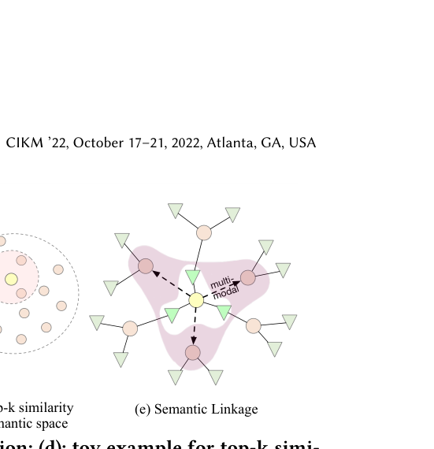
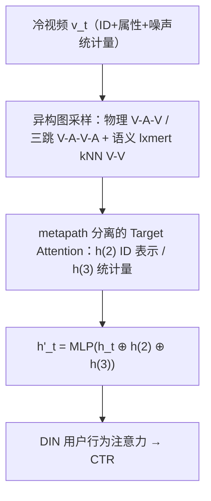

# GIFT: Graph-guIded Feature Transfer for Cold-Start Video Click-Through Rate Prediction (图引导的冷启动短视频 CTR 预估特征迁移)

- **会议/期刊**: CIKM 2022
- **作者与机构**: Yi Cao, Sihao Hu, Yu Gong, Zhao Li, Yazheng Yang, Qingwen Liu, Shouling Ji（阿里巴巴集团 / 浙江大学）
- **推荐链路定位**: 精排（item-side 模块，可下沉到粗排/召回）
- **研究方向**: 冷启动与长尾推荐 / 图神经网络与知识图谱推荐
- **论文原文**: [https://arxiv.org/abs/2202.11525v2](https://arxiv.org/abs/2202.11525v2)
- **开源代码**: 暂未开源

## TL;DR (1分钟核心速览)

淘宝首页短视频每天新增数十万条，新视频（发布 ≤3 天）既攒不够 ID embedding 所需的 5–10 次曝光，其 PV/CTR 统计量也近乎噪声，而纯内容特征早已被现有特征体系榨干。GIFT 换了个思路：不再"造"内容特征，而是构建含**物理链接**（同作者 / 同商品，覆盖 >95% 冷视频）与**多模态语义链接**（lxmert 编码标题+封面后 kNN）的异构图，用 metapath 引导的多路 target attention 把热视频的 ID 表征与历史统计迁移到冷视频上；配合"全量预训练 + 冷日志微调"的两级迁移。淘宝全量日志上 AUC 从 DIN 的 0.7568 升至 0.7693（RelaImpr +4.87%），线上 A/B 的 CTR 提升 6.82%，延迟仅增约 4 ms。

## Background & Motivation (背景与核心矛盾)

- **主流范式**: 工业 CTR 模型（DNN/Wide&Deep/DeepFM/DIN）以 ID embedding + 用户行为 target attention 为主干，冷启动问题靠补充内容侧信息（类目、标题、封面、视频表征）缓解。
- **前人局限**: ① 协同/深度模型要求实体至少出现 5–10 次才能学到有意义 ID 向量，而新视频远达不到；② 冷视频的 ctr_15d、pv_cnt 等统计量本身极不可靠，直接喂入等同于噪声；③ 更致命的是，在淘宝这种成熟平台上，标题/图像/类目等内容信息**早已被特征工程用尽**，DropOutNet（+0.19%）与 ACCM（−0.70%）这类"内容+ID 融合"的冷启动方法几乎没有增益空间。
- **核心洞察 (Key Insight)**: 新视频虽无自身行为，但**它的作者、它展示的商品**是天然存在的显式关系——作者相同则拍摄风格相近，商品相同则内容与受众相近。作者统计发现，仅靠 author/product 二跳即可把 **95% 以上**冷视频连到至少一个热视频，且完全不依赖冷视频的交互日志。
- **本文切入点**: 把冷启动从"补内容特征"重构为"沿图迁移热视频的成熟特征"，并显式区分不同 metapath 上迁移来的不同**类型**特征（ID 表示 vs. 历史统计）。

<figure class="paper-figure" markdown="span">
  <figcaption>图2：两类链接的构建规则。(a)-(c)：物理链接构建；(d)：语义表示空间中 top-k 相似度的简单示例；(e)：基于 top-k 相似度的语义链接构建。</figcaption>
</figure>

## Method (核心方法设计)

### 1. 整体框架 (Overall Architecture)

对每条冷视频 $v_t$，先离线采样其计算图并存入 iGraph 内存图库：一跳 V-A 边挂载视频自身的属性与统计量；二跳 V-A-V 沿 author / product 连到热视频，取回 ID 表征；三跳 V-A-V-A 取回热视频的 ctr_15d、pv_cnt 等统计量；另一条 V-V 语义边由 lxmert 多模态向量 kNN 得到，再向外扩一跳属性节点。GIFT 网络对每一类邻居集合分别做一次以$v_t$为 query 的 target attention，得到$\boldsymbol{h}^{(2)}$、$\boldsymbol{h}^{(3)}$，与原始$\boldsymbol{h}_t$拼接后过 MLP 生成鲁棒的$\boldsymbol{h}'_t$，再送入 DIN 的用户侧行为注意力完成 CTR 预测。训练采用全量预训练 + 冷日志微调的两级策略。

### 2. 关键设计拆解 (Key Designs)

1. **物理 + 语义双类链接构图**：痛点是一跳属性只能刻画冷视频自身（退化即内容法），且物理关系不保证语义最近邻、也无法保证每条冷视频都连满 ≥5 个热视频。本文用 author/product 建二跳 V-A-V（限热视频，保证统计可靠），三跳再向外取热视频的统计属性；同时用 lxmert 联合编码标题与封面得到语义向量，kNN 取 top-$k$ 后向外扩一跳属性。两路互补，把"结构可达"与"语义相近"解耦，召回邻居时物理边按时间间隔升序取 top-20、语义边按余弦相似度降序取 top-20。

2. **Metapath 分离的实例级特征迁移**：不同 metapath 的相关强度不同、沿途节点携带的信息类型也不同，混池池化会让信号互相抵消。GIFT 用 target attention 显式区分。ID 表征迁移把三条路径的热视频 embedding 合并后统一注意力池化：

$$\boldsymbol{h}^{(2)}=\text{TargetAttention}\big(\boldsymbol{h}_t\boldsymbol{W}^{Q}_{2},\ \mathbf{E}^{(2)}\boldsymbol{W}^{K}_{2},\ \mathbf{E}^{(2)}\boldsymbol{W}^{V}_{2}\big)$$

统计量迁移则对 $\rho_a,\rho_p,\rho_s$三条路径**各自独立**做一次注意力再加权拼接（$\boldsymbol{h}^{(3)}=\boldsymbol{h}^{(3)}_a\oplus\boldsymbol{h}^{(3)}_p\oplus\boldsymbol{h}^{(3)}_s$），因为"同商品"共享内容语义、"同作者"共享拍摄风格，独立建模可防止异质信号被平均稀释。最终$\boldsymbol{h}'_t=\text{MLP}(\boldsymbol{h}_t\oplus\boldsymbol{h}^{(2)}\oplus\boldsymbol{h}^{(3)})$。以$\boldsymbol{h}_t$ 为 query 使注意力自发聚焦与目标最像的邻居，这正是 mean/sum pooling 做不到的。

3. **两级迁移训练与推理开销**：先用 15 天全量日志预训练（冷视频样本仅占约 1/10，单独训练泛化不足且会过拟合内容特征），再在近 1 月冷视频日志上微调以消除"老视频模型过度依赖 ID/统计量"的域偏置，该步单独贡献 0.86% RelaImpr。损失为标准交叉熵：

$$\mathcal{L}=-\frac{1}{N}\sum_{(x,y)\in\mathcal{D}}\big[y\log f(x)+(1-y)\log(1-f(x))\big]$$

负样本直接取自曝光未点击日志（无额外负采样器）；邻居子图**离线预采样**后按序列存入 iGraph，在线只做异步查询，故图采样不进入推理关键路径。由于 GIFT 纯属 item-side 计算，可无缝迁移到 DNN/Wide&Deep/DeepFM 等任意主干。

## Experimental Setup & Evaluation Protocol (实验设置与评估协议)

- **数据集与预处理**:

| 数据集 | #Users | #Items | #Samples | 稀疏度/密度 | 特征/场景说明 |
| :--- | :---: | :---: | :---: | :---: | :--- |
| Taobao-full | 4.98e7 | 2.2e7 | 5.78e8 | 极稀疏 | 15 天全量视频交互日志均匀采样 |
| Taobao-cold | 3.0e7 | 4.8e5 | 1.38e8 | 极稀疏 | full 的子集，仅含发布 ≤3 天新视频日志 |
| Taobao-test | 2.1e6 | 1.2e5 | 9.4e6 | 极稀疏 | full/cold 之后 1 天的冷视频日志 |

- **数据划分与防穿越 (Splitting Strategy)**: 严格**全局时间戳切分**——full/cold 取 15 天日志，test 取紧随其后的 1 天，且 test 仅含冷视频，模拟线上"用历史预测未来新视频"的真实场景，无标签泄漏。
- **排名评测协议 (Ranking Protocol)**: 由于是 CTR 任务，采用**真实曝光日志上的 AUC**（非采样负例，正负比即线上真实分布），并辅以 $\text{RelaImpr}=\big(\frac{\text{AUC}_{m}-0.5}{\text{AUC}_{b}-0.5}-1\big)\times100\%$ 做相对归一化。
- **对比基线与超参设置**: 三类基线——手工特征（LR/SVM/GBDT）、DNN 系（DNN/Wide&Deep/DeepFM/DIN）、冷启动专法（DropOutNet/ACCM，均以 DIN 为主干以保证公平）。所有 DNN 主干统一为 512-256-128 三层 MLP，注意力隐层 128，Adagrad + lr=1e-4，batch=512，物理/语义邻居数均取 20（>20 后边际收益可忽略）。

## Key Experimental Results (实验关键数据)

### 1. 主实验对比 (Main Results)

| 方法 | 类别 | AUC | RelaImpr |
| :--- | :--- | :---: | :---: |
| LR | 手工特征 | 0.7218 | −13.63% |
| GBDT | 手工特征 | 0.7377 | −7.44% |
| DNN | DNN 系 | 0.7423 | −5.65% |
| Wide&Deep | DNN 系 | 0.7465 | −4.01% |
| DeepFM | DNN 系 | 0.7508 | −2.33% |
| DIN (base) | DNN 系 | 0.7568 | 0.00% |
| DropOutNet | 冷启动 | 0.7573 | +0.19% |
| ACCM | 冷启动 | 0.7550 | −0.70% |
| **GIFT** | Ours | 0.7670 | **+3.97%** |
| **GIFT† (微调)** | Ours | **0.7693** | **+4.87%** |

### 2. 消融实验 (Ablation Study)

| 层级 | 移除项 | AUC | RelaImpr |
| :--- | :--- | :---: | :---: |
| 特征 | R(−) 去掉 ID 表示 | 0.7600 | −2.62% |
| 特征 | S(−) 去掉统计量 | 0.7636 | −1.27% |
| 图 | P(−) 去掉全部物理边 | 0.7603 | −2.51% |
| 图 | P(author)(−) | 0.7631 | −1.46% |
| 图 | P(product)(−) | 0.7620 | −1.87% |
| 图 | S(−) 去掉语义边 | 0.7622 | −1.80% |
| 模型 | $\boldsymbol{h}^{(2)}$(−) | 0.7635 | −1.31% |
| 模型 | $\boldsymbol{h}^{(3)}$(−) | 0.7594 | −2.85% |
| — | GIFT 完整版 | **0.7670** | 0.00% |

### 3. 关键实验发现 (Key Findings)

1. **ID 表示比统计量更值钱**：去掉 ID 表示掉 2.62% RelaImpr，去掉统计量只掉 1.27%；原因是 ID 向量不仅补偿冷视频自身的表征不足，还决定了 target attention 打分能否算准——纯数值统计量无法支撑注意力匹配。
2. **语义边与物理边互补且 product 强于 author**：单独去语义边掉 1.80%，几乎与去掉全部物理边（−2.51%）同量级；同商品（−1.87%）比同作者（−1.46%）更强，说明"卖同一件货"比"同一人拍摄"蕴含更紧的内容一致性。
3. **统计量迁移层 $\boldsymbol{h}^{(3)}$贡献大于 ID 层$\boldsymbol{h}^{(2)}$**（−2.85% vs −1.31%），因其同时携带邻居 ID 与历史 PV/CTR 两类信息；线上部署带来 CTR 4.180%→4.465%（**+6.82%**），端到端响应时间仅从 129.99 ms 升至 133.31 ms，400 worker 下训练速度已逼近 DIN。

## Highlights & Limitations (亮点、对比与审稿批判)

- **与代表作对比 (vs. Prior Work)**: 相比 DropOutNet 的"输入 dropout 让模型适应缺失特征"与 ACCM 的"注意力融合 ID 与内容向量"，GIFT 的根本差别在于**信息源不是内容而是邻居**——它迁移的是热视频已经学好的 ID/统计量，绕开了"内容特征已被榨干"的死局，这也是二者在淘宝数据上近乎零增益而 GIFT 有 4% 提升的原因。相比同期的图冷启动工作（如基于知识图谱的元学习路线），GIFT 的图不含任何用户交互边，因此对严格零交互的新品同样适用。
- **可迁移亮点**: ① "路径分离 + 单独注意力再拼接"的策略可直接搬到任何多关系异构图召回/精排模块，避免异质信号池化稀释；② "离线预采样邻居序列 + 内存图库异步查询"是把图模型延迟压到可忽略的工程范式，值得所有在线图推荐系统借鉴。
- **审稿级局限批判**: ① **评估仅用 AUC**，未报告 NDCG/GAUC 或按视频年龄分桶的细粒度结果，无法判断收益是否集中在"发布 2–3 天"而非真正的 0–1 天极冷区间；② 语义链接依赖 lxmert 对标题+封面的编码质量，封面党/标题党会造成语义边噪声，论文未做鲁棒性分析；③ 超参 top-20 的选择仅凭"边际收益递减"的经验观察，缺乏对度数长尾分布下采样偏差的讨论；④ 与 DIN 的 AUC 差仅 0.01，虽线上显著，但离线未给置信区间或多次随机种子结果。

## Rating (四维评分)

- **方法创新性 (Novelty)**: ⭐⭐⭐⭐ （把冷启动从"补内容"翻转为"图迁移成熟特征"，物理/语义双链接与 metapath 分离注意力组合巧妙，但图迁移本身非全新范式）
- **评估协议与实验扎实度 (Protocol & Experiments)**: ⭐⭐⭐⭐ （亿级真实数据 + 严格时间切分 + 线上 A/B + 特征/图/模型三层消融齐备，扣分在仅有 AUC 单一指标与缺显著性检验）
- **写作与数学规范度 (Clarity & Rigor)**: ⭐⭐⭐⭐ （公式简洁、metapath 定义清晰、系统实现描述详实，但 Eq.4 中 $\rho_a/\rho_s$ 的邻居集合标注存在笔误，易误读）
- **工业落地与复现价值 (Industrial & Practical Value)**: ⭐⭐⭐⭐⭐ （已在淘宝上线并给出完整 iGraph/ABFS 部署架构、+4 ms 延迟与 400 worker 扩展性数据，工程参考价值极高；可惜未开源代码）

