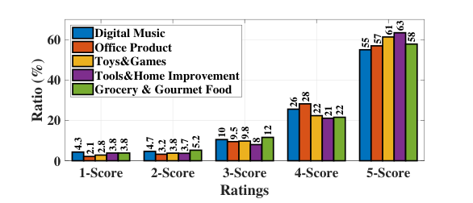
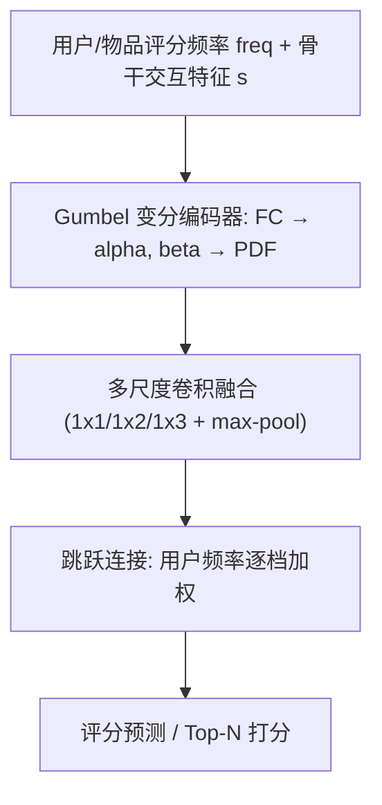
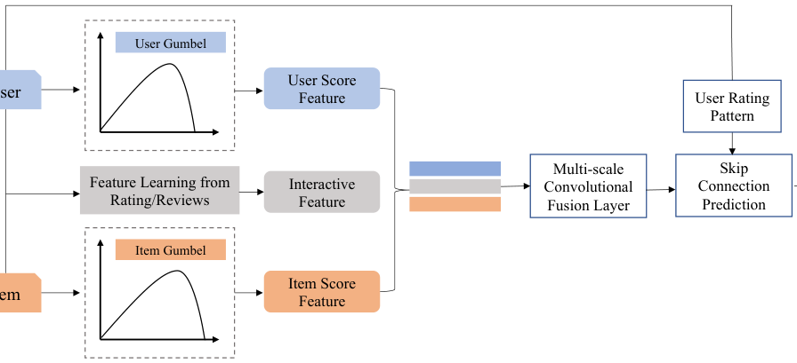

# A Gumbel-based Rating Prediction Framework for Imbalanced Recommendation (面向不平衡推荐的 Gumbel 评分预测框架)

- **会议/期刊**: CIKM 2022
- **作者与机构**: Yuexin Wu, Xiaolei Huang (University of Memphis)
- **推荐链路定位**: 精排（评分预测 / 回归 + Top-N 排序双目标）
- **研究方向**: 协同过滤与双塔召回 / 去偏公平与可信推荐
- **论文原文**: [https://arxiv.org/abs/2012.05009v6](https://arxiv.org/abs/2012.05009v6)
- **开源代码**: [https://github.com/woqingdoua/Gumbel-](https://github.com/woqingdoua/Gumbel-)

## TL;DR (1分钟核心速览)

真实评分呈长尾（Amazon 五类目 4–5 星占比 81–91%），而 PMF/ANR/NARRE/NRPA 等主流模型的预测分布几乎坍缩成单峰，尾部 1–3 星几乎无法命中。本文提出 GVN：用 Gumbel PDF 作为激活函数构建确定性变分编码器，把用户/物品的评分频率向量映射到非正态空间，再经多尺度卷积融合评论交互特征、以跳跃连接按用户评分频率重新加权输出。作者在 4 个 Amazon 类目 + Yelp 上、随机 80/10/10 划分、MAE 与 Top-5 HR/NDCG/F1 双协议评测，作为"插件"包裹任意骨干后 MAE 相对下降 0.46%–57.82%（TDAR 降幅最大）。

## Background & Motivation (背景与核心矛盾)

- **主流范式**: 评分预测分两支——评分型（PMF、NeuMF 从评分矩阵学隐向量）与评论型（DeepCoNN、ANR、NARRE、NRPA、TDAR 用 CNN/注意力从用户与物品评论中抽取语义），失衡处理则普遍采用加权交叉熵（重加权）或 RERANK 式的头尾标签分模型训练。
- **前人局限**: ①重加权假设数据落在"正态、对称、均衡"的空间里，只能调整损失权重，无法改变特征表征本身的偏斜；②重加权/重采样依赖人工设定类权重，RERANK 式分模型则显存开销翻倍且割裂了不同评分档之间的相关性。
- **核心洞察 (Key Insight)**: 图 1 的分布统计与图 2 的预测分布对比表明，模型并非"分错"，而是"根本不敢预测低分"——预测分布整体向头类挤压。Gumbel 属于极值分布（EVD），天生刻画"稀有极大/极小事件"的概率，正好对应 1–2 星这类长尾评分；只要能给稀有档位保留可激活的概率质量，偏斜就能被"平滑"掉。

<figure class="paper-figure" markdown="span">
  <figcaption>图 1：Amazon 评论的评分分布。</figcaption>
</figure>

- **本文切入点**: 放弃正态假设，用可学习的 Gumbel 位置参数 $\alpha$与尺度参数$\beta$ 直接生成每个评分档的隐概率，作为一种"非正态激活函数"替换 softmax/频率直方图。

## Method (核心方法设计)

### 1. 整体框架 (Overall Architecture)

GVN 是即插即用外壳：输入端取用户 $i$、物品$j$各自的评分频率向量$\mathrm{freq}^{u}_{i}$、$\mathrm{freq}^{i}_{j}\in\mathbb{R}^{1\times c}$（$c=5$），并保留一个可选骨干（评分型或评论型）输出的交互特征$\mathbf{s}_{u,i}$。Gumbel 变分编码器把频率向量变为非正态概率表征$\mathbf{p}^{u}_{i}$、$\mathbf{p}^{i}_{j}$；三路特征投影到同维后堆成$\mathbf{z}_{i,j}\in\mathbb{R}^{c\times 3}$，经$c\times1/c\times2/c\times3$三种卷积核 + max-pooling 融合为$\mathbf{h}_{i,j}$；最后由跳跃连接用用户评分频率对$\mathbf{h}_{i,j}$逐档加权输出$\hat{r}_{i,j}$。训练按任务切换 MSE（回归）或 BCE（Top-N），推理仅一次前向，无采样。

<figure class="paper-figure" markdown="span">
  <figcaption>图 3：基于 Gumbel 的变分网络框架概览。</figcaption>
</figure>

### 2. 关键设计拆解 (Key Designs)

1. **Gumbel 变分编码器（非正态空间激活）**：痛点是不均衡档位在正态/softmax 空间中被压成近零概率。作者把频率向量送入两路并行的全连接网络学出逐档的 $\alpha_l,\beta_l$，再以 Gumbel PDF 直接充当激活：
 $p^{u}_{i,l}=\frac{1}{\beta_l}\exp\!\left(\frac{x_l-\alpha_l}{\beta_l}-\exp\frac{x_l-\alpha_l}{\beta_l}\right),\ \beta_l>0$，其中$x_l\in\{1,\dots,5\}$为评分档标签，并对$\beta_l=\sqrt{\beta_l^2+\Delta}$（$\Delta=0.5$）做平滑防除零。直觉：$\alpha_l$决定该档位是否落入"激活区"、$\beta_l$决定激活陡峭度；大$\alpha_l$ 会把稀有档的隐概率抬起来，即使某用户历史上从未打过 1 星也能得到一个非零的可分辨概率。与 Gumbel-Softmax 的本质区别在于这是**确定性**前向，不含重参数化采样。
2. **多尺度卷积融合层（3 视图相关性建模）**：三路特征若简单拼接/平均，无法刻画"用户偏好档 × 物品口碑档 × 交互强度"之间的交叉。作者把 $\mathbf{p}^{u}_i,\mathbf{p}^{i}_j,\mathbf{t}_{i,j}$堆成$c\times3$特征图，用$c\times1$抓单路内部信息、$c\times2$抓$\mathbf{p}^{u}_i$与交互特征的相关性、$c\times3$抓三路整体交互，各自 max-pool 后拼接得$\mathbf{m}_{i,j}\in\mathbb{R}^{K}$，再线性映射$\mathbf{h}_{i,j}=\mathbf{m}_{i,j}^{\top}\mathbf{W}_1+\mathbf{b}_1$。
3. **跳跃连接与训练目标**：深层变分网络易出现梯度退化，且 $\alpha/\beta$信息在融合中被稀释。作者把用户评分频率与融合特征做逐档乘性再连接：$\hat{r}_{i,j}=\sum_{l=1}^{c} f(\mathrm{freq}^{u}_{i,l})\,h_{i,j,l}$，其中$f(\cdot)$为同维全连接——相当于为每个用户学一个个性化的"档位先验权重"。回归用$\mathcal{L}=\sum_{(i,j)\in\Omega}(\hat{r}_{i,j}-r_{i,j})^2$，Top-N 用 BCE（正样本为有评分记录的用户-物品对，负样本按未交互采样）。全程无负采样调优、无额外推理开销（相比 RERANK 省掉一份模型）。

## Experimental Setup & Evaluation Protocol (实验设置与评估协议)

- **数据集与预处理**: 4 个 Amazon 类目 + Yelp，沿用"用户评论数 $>5$"的过滤（等同 5-core 精神）；评论经 NLTK 分词，短补长截至统一长度，覆盖 0.85% 的用户/物品。

| 数据集 | #Users | #Items | #Interactions | 稀疏度(密度%) | 5/4/3/2/1 星占比(%) |
| :--- | :---: | :---: | :---: | :---: | :--- |
| Musical Instrument | 1,429 | 900 | 10,261 | 0.798 | 68.06 / 20.37 / 7.29 / 2.31 / 1.97 |
| Toys Game | 19,412 | 11,924 | 167,597 | 0.079 | 62.16 / 21.66 / 9.47 / 3.80 / 2.91 |
| Digital Music | 5,541 | 3,568 | 64,706 | 0.327 | 55.01 / 26.03 / 10.04 / 4.71 / 4.33 |
| Video Game | 24,303 | 10,672 | 231,779 | 0.089 | 63.03 / 23.37 / 8.26 / 2.91 / 2.43 |
| Yelp | 1,631 | 1,633 | 78,966 | 2.960 | 27.43 / 41.69 / 19.18 / 8.22 / 3.84 |

- **数据划分与防穿越**: 随机 `比例划分` 80%/10%/10%（非全局时间戳切分，非 Leave-One-Out），验证集选超参、测试集报结果。
- **排名评测协议**: 近似 `Sampled Ranking`——对每个测试用户仅在测试集中的正样本与负样本间打分排序后取 Top-5，报告 F1 / HR@5 / NDCG@5；回归侧用 MAE（对离群鲁棒）。**注意：未做 Full-Ranking 全库排序**。
- **对比基线与超参**: 评分型 PMF、NeuMF；评论型 DeepCoNN、ANR、NARRE、NRPA、TDAR；失衡专用 RERANK。统一 300 维 GloVe 词向量、Adam、学习率 $\in[0.005,0.01,0.03]$每轮衰减 60%、batch 64、最多 30 epoch；重复 5 次，$p<0.05$ t 检验。

## Key Experimental Results (实验关键数据)

### 1. 主实验对比 (Main Results)

MAE（越低越好，加粗为全表最优；`Improv.` 为同骨干挂载 GVN 后的相对降幅）：

| 骨干 | Musical | Toys | Digital Music | Video Game | Yelp |
| :--- | :---: | :---: | :---: | :---: | :---: |
| PMF | 0.744 | 0.788 | 0.895 | 1.421 | 0.738 |
| NeuMF | 0.655 | 0.723 | 0.778 | 0.902 | 0.798 |
| DeepCoNN | 0.636 | 0.664 | 0.769 | 0.860 | 0.768 |
| ANR | 0.623 | 0.657 | 0.766 | 0.987 | 0.783 |
| NARRE | 0.771 | 0.710 | 0.802 | 0.926 | 0.860 |
| NRPA | 0.684 | 0.692 | 0.806 | 0.949 | 0.881 |
| TDAR | 1.504 | 1.375 | 1.179 | 1.248 | 1.195 |
| **PMF(G)** | 0.639 | **0.566** | 0.662 | 0.799 | **0.725** |
| **NeuMF(G)** | 0.652 | 0.552 | 0.689 | 0.720 | 0.780 |
| **DeepCoNN(G)** | 0.638 | 0.538 | **0.532** | 0.668 | 0.728 |
| **ANR(G)** | **0.611** | **0.510** | 0.675 | **0.664** | 0.760 |
| **NARRE(G)** | 0.665 | 0.534 | 0.669 | 0.670 | 0.820 |
| **NRPA(G)** | 0.616 | 0.570 | 0.543 | 0.683 | 0.726 |
| **TDAR(G)** | 0.634 | 0.649 | 0.570 | 0.727 | 1.052 |
| Improv.% 区间 | 0.46–57.8 | 18.9–52.8 | 11.4–51.7 | 20.2–54.3 | 1.76–17.6 |

Top-5 排序（HR@5 / NDCG@5）：

| 方法 | Musical | Toys | Video Game | Yelp |
| :--- | :---: | :---: | :---: | :---: |
| PMF | 0.0903 / 0.0334 | 0.0710 / 0.0359 | 0.1812 / 0.0595 | 0.6900 / 0.2400 |
| NARRE | 0.2788 / 0.1144 | 0.3520 / 0.1197 | 0.4266 / 0.1590 | 0.7880 / 0.3302 |
| TDAR | 0.3629 / 0.1500 | 0.4377 / 0.1899 | 0.4428 / 0.1726 | 0.5168 / 0.1475 |
| NeuMF(G) | **0.5119 / 0.2738** | 0.3420 / 0.1451 | **0.5828 / 0.2727** | **0.8080 / 0.3320** |
| NARRE(G) | 0.5000 / **0.2749** | 0.3280 / 0.1532 | 0.4384 / 0.1661 | 0.8000 / 0.3233 |
| NRPA(G) | 0.4702 / 0.2453 | 0.1260 / 0.0532 | 0.5664 / 0.2528 | 0.7840 / 0.3314 |
| TDAR(G) | 0.4970 / 0.2500 | **0.4465 / 0.2063** | 0.5302 / 0.2247 | 0.5603 / 0.1631 |

### 2. 消融实验 (Ablation Study)

MAE，`-G` 去 Gumbel 模块（频率直入融合层），`-F` 去多尺度卷积改用三视图均值，`-S` 去跳跃连接（$\hat{r}_{i,j}=\sum_l h_{i,j,l}$）：

| 配置 | Musical | Office Product | Toys | Grocery |
| :--- | :---: | :---: | :---: | :---: |
| PMF(G) | 0.639 | 0.584 | 0.566 | 0.678 |
| PMF -G | 0.694 | 0.703 | 0.630 | 0.744 |
| PMF -F | 0.790 | 0.631 | **0.554** | 0.754 |
| PMF -S | 0.640 | 0.581 | 0.594 | 0.709 |
| NeuMF(G) | 0.652 | 0.622 | 0.552 | 0.750 |
| NeuMF -G | 0.734 | 0.658 | 0.604 | 0.770 |
| NeuMF -F | 0.723 | 0.676 | 0.592 | 0.731 |
| NeuMF -S | 0.700 | 0.621 | 0.598 | 0.767 |
| ANR(G) | **0.611** | 0.604 | **0.510** | 0.754 |
| ANR -G | 0.733 | 0.676 | 0.563 | 0.706 |
| ANR -F | 0.649 | 0.650 | 0.550 | 0.711 |
| ANR -S | 0.638 | 0.627 | 0.545 | 0.723 |
| NARRE(G) | 0.665 | 0.592 | 0.534 | 0.669 |
| NARRE -G | 0.790 | 0.680 | 0.586 | 0.726 |
| NARRE -F | 0.727 | 0.738 | 0.572 | 0.726 |
| NARRE -S | 0.644 | 0.599 | 0.569 | 0.741 |

分布函数替换实验（24 个任务）：Gumbel 在 18/24（75%）任务上最优；EVD 家族（Gumbel/Weibull/Fréchet）整体优于 Poisson/Normal/Exponential。例：NeuMF 在 Toys 上 Gumbel 0.552 vs. Normal 0.721 vs. Poisson 0.659。

与失衡专用 RERANK 对比（Amazon）：RERANK 在 PMF 上 MAE 0.937 / F1 0.070 / HR 0.232，GVN 为 0.639 / 0.163 / 0.481；Yelp 上 RERANK 在 NARRE 上仅 0.842 MAE，GVN 0.820。

### 3. 关键实验发现 (Key Findings)

- **尾部档位误差被真正压缩，而非牺牲头类换取**：图 5 逐档 MAE 显示 Toys 上 PMF 的 1 星误差由 3.01 降至 2.09、2 星由 2.24 降至 1.51，同时 5 星误差从 1.35 降到 0.44——"越稀有的档位降幅越大"这一非对称下降是 Gumbel 抬升稀有档隐概率的直接证据。
- **Gumbel 模块是唯一不可替代组件**：所有骨干上 `-G` 均造成最大退化（NARRE 在 Musical 从 0.665 恶化到 0.790，退化 18.8%），而 `-F`/`-S` 仅在部分数据集退化 1–15%，甚至在 Toys 上略优；说明融合层与跳跃连接是"锦上添花"，非正态空间才是"雪中送炭"。
- **失衡越重收益越大**：Video Game（1–2 星占比 5.34%，五类中偏头疼最高）与 TDAR 骨干上相对降幅冲到 54.3%/57.8%；反之 Yelp（5 星仅 27.4%，分布最平）最佳增益仅 1.76–17.6%，佐证收益来源确为长尾矫正而非通用正则。

## Highlights & Limitations (亮点、对比与审稿批判)

- **与代表作对比 (vs. Prior Work)**: 相比 RERANK 的"头尾分模型"，GVN 用单一端到端网络把类间相关性保留下来且显存不翻倍；相比 Gumbel-Softmax（Jang 等）的随机采样重参数化，GVN 直接用 PDF 当确定性激活，可零成本挂到任意评分/评论骨干上；相比 PMF/ANR 的隐向量点积，它把"评分档位分布"本身作为一等公民建模。
- **可迁移亮点**: ①"分布函数作激活"这一招可直接搬到 CTR 的多档位校准、星级/情感多分类、以及长尾物品的曝光概率建模；②$\sqrt{\beta^2+\Delta}$ 的尺度平滑技巧能避免 EVD 在训练初期数值爆炸，成本几乎为零。
- **审稿级局限批判**: ①**增益归因存疑**——PMF 挂上 GVN 后 HR@5 从 0.0903 跃到 0.5119（5.7×），而 GVN 的输入恰恰是"用户/物品评分频率直方图"，这本质上是把强先验（物品平均分/流行度）直接喂给了排序器，性能飞跃更可能来自特征泄漏而非 Gumbel；②**评估协议偏弱**——随机 80/10/10 划分而非时间切分，存在未来评分泄漏；Top-N 用 1 正 vs. 采样负而非 Full-Ranking，HR/NDCG 数值与真实生产差距大，且未报告方差与效应量；③Yelp 上多数配置仅个位数提升甚至负向（DeepCoNN(G) 在 Musical 上 0.638 > 0.636），说明分布失衡较轻时方法无优势，缺少"何时该用"的自适应判据。

## Rating (四维评分)

- **方法创新性 (Novelty)**: ⭐⭐⭐⭐ （首次把 Gumbel PDF 当作确定性激活来解决评分长尾，思路清爽且不属于"换个损失函数"的修修补补）
- **评估协议与实验扎实度 (Protocol & Experiments)**: ⭐⭐⭐ （5 数据集 + 误差/排序双指标 + 分布替换 + 消融 + RERANK 对比很齐全，但随机划分、采样排序与只看均值仍是硬伤）
- **写作与数学规范度 (Clarity & Rigor)**: ⭐⭐⭐ （三模块叙述清晰、图示直观，但 Gumbel PDF 与标准形式的符号混用、$\Delta$ 只给经验值、缺乏复杂度与收敛性分析）
- **工业落地与复现价值 (Industrial & Practical Value)**: ⭐⭐⭐ （代码已开源、作为插件即插即用且推理零额外开销，但 Top-N 增益成因待厘清，直接上线存在被高频先验"骗分"的风险）

