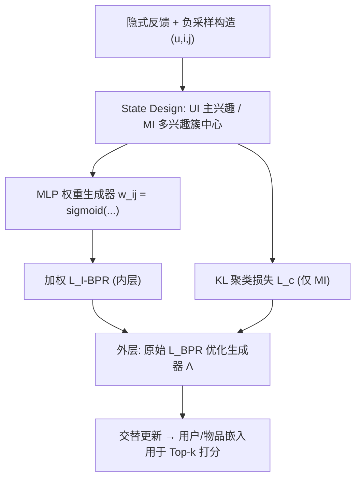

# Adapting Triplet Importance of Implicit Feedback for Personalized Recommendation (面向隐式反馈三元组重要性的自适应个性化推荐)

- **会议/期刊**: CIKM 2022
- **作者与机构**: Haolun Wu, Xue Liu, Mark Coates (McGill University)；Chen Ma (City University of Hong Kong)；Yingxue Zhang, Ruiming Tang (华为诺亚方舟实验室)
- **推荐链路定位**: 召回（训练范式层面，可插拔于 MF / GNN 骨干）
- **研究方向**: 协同过滤与双塔召回 / 自监督对比学习与交互去噪
- **论文原文**: [https://arxiv.org/abs/2208.01709v4](https://arxiv.org/abs/2208.01709v4)
- **开源代码**: [https://github.com/haolun-wu/TIL](https://github.com/haolun-wu/TIL)

## TL;DR (1分钟核心速览)

隐式反馈下 BPR 对所有三元组 $(u,i,j)$ 一视同仁，忽略「正物品偏好强弱」与「负物品假阴性」的差异；现有工作要么只调负采样、要么只重加权正样本对，都无法刻画三元组的整体可信度。本文提出 **TIL**：用 MLP 从「正/负物品与用户兴趣的贴合度」状态生成三元组权重，并以**双层优化**（内层学嵌入、外层学权重生成器）避免权重坍缩到 0，配合单兴趣 (UI) 与端到端多兴趣聚类 (MI) 两种状态设计。在 Amazon_CD/Gowalla/Last.fm 三数据集、四种骨干上 Recall@20 全面领先，最优基线之上再提升 3–21%。

## Background & Motivation (背景与核心矛盾)

- **主流范式**: 隐式反馈推荐几乎统一采用成对排序（BPR）构造 $(u,i,j)$ 三元组，再用 MF 或 LightGCN 类 GNN 编码用户/物品嵌入。
- **前人局限**: 一类工作只做负采样（AOBPR/WBPR/PRIS），一类只重加权正样本对（TCE/RCE）；二者都只触及三元组的一个端点，必然次优。此外辅助信息（停留时长）流派在实际系统中常常拿不到。
- **核心洞察 (Key Insight)**: 三元组的重要性不由 user、item 或 user-item 对单独决定，而是由三者共同关系决定。原文例子：只爱超级英雄片的 $u$，$\langle u,\text{Iron Man},\text{Spider Man}\rangle$应给小权重，$\langle u,\text{Iron Man},\text{Titanic}\rangle$ 应给大权重。
- **本文切入点**: 不直接为每个三元组分配可学习标量（空间爆炸且必然坍缩至 0），而是学习一个**从状态到权重的生成函数**，并把「学权重」与「学嵌入」用双层优化解耦。

## Method (核心方法设计)

### 1. 整体框架 (Overall Architecture)

输入用户的隐式交互集 $S_u^+$，负采样得到三元组流；State Design 模块把每个三元组编码成状态向量（UI 策略仅用主兴趣$\eta_u$，MI 策略额外引入物品所属簇中心$\mu_{c_i},\mu_{c_j}$）；一个两层 MLP 把状态映射为$(0,1)$权重$w_{uij}$，用于加权 BPR 损失。训练采用内/外层交替：内层固定$\Lambda$ 优化嵌入/图参数，外层用一步近似梯度优化权重生成器；MI 版本额外叠加自监督 KL 聚类损失，簇中心在训练中端到端更新，推理阶段零额外开销（权重生成器不参与打分）。

### 2. 关键设计拆解 (Key Designs)

1. **三元组级加权 BPR（Triplet Importance Enhanced Ranking）**：把等权 BPR 改写成 $L_{\text{I-BPR}} = f(\mathbf{s}_{uij};\Lambda)\cdot L_{\text{BPR}}(u,i,j;\Theta)$，其中$f$为$\text{relu}\rightarrow\text{sigmoid}$ 的两层 MLP。直觉：让「正物品贴合主兴趣、负物品远离主兴趣」的三元组主导梯度，从而在不引入辅助信息的前提下模拟细粒度偏好强度。
2. **UI / MI 状态设计（兴趣贴合度作为权重的输入信号）**：单兴趣状态 $\mathbf{s}^{\text{UI}}_{uij}=(\mathbf{q}_i\odot\boldsymbol{p}_u+\mathbf{q}_i\odot\boldsymbol{\eta}_u)\,\|\,(\mathbf{q}_j\odot\boldsymbol{p}_u+\mathbf{q}_j\odot\boldsymbol{\eta}_u)$，前三项分别刻画「当前嵌入偏好」与「与主兴趣$\boldsymbol{\eta}_u=\frac{1}{|S_u^+|}\sum_{v\in S_u^+}\mathbf{q}_v$的一致性」。MI 策略再加$\alpha\cdot(\boldsymbol{\mu}_{c_i}\odot\boldsymbol{p}_u+\boldsymbol{\mu}_{c_i}\odot\boldsymbol{\eta}_u)$ 等四项，把物品所属簇中心作为细粒度兴趣锚点，解决单向量无法覆盖多峰兴趣的问题。
3. **端到端聚类（End-to-end Clustering）**：直接对簇中心用 K-means 与下游目标脱耦，故把簇中心矩阵 $\Phi\in\mathbb{R}^{K\times d}$设为可学习参数：软分配用 Student-t 核$Q_{ik}\propto(1+\|\mathbf{q}_i-\Phi_k\|^2/\tau)^{-\frac{\tau+1}{2}}$，目标分布$T_{ik}\propto Q_{ik}^2/\sum_i Q_{ik}$（平方以强化高置信样本），并以$\mathcal{L}_c=\mathrm{KL}(T\|Q)$拉近样本与簇心。核心公式：$\min_{\Gamma}\ \sum L_{\text{I-BPR}}+\gamma\mathcal{L}_c$，$\Gamma=[\Theta\|\Phi]$。
4. **训练目标、负采样与推理效率**：总损失即式 (10)/(11) 的加权和；负采样为**均匀采样、每正样本配 1 个负样本**（非 hard negative、非免负采样）。关键是外层目标仍用**未加权** $\mathcal{L}_{\text{BPR}}$：$\min_\Lambda \mathcal{L}_{\text{BPR}}(\Theta^*(\Lambda))$，并用$\nabla_\Lambda \mathcal{L}\approx\nabla_\Lambda\mathcal{L}(\Theta-\alpha\nabla_\Theta \mathcal{L}_{\text{inner}})$做一阶近似，从而无需在整个数据上施加$\sum w=1$的批内不可行约束。代价仅训练期多一套优化器（$K=60$、预训练 500 epoch、每 10 iter 刷新簇归属），**在线推理与骨干模型完全一致**。

## Experimental Setup & Evaluation Protocol (实验设置与评估协议)

- **数据集与预处理**: 显式评分 $\ge 4$视为正反馈，其余为缺失；过滤交互数$<10$ 的用户与物品（类 10-core）。

| 数据集 | #Users | #Items | #Interactions | 密度 | 领域 |
| :--- | :---: | :---: | :---: | :---: | :--- |
| Amazon_CD | 11,346 | 32,705 | 466,501 | 0.126% | 亚马逊 CD 商品 |
| Gowalla | 29,858 | 40,981 | 1,027,370 | 0.084% | LBSN 签到 |
| Last.fm | 23,385 | 34,186 | 982,798 | 0.123% | 音乐收听 |

- **数据划分与防穿越 (Splitting Strategy)**: **比例划分 8:1:1**（train/valid/test），同种子重复 5 次取均值；未采用 Leave-One-Out，也未采用全局时间戳切分（存在未来交互泄漏风险）。
- **排名评测协议 (Ranking Protocol)**: 指标为 Recall@20 与 NDCG@20；训练侧每正样本采 1 个均匀负例，评测侧论文未明示是 Full-Ranking 还是采样排序（按 8:1:1 + 全测试集候选的常见实践推断应为全库排序，属可复现性瑕疵）。
- **对比基线与超参设置**: 负采样类 BPR/AOBPR/WBPR/PRIS，正对重加权类 TCE/RCE 及其成对排序复现 TCE-BPR/RCE-BPR；骨干 MF、NeuMF、MGCCF、LightGCN（1 层图卷积）；嵌入维度 $d=64$，batch=5000，Adam + Xavier，$\lambda\in\{10^{-6},\dots,10^{-2}\}$，$\alpha\in\{10^{-2},0.1,1,5,10\}$，$\gamma\in\{10^{-4},\dots,0.1\}$，早停（验证 Recall@20 连续 100 轮不涨）；对最优基线做 paired t-test，$p\le 0.01$。

## Key Experimental Results (实验关键数据)

### 1. 主实验对比 (Main Results)

Recall@20 / NDCG@20 (%)，加粗为最优，`Improv.` 相对该行最强基线：

| 数据集 / 骨干 | 指标 | BPR | AOBPR | WBPR | PRIS | TCE-BPR | RCE-BPR | TIL-UI | TIL-MI | Improv. |
| :--- | :---: | :---: | :---: | :---: | :---: | :---: | :---: | :---: | :---: | :---: |
| Amazon_CD / MF | R@20 | 9.99 | 10.03 | 10.01 | 10.32 | 9.03 | 9.71 | 10.88 | **12.03** | +16.6% |
| Amazon_CD / MF | N@20 | 5.81 | 5.83 | 5.92 | 6.04 | 5.36 | 5.73 | 6.30 | **7.11** | +17.7% |
| Amazon_CD / NeuMF | R@20 | 11.03 | 11.08 | 11.05 | 11.93 | 11.77 | 11.42 | 11.85 | **13.33** | +11.7% |
| Amazon_CD / LightGCN | R@20 | 13.40 | 13.44 | 13.52 | 13.77 | 13.52 | 13.45 | 13.92 | **14.21** | +3.2% |
| Gowalla / MF | R@20 | 12.19 | 12.22 | 13.02 | 14.88 | 13.94 | 13.82 | 15.80 | **16.42** | +10.4% |
| Gowalla / LightGCN | R@20 | 17.73 | 17.75 | 17.78 | 18.03 | 17.99 | 17.82 | 18.01 | **18.61** | +3.2% |
| Last.fm / LightGCN | R@20 | 23.31 | 23.33 | 23.35 | 23.92 | 23.82 | 23.30 | 24.14 | **24.85** | +3.9% |
| Last.fm / LightGCN | N@20 | 14.25 | 14.28 | 14.26 | 14.68 | 14.51 | 14.20 | 14.82 | **15.35** | +4.6% |

### 2. 消融实验 (Ablation Study)

| 变体（骨干固定） | Amazon_CD R@20 | Gowalla R@20 | Last.fm R@20 | 说明 |
| :--- | :---: | :---: | :---: | :--- |
| BPR（等权，w/o 重要性） | 9.99 (MF) | 12.19 (MF) | 23.31 (LGCN) | 基线 |
| TIL-UI（仅主兴趣状态） | 10.88 | 15.80 | 24.14 | 权重学习有效 |
| TIL-MIK（K-means 硬簇心） | 图 5 中均优于 UI、劣于 MI | 同左 | 同左 | 端到端聚类增益 |
| TIL-MI（完整模型） | **12.03** | **16.42** | **24.85** | 最优 |
| TCE / RCE（仅正对重加权） | 8.90 / 9.70 | 13.05 / 12.83 | 19.99 / 19.00 | 低于 BPR |
| 噪声注入 (Pos+Neg, $c_u$=50%) | 性能下降最小 | 同左 | 同左 | 鲁棒性最优 |

### 3. 关键实验发现 (Key Findings)

1. **增益与数据域语义聚集度强相关**：Amazon_CD 上 MF 骨干从 10.32 (PRIS) 涨到 12.03 (+16.6%)，而 Gowalla/Last.fm 的 GNN 骨干仅 +3~4%；说明 MI 的物品簇先验在品类集中（CD）场景收益最大，图模型本身已编码的邻域结构会稀释该先验的边际价值。
2. **只有「三元组级」加权才稳定为正收益**：TCE/RCE 在 Amazon_CD 上甚至低于等权 BPR（8.90 vs 9.99），因为其权重是 loss 值的直接映射且只看正样本，会强化早期错误；TIL 的 UI→MI 逐级单调提升（9.99→10.88→12.03）证明「带兴趣状态输入的可学习权重」与「多兴趣分解」是两项独立有效增量。
3. **鲁棒性与效率双赢**：注入 50% 假阳性 + 假阴性噪声后，TIL-UI/TIL-MI 的 Recall 跌幅在三数据集上均最小（噪声越双侧越明显），佐证权重确实在识别噪声；同时 NeuMF+TIL-MI 的 Recall 已接近原生 LightGCN，而训练时间缩短 **50% 以上**，具备替代重图模型的工程价值。

## Highlights & Limitations (亮点、对比与审稿批判)

- **与代表作对比 (vs. Prior Work)**: 相比 AOBPR/WBPR/PRIS 只改「采哪个负例」，本文改「这一三元组给多少梯度」；相比最接近的 TCE/RCE 只用不可学习的 loss 映射重加权正样本对，本文权重函数**可学习**且同时建模正、负两端与用户多兴趣簇；相比辅助信息流派，无需停留时长等系统内难以采集的信号。
- **可迁移亮点**: (1) 把「用户兴趣中心 / 物品簇中心」作为状态特征喂给权重生成器，可无缝加在任何 pairwise 损失上；(2) 用外层未加权目标 + 一阶近似梯度规避权重坍缩，这一技巧可迁移到样本重加权、去噪、蒸馏权重的训练中。
- **审稿级局限批判**: (1) 评测协议未明确 Full-Ranking，且未给复杂度/参数量分析，簇数 $K=60$、预训练 500 epoch、每 10 iter 刷新簇归属均需调参，双层优化带来两套学习率与$\alpha,\gamma$的耦合敏感；(2) 权重只在训练期生效、缺乏理论收敛刻画（仅引用他人收敛保证），且聚类与推荐目标通过$\gamma$ 手工平衡，缺少对极端稀疏（密度 0.084%）下假阴性过度降权的风险分析。

## Rating (四维评分)

- **方法创新性 (Novelty)**: ⭐⭐⭐⭐ （首次把重要性建模提升到三元组粒度并用双层优化替代规则化重加权，思想清晰；聚类部分借用了 DEC 式自监督范式，属组合创新）
- **评估协议与实验扎实度 (Protocol & Experiments)**: ⭐⭐⭐ （三域数据 + 四骨干 + 5 次重复 + paired t-test 较扎实，但划分非时序、排序协议未明示、缺少正式消融表与效率量化表）
- **写作与数学规范度 (Clarity & Rigor)**: ⭐⭐⭐⭐ （状态设计与双层目标推导链路完整、符号统一，权重坍缩的动机解释到位；式 (5)(6) 项数较多，符号略显拥挤）
- **工业落地与复现价值 (Industrial & Practical Value)**: ⭐⭐⭐ （代码已开源、推理零额外开销、训练时间可减半，但需两阶段预训练与额外超参，落地需重调，且未在大规模工业流上验证）

