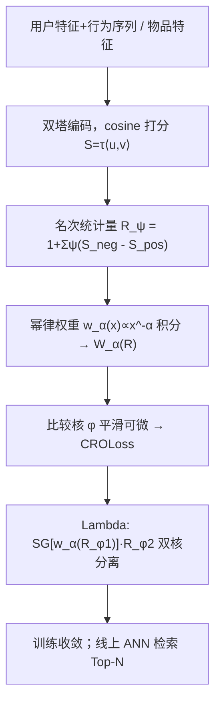
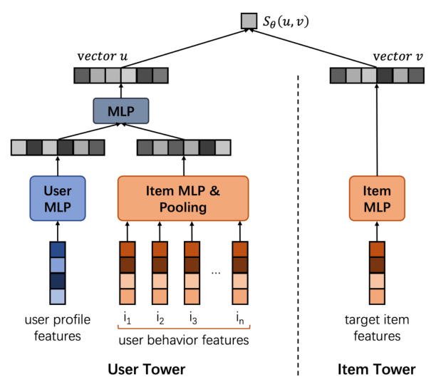
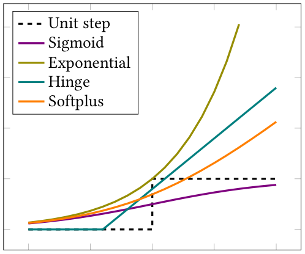

# CROLoss: Towards a Customizable Loss for Retrieval Models in Recommender Systems (面向推荐系统检索模型的可定制损失函数)

- **会议/期刊**: CIKM 2022 (31st ACM International Conference on Information and Knowledge Management)
- **作者与机构**: Yongxiang Tang, Wentao Bai, Guilin Li, Xialong Liu, Yu Zhang（阿里巴巴集团 / Lazada）
- **推荐链路定位**: 召回（双塔向量检索）
- **研究方向**: 协同过滤与双塔召回 / 自监督与鲁棒表征
- **论文原文**: [https://arxiv.org/abs/2208.02971v3](https://arxiv.org/abs/2208.02971v3)
- **开源代码**: [https://github.com/WDdeBWT/CROLoss](https://github.com/WDdeBWT/CROLoss)

## TL;DR (1分钟核心速览)

召回阶段的真实指标是 Recall@N，但工业界主流的 softmax 交叉熵、Triplet、BPR 都只优化"分类似然"或"成对偏序"，既不直接对齐 Recall@N，也无法随业务检索规模 $N$变化而重调。CROLoss 把 Recall@N 的指示函数重写为**排名统计量**，再用幂律权重$w_\alpha(x)\propto x^{-\alpha}$对全部$N$做重要性加权，配合成对比较核$\phi$使其可微；并由梯度分解提出$\phi_1/\phi_2$分离的 Lambda 法。在 Amazon Books 与 Taobao 上，$N\in\{50,100,200,500\}$ 全面超越三baseline（Taobao Recall@50 +11.9%），线上 14 天 A/B 召回率 +6.50%、CPC 广告收入 +4.75%。

## Background & Motivation (背景与核心矛盾)

- **主流范式**: 双塔模型（User Tower / Item Tower 内积打分）做大规模召回，损失函数普遍取 softmax 交叉熵（视为分类）或 BPR / Triplet 等成对（pairwise）排序损失。
- **前人局限**: ①交叉熵的最优解是最大似然，BPR/Triplet 只约束正负样本的相对间隔，二者的优化目标与 Recall@N 存在系统性错位；②三者都是"单一固定形态"，当业务把召回候选数 $N$ 从 500 调到 50 时，损失函数无法随之改变关注区间，导致 Recall@小 N 次优。
- **核心洞察 (Key Insight)**: Recall@N 本质上只依赖"正样本在打分序列中的名次 $R_\psi(u,v)$是否$\le N$"，是一个**阶跃指示函数**；若给它乘上一个随名次衰减的重要性密度，就能把"离散的、不可微的指标"转写为"连续的、可微的、且按$N$ 可调的期望风险"。
- **本文切入点**: 用一个可微核 $\phi$替掉阶跃函数$\psi$，用一个幂律权重$\alpha$ 控制"关注 Top-N 中多大的 N"，把既有损失统一为该函数空间的特例。

## Method (核心方法设计)

### 1. 整体框架 (Overall Architecture)

输入仍是用户画像 + 行为序列与物品特征的双塔，输出 cosine 相似度并缩放为 $S_\theta(u,v)=\tau\langle u,v\rangle$（$\tau=10$）。核心改造全部发生在**损失层**：先把正样本$(u,v)$在整库打分中的名次写成$R_\psi$，用幂律权重积分得到$\mathcal{L}_{\alpha,\psi}$；再用比较核$\phi$平滑$R_\psi$得到可微的$\mathcal{L}_{\alpha,\phi}$；训练时用 batch 内共享的均匀负样本估计全库名次；最后按梯度分解拆出$\phi_1$（估权重，stop-gradient）与$\phi_2$（给梯度），即 Lambda 版。推理侧完全不变——离线灌好物品向量，线上 ANN 检索 Top-N，零额外开销。

<figure class="paper-figure" markdown="span">
  <figcaption>图 1：双塔检索模型架构</figcaption>
</figure>

### 2. 关键设计拆解 (Key Designs)

1. **名次统计量 → 加权 Recall 风险**：把不可微的 Recall@N 指示函数改写为名次计数，再对全部 $N$ 做期望：

$$R_\psi(u,v;\theta)=1+\sum_{v_i\in\mathcal{I},v_i\neq v}\psi\big(S_\theta(u,v_i)-S_\theta(u,v)\big),\quad \mathcal{L}(\theta)=-\mathbb{E}_{w}\,\text{Recall@}x=\frac{1}{|\mathcal{C}|}\sum_{(u,v)}\big[W_\alpha(R_\psi)-1\big]$$

其中 $w_\alpha(x)=\frac{1}{Z}x^{-\alpha}$、$W_\alpha(N)=\frac{1-N^{1-\alpha}}{1-(|\mathcal{I}|+1)^{1-\alpha}}$。**直觉**：$\alpha$越大，密度越集中在名次靠前处，模型越"在意"小$N$；$\alpha\to 0$ 退化为对全部名次均匀加权。这正是"可定制"的旋钮。

2. **成对比较核 $\phi$与统一损失空间**：阶跃函数不可导，故用满足单调递增、$\phi(-\infty)=0$、$0.5\le\phi(0)\le1$ 的核替代，得到

$$\mathcal{L}_{\alpha,\phi}(\theta)=\sum_{(u,v)\in\mathcal{C}}W_\alpha\Big(1+\sum_{v_i\neq v}\phi\big(g_u^{(i)}\big)\Big),\quad g_u^{(i)}=S_\theta(u,v_i)-S_\theta(u,v)$$

**关键结论**：取 $\phi=e^x,\alpha=1$严格退化为 softmax 交叉熵；取$\phi=\text{hinge},\alpha=0$退化为 Triplet；取$\phi=\text{softplus},\alpha=0$退化为 BPR。即三种主流损失只是"核 + 权重"的两个坐标点——这解释了为何交叉熵（$\alpha=1$）自带难负样本聚焦能力而 Triplet（$\alpha=0$）必须额外做 hard mining。

<figure class="paper-figure" markdown="span">
  <figcaption>图 2：可选比较核函数示例。</figcaption>
</figure>

3. **Lambda 方法与训练目标**：对 $\mathcal{L}_{\alpha,\phi}$求梯度得$\partial\mathcal{L}/\partial g_u^{(i)}=\underbrace{w_\alpha(R_\phi)}_{\text{权重密度}}\cdot\underbrace{\phi'(g_u^{(i)})}_{\text{下降速度}}$。两项对$\phi$ 的要求冲突（估名次要 sigmoid/阶跃，罚大间隔要 softplus/hinge），故拆成两核：

$$\mathcal{L}_{\alpha,\phi_1,\phi_2}(\theta)=\sum_{(u,v)\in\mathcal{C}}\mathrm{SG}\Big[w_\alpha\big(R_{\phi_1}(u,v;\theta)\big)\Big]\cdot R_{\phi_2}(u,v;\theta)$$

$\mathrm{SG}(\cdot)$为 stop-gradient，$\phi_1$只提供权重不传梯度。**负采样与开销**：每正样本均匀采$n_{rn}=10$个负样本并在 batch 内共享，用$\hat{R}_\phi=\frac{|\mathcal{I}|}{|\mathcal{I}'|}\big[1+\sum_{v_i\in\mathcal{I}'}\phi(\cdot)\big]$ 做缩放估计；embedding/隐层维度 32，Adam 学习率 0.02，推理零附加成本。

## Experimental Setup & Evaluation Protocol (实验设置与评估协议)

| 数据集 | #Users | #Items | #Interactions | 稀疏度 | 特征/场景说明 |
| :--- | :---: | :---: | :---: | :---: | :--- |
| Amazon Books | 459,133 | 313,966 | 8,898,041 | 6.2e-5 | 图书评论，行为序列截断 20 |
| Taobao | 976,779 | 1,708,530 | 85,384,110 | 5.1e-5 | 淘宝点击日志，序列截断 50，候选池更大 |

- **数据划分与防穿越**: 按用户 8:1:1 划分为 train/valid/test；每个样本用前 $k$个行为预测第$k+1$ 个行为（next-item），属**按用户比例划分 + 序列前缀预测**，未见全局时间戳切分。
- **排名评测协议**: 指标为 Recall@N，$N\in\{50,100,200,500\}$。训练侧以 batch 内 10 个均匀负样本按$|\mathcal{I}|/|\mathcal{I}'|$ 缩放估计全库名次（采样式无偏估计）；论文未显式声明测试侧是否严格 Full-Ranking，属协议表述模糊点。
- **对比基线与超参**: softmax 交叉熵、Triplet（margin $m=5$）、BPR 三类；CROLoss 变体覆盖 hinge / sigmoid / exponential / softplus 四种核，$\alpha\in[0.6,1.6]$；双塔打分$S=\tau\langle u,v\rangle$，$\tau=10$，$d=32$，$n_{rn}=10$，batch 256（Amazon）/512（Taobao）。

## Key Experimental Results (实验关键数据)

### 1. 主实验对比 (Main Results)

| 数据集 | 方法 | R@50 | R@100 | R@200 | R@500 |
| :--- | :--- | :---: | :---: | :---: | :---: |
| Amazon | cross-entropy | 9.68 | 13.24 | 17.46 | 24.26 |
| Amazon | triplet | 7.53 | 11.21 | 15.93 | 24.11 |
| Amazon | BPR | 8.24 | 12.08 | 16.96 | 25.21 |
| Amazon | CROLoss (softplus, $\alpha$=1.0) | 10.20 | 14.03 | 18.63 | 26.06 |
| Amazon | **CROLoss-Lambda** (sigmoid+softplus) | **10.17** | **14.07** | **18.81** | **26.20** |
| | *Improv. vs CE* | *+5.06%* | *+6.27%* | *+7.73%* | *+8.00%* |
| Taobao | cross-entropy | 4.71 | 6.59 | 9.01 | 13.13 |
| Taobao | triplet | 2.46 | 3.71 | 5.43 | 8.84 |
| Taobao | BPR | 2.89 | 4.33 | 6.35 | 10.25 |
| Taobao | CROLoss (exp, $\alpha$=1.4) | 4.75 | 6.65 | 9.06 | 13.13 |
| Taobao | **CROLoss-Lambda** (sigmoid+exp) | **5.27** | **7.35** | **10.01** | **14.57** |
| | *Improv. vs CE* | *+11.89%* | *+11.53%* | *+11.10%* | *+10.97%* |

### 2. 消融实验 (Ablation Study)

| 配置 | Amazon R@50/100/200/500 ($\alpha$=1.0) | Taobao R@50/100/200/500 ($\alpha$=1.4) |
| :--- | :---: | :---: |
| w/o 核替换（hinge） | 9.88 / 13.55 / 17.94 / 24.99 | 4.02 / 5.62 / 7.68 / 11.18 |
| sigmoid 核 | 9.96 / 13.94 / 18.59 / 26.09 | 4.11 / 5.87 / 8.15 / 12.13 |
| exponential 核 | 9.68 / 13.24 / 17.46 / 24.26 | 4.75 / 6.65 / 9.06 / 13.13 |
| softplus 核 | 10.20 / 14.03 / 18.63 / 26.06 | 4.36 / 6.21 / 8.52 / 12.54 |
| w/o Lambda（单核退化） | 10.20 / 14.03 / 18.63 / 26.06 | 4.75 / 6.65 / 9.06 / 13.13 |
| **Lambda 双核** | **10.17 / 14.07 / 18.81 / 26.20** | **5.27 / 7.35 / 10.01 / 14.57** |
| Lambda 用 unit-step 作 $\phi_1$ | 9.98 / 13.85 / 18.53 / 25.96 | 4.85 / 6.81 / 9.36 / 13.70 |

### 3. 关键实验发现 (Key Findings)

1. **$\alpha$与$N$呈明确的反向匹配关系**：Amazon 上 softplus 核在$\alpha=1.0$时 R@50 达 10.20（$\alpha=0.6$仅 9.63），而 R@500 在$\alpha=0.6$时更高（26.20 vs 25.51）；即"目标 N 小则调大$\alpha$"，首次把损失超参与业务检索规模显式绑定，可直接迁移到不同候选池规模的召回链路。
2. **核的选择依赖候选池/检索比 $N/|\mathcal{I}|$**：exponential 核在 Taobao（$|\mathcal{I}|$=1.7M，$N/|\mathcal{I}|$极小）显著优于 Amazon，但随$N$增大性能快速衰减（Amazon R@500 从 24.33 掉回 23.81）；softplus 在 Amazon 稳定取得最优/次优，sigmoid 则在$\alpha$可定制性上最强（Lambda 中作为$\phi_1$ 时 Taobao R@200 相较 unit-step 版 9.36 → 10.01）。
3. **$\alpha>0$等价于一种"隐式难负样本挖掘"**：把 Triplet / BPR 的核直接套入 CROLoss 并令$\alpha=1$，Triplet 在 R@50 上提升 +2.35%、R@100 +1.96%，且提升幅度随$N$ 增大而衰减（R@500 仅 +0.88%）——这从理论上解释了交叉熵不需要 hard mining 而 Triplet 必须做的经验事实，且给出了免构造 hard negative 的替代路径。

## Highlights & Limitations (亮点、对比与审稿批判)

- **与代表作对比 (vs. Prior Work)**: 相比 softmax 交叉熵（$\alpha=1$、$\phi=e^x$的固定点），CROLoss 将$\alpha$与$\phi$打开为两个可控维度；相比 BPR/Triplet 这类$\alpha=0$ 的均匀加权成对损失，它以"名次密度加权"天然获得 Top 区间聚焦；相比 RankNet 类 pairwise LTR，它不依赖人工标注的序关系标签，而是以全库名次为监督信号。
- **可迁移亮点**: ①"把不可微指标写成名次统计量 + 幂律权重 + 平滑核"这套模板可直接套用到 Recall@K 之外的 NDCG@K、HitRate@K 等 Top-K 指标；②Lambda 的 stop-gradient 双核分离把"估权重量"和"给梯度"两职责解耦，可迁移到任何带重要性加权的采样估计场景。
- **审稿级局限批判**: ①训练时仅用 10 个 batch 内均匀负样本估计全库名次，$|\mathcal{I}|/|\mathcal{I}'|$缩放估计方差大，缺少对负采样数量$n_{rn}$的敏感性分析；②收益高度依赖$\phi$与$\alpha$的联合网格搜索（论文试验了 4 核 × 4$\alpha$），在线部署需针对目标$N$ 重新调参，自动选参机制缺失；③评测仅两个数据集、序列长度截断较激进（20/50），缺少对长尾用户与新物品分桶的细粒度验证。

## Rating (四维评分)

- **方法创新性 (Novelty)**: ⭐⭐⭐⭐ （把 Recall@N 重写为可微加权风险并证明交叉熵/Triplet/BPR 皆为特例，函数空间视角新颖，但数学工具本身较朴素）
- **评估协议与实验扎实度 (Protocol & Experiments)**: ⭐⭐⭐⭐ （两组大规模真实数据集 × 4 个 $N$× 4 核 × 4$\alpha$ 的网格覆盖充分，且有 14 天线上 A/B，但缺全库 Full-Ranking 声明与显著性检验）
- **写作与数学规范度 (Clarity & Rigor)**: ⭐⭐⭐⭐ （从指标定义到核约束再到梯度分解的推导链条完整、特例证明清晰，公式符号基本自洽）
- **工业落地与复现价值 (Industrial & Practical Value)**: ⭐⭐⭐⭐⭐ （开源代码完整，推理侧零改动、仅替换损失即可上线，实测收入 +4.75%，落地成本极低）

