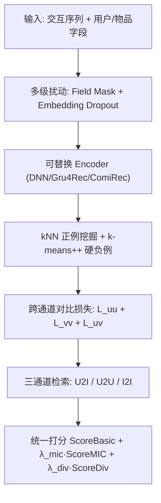
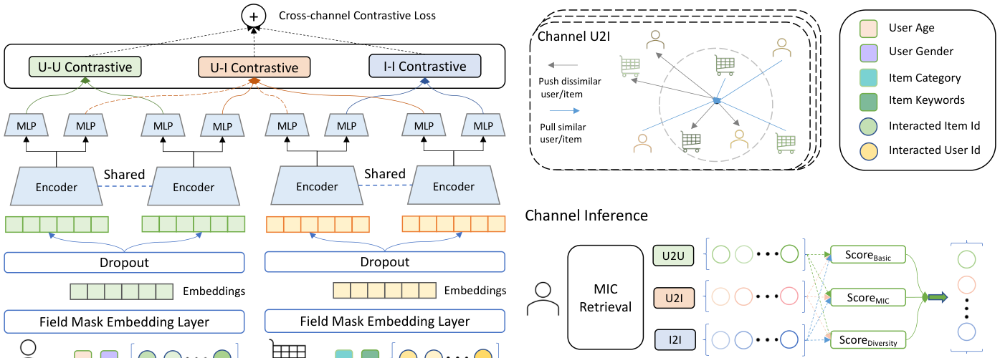

# MIC: Model-agnostic Integrated Cross-channel Recommenders (模型无关的集成跨通道推荐器)

- **会议/期刊**: CIKM 2022
- **作者与机构**: Yujie Lu, Ping Nie, Shengyu Zhang, Ming Zhao, Ruobing Xie, William Wang, Yi Ren（UCSB / 浙江大学 / 腾讯）
- **推荐链路定位**: 召回（matching stage）
- **研究方向**: 协同过滤与双塔召回 / 自监督对比学习
- **论文原文**: [https://arxiv.org/abs/2110.11570v2](https://arxiv.org/abs/2110.11570v2)
- **开源代码**: 暂未开源（原文仅使用 Faiss 作为向量检索库：[facebookresearch/faiss](https://github.com/facebookresearch/faiss)）

## TL;DR (1分钟核心速览)

工业召回普遍并行跑 U2I、U2U、I2I 三路通道，但每路各自训练、线上靠配额（quota）硬拼，导致跨通道互信息被浪费、精度与多样性呈"跷跷板"。本文提出 MIC：以单一可替换 encoder 统一承载三通道表征，用字段掩码/Embedding Dropout 扰动 + kNN/k-means++ 采样构造正负例，施加 U-U、I-I 通道内与 U-I 通道间三重对比损失，再把三路候选按"基础分 + 计数软归一 + 类别多样性"统一打分。作为插件接入 DNN/Gru4Rec/ComiRec，在 Amazon Book、Taobao、Movielens、Steam 四库上 Recall@50 最高相对提升 10.90%，Amazon Book 上 Hit Rate@50 提升 18.51%；Tencent News 线上 A/B（各约百万用户）EPV 占比达 25%，播放完成率 +3.51%。

## Background & Motivation (背景与核心矛盾)

- **主流范式**: 工业两阶段系统中，召回层并行部署 U2I（向量检索）、U2U（相似用户历史）、I2I（相似物品）多路通道，各路独立建模后按配额混合；学术界则以单通道序列/多兴趣模型（YoutubeDNN、Gru4Rec、ComiRec）为主。
- **前人局限**: ① 各通道只从用户-物品交互的**局部信息**出发，无法共享 U2U/I2I 中隐含的协同信号，跨通道相关路径（U2U2I、U2I2I）被割裂；② 线上配额混合是"事后拼接"，无法在训练期联合优化，精度与多样性长期此消彼长。
- **核心洞察 (Key Insight)**: 同一套表征空间其实可以同时服务三通道——只要用对比学习把"语义近的对拉近、远的推远"，就能让 U2I 的对齐性（alignment）与 U2U/I2I 的均匀性（uniformity）同步改善；作者用 Alignment/Uniformity 可视化验证了这一点。
- **本文切入点**: 不做通道专属结构，而是做一个**与 encoder 解耦**的跨通道对比聚合模块，即插即用于任意召回模型。

## Method (核心方法设计)

### 1. 整体框架 (Overall Architecture)

输入为实例三元组 $(X_u, F_u, F_v)$（用户交互序列、用户侧字段、目标物品字段）。先经**扰动挖掘模块**生成两个视图：字段级随机掩码（用户 ID/性别/年龄/交互 item ID；物品 ID/关键词/交互 user ID）与嵌入层 Dropout；同时在表征空间用 kNN 检索正样本、k-means++ 跨簇采样硬负样本。随后 encoder（可替换）输出$\vec{e}_u=f(X_u,F_u)$、$\vec{e}_v=g(F_v)$，进入**跨通道对比模块**计算 U-U、I-I、U-I 三路损失并联合 BPR 式基础损失训练。推理时建立 user/item/interaction 三个 Datastore，分别检索$K_1$（U2I）、$K_2$（U2U）、$K_3$（I2I）候选，用统一打分函数融合后取 Top-$N$。

<figure class="paper-figure" markdown="span">
  <figcaption>图3：模型无关的集成跨通道推荐器（MIC）概览。扰动在字段级和嵌入特征级进行。用户-物品（U2I）、用户-用户（U2U）和物品-物品（I2I）模块被聚合以计算跨通道对比损失。在推理阶段，MIC 对从三个通道召回的物品进行聚合，并计算 Score𝐵𝑎𝑠𝑖𝑐、Score𝑀𝐼𝐶 和 Score𝐷𝑖𝑣𝑒𝑟𝑠𝑖𝑡𝑦，作为最终推荐参考。</figcaption>
</figure>

### 2. 关键设计拆解 (Key Designs)

1. **跨通道对比估计（Inter/Intra-channel Contrastive）**：痛点是对比学习多用于单通道自监督，通道间语义鸿沟未打通。本文在同一 mini-batch 内对正例对 $(u,v)$施加双向 InfoNCE，其中$\mathrm{sim}(u,v)=\mathbf{u}^{\top}\mathbf{v}/(\|\mathbf{u}\|\|\mathbf{v}\|)$：

$$\mathcal{L}_{uv}=-\log\frac{\exp(\mathrm{sim}(u,v_i)/\tau)}{\sum_{j\neq i}\exp(\mathrm{sim}(u,\tilde{v}_j)/\tau)}-\log\frac{\exp(\mathrm{sim}(v,u_i)/\tau)}{\sum_{j\neq i}\exp(\mathrm{sim}(v,\tilde{u}_j)/\tau)}$$

同式构造 $\mathcal{L}_{uu}$、$\mathcal{L}_{vv}$。直觉：U-I 对比负责"对齐"，U-U/I-I 对比负责让表征各向异性更均匀（uniform），三者共同把三通道的信息流打通，故无需通道专属结构。

2. **多级扰动 + 检索式样本挖掘（Perturbation & Mining）**：仅靠 dropout 视图多样性不足、且难以保证语义一致。本文双管齐下：字段级掩码 + 嵌入层 dropout 生成伪视图；再用 kNN 把锚点近邻扩为正例集、用 k-means++ 跨簇用户作硬负例，正负例数量（近邻数、簇数、掩码比例）均可在线调节，保证对业务快速变化的时效性。

3. **训练目标与统一打分推理**：总损失 $\mathcal{L}=0.7\,\mathcal{L}_{basic}+0.3(\mathcal{L}_{uv}+\mathcal{L}_{vv}+\mathcal{L}_{uu})$，三通道等权、温度$\tau=0.1$。推理时三通道候选合并为$V_C=\{(v_i,s_i)\}$（$s_i$为被重复召回的计数），并做计数软归一$Score_{MIC}(v_i)=\exp(s_i)/\sum_{j\in V_C}\exp(s_j)$，最终$Score=Score_{Basic}+\lambda_{mic}Score_{MIC}+\lambda_{div}Score_{Div}$，其中$Score_{Div}$ 按物品类别惩罚同类聚集。**负采样**用 in-batch 负例 + 硬负例，无额外采样器；**推理开销**为 Faiss 检索 + Redis 查相似用户/物品 + 聚合三步，各 <10ms，线上小时级更新模型、秒级更新行为。

## Experimental Setup & Evaluation Protocol (实验设置与评估协议)

- **数据集与预处理**: 主文未给出完整统计表（置于附录 Table 4），可确认四库规模量级与场景如下：

| 数据集 | #Users | #Items | #Interactions | 稀疏度/密度 | 特征/场景说明 |
| :--- | :---: | :---: | :---: | :---: | :--- |
| Amazon Book | 未报告 | 未报告 | 未报告 | 未报告 | 图书评论，序列 + 物品关键词，强稀疏 |
| Taobao | 未报告 | 未报告 | 未报告 | 未报告 | 电商行为，用户/物品属性丰富 |
| Movielens | 未报告 | 未报告 | 未报告 | 未报告 | 电影评分，稠密、长尾较轻 |
| Steam | 未报告 | 未报告 | 未报告 | 未报告 | 游戏购买/游玩，极稀疏、短序列 |

- **数据划分与防穿越 (Splitting Strategy)**: 划分方式主文未明示，仅说明训练中跟踪 Development split 的 Recall/NDCG/HR 并按 Recall 最优早停，可推断为**按时间序列的留出式划分（类 Leave-Last-Out）**，但缺乏显式声明。
- **排名评测协议 (Ranking Protocol)**: 采用按用户平均（per-user average）的 Recall@N、NDCG@N、Hit Rate@N，$N\in\{20,50\}$；**未明确是全库 Full-Ranking 还是负采样 Sampled Ranking**（这直接影响数值可比性，属评估漏洞）。
- **对比基线与超参设置**: 基线为 YoutubeDNN、Gru4Rec、ComiRec 三类召回模型，以及各自的 $X+\text{MIC}$变体；Embedding 维度$d=128$、batch 1024、学习率 1e-3、dropout 0.2、$\tau=0.1$、$\lambda=0.7$，TensorFlow + 单卡 P40；未做显著性检验。

## Key Experimental Results (实验关键数据)

### 1. 主实验对比 (Main Results)

各模型 @50 指标（数值为百分制，加粗为最优；`Improv.` 为 $X+\text{MIC}$ 相对同 backbone 的提升）：

| 数据集 | 指标@50 | YoutubeDNN | Gru4Rec | ComiRec | ComiRec+MIC | Improv. |
| :--- | :--- | :---: | :---: | :---: | :---: | :---: |
| Amazon Book | Recall | 8.885 | 8.908 | 10.257 | **11.550** | +10.90% |
| | NDCG | 6.594 | 6.915 | 7.217 | **7.889** | +9.31% |
| | HR | 18.709 | 18.949 | 19.231 | **22.790** | +18.51% |
| Taobao | Recall | 5.075 | 6.118 | 7.115 | **7.861** | +10.48% |
| | NDCG | 14.263 | 16.084 | 20.635 | **22.509** | +9.08% |
| | HR | 39.310 | 42.114 | 48.094 | **51.607** | +7.30% |
| Movielens | Recall | 23.028 | 24.447 | 25.043 | **25.927** | +3.53% |
| | NDCG | 38.756 | 39.888 | 41.099 | **42.109** | +2.46% |
| | HR | 87.245 | 89.705 | 90.138 | **91.391** | +1.39% |
| Steam | Recall | 3.671 | 4.432 | 5.021 | **5.123** | +2.03% |
| | NDCG | 5.077 | 4.997 | 6.230 | **6.671** | +7.08% |
| | HR | 12.031 | 11.089 | 13.149 | **14.388** | +9.42% |

线上 A/B（Tencent News 视频推荐，2021.10.01–10.15，实验/对照各约 100 万用户）：EPV 占比 **25%**（第二名召回模型约 8%），平均播放完成率 **+3.51%**，平均观看时长 **+1.26%**，人均观看视频数 **+1.85%**。

### 2. 消融实验 (Ablation Study)

Amazon Book @50（backbone = ComiRec）：

| 变体 | Recall | NDCG | HR | Diversity |
| :--- | :---: | :---: | :---: | :---: |
| Full Model | **11.554** | **7.889** | **22.790** | **49.511** |
| w/o U-U 对比 | 10.556 | 7.689 | 21.132 | 44.021 |
| w/o U-I 对比 | 10.347 | 6.462 | 21.273 | 42.483 |
| w/o I-I 对比 | 11.096 | 7.089 | 22.668 | 46.796 |
| w/o 扰动模块 | 8.415 | 5.346 | 16.590 | 34.188 |
| w/o kNN 挖掘 | 10.176 | 6.098 | 20.727 | 41.983 |
| 推理 w/o U2U 通道 | 11.148 | 7.688 | 22.076 | 45.478 |
| 推理 w/o U2I 通道 | 11.484 | 7.825 | 22.571 | 45.603 |
| 推理 w/o I2I 通道 | 11.316 | 7.758 | 22.443 | 41.709 |

### 3. 关键实验发现 (Key Findings)

1. **扰动模块是"命门"而非可选项**：去掉扰动后 Recall@50 从 11.554 崩至 8.415（−27.2%），跌幅远超去掉任一对比通道分支（−3.9% ~ −10.4%），说明多视图增广决定了对比信号的可用性，通道间聚合只是在此基础上的二次增益。
2. **U-I 对比主导精度、I-I 对比主导多样性**：去掉 U-I 使 NDCG 从 7.889 掉到 6.462（−18.1%），是精度损失最大项；而推理阶段去掉 I2I 通道使 Diversity 从 49.511 降到 41.709（−15.8%），却几乎不损 Recall，说明通道级多样性主要由 I2I 路径承担，可按业务目标单独调 $\lambda_{div}$。
3. **MIC 打破了精度-多样性跷跷板**：Amazon Book 上 ComiRec-SA 沿召回-多样性曲线滑动时 Recall 上限约 10.3，而 MIC 增强版在多样性 50+ 区间仍拿到 11.5+，整体曲线外移；稀疏集（Steam）与稠密集（Movielens）增益差异（+2.03% vs +10.90% Recall）说明协同信号越稀疏、跨通道互补价值越大。

## Highlights & Limitations (亮点、对比与审稿批判)

- **与代表作对比 (vs. Prior Work)**: 相比 ComiRec 的多兴趣单通道建模，MIC 不改 encoder 而改"信息流"；相比 YoutubeDNN/Gru4Rec 的纯 U2I 目标，MIC 显式引入 U2U/I2I 作为对比监督信号；相比工业常用的配额式多路混合（事后融合），MIC 把融合前移到训练与打分层（$\lambda_{mic}$、$\lambda_{div}$ 可调），是首个在单一模型中同时启用三通道的工作。
- **可迁移亮点**: ① "计数软归一"$Score_{MIC}=\exp(s_i)/\sum\exp(s_j)$ 用召回重复次数刻画多通道共识度，可零成本迁移到任意多路召回融合；② 用 k-means++ 跨簇采样硬负例替代随机负采样，对稀疏场景鲁棒。
- **审稿级局限批判**: ① 评估协议未声明 Full-Ranking 还是负采样排序、未做显著性检验、四个数据集的统计与预处理（是否 5-core 过滤）缺失，跨论文可比性弱；② 线上为小时级更新模型 + 三通道各需 Faiss/Redis 多跳查询，参数量与延迟随 $M_1,M_2,M_3$呈乘性增长，且$\lambda_{mic},\lambda_{div}$ 依赖 Grid Search，冷启动/新物品下的稳定性未验证。

## Rating (四维评分)

- **方法创新性 (Novelty)**: ⭐⭐⭐⭐ （把跨通道对比学习做成 model-agnostic 插件并用 Alignment/Uniformity 给出机理解释，思路干净，但对比学习本身在 2022 年已非新范式）
- **评估协议与实验扎实度 (Protocol & Experiments)**: ⭐⭐⭐ （三基线 × 四数据集 + 线上 A/B 很有说服力，但未声明全库排序协议、缺数据统计与显著性检验，削弱可比性）
- **写作与数学规范度 (Clarity & Rigor)**: ⭐⭐⭐⭐ （三通道损失与统一打分公式清晰、超参与线上配置交代到位；第 2 节公式排版稍乱、部分符号重复定义）
- **工业落地与复现价值 (Industrial & Practical Value)**: ⭐⭐⭐⭐⭐ （腾讯新闻百万级用户线上验证，插件式改造迁移成本极低，Faiss+Redis 三步各 <10ms 具备直接复刻条件）

