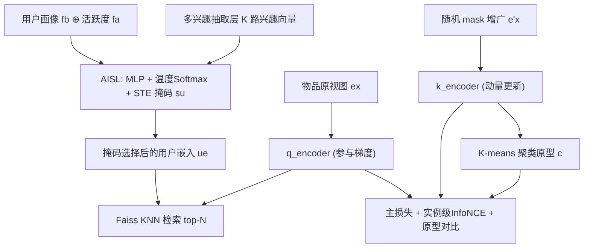
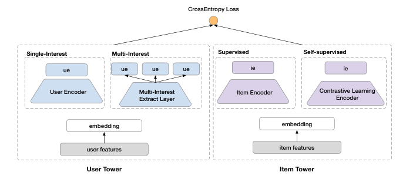
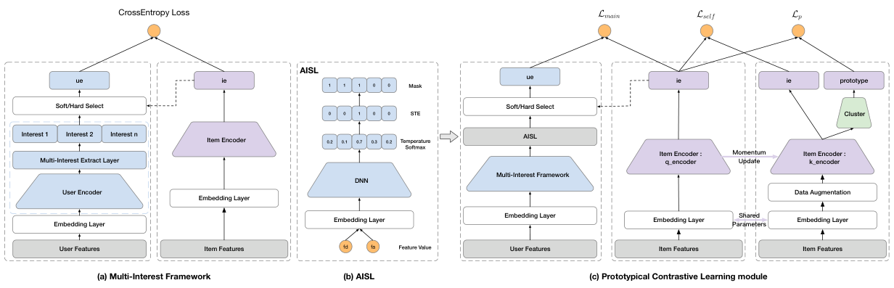

# Prototypical Contrastive Learning and Adaptive Interest Selection for Candidate Generation in Recommendations (面向推荐候选生成的原型对比学习与自适应兴趣选择)

- **会议/期刊**: CIKM 2022 (31st ACM International Conference on Information and Knowledge Management, short paper)
- **作者与机构**: Ningning Li, Qunwei Li, Xichen Ding, Shaohu Chen, Wenliang Zhong（蚂蚁集团 Ant Group）
- **推荐链路定位**: 召回（双塔候选生成，KNN/Faiss 近邻检索）
- **研究方向**: 协同过滤与双塔召回 / 自监督对比学习与交互去噪
- **论文原文**: [https://arxiv.org/abs/2211.12893v1](https://arxiv.org/abs/2211.12893v1)
- **开源代码**: 暂未开源

## TL;DR (1分钟核心速览)

双塔召回的两大痛点：多兴趣模型对**所有用户固定兴趣向量数 $K$**（非活跃用户被冗余向量拖累），以及负采样带来的**类冲突（class collision）**——语义相近的物品被手工标签强行推开。本文提出 AISL（自适应兴趣选择层）用 DNN + 温度 Softmax + STE 可微地学出每用户应保留的兴趣向量个数；并提出原型对比学习（PCL）用 K-means 质心作为高层语义原型，做「实例-原型」对比以拉近同类、推远异类。在 Amazon Books / Kindle Store、每用户 1:100 采样的排序协议下，HR@10 较 SASRec 相对提升 9.07% / 5.43%，NDCG@20 提升 13.58% / 13.23%，同时 AINPU 从 5→4.1、4→3.2（-18% / -20%）。

## Background & Motivation (背景与核心矛盾)

- **主流范式**: 工业界 DCG 采用用户塔 + 物品塔的双塔结构，用户塔分单兴趣（YouTube DNN）与多兴趣（MIND 的胶囊路由、SASRec 的多头注意力）两派，用交叉熵 + ItemID 标签训练，再用 Faiss 建 KNN 索引检索 top-$N$。
- **前人局限一（固定 $K$）**: 多兴趣框架对每个用户输出恒定$K$个兴趣向量，但用户活跃度差异极大——新用户/低活用户仅有一两条行为，$K$ 个向量中大部分是噪声向量，反而在 KNN 检索中引入大量误召回，同时抬高索引与算力成本。
- **前人局限二（类冲突）**: 传统对比学习只能编码 ItemID 级别的**低层信息**，无法刻画 category/brand 这类**高层语义**；而在 DCG 中负样本由无观测监督的采样策略与人工标签生成，大量同类物品被当作负例相互推开，即 class collision。
- **核心洞察 (Key Insight)**: 兴趣向量的“条数”本身应当是**可学习的个性化变量**而非超参；而“什么该被推近”应由**无标签的聚类结构（原型）** 而非人工标签决定。
- **本文切入点**: 在物品嵌入空间上做在线 K-means 得到语义原型，把对比学习的正样本从“同一物品的增广视图”升级为“同一簇原型”，用无标签结构自带的高层语义纠偏负采样噪声。

## Method (核心方法设计)

### 1. 整体框架 (Overall Architecture)

用户塔：用户画像 $f_b$与活跃度特征$f_a$拼接后经$L$层 MLP 输出$K$维活跃度分布，经温度 Softmax + 直通估计得到 **multi-hot 掩码**$s_u$，仅在多兴趣抽取层（胶囊/多头注意力）输出的$K$个兴趣向量上保留被选中的那几路，拼成最终$u_e$。物品塔：原视图送入 q_encoder（参与梯度回传，用于线上检索），其随机 mask 增广视图送入动量更新的 k_encoder$\mathcal{G}'$；k_encoder 的输出周期性 K-means 聚类得到$|\mathcal{C}|$ 个原型，供原型对比损失使用。三路损失联合端到端训练，线上只用 q_encoder 的物品嵌入建索引，用户塔额外多一层轻量 MLP 与掩码，检索复杂度与基线同阶。

<figure class="paper-figure" markdown="span">
  <figcaption>图1：深度候选生成模型</figcaption>
</figure>
<figure class="paper-figure" markdown="span">
  <figcaption>图2：自适应兴趣选择层与原型对比学习模块示意图。</figcaption>
</figure>

### 2. 关键设计拆解 (Key Designs)

1. **自适应兴趣选择层 AISL（把“兴趣条数”变成可微变量）**：痛点是对非活跃用户硬性输出 $K$个向量会注入噪声。做法是先由$h_L=\sigma(W_L^\top h_{L-1}+b_L)$编码活跃度，温度 Softmax 得$p_u$，再对 argmax 做连续松弛并借 STE 消除训练/推理不一致：
$s_u=\hat{s}_u+\mathrm{stop\_gradient}(s_u-\hat{s}_u),\quad \hat{s}^k_u=\frac{\exp(h^k_L/T)}{\sum_j\exp(h^j_L/T)}$
直觉：前向严格走 hard multi-hot（保证线上行为一致），反向走 soft 概率的梯度（保证可学），使“活跃用户多留几路、沉默用户少留几路”成为可优化目标而非人工规则。
2. **原型对比学习 PCL（用无标签簇结构对抗类冲突）**：以随机维度 mask $e'_x=m_x\odot e_x$增广，q/k 双编码器间做实例级 InfoNCE$\mathcal{L}_{self}$；更关键的是以 k_encoder 输出上的 K-means 质心$c_x$ 作原型，构造
$\mathcal{L}_{p}=-\frac{1}{B}\sum_{x}\log\frac{\exp(s(e_x,c_x)/\tau_{c_x})}{\exp(s(e_x,c_x)/\tau_{c_x})+\sum_{j\in[r]}\exp(s(e_x,c_j)/\tau_{c_j})}$并按簇规模自适应调温$\tau_c=\sqrt{\sum_{x\in N_c}\|e'_x-c_x\|^2}/\big(N_c\log(N_c+1)\big)$，避免大簇主导梯度。物理直觉：同 category/brand 的物品即便标签不同也会共享原型，从而被拉回同一区域，负采样误标不再“致命”。
3. **训练目标、负采样与推理效率**：总损失 $\mathcal{L}=\mathcal{L}_{main}+\alpha\mathcal{L}_{self}+\beta\mathcal{L}_{p}$；每个用户取 1 正对（自身增广）+$J$个随机物品增广作负对，原型侧每样本采$r=100$个非所属原型作负例（免大批量负采样）；k_encoder 动量更新$\mathcal{G}'\leftarrow\alpha\mathcal{G}'+(1-\alpha)\mathcal{G}$，$\alpha\to1$保证目标一致性。线上仅需单次用户塔前传 + Faiss 检索，AISL 带来的额外开销小于因$K$ 减少而节省的索引与打分开销。

## Experimental Setup & Evaluation Protocol (实验设置与评估协议)

- **数据集与预处理**: 沿用 DIEN 的 Amazon 预处理流程（隐含 5-core 过滤），取 Books 与 Kindle Store 两个子类：

| 数据集 | #Users | #Items | #Interactions | 稀疏度/密度 | 特征/场景说明 |
| :--- | :---: | :---: | :---: | :---: | :--- |
| Kindle Store | 61,235 | 62,528 | 123,108 | 3.2e-5 (0.0032%) | 图书类目，极稀疏小规模 |
| Amazon Books | 459,133 | 313,966 | 8,898,041 | 6.2e-5 (0.0062%) | 图书类目，大规模长行为序列 |

- **数据划分与防穿越 (Splitting Strategy)**: 遵循 DIEN 的**用户级序列切分**（用户历史行为按时间排序，末位交互作测试目标、倒数第二作验证，属 Leave-Last-Out 范式），物品特征仅用静态元信息，无时间穿越风险。
- **排名评测协议 (Ranking Protocol)**: **Sampled Ranking（采样排序）**——对测试集每个用户，从全库中随机抽取 **100 个未交互物品**作负例，与真实正例混合排序，报告 HR@10/20 与 NDCG@10/20；另报告平均每用户兴趣向量数 AINPU 以度量效率（同效果下越低越好）。
- **对比基线与超参设置**: 基线为 MostPopular、YouTube DNN（单兴趣）、MIND（胶囊多兴趣）、SASRec（多头自注意力多兴趣）；统一 TensorFlow + Adam，batch=256，学习率 1e-3，嵌入维度 $d=32$，$K=5$（Books）/$4$（Kindle），簇数$|\mathcal{C}|=1000$，原型负例$r=100$。

## Key Experimental Results (实验关键数据)

### 1. 主实验对比 (Main Results)

| 数据集 / 指标 | MostPopular | YouTube DNN | MIND | SASRec | **Ours** | Improv.(vs SASRec, 相对) |
| :--- | :---: | :---: | :---: | :---: | :---: | :---: |
| Books AINPU | - | 1 | 5 | 5 | **4.1** | **-18.0%** |
| Books HR@10 | 10.59 | 22.67 | 30.05 | 31.86 | **34.75** | **+9.07%** |
| Books NDCG@10 | 8.53 | 14.67 | 22.80 | 22.99 | **25.54** | **+11.09%** |
| Books HR@20 | 15.39 | 38.28 | 42.93 | 42.61 | **45.10** | **+5.84%** |
| Books NDCG@20 | 10.93 | 15.07 | 24.36 | 24.23 | **27.52** | **+13.58%** |
| Kindle AINPU | - | 1 | 4 | 4 | **3.2** | **-20.0%** |
| Kindle HR@10 | 12.42 | 24.75 | 35.19 | 35.54 | **37.47** | **+5.43%** |
| Kindle NDCG@10 | 10.06 | 14.11 | 20.94 | 22.09 | **25.07** | **+13.49%** |
| Kindle HR@20 | 18.30 | 39.10 | 45.84 | 45.06 | **47.36** | **+5.10%** |
| Kindle NDCG@20 | 13.61 | 26.24 | 29.39 | 28.50 | **32.27** | **+13.23%** |

（原文为 5 页短文，仅报告上述 4 个基线；作者自述相对 SASRec 的 HR@10 提升 2.89 个百分点、NDCG@20 提升 3.77 个百分点，与上表换算一致。）

### 2. 消融实验 (Ablation Study)

> 说明：原文**未提供组件级 `w/o` 消融表**，仅以 T-SNE 定性展示 PCL 效果（图 3）。下表以论文可得的代理证据整理，供读者判断增量来源，非原文表格。

| 配置（代理消融） | Books HR@10 | Books NDCG@20 | Kindle HR@10 | Kindle NDCG@20 | AINPU |
| :--- | :---: | :---: | :---: | :---: | :---: |
| 单兴趣基线 YouTube DNN | 22.67 | 15.07 | 24.75 | 26.24 | 1 |
| 多兴趣（MIND / SASRec，最佳者） | 31.86 | 24.36 | 35.54 | 29.39 | 5 / 4 |
| **+ AISL + PCL (Ours)** | **34.75** | **27.52** | **37.47** | **32.27** | **4.1 / 3.2** |
| PCL 定性效果（图 3, T-SNE） | 同类 10 类×100 样本簇内更紧、簇间更分 | | | | |

### 3. 关键实验发现 (Key Findings)

1. **多兴趣 > 单兴趣，但“更多”不等于“更好”**：从 1 路升到 4–5 路带来 Books HR@10 从 22.67%→31.86%（+40.5%），而本文把路数**降到 4.1** 仍取得 34.75%，说明非活跃用户上的冗余兴趣向量是净负收益，AISL 的裁剪本身就是涨点来源之一。
2. **增益主要在排序质量而非命中率上限**：NDCG@20 的相对提升（13.58% / 13.23%）显著高于 HR@10（9.07% / 5.43%），说明 PCL 让正例整体前移、排序头部更准，符合“语义原型纠偏类冲突”的作用机理，而非单纯扩大了召回池。
3. **效率与效果同向改善**：AINPU 下降 18%–20% 的同时两个数据集 4 项指标全面最优，意味着线上可用更短的兴趣向量列表做 KNN 检索，索引访问与打分开销同步下降，是难得的“双赢”而非效果-效率折衷。

## Highlights & Limitations (亮点、对比与审稿批判)

- **与代表作对比 (vs. Prior Work)**: 相对 MIND/SASRec 这类多兴趣模型，本文的本质差异是**把 $K$ 从超参变为逐用户可微输出**（STE 保证前后向一致）；相对 SGL/SimGCL 等图对比方法，本文不增广图结构而是**用 K-means 原型引入无标签高层语义**，把对比的正样本从实例级抬到簇级，直击负采样误标的类冲突。
- **可迁移亮点**: (1) 温度 Softmax + stop_gradient 的“硬前向/软反向”技巧可迁移到任何需要在推理时保持离散结构的门控/剪枝模块（如专家选择、兴趣路由）；(2) 用簇规模自适应调温 $\tau_c\propto 1/\log(N_c+1)$ 平衡大簇主导，可直接用于大规模物品聚类的对比预训练。
- **审稿级局限批判**: (1) 评测仅用 **1:100 采样排序**，在 10 万级物品库中采样负例难度极低，指标可能高估真实全库检索表现，缺少 Full-Ranking 或更硬负例的验证；(2) **无组件级消融**、无 $K$/簇数$|\mathcal{C}|$/$r$ 的敏感度分析，也未报告在线 A/B，AISL 与 PCL 各自贡献的量化归因缺失；(3) K-means 需周期性在全量物品嵌入上重跑，簇数 1000、维度 32 时尚可，扩展到亿级物品时的训练开销与原型漂移未讨论。

## Rating (四维评分)

- **方法创新性 (Novelty)**: ⭐⭐⭐⭐ （“活跃度驱动的可微兴趣数选择 + 簇原型对比”组合在 2022 年的双塔召回语境下颇为新颖，STE 松弛写法简洁有效）
- **评估协议与实验扎实度 (Protocol & Experiments)**: ⭐⭐⭐ （两数据集 + 4 基线 + 效率指标尚可，但仅 1:100 采样排序、缺消融与敏感度分析，5 页短文实验面偏薄）
- **写作与数学规范度 (Clarity & Rigor)**: ⭐⭐⭐⭐ （AISL 的松弛与 STE 推导、原型温度设计交代清楚，公式紧凑；但掩码如何聚合为最终 $u_e$ 的描述略含糊）
- **工业落地与复现价值 (Industrial & Practical Value)**: ⭐⭐⭐⭐ （来自蚂蚁的工业动机，AISL 与 PCL 均可即插即用于现有双塔，AINPU 下降直接降低检索成本；可惜未开源、聚类离线开销未评估）

