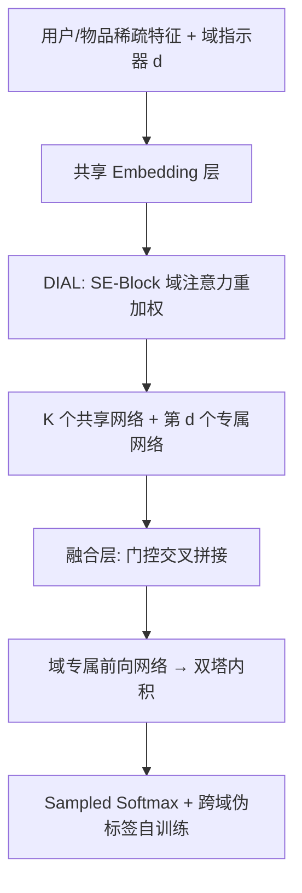
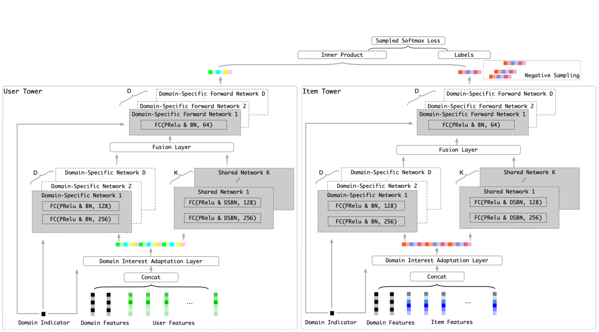

# Adaptive Domain Interest Network for Multi-domain Recommendation (自适应领域兴趣网络的多场景推荐)

- **会议/期刊**: CIKM 2022
- **作者与机构**: Yuchen Jiang, Qi Li, Han Zhu 等，阿里巴巴集团（阿里妈妈展示广告团队）
- **推荐链路定位**: 召回（双塔向量内积 + Sampled Softmax 检索）
- **研究方向**: 跨域与多场景推荐 / 协同过滤与双塔召回
- **论文原文**: [https://arxiv.org/abs/2206.09672v1](https://arxiv.org/abs/2206.09672v1)
- **开源代码**: 暂未开源

## TL;DR (1分钟核心速览)

工业多场景召回中，"每场景一模型"浪费跨域重叠知识，"全量混训单模型"又会被场景分布冲突拖垮。ADI 在双塔召回骨干上用 $K$个共享网络 +$D$ 个领域专属网络的参数级分离、DSBN 与 SE-Block 域注意力做特征级适配、跨域伪标签自训练做标签级迁移。在阿里展示广告三场景（次日全库 Recall@100/500/1000）全场景、全 topK 一致超越 PLE/STAR 类基线（R@1000 相对提升 8.9%–11.9%），线上 A/B 两周整体广告收入 +1.8%。

## Background & Motivation (背景与核心矛盾)

- **主流范式**: 召回侧主流是 YouTube DNN / MIND 式双塔，用户/物品塔出向量做内积，配合 Sampled Softmax 训练；多域建模则借用 MTL 架构（Shared-Bottom、Cross-Stitch、MMoE、PLE）或在精排侧做 STAR 星型拓扑。
- **前人局限**: 其一，分场景独立训练无法利用跨域共享（阿里线上统计 49% 用户、79% 物品至少出现在两个场景），小场景数据稀疏难以收敛；其二，多域与多任务本质不同——多任务共享输入、标签各异，多域则是**输入分布各异、目标任务相同**，直接套用 MMoE/PLE 会遭遇 seesaw 现象（表 2 中 DNN 混训在 Domain#1 反而劣于 DNN-Single）。
- **核心洞察**: 域间差异主要来自输入特征分布（竞价、投放权限、用户偏好）而非任务目标，所以应在**参数、特征、标签三个层级**同时分离共性与差异。
- **本文切入点**: 把领域自适应（Domain Adaptation）从精排/CV 迁移到召回，构造一个"参数解耦 + 特征重加权 + 伪标签"的三层适配骨干。

## Method (核心方法设计)

### 1. 整体框架 (Overall Architecture)

样本先经**全域共享 Embedding** 查表拼接为 $F$；进入**领域兴趣适配层（DIAL）** 按域指示器$d$重加权原始特征；随后并行送入$K$个共享 MLP 与第$d$个领域专属 MLP，由**融合层**把两路表征做门控交叉拼接；再经域专属前向网络得到用户/物品塔向量，内积后计算带$\log Q(v)$纠偏的 Sampled Softmax 损失；训练中额外注入跨域自训练伪标签损失。推理时按$d$ 选择对应分支，产出该场景专属 topK。

<figure class="paper-figure" markdown="span">
  <figcaption>图1：ADI 总体架构示意图。沿灰色箭头，样本首先被嵌入，然后依次输入领域兴趣适配层、共享领域特定网络、融合层和领域特定前向网络。通过用户/物品塔得到用户/物品表示后，计算内积，最后计算采样 softmax 损失。领域指示器用于选择使用哪个领域相关网络。</figcaption>
</figure>

### 2. 关键设计拆解 (Key Designs)

1. **共享—专属双路骨干与门控融合**：Shared-Bottom 只学共性、STAR 只做单共享网乘性分解，都难以兼顾多域。ADI 用域指示器嵌入 $e_d$生成共享网软权重$\alpha_k=\text{softmax}_k(W_k^{sh}e_d+b_k^{sh})$，$E_{shared}=\sum_{k=1}^{K}\alpha_k\text{MLP}_k^{sh}(F)$，再与专属表征$E^{(d)}_{spec}$ 做三路拼接：
$E^{(d)}_{fuse}=[\beta_1 E^{(d)}_{spec}\,\|\,\beta_1 E^{(d)}_{spec}\odot\beta_2 E_{shared}\,\|\,\beta_2 E_{shared}]$，其中$\beta_1,\beta_2$由$e_d$ 经 sigmoid 得到。交叉项显式刻画"共性 × 个性"交互，比 SUM（MMoE 门控加权和）与 Network-Mul（STAR）表达力更强。

2. **DSBN + SE-Block 特征级域适配**：混域 batch 的全局 BN 统计量违背 i.i.d. 假设，故改用域内统计量 $\hat{X}^{(d)}=\gamma^{(d)}\frac{X^{(d)}-\mu^{(d)}}{\sqrt{(\sigma^{(d)})^2+\epsilon}}+\beta^{(d)}$；同时不同场景应关注不同特征切片，用 SE-Block 作为轻量域注意力$\boldsymbol{\alpha}^{(d)}=F_{se}(\text{concat}(F_{avg}(F_1^{(d)}),\dots,F_{avg}(F_N^{(d)})))$，$\hat{F}^{(d)}=\boldsymbol{\alpha}^{(d)}\odot F^{(d)}$，每个域一条独立分支，参数量仅$(FC,ReLU,FC)$，在线开销近乎可忽略。

3. **训练目标、负采样与推理效率**：主损失为带重要性纠偏的 Sampled Softmax $\tilde{f}_\theta=f_\theta-\log Q(v)$，负例按 proposal 分布$Q$采样且$|\mathcal{N}_{u,d}|\ll|\mathcal{V}|$；自训练阶段按置信度取 top-$p$的跨域伪正例$\tilde{v}$，$p$ 随训练从 0 递增：
$\mathcal{L}=-\sum_d\sum_u\sum_{v\in\mathcal{B}_{u,d}}\big(\log s_\theta(v|u,d)+\log s_\theta(\tilde{v}|u,d)\big)$。
作者论证召回只需"候选集质量"而非精确 CTR，故分布轻微漂移可接受，这是自训练只用于召回而不用于精排的关键理由。

## Experimental Setup & Evaluation Protocol (实验设置与评估协议)

- **数据集与预处理**:

| 数据集 | #Users | #Items | #Interactions | 稀疏度/密度 | 特征/场景说明 |
| :--- | :---: | :---: | :---: | :---: | :--- |
| Alibaba Production | 92,664,693 | 2,240,723 | 1.36B / 167M / 610M（三域） | 极稀疏 | 用户画像/行为、广告创意与竞价、域统计特征（CTR、CLICK、COST、PAYNUM） |
| WSDM Cross-Market | 16,903 | 10,994 | 77K / 48K / 23K | 稀疏 | 仅 userId/itemId/rating（≥5 分记正），无域间重叠用户 |

- **数据划分与防穿越**: 阿里数据用**某一天全量训练、次日数据测试**的全局时间戳切分；WSDM 沿用官方给定测试集（每用户 100 候选）。
- **排名评测协议**: 阿里为无偏 **Full-Ranking**（从全库千万级候选检索）；WSDM 为 **Sampled Ranking（1:99，每用户 100 候选仅 1 正例）**，指标统一 Recall@N（阿里 N=100/500/1000，WSDM N=10）。
- **对比基线与超参设置**: DNN-Single、DNN（混训）、Shared-Bottom、Cross-Stitch、MMoE、PLE、STAR（即 Network-Mul 变体）；所有方法共享输入与 Embedding 维度、总参数量对齐（3 域时统一 3 专属 + 1 共享，MMoE 设 4 expert）；ADI 内部再分 ADI-LT / ADI-VA / ADI-SE / ADI-SE(MAX)。

## Key Experimental Results (实验关键数据)

### 1. 主实验对比 (Main Results)

阿里生产数据 Recall@N（三业务域）：

| Method | D#1 R@100 | D#1 R@1000 | D#2 R@100 | D#2 R@1000 | D#3 R@100 | D#3 R@1000 |
| :--- | :---: | :---: | :---: | :---: | :---: | :---: |
| DNN-Single | 0.1862 | 0.5109 | 0.1170 | 0.3647 | 0.1029 | 0.3189 |
| DNN (mixed) | 0.1845 | 0.5077 | 0.1548 | 0.4429 | 0.1168 | 0.3597 |
| Shared-Bottom | 0.1418 | 0.4323 | 0.1247 | 0.3890 | 0.0796 | 0.2860 |
| Cross-Stitch | 0.1476 | 0.4416 | 0.1306 | 0.3978 | 0.0879 | 0.3028 |
| MMoE | 0.1860 | 0.5142 | 0.1633 | 0.4619 | 0.1097 | 0.3530 |
| PLE | 0.1908 | 0.5248 | 0.1777 | 0.4901 | 0.1102 | 0.3662 |
| ADI-VA | 0.2062 | 0.5465 | 0.1865 | 0.5005 | 0.1123 | 0.3672 |
| **ADI-SE** | 0.2325 | **0.5874** | 0.2064 | **0.5337** | 0.1259 | **0.3999** |
| **ADI-SE (MAX)** | **0.2438** | **0.6039** | **0.2219** | **0.5547** | **0.1468** | **0.4342** |
| Improv.% (ADI-SE vs PLE) | +21.9% | +11.9% | +16.2% | +8.9% | +14.2% | +9.2% |

WSDM Cross-Market（Recall@10）：DNN-Single 0.453 / MMoE 0.417 / PLE 0.424 / **ADI 0.466**（域内非全胜，仅平均最优，因无重叠用户且无特征可做 DIAL）。

### 2. 消融实验 (Ablation Study)

阿里 R@500 逐层剥离：

| Variant | D#1 | D#2 | D#3 |
| :--- | :---: | :---: | :---: |
| ADI-SE (full) | **0.4683** | **0.4222** | **0.2982** |
| w/o ST | 0.4462 | 0.4022 | 0.2744 |
| w/o ST & DIAL | 0.4164 | 0.3784 | 0.2576 |
| w/o ST & DIAL & DSBN（≈纯双路骨干） | 0.3964 | 0.3555 | 0.2399 |

其他组件探针（R@500，D#1 为例）：融合层 SUM 0.4567 / Network-Mul(STAR) 0.4619 / **CONCAT 0.4683**；SE 用法 1-SE 0.4415 / **3-SE 0.4683** / 4-SE 0.4516。

### 3. 关键实验发现 (Key Findings)

1. **三层适配各贡献约 4–5 个点**：自训练（+0.022）、DIAL（+0.030）、DSBN（+0.020），三者叠加使 D#1 R@500 从 0.3964 升至 0.4683（+18.1%），说明"标签级 + 特征级 + 统计级"互补而非冗余。
2. **域专属注意力优于全局注意力与堆参数**：3-SE 相比 1-SE 提升 6.1%，而给每个专家都加 SE 的 4-SE 反而下降 3.5%——SE 只有在"按域选择分支"时才承担域适配语义，否则只是无效容量。
3. **共享网络数量存在任务相关性的最优区间**：随 3+K 中 K 从 1 增到 5，ADI 与 PLE 单调上升，MMoE 先升后降，印证 ADI 的"专属 + 多共享"结构更能抵抗 seesaw；但线上需在 +0.24%（D#3 R@1000 提升）与参数量之间权衡。

## Highlights & Limitations (亮点、对比与审稿批判)

- **与代表作对比 (vs. Prior Work)**: 相较 STAR（仅单共享网的乘性拓扑）与 PLE（面向多任务的专家分层），ADI 同时引入多共享网软门控、交叉拼接融合与跨域伪标签；相较 SAR-Net 的注意力迁移，ADI 把域适配显式下沉到 BN 统计与特征重加权。不同域不加区分地共享或分离，是其性能差距的根本来源。
- **可迁移亮点**: ①SE-Block 按域分支做特征重加权（3-SE）这一"轻量域适配"技巧几乎零成本，可直接插入任何多场景双塔；②"召回可容忍分布漂移、精排不可"的自训练适用性论证，为伪标签落地召回提供了判断准则。
- **审稿级局限批判**: ①WSDM 数据集仅 ID 特征且域间零用户重叠，DIAL 完全无法启用，跨域迁移效果的公开可复现证据偏弱；②自训练需为每轮每域额外前向打伪标签，训练成本提升且超参 $p$、$\Delta p$ 敏感性未做分析；③离线只报 Recall，未给 NDCG 或下游精排一致性评估，线上收益仅 +1.8% 且 D#2 PPC 出现 -0.2% 的负向。

## Rating (四维评分)

- **方法创新性 (Novelty)**: ⭐⭐⭐⭐ （参数/特征/标签三层解耦设计成体系，SE-Block 域适配与 CONCAT 融合有增量，但各模块均为已有技术的针对性重组）
- **评估协议与实验扎实度 (Protocol & Experiments)**: ⭐⭐⭐⭐ （三域全库 Recall + 工业级十亿样本 + 两周线上 A/B + 逐组件消融与融合层/SE 用法探针，但公开数据集仅一个且指标单一）
- **写作与数学规范度 (Clarity & Rigor)**: ⭐⭐⭐⭐ （公式与符号定义清楚、变体对比有据，但部分表格排版与图注错位，缺复杂度与训练开销量化分析）
- **工业落地与复现价值 (Industrial & Practical Value)**: ⭐⭐⭐⭐⭐ （已在阿里展示广告全量部署并带来 1.8% 收入提升，模块轻量易插拔，唯代码未开源）

