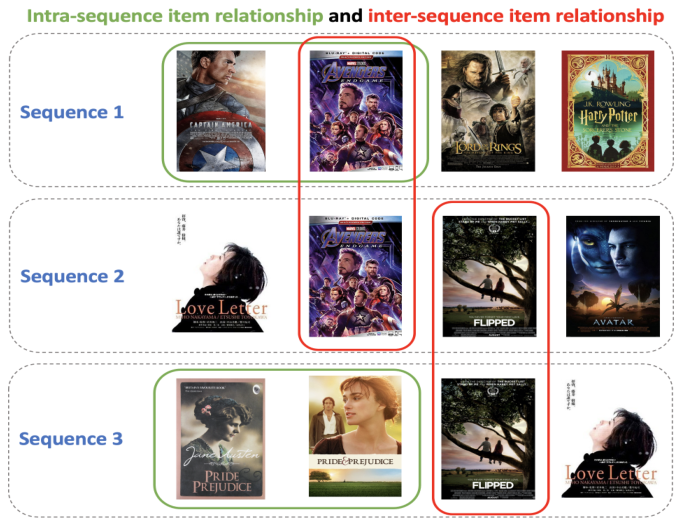
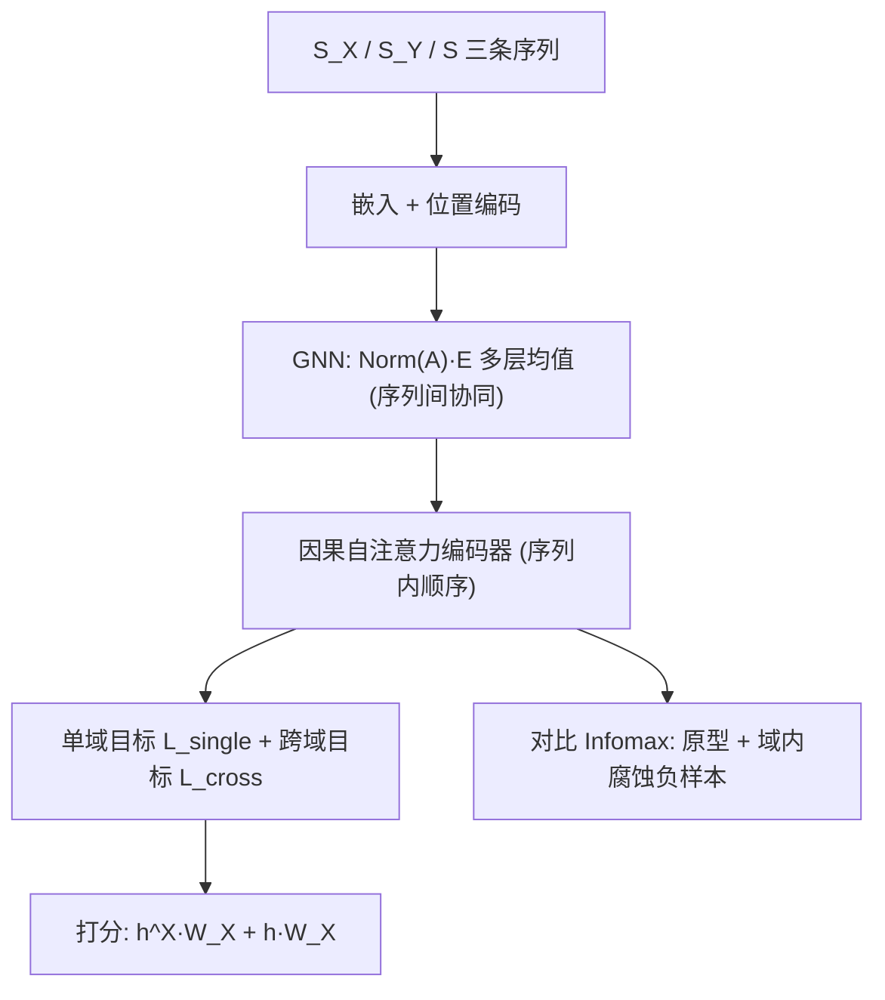

# Contrastive Cross-Domain Sequential Recommendation (对比式跨域序列推荐)

- **会议/期刊**: CIKM 2022
- **作者与机构**: Jiangxia Cao, Xin Cong, Jiawei Sheng, Tingwen Liu (中科院信工所/国科大网安学院), Bin Wang (小米 AI Lab)
- **推荐链路定位**: 召回（Next-Item 序列召回）
- **研究方向**: 跨域与多场景推荐 / 序列与会话推荐
- **论文原文**: [https://arxiv.org/abs/2304.03891v1](https://arxiv.org/abs/2304.03891v1)
- **开源代码**: [https://github.com/cjx96/C2DSR](https://github.com/cjx96/C2DSR)

## TL;DR (1分钟核心速览)

针对 CDSR 中"先各自学单域表征、再用门控/知识图谱模块隐式迁移"的流水线范式瓶颈，本文提出 C2DSR：用一层轻量 GNN 挖掘 **序列间协同关系**、自注意力捕获 **序列内顺序关系**，并以"单域 + 跨域"两套预测目标联合训练，最后用 **对比 Infomax 目标**最大化单域原型与跨域原型的互信息。在重新切分（消除时间穿越）的 Amazon/HVIDEO 三个跨域场景、1 正 999 负采样排序协议下，HR@10 相对最优基线最高提升 **14.4%–22.1%**。

## Background & Motivation (背景与核心矛盾)

- **主流范式**: π-Net/PSJNet 用门控循环模块迁移，MIFN 用跨域知识图谱显式连接物品，本质都是"单域编码 → 迁移模块 → 跨域表征"的两段式流水线。
- **前人局限**: ① 单域表征本身带域偏置，迁移模块成为信息瓶颈，误差被逐级放大；② 只建模序列内 (intra-sequence) 顺序信号，丢弃了跨序列物品共现的协同信号（图 2 红框），稀疏域尤其吃亏。
- **核心洞察 (Key Insight)**: 单域交互只反映**部分偏好**（图 1 中只看 Book 域无法推出《指环王》），两域合并才能恢复较完整的 "Romance/Fantasy" 偏好；且单域与跨域表征本就应当**互相关**，可直接用互信息作为显式约束而非依赖迁移模块隐式对齐。
- **本文切入点**: 把"表征学习"与"迁移"解耦为同一批次内的多目标 + 对比约束，让跨域信息通过损失函数而非网络模块流动。

<figure class="paper-figure" markdown="span">
  <figcaption>图 2：物品关系的玩具示例。绿色框反映序列内物品关系的序列模式信号。红色框反映序列间物品关系的协同信号。</figcaption>
</figure>

## Method (核心方法设计)

### 1. 整体框架 (Overall Architecture)

输入为用户的单域序列 $S_X,S_Y$与按时间合并的跨域序列$S$。三条序列分别经"嵌入 + 位置编码"进入共享结构的三套编码器：先在有向物品–物品矩阵$A_X,A_Y,A$上做无卷积核、无非线性的 LightGCN 式传播得到协同增强嵌入，再送入因果自注意力编码器得到$H_X,H_Y,H$。随后两条序列级目标分别把$H_X/H_Y$训成单域偏好、把$H$训成跨域偏好；并行的对比 Infomax 目标把单域原型与跨域原型拉近。推理时融合$h^{X}_{|S|}$与$h_{|S|}$ 打分。

### 2. 关键设计拆解 (Key Designs)

1. **双关系编码器（Inter + Intra Sequence）**：痛点是从未利用跨序列共现。做法是对 $A$行归一化后做$G_1=\mathrm{Norm}(A)G_0$，堆$L$层并取均值$G=\mathrm{Mean}(G_l)+E$，去掉非线性以保留纯协同滤波信号；再由多头注意力建模顺序依赖。直觉：GNN 提供"看过 X 的人也看过 Y"的全局协同补全，注意力提供"最近看了什么"的时序信号，两者互补缓解单域稀疏。

2. **分解式跨域预测目标（Balanced Cross-Domain Objective）**：若把 $S$直接做$|X|+|Y|$维 softmax，连续多个 Movie 会把 Book 概率整体压低。本文改为等权分解：$\mathcal{L}_{cross}=\sum_t\big[-\log P^X_{cross}(x_{t+1}|S)-\log P^Y_{cross}(y_{t+1}|S)\big]$，其中$P^X_{cross}=\mathrm{Softmax}(h_t W_X)$与单域目标$P^X_{single}=\mathrm{Softmax}(h^X_t W_X + h_t W_X)$共享输出矩阵$W_X$。直觉：分域归一化保证数据稀少域（Book）不被淹没，共享$W_X$ 使单域/跨域表征落在同一语义空间，便于后续对比对齐。

3. **对比 Infomax 与训练目标**：以 Mean 池化构造原型 $o^X_{single}=\mathrm{Mean}(H_X)$、$o^Y_{cross}=\mathrm{Mean}(\{h_t:S_t\in Y\})$，并用域内随机物品替换构造腐蚀负样本$\tilde{S}_X$，判别器$D_X=\sigma(o^X_{single}W_{disc}(o^Y_{cross})^\top)$，损失$\mathcal{L}^X_{disc}=-\big[\log D_X(o^X_{single},o^Y_{cross})+\log(1-D_X(o^X_{single},\tilde{o}^Y_{cross}))\big]$。该 BCE 形式是 JS 散度下的有效 MI 估计器。总损失$\mathcal{L}=\lambda(\mathcal{L}_{cross}+\mathcal{L}^X_{single}+\mathcal{L}^Y_{single})+(1-\lambda)(\mathcal{L}^X_{disc}+\mathcal{L}^Y_{disc})$，$\lambda$ 为调和因子。**负采样**仅来自"序列内腐蚀"（无需跨 batch 负样本），推理开销与 SASRec 同量级（Food-Kitchen 单 epoch 54s vs 40s，T4）。

## Experimental Setup & Evaluation Protocol (实验设置与评估协议)

- **数据集与预处理**: 保留双域均有交互的用户，过滤交互数 <10 的用户/物品，并要求每域在时间窗（Movie-Book 1 个月、Food-Kitchen 1 年）内至少 3 个物品。

| 场景 | #Items | #Train | #Valid | #Test | Avg.length |
| :--- | :---: | :---: | :---: | :---: | :---: |
| Food-Kitchen | 29,207 / 34,886 | 34,117 | 2,722 | 2,747 | 9.91 |
| Movie-Book | 36,845 / 63,937 | 58,515 | 2,032 | 1,978 | 11.98 |
| Entertainment-Education | 8,367 / 11,404 | 120,635 | 4,525 | 4,485 | 29.94 |

- **数据划分与防穿越**: `Leave-One-Out` 风格但**显式修正时间穿越**——作者统计发现原 Amazon 划分中约 **60%** 的 valid/test 样本在时间上早于训练序列（用未来预测过去），故改为"用户最新序列均分到 valid/test，其余入训练"。
- **排名评测协议**: `Sampled Ranking`，每个测试样本 1 正 + 999 负（遵循 Rendle 的 1000-item 协议），报告 MRR、NDCG@{5,10}、HR@{1,5,10}。
- **对比基线**: 传统 (BPRMF, ItemKNN)、跨域 (NCF-MLP, CoNet)、序列 (GRU4Rec, SASRec, SR-GNN)、CDSR (π-Net, PSJNet, MIFN)。$d=256$、batch=256、dropout=0.3、Adam、100 epoch、$L\in\{1,2,3,4\}$、$\lambda\in[0.1,0.9]$，以验证集 MRR 早停。

## Key Experimental Results (实验关键数据)

### 1. 主实验对比 (Main Results)

| 场景/域 | 指标 | SASRec | SR-GNN | π-Net | PSJNet | MIFN | **C2DSR** | Improv. |
| :--- | :--- | :---: | :---: | :---: | :---: | :---: | :---: | :---: |
| Food | MRR | 7.30 | 7.84 | 7.68 | 8.33 | 8.55 | **8.91** | +4.2% |
| Food | HR@10 | 11.68 | 12.27 | 11.75 | 12.45 | 12.71 | **14.54** | +14.4% |
| Kitchen | MRR | 3.79 | 4.01 | 3.53 | 4.10 | 4.09 | **4.65** | +13.4% |
| Kitchen | HR@10 | 6.62 | 6.84 | 6.67 | 7.15 | 7.08 | **8.18** | +14.4% |
| Movie | MRR | 3.79 | 3.85 | 4.16 | 4.63 | 5.05 | **5.54** | +9.7% |
| Movie | HR@10 | 5.20 | 5.81 | 6.11 | 7.53 | 8.29 | **9.55** | +15.2% |
| Book | MRR | 1.81 | 1.78 | 2.17 | 2.44 | 2.51 | **2.55** | +1.6% |
| Book | HR@10 | 2.75 | 2.72 | 2.84 | 3.28 | 3.07 | **3.75** | +14.3% |
| Ent. | MRR | 50.44 | 50.67 | 52.68 | 53.50 | — | **53.87** | +0.7% |
| Ent. | HR@10 | 76.92 | 77.17 | 75.11 | 76.56 | — | **79.08** | +2.5% |
| Edu. | MRR | 53.69 | 54.74 | 55.05 | 55.94 | — | **56.72** | +1.4% |
| Edu. | HR@10 | 76.56 | 77.47 | 74.65 | 75.08 | — | **79.21** | +2.2% |

### 2. 消融实验 (Ablation Study)

| 变体 (Food-Kitchen) | Food MRR | Food NDCG@10 | Food HR@10 | Kitchen MRR | Kitchen HR@10 |
| :--- | :---: | :---: | :---: | :---: | :---: |
| SASRec | 7.30 | 7.79 | 11.68 | 3.79 | 6.62 |
| SASRec++ (加 GNN + 跨域目标) | 8.09 | 8.70 | 13.11 | 4.20 | 7.55 |
| C2DSR$^{*}$ (去 Infomax) | 8.73 | 9.36 | 13.66 | 4.41 | 7.70 |
| **C2DSR** | **8.91** | **9.71** | **14.54** | **4.65** | **8.18** |
| C2DSR(GRU4Rec)$^{*}$ → C2DSR(GRU4Rec) | 6.83 → 7.68 | 7.26 → 8.02 | 10.72 → 11.60 | 3.57 → 3.92 | 6.10 → 6.54 |

### 3. 关键实验发现 (Key Findings)

- **"双关系 + 跨域目标"是最大增益源**：仅给 SASRec 加上 GNN 与分解式跨域目标（SASRec++），Food HR@10 从 11.68 升至 13.11（+12.2%），Kitchen 从 6.62 升至 7.55（+14.0%），说明序列间协同信号的缺失比迁移模块设计更致命。
- **Infomax 项稳定贡献 5–7%**：C2DSR$^{*}\to$C2DSR 在 Food 上 HR@10 13.66→14.54（+6.4%）、Kitchen MRR 4.41→4.65（+5.4%）；图 5 进一步显示跨域表征的单域预测力始终强于单域表征，且 Infomax 同时抬升两者——即该目标让单域表征"感知"完整偏好。
- **增益集中在列表整体排序而非头部**：Food HR@1 (5.84) 与 Entertainment HR@1 (40.89) 反而略输 MIFN (6.02) / PSJNet (42.52)，但 NDCG@10 与 HR@10 全面领先，说明 C2DSR 提升的是候选召回广度而非 top-1 精度；同时 $L\ge3$出现明显过平滑退化，$\lambda\in[0.3,0.7]$稳健，$\lambda=0.7$ 兼顾收敛速度。

## Highlights & Limitations (亮点、对比与审稿批判)

- **与代表作对比**: vs π-Net/PSJNet 的门控隐式迁移，本文取消迁移模块、改为双目标 + MI 约束，避免"偏置表征被二次放大"；vs MIFN 的外部知识图谱，本文只用交互图（无需 KG 资源），却在 HVIDEO 上因无 KG 而可正常运行——工程上更轻。
- **可迁移亮点**: ① 分域 softmax 等权分解（共享输出矩阵）可直接搬到任何"多行为/多场景共享序列"的建模中；② 用"域内随机替换序列物品"构造腐蚀负样本，避免跨 batch 大负样本队列，单卡即可训练。
- **审稿级局限批判**: ① 评测仍是 1 正 999 负的 `Sampled Ranking`，未做 Full-Ranking，高绝对值（HVIDEO ~79 HR@10）与重复消费行为强相关，跨场景可比性存疑；② Book 域 MRR 仅 +1.6%，且未见显著性检验，稀疏域收益不稳定；③ 需为三套序列各建物品–物品图并堆叠注意力，序列长（平均 29.94）时训练成本约为 SASRec 的 1.35 倍，且仅支持双域、无冷启动物品处理。

## Rating (四维评分)

- **方法创新性 (Novelty)**: ⭐⭐⭐⭐ （首次把"序列间协同 + 单/跨域联合训练 + 对比 Infomax"三者合成一个统一损失，MI 视角的解释比门控迁移更清晰）
- **评估协议与实验扎实度 (Protocol & Experiments)**: ⭐⭐⭐⭐ （主动发现并修正约 60% 的时间穿越泄漏、重发布数据集是一大贡献，但仅采样排序、缺显著性检验）
- **写作与数学规范度 (Clarity & Rigor)**: ⭐⭐⭐⭐ （三目标分解与符号定义干净，MI 与 JS 散度的论证引用了成熟结论，复杂度分析略简）
- **工业落地与复现价值 (Industrial & Practical Value)**: ⭐⭐⭐⭐ （代码与重切分数据集已开源，无需知识图谱、负样本成本低，但多域扩展与超长序列开销需额外工程优化）

