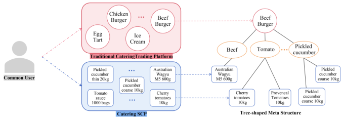
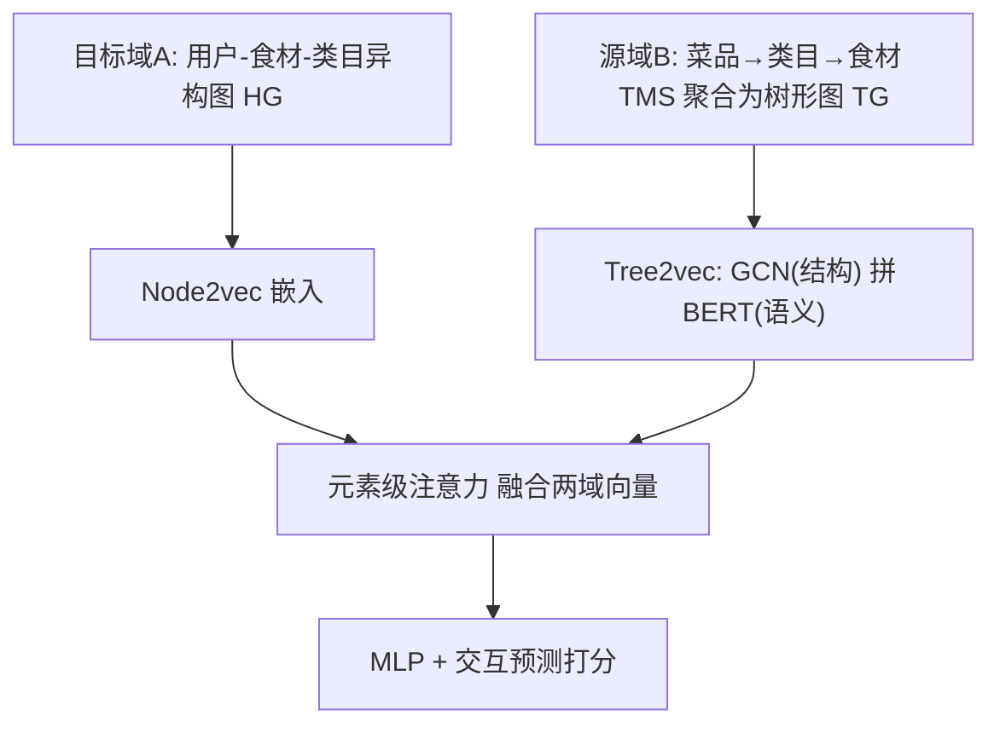

# GReS: Graphical Cross-domain Recommendation for Supply Chain Platform (面向供应链平台的图化跨域推荐)

- **会议/期刊**: CIKM 2022 (Short Paper)
- **作者与机构**: Zhiwen Jing, Ziliang Zhao, Yang Feng, Xiaochen Ma, Nan Wu, Shengqiao Kang, Cheng Yang, Yujia Zhang, Hao Guo (太原理工大学、中国人民大学高瓴人工智能学院、美团、浙江工商大学)
- **推荐链路定位**: 召回（跨域表征学习 + 用户/物品打分）
- **研究方向**: 跨域与多场景推荐 / 图神经网络与知识图谱推荐
- **论文原文**: [https://arxiv.org/abs/2209.01031v1](https://arxiv.org/abs/2209.01031v1)
- **开源代码**: 暂未开源

## TL;DR (1分钟核心速览)

供应链平台（SCP）用户兴趣极窄、交互远稀疏于普通电商，直接把通用 CDR 搬过来会丢失「菜品⊃类目⊃食材」的层级语义。GReS 将目标域（食材 SCP）建成含用户-食材-类目的异构图并用 Node2vec 嵌入，将源域（餐饮交易平台）的菜品层级整理为树形元结构 TMS 并合成树形图，用 Tree2vec（GCN 抽结构 + BERT 抽语义）编码，再以元素级注意力融合两域向量。在 3,000 名重叠用户的商用日志上，HR@10/.1023、NDCG@20/.0863、MRR@50/.0707 全面超越 DCDIR 等 5 个基线，平均提升约 9.03%。

## Background & Motivation (背景与核心矛盾)

- **主流范式**: SCP 推荐沿用 CDR 思路——用重叠用户在下游富域（菜品交易平台 B）的行为补齐上游目标域（食材供应链 A）的稀疏交互，代表作含 EMCDR（映射式）、GA-DTCDR（双目标）、DCDIR（知识图谱元路径）。
- **前人局限之一（语义鸿沟）**: 源域「Beef Burger」按分词只能拆出 "Beef"、"Burger"，而目标域 A 中该菜品真实由牛肉、洋葱、橄榄油等食材构成，纯文本/纯元路径的跨域对齐在这类"成品 ↔ 原料"关系上严重失真。
- **前人局限之二（关系扁平化）**: 传统 CDR（电影→小说）默认跨域物品关系对等；而 SCP 中「酸黄瓜」与「牛肉汉堡」是层级从属关系，非对等相似关系，等权对齐会引入噪声。
- **核心洞察 (Key Insight)**: 重叠用户在 A 是采购方、在 B 是供给方，两域通过"原料→成品"的物理构成关系天然耦合，因此跨域迁移的正确载体是**层级结构**而非相似度。
- **本文切入点**: 用 TMS 显式建模三级从属关系，GCN 保留有向层级结构、BERT 保留节点语义，二者拼接形成源域表征。

<figure class="paper-figure" markdown="span">
  <figcaption>图1：餐饮供应链平台的CDR</figcaption>
</figure>

## Method (核心方法设计)

### 1. 整体框架 (Overall Architecture)

GReS 分五层：图结构层为目标域 A 构建含用户、食材、类目三类节点（新增 user-category、category-category、category-item 三类边）的异构图 HG，为源域 B 按"菜品→类目→食材"构建由多条 TMS 聚合而成的有向树形图 TG；图嵌入层用 Node2vec 编码 HG 得到 $\hat{v}_{u_i},\hat{v}_{i_h}$，用 Tree2vec 得到$\tilde{v}_{u_i},\tilde{v}_{i_h}$；特征组合层用元素级注意力按用户稀疏度自适应分配两域权重；最后由 MLP 拟合非线性交互并输出预测分。全流程为静态图嵌入 + 轻量 MLP，无需在线图更新。

### 2. 关键设计拆解 (Key Designs)

1. **TMS 树形元结构与有向约束 GCN（把层级关系写进图拓扑）**: 痛点是跨域物品关系扁平化导致对齐噪声。本文将每道菜作为父节点、类目为中间层、食材为叶节点，三层构成 TMS，多用户 TMS 合为有向树形图（邻接矩阵 $M^i_T$为下三角）。两层 GCN 仅沿单向传播：$H^{(l+1)}=\sigma(\tilde{D}^{-\frac{1}{2}}\tilde{M}^i_T\tilde{D}^{-\frac{1}{2}}H^{(l)}W^{(l)})$，$\tilde{M}^i_T=M^i_T+I$。下三角结构使消息只能"父→子"流动，等价于把从属偏序编码进感受野，避免子节点反向污染菜品表征。

2. **Tree2vec-BERT 与层级位置编码（补 GCN 缺失的语义）**: GCN 只拿到拓扑，无法理解"和牛 M5"与"牛肉"的语义近邻。本文对每条 TMS 做 DFS 序列化，插入 "-"（菜→类目）与 "--"（类目→食材）两个特殊 token 显式标记边类型，并把 BERT 位置嵌入按三个层级重写为固定层级编码；菜品与食材分别取对应 token 的隐状态并按用户求和/直取。最终 $\tilde{v}= \mathrm{GCN}(T_{u_i})\oplus \mathrm{BERT}(T_{u_i})$。固定层级位置编码让模型先验区分"原料/类目/成品"，消融显示去掉后平均掉 1.80%。

3. **元素级注意力跨域融合与训练目标**: 稀疏用户应更多依赖源域。融合式为 $v_{u_i}=W_i\odot\hat{v}_{u_i}+(1-W_i)\odot\tilde{v}_{u_i}$（$W_i$ 为注意力网络输出的逐维权重），物品同理。预测层为 MLP + Sigmoid，按隐式反馈的交叉熵/pointwise 排序损失训练，负样本按常规未交互采样，无额外难负样本挖掘；推理阶段为向量拼接 + 双塔式 MLP 打分，开销与单域模型同量级。

## Experimental Setup & Evaluation Protocol (实验设置与评估协议)

- **数据集与预处理**: 无公开 SCP-CDR 数据集，作者从商用日日志采样构建（含两域购买/销售记录），未报告交互总量与过滤规则：

| 数据集 | #Users | #Items | #Interactions | 稀疏度/密度 | 特征/场景说明 |
| :--- | :---: | :---: | :---: | :---: | :--- |
| Commercial SCP-CDR | 3,000 重叠 + 600 仅域A = 3,600 | 未报告（食材/类目/菜品） | 未报告 | 未报告（文中定性称远稀疏于电商） | 域A=餐饮供应链（食材采购）；域B=餐饮交易平台（菜品销售）；含 Doc2vec 生成的用户/类目/物品画像文本 |

- **数据划分与防穿越 (Splitting Strategy)**: 随机 `80%/10%/10%` 训练/验证/测试，按验证集早停调参；未采用时间戳切分，存在轻度未来信息泄漏风险。
- **排名评测协议 (Ranking Protocol)**: 沿用前人 [2,8,14,18,22] 的 HR@K、NDCG@K、MRR@K，$K\in\{5,10,20,50\}$；论文未明确声明是 Full-Ranking 还是 Sampled Ranking（按 HR/NDCG/MRR 组合推断为对候选集全排序），负样本比例亦未披露。
- **对比基线与超参设置**: SDR 组 CTR-RBF、TMH；CDR 组 EMCDR、GA-DTCDR；CDR+KG 组 DCDIR（meta-path 取 dish-category-item）。Doc2vec/Node2vec 按原文献默认，边采样阈值 $\alpha=0.05$，Adam，学习率 0.0015，batch=30；未报告显著性检验。

## Key Experimental Results (实验关键数据)

### 1. 主实验对比 (Main Results)

| Model | HR@5 | HR@10 | HR@20 | HR@50 | NDCG@10 | NDCG@20 | MRR@10 | MRR@20 |
| :--- | :---: | :---: | :---: | :---: | :---: | :---: | :---: | :---: |
| CTR-RBF (SDR) | .0213 | .0334 | .0603 | .0811 | .0234 | .0376 | .0211 | .0301 |
| TMH (SDR) | .0224 | .0398 | .0687 | .0852 | .0278 | .0417 | .0251 | .0339 |
| EMCDR (CDR) | .0311 | .0667 | .0923 | .1026 | .0464 | .0545 | .0399 | .0447 |
| GA-DTCDR (CDR) | .0316 | .0659 | .1056 | .1173 | .0468 | .0597 | .0394 | .0478 |
| DCDIR (CDR+KG) | .0438 | .0953 | .1320 | .1422 | .0632 | .0794 | .0533 | .0631 |
| **GReS** | **.0467** | **.1023** | **.1477** | **.1577** | **.0692** | **.0863** | **.0593** | **.0698** |
| Improv. vs DCDIR | +6.62% | +7.35% | +11.89% | +10.90% | +9.49% | +8.69% | +11.26% | +10.62% |

### 2. 消融实验 (Ablation Study)

| 变体 | HR@10 | NDCG@10 | MRR@20 | 平均性能变化 |
| :--- | :---: | :---: | :---: | :---: |
| GReS | **.1023** | **.0692** | **.0698** | — |
| w/o tree (去掉 TMS) | .0828 | .0578 | .0616 | −17.36% |
| w/o BERT | .0861 | .0613 | .0627 | −9.68% |
| w/o GCN | .0878 | .0601 | .0631 | −9.57% |
| w/o unidirectional (改双向传消息) | .0994 | .0659 | .0683 | −3.25% |
| w/o fix-position (不固定层级位置码) | .1031 | .0690 | .0680 | −1.80% |

### 3. 关键实验发现 (Key Findings)

1. **层级结构是收益主引擎，编码器只是载体**: 移除 TMS 后平均掉 17.36%（HR@10 从 .1023 跌至 .0828），跌幅是移除 GCN（9.57%）或 BERT（9.68%）的近两倍——说明"菜→类目→食材"的拓扑先验本身贡献了大部分增益，与"跨域关系需按层级对齐"的动机一致。
2. **结构与语义不可互相替代**: 单去 GCN 与单去 BERT 的损失几乎相等（9.57% vs 9.68%），证明下三角有向传播提供的偏序信息与层级 token 提供的语义信息是正交的，二者拼接优于任一单独通道；同时移除双向传消息掉 3.25%，验证了"禁止子→父反向传播"对层级建模的必要性。
3. **跨域增益随 K 增大而放大，且 K=10 附近有异常点**: 相对 DCDIR 的提升从 HR@5 的 6.62% 增长到 HR@20 的 11.89%，说明两域融合主要改善了长尾候选的排序位置（MRR@50 提升 11.69% 为全表最高）；但 `w/o fix-position` 的 HR@10=.1031 反而略高于完整模型 .1023，反映固定层级位置编码在 Top-10 头部排序上存在边际冗余，是该组件仅带来 1.80% 平均收益的根本原因。

## Highlights & Limitations (亮点、对比与审稿批判)

- **与代表作对比 (vs. Prior Work)**: EMCDR/GA-DTCDR 用映射函数对齐两域隐空间，默认物品关系对等；DCDIR 虽引入 KG 元路径，但 dish-category-item 路径仍被当作等权语义路径处理，无法表达"父→子"偏序。GReS 的差异在于把偏序写进邻接矩阵（下三角）+ 消息单向传播，使层级从"特征"升级为"结构约束"。
- **可迁移亮点**: (1) 用 DFS 序列化 + 边类型特殊 token（"-"/"--"）把任意层级 DAG 灌入 BERT，可迁移到类目树、BOM 物料清单、医疗诊疗路径等场景；(2) 元素级注意力按用户稀疏度自适应分配跨域权重，是缓解冷启动用户"域内无行为"的廉价手段。
- **审稿级局限批判**: (1) 评估薄弱——单商用数据集、随机 80/10/10 划分（无时间戳切分）、未声明 Full-Ranking / 负采样比例、无显著性检验、无重复实验方差，且未报告交互规模使稀疏度论断不可复核；(2) 工程与泛化性存疑——Node2vec/Tree2vec 为静态嵌入，新菜品/新食材上线需重构图重训，且每个用户单独建 TG（$T_{u_i}$）在万级重叠用户下存储与 GCN 前向开销会线性膨胀；3,600 用户的小样本也难支撑"可推广到工业配件、医药等其它 SCP"的结论。

## Rating (四维评分)

- **方法创新性 (Novelty)**: ⭐⭐⭐ （TMS + 有向单传 GCN + 层级位置编码的组合在 SCP 场景属首次，但各组件均为 GCN/BERT/Node2vec 的成熟拼装，理论新意有限）
- **评估协议与实验扎实度 (Protocol & Experiments)**: ⭐⭐ （仅一个未公开规模的商用数据集、随机划分、打分协议与显著性均未交代，消融虽完整但缺少长尾/稀疏分桶与方差报告）
- **写作与数学规范度 (Clarity & Rigor)**: ⭐⭐⭐ （五层架构与 TMS 示例清晰、公式简洁，但边权构建与 BERT 序列化细节偏略，且域 A/B 命名在摘要与正文中易混）
- **工业落地与复现价值 (Industrial & Practical Value)**: ⭐⭐⭐ （源自美团真实业务、链路为静态嵌入 + MLP 易于上线，但未开源、构图与逐用户建树的重训成本是主要落地障碍）

