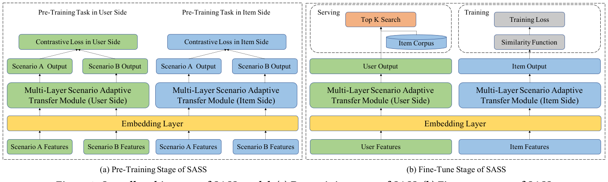
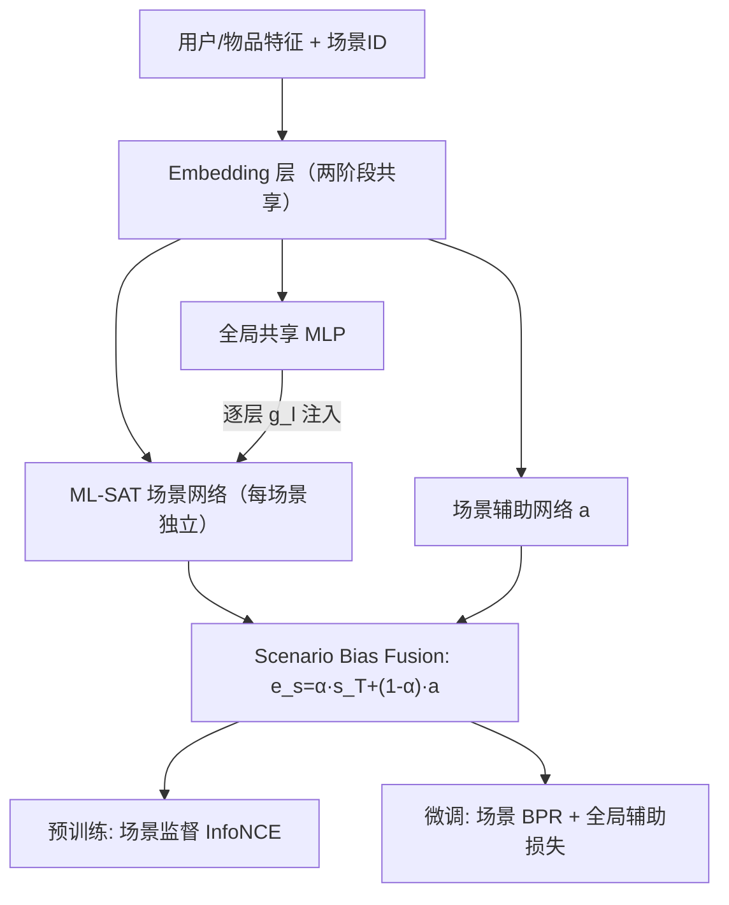

# Scenario-Adaptive and Self-Supervised Model for Multi-Scenario Personalized Recommendation (面向多场景个性化推荐的场景自适应自监督模型)

- **会议/期刊**: CIKM 2022
- **作者与机构**: Yuanliang Zhang, Xiaofeng Wang, Jinxin Hu, Ke Gao, Chenyi Lei, Fei Fang（阿里巴巴）
- **推荐链路定位**: 召回（双塔向量检索，可平移至排序）
- **研究方向**: 跨域与多场景推荐 / 自监督对比学习
- **论文原文**: [https://arxiv.org/abs/2208.11457v1](https://arxiv.org/abs/2208.11457v1)
- **开源代码**: 暂未开源

## TL;DR (1分钟核心速览)

多场景召回的核心矛盾是「全局共享」与「场景独立」的信息迁移粒度太粗：STAR 靠逐元素乘、HMoE/SAR-Net 靠专家门控隐式迁移，无法精确控制迁移强度；且绝大多数模型只用有标签样本、并假设物品只有一套表征。SASS 提出 ML-SAT 模块，用类 GRU 的场景自适应门控在每一层显式调节全局网络向场景网络的注入量，并把「同一用户/物品在不同场景的行为」当作对比学习的数据增广做两阶段预训练。在淘宝 Ali-MSSV 与 Ali-Mama 上，HR@20/NDCG@20 端到端全库候选排序评测优于 STAR-M 等 SOTA（#A3 场景 HR@20 相对提升 51.1%），线上 AWT 提升超过 8.0%。

## Background & Motivation (背景与核心矛盾)

- **主流范式**: 以多任务/多专家框架构建统一模型（STAR 星型拓扑、HMoE 多门 MoE、SAR-Net 场景注意力、M2M 动态权重），共享底层+场景专属顶层。
- **前人局限其一**: 信息迁移是「隐式且粗粒度」的——STAR 用层权重的逐元素积做迁移、MoE 类方法用专家加权，均无法给出「从全局到某场景迁移了多少、迁哪一维」的显式可控量。
- **前人局限其二**: 仅用有标签交互训练，海量曝光未点击样本被浪费；ZEUS 虽做 Next-Query 自监督，但只在 query 侧，且未与多场景建模耦合。
- **前人局限其三**: 几乎全部工作只做「用户侧」场景化意图建模，物品在各场景下的表征解耦被忽略。
- **核心洞察 (Key Insight)**: 同一用户/同一视频跨场景的出现本身就是一种天然「数据增广」；场景分布差异应通过**逐层、逐维的门控**而非硬共享来控制。
- **本文切入点**: 全局共享网络 + 每场景一套 ML-SAT 场景网络，用场景自适应门控连接；先用跨场景对比预训练灌入全空间样本，再按场景微调。

<figure class="paper-figure" markdown="span">
  <figcaption>图3：SASS模型的整体架构。(a) SASS的预训练阶段。(b) SASS的微调阶段。</figcaption>
</figure>

## Method (核心方法设计)

### 1. 整体框架 (Overall Architecture)

双塔对称（用户侧与物品侧结构完全同构）。输入为用户画像、场景上下文（场景 ID）、用户-场景交叉行为序列/统计特征与物品侧对应特征，经 Embedding 层后分两路：一条进全局共享 MLP（学全场景共性），一条进场景专属的 ML-SAT（学场景差异）；ML-SAT 每层用场景自适应门控接收全局层输出，末端再与场景辅助网络的输出做偏置融合得到场景表征。训练分两段：预训练用跨场景对比损失（有标签+无标签样本，用户侧与物品侧共享 Embedding），微调阶段用场景 BPR 损失 + 全局辅助损失联合优化。线上服务时物品向量离线灌库，用户向量实时计算，走 ANN top-k 检索，两塔均只用场景输出向量。

### 2. 关键设计拆解 (Key Designs)

1. **ML-SAT 与场景自适应门控单元（细粒度解耦迁移）**：痛点是 STAR/MoE 的迁移量不可控。作者借用 GRU 思路，在第 $l$层用自适应门$r^l$决定全局输出$g^l$能被吸收多少，更新门$z^l$ 决定新旧场景状态的融合比例：
$r^l=\sigma(W^l_r[g^l,s^{l-1}]+W^l_{br}a),\quad h^l=\tanh(W^l_h[r^l\cdot g^l,s^{l-1}])$
$z^l=\sigma(W^l_z[g^l,s^{l-1}]+W^l_{bz}a),\quad s^l=(1-z^l)\cdot s^{l-1}+z^l\cdot h^l$场景辅助向量$a$ 作为门控的强场景指示偏置，使「同一全局知识」在不同场景下被不同强度地吸收；逐层堆叠即渐进式分层提取（PLE 式），可解释性上等价于显式的迁移量控制。
2. **场景偏置融合与场景专属输出**：场景 ID 在浅层易被高维行为特征淹没，故单设辅助网络输出 $a$，与 ML-SAT 末层$s^T$做自适应加权：$e^s=\alpha\cdot s^T+(1-\alpha)\cdot a,\ \alpha=\sigma(W_o[s^T,a])$。该设计保证表征既含行为信息又保留场景身份，且用户/物品两侧同构，天然实现物品的**多场景表征解耦**（同一视频在不同场景生成不同向量）。
3. **两阶段训练与损失**：预训练把同一用户（或物品）在两个场景下的两组特征视为正对，batch 内其余 $2(N-1)$个向量为负，用温度$\tau$的 InfoNCE：$\mathcal{L}_{ij}=-\log\frac{\exp(\mathrm{sim}(e^s_i,e^s_j)/\tau)}{\sum_{k\neq i}\exp(\mathrm{sim}(e^s_i,e^s_k)/\tau)}$；若用户访问$k$个场景则组合出$C_k^2$个样本对。微调阶段采样随机负例，损失为$\mathcal{L}=\mathcal{L}_{scenario}+\beta\cdot\mathcal{L}_{auxiliary}$，前者为场景内 BPR  triplet，后者用全局网络输出的三元组做同式 pairwise 约束，加速全局网络收敛。推理零额外开销（仅场景塔）。

## Experimental Setup & Evaluation Protocol (实验设置与评估协议)

- **数据集与预处理**:

| 数据集 | #Users | #Items | #Interactions | 稀疏度/密度 | 特征/场景说明 |
| :--- | :---: | :---: | :---: | :---: | :--- |
| Ali-MSSV #A1 | 10.1M | 2.5M | 630M | 稠密 | 淘宝短视频主 Feed，训练 03-24~04-04 / 测试 04-05 |
| Ali-MSSV #A2 | 30.1M | 5.6M | 1.2B | 稠密 | 沉浸式 Feed |
| Ali-MSSV #A3 | 2.1M | 0.53M | 100.2M | 稀疏 | 首页 Feed |
| Ali-MSSV #A4 | 1.5M | 0.39M | 100M | 稀疏 | 长尾场景 |
| Ali-CCP #B1–#B3 | 0.05–0.18M | 0.2–2.44M | 13k–1M | 极稀疏 | 按 scenario id 切 3 场景，缺预训练所需特征 |
| Ali-Mama #C1–#C5 | 40K–0.15M | 50k–0.13M | 94k–0.42M | 中 | 按城市等级切 5 场景 |

- **数据划分与防穿越 (Splitting Strategy)**: 工业数据集采用**全局时间戳切分**（最后一天做测试），公开集沿用官方 train/test 划分，未见 Leave-One-Out。
- **排名评测协议 (Ranking Protocol)**: 报告 HR@20 与 NDCG@20，从候选物品集取 top-20；训练负例为**全候选集随机负采样**（非 in-batch、非 hard negative）。论文未明确说明评测是否为严格 Full-Ranking，属于潜在的协议透明度短板。
- **对比基线与超参设置**: 单场景（YoutubeDNN/DSSM/BST/MIND）、混场景（同四个模型混数据训练）、多场景（SAR-Net-M、STAR-M、HMoE-M、ZEUS-M、ICAN）；行为序列截断 50，AdamGrad，lr=0.001，batch=512。

## Key Experimental Results (实验关键数据)

### 1. 主实验对比 (Main Results)

| 模型 | #A1 HR@20 | #A1 NDCG@20 | #A3 HR@20 | #A3 NDCG@20 | #B1 HR@20 | #C2 HR@20 |
| :--- | :---: | :---: | :---: | :---: | :---: | :---: |
| MIND (单场景) | 0.052 | 0.021 | 0.041 | 0.023 | 0.153 | 0.179 |
| BST (单场景) | 0.042 | 0.014 | 0.036 | 0.021 | 0.144 | 0.142 |
| MIND-Mix (混场景) | 0.044 | 0.024 | 0.045 | 0.021 | 0.164 | 0.155 |
| SAR-Net-M | 0.079 | 0.033 | 0.042 | 0.021 | 0.185 | 0.147 |
| STAR-M | 0.082 | 0.036 | 0.045 | 0.019 | 0.211 | 0.173 |
| HMoE-M | 0.061 | 0.022 | 0.041 | 0.017 | 0.194 | 0.183 |
| ZEUS-M | 0.072 | 0.031 | 0.039 | 0.016 | 0.212 | 0.192 |
| ICAN | 0.072 | 0.025 | 0.039 | 0.013 | 0.175 | 0.204 |
| SASS-Base | 0.082 | 0.039 | 0.047 | 0.025 | **0.234** | 0.209 |
| **SASS (本文)** | **0.087** | **0.042** | **0.068** | **0.037** | – | **0.227** |
| Improv.% (vs 最优基线) | +6.1% | +16.7% | +51.1% | +94.7% | +10.4% | +11.3% |

### 2. 消融实验 (Ablation Study)

| 变体 | #A1 HR@20 | #A1 NDCG@20 | #A3 HR@20 | #A3 NDCG@20 |
| :--- | :---: | :---: | :---: | :---: |
| SASS*（无迁移门） | 0.054 | 0.021 | 0.029 | 0.019 |
| SASS* + Production Gate（≈STAR 式） | 0.059 | 0.022 | 0.033 | 0.018 |
| SASS* + Simnet Gate | 0.065 | 0.027 | 0.037 | 0.017 |
| SASS* + Sigmoid Gate（≈MMoE/Cross-Stitch） | 0.071 | 0.029 | 0.042 | 0.023 |
| SASS-Base（完整门控，无预训练） | **0.082** | **0.039** | **0.047** | **0.025** |
| SASS-Base → Next Video Prediction 预训练 | 0.083 | 0.033 | 0.052 | 0.031 |
| SASS-Base → **SASS 对比预训练** | **0.087** | **0.042** | **0.068** | **0.037** |
| 单物品向量（不解耦） | 0.081 | 0.037 | 0.054 | 0.033 |
| 去掉全局辅助损失 | 0.045 | 0.018 | 0.036 | 0.021 |
| 去掉场景偏置融合 | 0.075 | 0.031 | 0.039 | 0.024 |

### 3. 关键实验发现 (Key Findings)

1. **迁移门控是主要增益来源，而非「共享」本身**：无门的 SASS*（等价 MoE 变体）仅 0.054，#A1 上换成场景自适应门控后升至 0.082（+51.9%），且优于 STAR 式逐元素积（0.059）与 MMoE 式 sigmoid 门（0.071），说明逐层显式调节迁移量确实优于隐式融合。
2. **预训练红利集中在稀疏场景**：#A1（稠密）仅 +6.1%（0.082→0.087），而 #A3（稀疏）+44.7%（0.047→0.068）；且 ZEUS 式 Next-Video-Prediction 只在稀疏场景小幅有效（0.047→0.052），跨场景对比目标显著更优，印证「无标签样本对稀疏小场景最值钱」。
3. **层数与组件均存在最优权衡**：ML-SAT 从 2 层增至 3 层性能上升、继续加层反而下降（迁移过多会抹平场景差异）；去掉全局辅助损失使 #A1 HR 由 0.087 跌至 0.045，去偏置融合跌至 0.075，物品跨场景解耦则带来 #A3 0.054→0.068 的增益。线上 A/B：AWT 在 #A1 +8.3%、#A4 +15.2%，CTR 最高 +16.3%。

## Highlights & Limitations (亮点、对比与审稿批判)

- **与代表作对比 (vs. Prior Work)**: 相对 STAR 的逐元素积迁移，本文把「迁移量」变成可学习门控；相对 SAR-Net/HMoE 的专家加权，本文在**每一层**做解耦注入并引入场景 ID 偏置；相对 ZEUS，本文把自监督从 query 侧扩展到用户与物品双侧，并与多场景目标统一在同一框架下。
- **可迁移亮点**: (1)「同一主体跨域/跨场景出现 = 天然数据增广」这一构造可零成本迁移到跨域推荐与多业务排序；(2) 场景辅助向量作为门控偏置输入，是缓解场景 ID 被行为特征淹没的轻量技巧。
- **审稿级局限批判**: (1) 评测仅报 HR@20/NDCG@20，未声明候选集规模与是否全库排序，且未给显著性检验，与主流全库排序协议可比性存疑；(2) 预训练依赖同一主体跨 ≥2 场景出现，对单场景用户/严格冷启动物品无效，Ali-CCP 因缺特征直接无法预训练，泛化条件较苛刻；(3) 每场景一套 ML-SAT 使参数量随场景数线性增长，论文未给训练/推理开销与层数敏感度（仅 3 层最优）的定量分析。

## Rating (四维评分)

- **方法创新性 (Novelty)**: ⭐⭐⭐⭐ （GRU 式场景门控把「迁移量」显式化，配跨场景对比预训练，思路清晰但组件多为已有模块的场景化改写）
- **评估协议与实验扎实度 (Protocol & Experiments)**: ⭐⭐⭐⭐ （3 个数据集 12 场景 + 线上 A/B 与 4 组消融较完整，但缺显著性检验且排序协议披露不足）
- **写作与数学规范度 (Clarity & Rigor)**: ⭐⭐⭐⭐ （公式与模块图对应清楚，门控推导可复现；部分符号如 $W^l_r$ 与偏置项定义略简，复杂度分析缺失）
- **工业落地与复现价值 (Industrial & Practical Value)**: ⭐⭐⭐⭐⭐ （已在淘宝短视频全量部署，AWT +8%、稀疏场景 +15.2%，双塔+ANN 服务形态改造成本低；但无开源代码）

