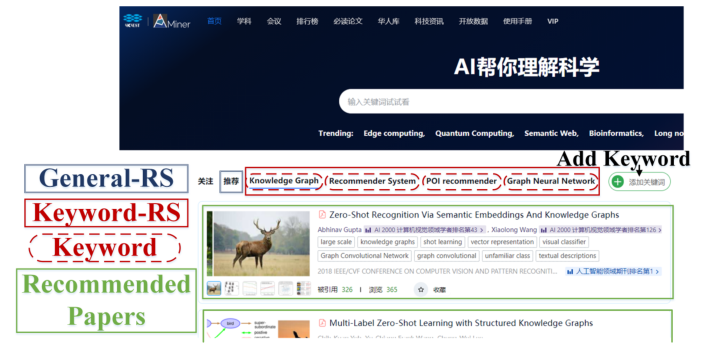
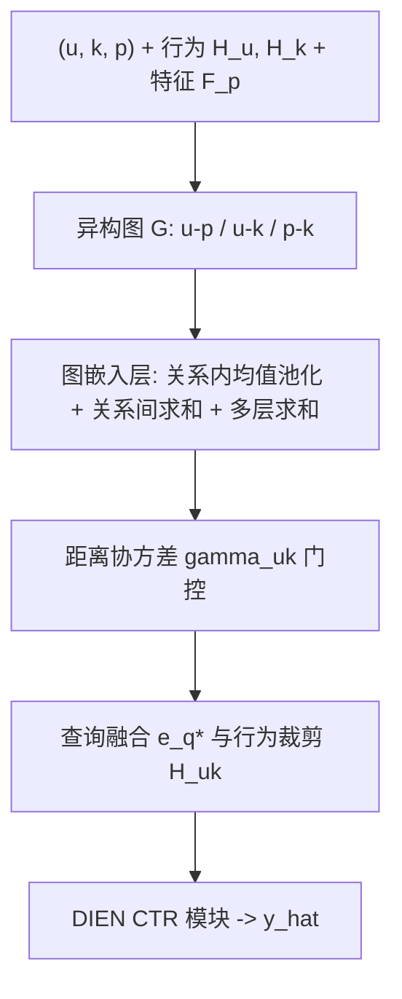
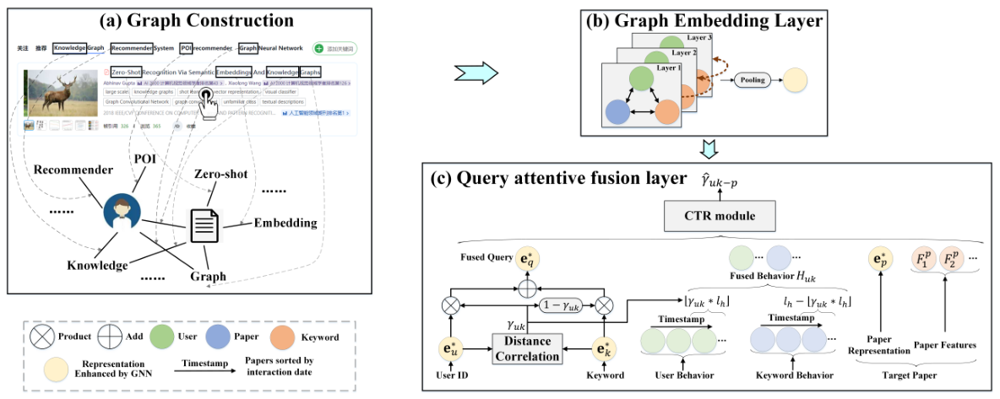

# AMinerGNN: Heterogeneous Graph Neural Network for Paper Click-through Rate Prediction with Fusion Query (融合查询的异构图神经网络论文点击率预估)

- **会议/期刊**: CIKM 2022 (Applied Research Track, 5 页短文)
- **作者与机构**: Zepeng Huai（UCAS/CASIA）、Zhe Wang（ByteDance）、Yifan Zhu（清华）、Peng Zhang（智谱 AI Lab / AMiner）
- **推荐链路定位**: 精排（CTR 预估）
- **研究方向**: CTR/CVR 预估与特征交叉 / 图神经网络推荐
- **论文原文**: [https://arxiv.org/abs/2208.07201v1](https://arxiv.org/abs/2208.07201v1)
- **开源代码**: 暂未开源（论文中出现的 `github.com/nltk/nltk` 为分词工具仓库，非本文代码）

## TL;DR (1分钟核心速览)

学术搜索场景下推荐同时受 **userID** 与用户手输 **keyword** 两个 query 约束，而 CTR 模型（DIN/DIEN/UBR）只吃单一 userID query，商品搜索模型（HEM/ALSTP/MGDSPR）又假定两 query 重要性恒定。AMinerGNN 把 user/paper/keyword 投影进同一 embedding 空间（异构图 GNN），再用两 query 间的**距离相关系数** $\gamma_{uk}$ 作为门控权重线性融合成一个 query 并按比例裁剪双行为序列，端到端接 DIEN 输出 CTR。在自建 AMiner_KRS 上 AUC 从 0.871（MGDSPR）提升到 **0.899**，线上 14 天 A/B（3 万用户）UV-CTR +9.6%、PV-CTR +30.2%（vs DIEN）。

## Background & Motivation (背景与核心矛盾)

- **主流范式**: 学术站点 AMiner 有两条链路——不输关键词走 General-RS（纯个性化），输关键词走 Keyword-RS（个性化 + 关键词相关性），后者被建模为"双 query 的 CTR 预估"：$\hat{y}_{uk-p}=f(u,k,p,H_u,H_k,F_p)$。
- **前人局限（一）**: 所有 CTR 基线（FM/DeepFM/DIN/DIEN/UBR）输入恒为 $(\text{userID}, \text{target item})$，两 query 无法同时进入网络，keyword 语义只能被当成普通离散特征拼接，丢失与用户历史研究方向的关系。
- **前人局限（二）**: 商品搜索类方法（HEM 拼接 userID-query、ALSTP/MGDSPR 建模长短序列）默认个性化与查询意图**权重固定**，无法刻画 S1/S2/S3 三场景下重要性的剧烈反转。
- **核心洞察 (Key Insight)**: 作者依据用户反馈将场景三分——S1（关键词=用户既有方向，userID 更重要，做深挖综述）、S2（跨领域交叉，两者同等重要）、S3（全新领域，keyword 更重要，应给热门经典论文）。**用户 query 与关键词的语义相关度，恰好可以作为"该信谁"的代理信号**。
- **本文切入点**: 先用异构图把三类实体对齐到同一空间，使"相关度"可被度量（距离协方差），再把该相关度直接当作注意力权重做 query 融合与行为裁剪。

<figure class="paper-figure" markdown="span">
  <figcaption>图 1：AMiner 中的 Keyword-RS。建议彩色查看。</figcaption>
</figure>

## Method (核心方法设计)

### 1. 整体框架 (Overall Architecture)

输入为三元组 $(u,k,p)$及其查询行为$H_u,H_k$与论文特征$F_p$。首先构建无向异构图$\mathcal{G}=\{\mathcal{V},\mathcal{E},O_V,O_E\}$，节点类型$O_V=\{user,keyword,paper\}$、边类型$O_E=\{u\text{-}p,u\text{-}k,p\text{-}k\}$（$u\text{-}p$来自点击与搜索日志，$u\text{-}k$来自用户输入关键词，$p\text{-}k$由论文标题分词后与停用词过滤得到的词表匹配生成）。图嵌入层做$L$层关系感知聚合，得到同空间表征$\mathbf{e}_u^{*},\mathbf{e}_k^{*},\mathbf{e}_p^{*}$；再由查询注意力融合层计算$\gamma_{uk}$，把两 query 融合为$\mathbf{e}_q^{*}$、把两行为序列按$\gamma_{uk}$比例拼成$H_{uk}$；最后送入 DIEN 输出点击概率，以 Logloss 端到端优化。

<figure class="paper-figure" markdown="span">
  <figcaption>图 2：AMinerGNN 的框架。建议彩色查看。</figcaption>
</figure>

### 2. 关键设计拆解 (Key Designs)

1. **关系感知图嵌入层（把三类实体拉进同一空间）**: 前人无法度量 query 相关度，根因是 user 与 keyword 表征不同源。本文第 $l$层先按边类型分别均值池化、再跨类型求和：$\mathbf{e}_i^{(l)}=\sum_{t\in O_E}\frac{1}{|\mathcal{N}_i^{t}|}\sum_{j\in\mathcal{N}_i^{t}}\mathbf{e}_j^{(l-1)}$，并对$0\ldots L$层求和得$\mathbf{e}_i^{*}=\sum_{l=0}^{L}\mathbf{e}_i^{(l)}$。直觉上，$p\text{-}k$边让论文吸收研究方向、$u\text{-}k$边让用户吸收关注领域、共现关键词互相靠近 → 为后续$\gamma_{uk}$ 提供可比几何。

2. **距离协方差查询注意力融合（场景自适应权重）**: 痛点是权重不该人工设定。以距离相关系数作门控：$\gamma_{uk}=\mathrm{dCor}(\mathbf{e}_u^{*},\mathbf{e}_k^{*})=\frac{\mathrm{dCov}(\mathbf{e}_u^{*},\mathbf{e}_k^{*})}{\sqrt{\mathrm{dCov}(\mathbf{e}_u^{*},\mathbf{e}_u^{*})\,\mathrm{dCov}(\mathbf{e}_k^{*},\mathbf{e}_k^{*})}}$，并融合$\mathbf{e}_q^{*}=\gamma_{uk}\mathbf{e}_u^{*}+(1-\gamma_{uk})\mathbf{e}_k^{*}$。极限情形可解释：$\gamma_{uk}\to 0$（S3 全新领域）退化为纯关键词表征，$\gamma_{uk}\to 1$（S1）退化为纯个性化，与业务三分场景一一对应；距离协方差可捕捉非线性的高阶依赖，比 cosine 更鲁棒。

3. **行为序列配比与训练目标**: 把两路行为按同一权重裁剪为定长 $l_h=100$的$H_{uk}$，取$H_u$最近$\lfloor\gamma_{uk}l_h\rfloor$篇、$H_k$补足$l_h-\lfloor\gamma_{uk}l_h\rfloor$篇，从而"重视谁就多用谁的历史"，同时保证张量定长可批量并行。损失为标准 Logloss$\mathcal{L}=-\frac{1}{N}\sum_{(u,k,p)\in S}\left[y_{uk-p}\log\hat{y}_{uk-p}+(1-y_{uk-p})\log(1-\hat{y}_{uk-p})\right]$；未设显式负采样策略（正负样本来自真实曝光-点击日志），图嵌入离线预训练、在线只做前向，$L=2$、$d=64$。

## Experimental Setup & Evaluation Protocol (实验设置与评估协议)

- **数据集与预处理**: 自建 AMiner_KRS，取 2022-02-01 至 2022-05-01 三个月日志，过滤未注册用户与低质论文（引用数/浏览量设阈值）。

| 数据集 | #Users | #Items(papers) | #Interactions | 稀疏度/密度 | 特征/场景说明 |
| :--- | :---: | :---: | :---: | :---: | :--- |
| AMiner_KRS (节点) | 67,806 | 200,837 | 398,001 keywords | — | 三节点类型异构图 |
| AMiner_KRS (边) | — | — | u-p 568,424 / u-k 240,116 / p-k 6,899,284 | 极稀疏 | p-k 占绝对多数 |
| AMiner_KRS (标签) | — | — | $y_{uk-p}$仅 2,781（$y_{k-p}$ 5,030） | 极稀疏 | 双 query 点击标签极少 |

- **数据划分与防穿越 (Splitting Strategy)**: 前两个月数据**仅用于构图与生成查询行为**，第三个月（2022-04）的 user&keyword-paper 交互**随机 80%/20% 划分**训练/测试；即标签按时间切分、图与行为取历史，避免未来交互泄漏。
- **排名评测协议 (Ranking Protocol)**: 采用 CTR 常规 **AUC + Log Loss**，基于对曝光样本的逐条打分计算，**非 Full-Ranking 全库排序**，也非采样负例排序；无 Recall@K/NDCG 类排名指标，亦未报告显著性检验。
- **对比基线与超参设置**: CTR 类 DeepFM/DIN/DIEN/UBR，商品搜索类 HEM/ALSTP/MGDSPR；统一 $d=64$、$l_h=100$、Adam（lr=0.001，batch=1024）、$L=2$；ALSTP 短序列长度网格$\{16,32,64,100\}$，MGDSPR 长/短窗为 10 天/1 个月。

## Key Experimental Results (实验关键数据)

### 1. 主实验对比 (Main Results)

| 模型类别 | 模型 | AUC | Log Loss |
| :--- | :--- | :---: | :---: |
| CTR | DeepFM | 0.635 | 0.674 |
| CTR | DIN | 0.657 | 0.645 |
| CTR | DIEN | 0.710 | 0.581 |
| CTR | UBR | 0.716 | 0.578 |
| 商品搜索 | HEM | 0.672 | 0.680 |
| 商品搜索 | ALSTP | 0.840 | 0.512 |
| 商品搜索 | MGDSPR | 0.871 | 0.478 |
| **本文** | **AMinerGNN (=DIEN$_{g\&f}$)** | **0.899** | **0.452** |
| **Improv.** | vs. 最优基线 MGDSPR | **+3.2%** | **−5.4%** |
| **Improv.** | vs. 同骨干 DIEN | **+26.6%** | **−22.2%** |

### 2. 消融实验 (Ablation Study)

以 base（两 query 直接相加、行为取并集）/ +f（仅融合层）/ +g（仅图嵌入）/ +g&f 四种变体跨四个骨干对比 AUC：

| 变体 | DeepFM | DIN | DIEN | UBR |
| :--- | :---: | :---: | :---: | :---: |
| base | 0.635 | 0.657 | 0.710 | 0.716 |
| +f (仅查询融合) | 0.673 | 0.684 | 0.711 | 0.719 |
| +g (仅图嵌入) | 0.799 | 0.856 | 0.875 | 0.876 |
| +g&f (完整) | **0.837** | **0.876** | **0.899** | **0.903** |

### 3. 关键实验发现 (Key Findings)

1. **图嵌入是主贡献、融合层是增益放大器**: DIEN 上 +f 仅 0.710→0.711（+0.14%），而 +g 冲到 0.875（+23.2%）；一旦有了共享空间，+f 再补 0.875→0.899（+2.7%，原文报 5.02%），UBR 上同趋势 0.876→0.903。说明**融合层必须依附于同空间表征才有意义**，孤立的 attention 权重在异源 embedding 上不可度量。
2. **场景分桶实验验证门控有效性**: 按 $\gamma_{uk}\in[0.5,1]/[0.1,0.5)/[0,0.1)$ 划分 S1/S2/S3 后，CTR+融合模型三桶表现稳定；商品搜索模型 MGDSPR/ALSTP 仅在 S2（两 query 同等重要）保持高位，在 S1/S3 明显掉点——直接证伪了"权重恒定"假设。
3. **线上与效率的双重权衡**: 14 天 A/B（约 3 万用户）中 AMinerGNN 取得 UV-CTR 0.533 / PV-CTR 0.112，优于 DIEN（0.437/0.086）与 MGDSPR（0.496/0.097）；延迟上 DIEN$_{g\&f}$仅 106 ms，而效果略好的 UBR$_{g\&f}$（AUC 0.903）需 329 ms（检索式取行为），故最终上线 DIEN 版本。

## Highlights & Limitations (亮点、对比与审稿批判)

- **与代表作对比 (vs. Prior Work)**: 相较 DIN/DIEN/UBR 的"单 query + 目标物品注意力"，本文把 query 从 1 个扩到 2 个并显式学习二者权重；相较 HEM（把 userID 映射到 query 同空间后拼接）与 MGDSPR（多粒度序列建模但权重隐式固定），本文用**可解释的距离相关系数**作为场景开关，且权重同时驱动表征融合与序列裁剪，是 HEM/MGDSPR 未做的耦合设计。
- **可迁移亮点**: (1) 用"两路输入表征的距离相关性"作为轻量、免监督的场景门控，可直接迁移到"用户兴趣 + 实时搜索词"的电商/短视频粗精排；(2) 把门控权重用于**序列长度配比**（$\lfloor\gamma l_h\rfloor$）而非仅加权求和，是控制多路行为预算的实用技巧。
- **审稿级局限批判**: (1) **标签极稀疏且评测偏弱**——双 query 正样本仅 2,781 条，AUC 在如此小测试集上方差大，且全程未做 Full-Ranking/NDCG、无显著性检验，难以判断 +2.7% 融合增益是否显著；(2) **图不具归纳能力**——新用户/新关键词需重建或至少重训子图，冷启动与在线增量场景未讨论，且 $p\text{-}k$边由标题分词（nltk）生成，噪声未被评估；(3) 细节瑕疵：摘要称相对 MGDSPR 的 UV-CTR 提升 3.7%，与表 4（0.496→0.533，约 +7.5%）自相矛盾；$L$、$l_h$、距离协方差计算开销均无敏感性分析。

## Rating (四维评分)

- **方法创新性 (Novelty)**: ⭐⭐⭐ （"距离协方差作场景门控 + 门控驱动行为配比"较新颖且可解释，但 GNN 聚合与 DIEN 骨干均为现成组件堆叠）
- **评估协议与实验扎实度 (Protocol & Experiments)**: ⭐⭐⭐ （有跨 4 骨干消融、场景分桶与线上 A/B，但仅 AUC/LogLoss、标签仅 2,781 条、无排名指标与显著性检验）
- **写作与数学规范度 (Clarity & Rigor)**: ⭐⭐⭐ （公式简洁、场景动机清晰，但摘要与表格数值自相矛盾，$H_{uk}$构造与$\gamma$ 的梯度回传路径未交代）
- **工业落地与复现价值 (Industrial & Practical Value)**: ⭐⭐⭐⭐ （已在 AMiner 上线、106 ms 延迟可控、异构图+轻量门控易复用于真实双 query 场景，但代码未开源、构图流程依赖内部数据）

