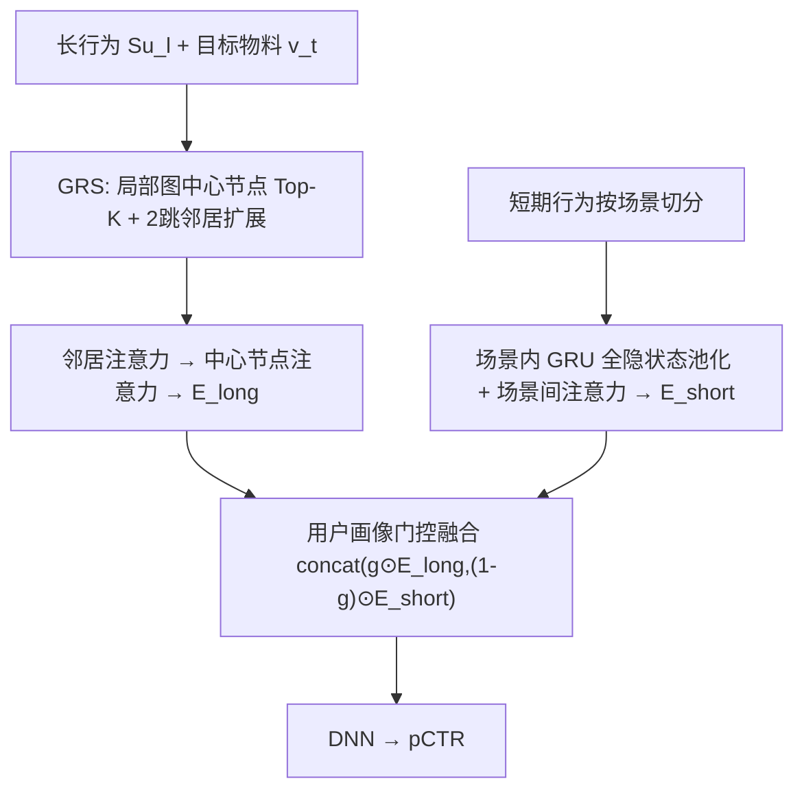
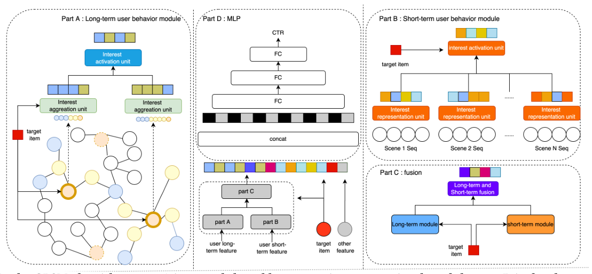

# Graph Based Long-Term And Short-Term Interest Model for Click-Through Rate Prediction (基于图的长短期兴趣建模的点击率预估)

- **会议/期刊**: CIKM 2022 (Applied Research Track)
- **作者与机构**: Huinan Sun, Guangliang Yu, Pengye Zhang, Bo Zhang, Xingxing Wang, Dong Wang（美团）
- **推荐链路定位**: 精排（CTR 预估），长期行为检索前置与物料服务并行
- **研究方向**: CTR/CVR 预估与特征交叉 / 序列与会话推荐
- **论文原文**: [https://arxiv.org/abs/2306.10028v1](https://arxiv.org/abs/2306.10028v1)
- **开源代码**: 暂未开源

## TL;DR (1分钟核心速览)

针对长行为序列的两大痛点——截断/规则过滤造成信息损失、单一反馈类型混合多场景造成意图混淆——本文提出 GLSM：用「全局图 + 用户局部图 + 中心节点」的图检索结构做长行为软召回（O(1) 级检索替代 O(N) 遍历与类目硬匹配），用分场景 GRU 建模短期多意图，再以用户画像驱动的门控网络自适应融合长短期表征。在 Taobao 与美团工业数据集上 AUC 达 0.9830 / 0.6705，相对 SIM 提升 1.17% / 1.24%，线上 A/B 带来 CTR +4.9%、GMV +4.3%。

## Background & Motivation (背景与核心矛盾)

- **主流范式**: 长行为侧以 MIMN（固定 size 记忆矩阵压缩）与 SIM（类目硬匹配两阶段检索）为代表；短行为侧以 DIN/DIEN/BST 等注意力或序列网络建模近期兴趣。
- **前人局限**: ① MIMN 把所有用户兴趣压进固定记忆矩阵，单元内噪声累积且无法按目标物料差异化读取；SIM 仅用类目 ID 硬匹配召回，召回条件过严，"烧烤-啤酒"这类跨类目共现关联被直接丢弃。
- **前人局限**: ② 短期序列通常只取 click 单一反馈子序列，割裂了曝光→点击→加购→下单的连续决策链；同时早/中/晚餐等场景行为被混合编码，跨场景互相污染。
- **核心洞察 (Key Insight)**: 用户长行为中真正与当前候选相关的只是极少数"兴趣簇"，而这些簇在物品共现图上具有强连通性——因此可以把检索复杂度从"遍历 N 条行为"降为"从若干兴趣中心节点出发的 K 跳扩展"。
- **本文切入点**: 用图连通性做**软检索**（而非类目硬匹配）保留跨类目关联，用**场景切分 + 多反馈**序列保留决策链，最后按用户个体差异门控融合长短期。

## Method (核心方法设计)

### 1. 整体框架 (Overall Architecture)

输入为用户长期行为序列 $S_u^l$、近期行为序列$S_u^s$、用户/物品画像与目标物料$v_t$。A 部分将$v_t$送入图检索结构（GRS）：先离线为每个用户构建局部共现图并选出中心节点集$V_c$，在线以$v_t$与中心节点的嵌入距离取 Top-$K$中心，再扩展 1–2 跳邻居得到相关长行为子序列，经两级注意力聚合为$E_{long}$；B 部分按就餐时段等场景切分短期序列，场景内 GRU 逐时刻编码并保留全部隐状态求和，场景间用目标物料注意力加权得$E_{short}$；C 部分用用户画像生成逐维门控$g$ 做加权拼接；D 部分与画像特征拼接后经 DNN 输出点击概率。

<figure class="paper-figure" markdown="span">
  <figcaption>图1：在GLSM算法中，A部分为基于图的长期兴趣召回模块；B部分为短期多意图识别兴趣模块；C部分为长期与短期兴趣融合模块；D部分为其余模型。</figcaption>
</figure>

### 2. 关键设计拆解 (Key Designs)

1. **图检索结构 GRS：中心节点驱动的软召回**：痛点是一对一比对复杂度 $O(N)$且类目硬匹配过严。构造全局共现图$G_g$（相邻行为物品连边）与用户局部图$G_l$，节点重要性由局部度中心性与全局聚类距离融合：
$union_{im} = \frac{d_v}{|N_s|-1} + \max_{v_{cn}}\frac{1}{\lVert \boldsymbol{E}_n - \boldsymbol{E}_{v_{cn}}\rVert_2}$其中全局项用 GraphSage 在$G_g$上学物品嵌入、K-means 聚出用户兴趣簇。取$union_{im}$Top-$N$为中心节点；在线按$\lVert \boldsymbol{E}_{v_c}-\boldsymbol{E}_{v_t}\rVert_2$取 Top-$K$ 中心并扩展 2 跳邻居。直觉：中心节点=兴趣簇的"锚"，邻居=簇的细粒度证据，跨类目关联通过共现边天然保留。
2. **两级注意力聚合（含时间衰减侧信息）**：邻居嵌入先注入侧信息 $\boldsymbol{E}_{v_i}=\boldsymbol{E}_{v_i}+\boldsymbol{E}_{cate_i}+\boldsymbol{E}_{behav_i}+\boldsymbol{E}_{int(\log(t_{now}-t_v))}$，再用目标物料做注意力$\alpha_i=\sigma(\boldsymbol{W}_1(\boldsymbol{W}_2([\boldsymbol{E}_{v_i},\boldsymbol{E}_{v_t}])))$、$\boldsymbol{E}_{center}=\sum_i\alpha_i\boldsymbol{E}_{v_i}$，中心节点层同理得$\boldsymbol{E}_{long}=\sum_j\beta_j\boldsymbol{E}_{center_j}$。对数时间差离散化使"越近行为权重越高"可学习，避免长序列中早期噪声主导。
3. **多场景短期建模 + 个性化门控融合**：短期按场景切分后接注意力 GRU，并保留各时刻隐状态求和以保留中间意图（单取末状态会丢失决策过程）；场景间注意力 $\gamma_i$抑制"早餐豆浆"对"晚间烧烤"的干扰。融合层$\boldsymbol{E}_{gate}^u=\boldsymbol{W}_1\sigma(\boldsymbol{W}_2(\boldsymbol{E}_{profile}))$经逐维 softmax 归一化，$\boldsymbol{E}_u=concat(\tilde{\boldsymbol{E}}_{gate}\odot\boldsymbol{E}_{long},(1-\tilde{\boldsymbol{E}}_{gate})\odot\boldsymbol{E}_{short})$。关键工程细节：用户画像嵌入**不接收门控网络的梯度**，避免门控训练扰动既有特征收敛。
- **训练目标与推理开销**：采用标准交叉熵 $\mathcal{L}=-\frac{1}{|D|}\sum[y\log\hat{y}+(1-y)\log(1-\hat{y})]$，论文未披露负采样/难负样本构造（工业场景依赖真实曝光负例）。推理上，长行为候选子图离线预构建存储，在线检索与物料服务、类目过滤**并行**执行，CTR 主模型只取通用特征，几乎不增加端到端延迟。

## Experimental Setup & Evaluation Protocol (实验设置与评估协议)

- **数据集与预处理**:

| 数据集 | #Users | #Items | #Interactions | 稀疏度/密度 | 特征/场景说明 |
| :--- | :---: | :---: | :---: | :---: | :--- |
| Taobao | 987,994 | 4,162,024 | 1.48M 实例 / 亿级行为 | 极稀疏 | 点击/购买/加购/收藏；近 30 行为为短期，其余为长期 |
| Industrial (美团) | 102,803,105 | 12,339,496 | 415,013,076 | 极稀疏 | 序列最长 5000；近两周且 ≤80 条为短期，其余长期 |

- **数据划分与防穿越 (Splitting Strategy)**: 论文未明确说明划分方式（未给出 Leave-One-Out / 时间戳切分细节），仅以 Taobao 公开 CTR 样本与工业日志做离线训练-测试；工业侧短期窗口以"过去两周"定义，隐含时间切分但未形式化披露，属可复现性短板。
- **排名评测协议 (Ranking Protocol)**: 未标注 Full-Ranking 或 Sampled Ranking，采用 CTR 任务通用的 AUC / GAUC（用户内排序）/ LogLoss 三指标，并辅以线上 A/B（CTR、GMV）作为最终判据。
- **对比基线与超参设置**: 基线为 DIN、DIEN、SIM，均分别与"仅长行为"或"仅短行为"组合对照，以隔离模块贡献。关键超参：兴趣簇数 $=28$（轮廓系数最优，见图 8）、中心节点 Top-$K=15$（过大反而下降）、GRS 扩展 2 跳、短期窗口 Taobao 30 条 / 工业两周 ≤80 条。

## Key Experimental Results (实验关键数据)

### 1. 主实验对比 (Main Results)

| 模型 | Taobao AUC | Taobao GAUC | Taobao LogLoss | Industrial AUC | Industrial GAUC | Industrial LogLoss |
| :--- | :---: | :---: | :---: | :---: | :---: | :---: |
| DIN + short | 0.9632 | 0.9620 | 0.1095 | 0.6543 | 0.5641 | 0.5354 |
| DIEN + short | 0.9653 | 0.9635 | 0.1079 | 0.6551 | 0.5647 | 0.5337 |
| DIN + long | 0.9599 | 0.9589 | 0.1149 | 0.6578 | 0.5669 | 0.5284 |
| SIM + long | 0.9716 | 0.9694 | 0.0950 | 0.6623 | 0.5715 | 0.5234 |
| GLSM + long | 0.9819 | 0.9811 | 0.0785 | 0.6671 | 0.5758 | 0.5163 |
| **GLSM + short + long** | **0.9830** | **0.9820** | **0.0771** | **0.6705** | **0.5786** | 0.5178 |
| Improv. vs SIM | +1.17% | +1.30% | −18.8% | +1.24% | +1.24% | — |

### 2. 消融实验 (Ablation Study)

| 配置 | Industrial AUC | 说明 |
| :--- | :---: | :--- |
| add（逐维相加） | 0.6622 | 最简单融合，无个性化 |
| weight（标量加权） | 0.6661 | 全局单一权重 |
| multiply（逐维乘） | 0.6664 | 无显式权重分配 |
| concat（直接拼接） | 0.6685 | 让 DNN 隐式学习权重 |
| **gate fusion（本文）** | **0.6705** | 画像驱动逐维门控，+0.002 AUC |
| w/o 场景切分（单场景 GRU） | ≈0.6563→0.6705 差距 | 见表 2 "short" 组，单场景在公开集被降级处理 |
| w/o 图检索（SIM 类目硬匹配） | 0.6623 | 相对 GLSM+long 低 0.7pt |

### 3. 关键实验发现 (Key Findings)

1. **长行为建模的收益远大于短期建模**：工业集上 GLSM+long（0.6671）比 GLSM+short（0.6563）高 1.08pt AUC，而短期内部 DIN→DIEN→GLSM 仅提升 0.20pt，说明长序列信息增益是主战场，短期模块更像"精细修补"。
2. **软检索优于硬匹配而非"更多行为"**：GLSM+long 相对 SIM+long 提升 0.97pt AUC / 0.96pt GAUC，同时 LogLoss 从 0.5234 降至 0.5163；作者归因于 SIM 的类目硬过滤"过度去噪"，丢失跨类目搭配共现，验证图连通性保留关联的价值。
3. **融合方式与检索规模都存在最优点**：门控融合比 concat 高 0.002 AUC（0.6705 vs 0.6685），比 add 高 0.83pt；中心节点 Top-$K$增大时效果先升后降（最优 15），兴趣簇数最优 28（轮廓系数最高），过大簇数导致$g_{im}$ 权重被稀释。线上 SIM→GLSM 带来 CTR +4.9%、GMV +4.3%，且午餐时段豆浆曝光下降、黄焖鸡米饭曝光上升，证明场景切分确实在纠偏。

## Highlights & Limitations (亮点、对比与审稿批判)

- **与代表作对比 (vs. Prior Work)**: 与 MIMN 相比，GLSM 不做固定容量压缩，而是按目标物料动态检索，避免兴趣表征"千人一面"；与 SIM 相比，召回条件从类目 ID 硬等价放宽为图多跳连通，实现跨类目软匹配；与 DIN/DIEN 相比，从"单场景单反馈序列"扩展为"多场景多反馈 + 长行为图召回"。
- **可迁移亮点**: ① 把候选子图与中心节点离线预构建、在线检索与物料服务并行，是长序列落地的低成本范式；② 门控网络的输入嵌入切断梯度（stop-gradient），可稳定多塔融合训练，几乎零成本可复用。
- **审稿级局限批判**: ① 评估协议披露不足——未说明训练/测试划分、负样本构造与采样比例，AUC 提升缺乏显著性检验支撑，离线结论可复现性偏弱；② 图检索仍依赖离线子图与 K-means / GraphSage 预计算，用户兴趣漂移时中心节点更新滞后，且 Top-$K$、簇数等超参在工业集单独调优（28/15），跨业务迁移需重新搜索；③ 短期场景划分依赖人工先验（就餐时段），非端到端学习。

## Rating (四维评分)

- **方法创新性 (Novelty)**: ⭐⭐⭐⭐ （图中心节点软检索替代类目硬匹配的思路清晰有效，但 GraphSage+K-means+两级注意力属成熟组件组合，理论分析较浅）
- **评估协议与实验扎实度 (Protocol & Experiments)**: ⭐⭐⭐ （有公开集+超大规模工业集+线上 A/B 三层验证，但划分/负采样协议未披露、无显著性检验，消融以融合方式与超参为主）
- **写作与数学规范度 (Clarity & Rigor)**: ⭐⭐⭐⭐ （模块划分与公式交代完整、工程细节坦诚，但部分符号重复定义、GRU 与门控公式存在排版冗余）
- **工业落地与复现价值 (Industrial & Practical Value)**: ⭐⭐⭐⭐ （检索与物料服务并行的部署方案与 +4.9% CTR 的线上收益极具参考价值，但无开源代码，复现需自建图与聚类管线）

