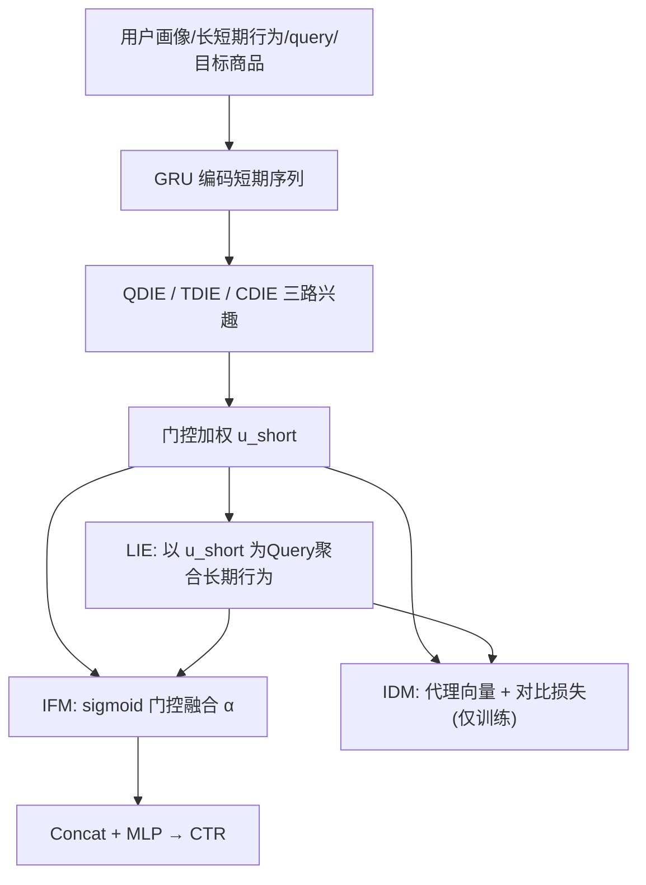
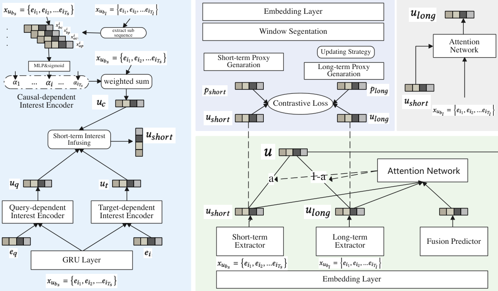

# Hierarchically Fusing Long and Short-Term User Interests for Click-Through Rate Prediction in Product Search (商品搜索 CTR 预估中的长短期用户兴趣分层融合)

- **会议/期刊**: CIKM 2022 (Full Paper)
- **作者与机构**: Qijie Shen, Hong Wen, Qi Rao (阿里巴巴集团); Jing Zhang (悉尼大学)
- **推荐链路定位**: 精排 (Rank 阶段 CTR 预估)
- **研究方向**: CTR/CVR 预估与特征交叉 / 自监督对比学习与交互去噪
- **论文原文**: [https://arxiv.org/abs/2304.02089v1](https://arxiv.org/abs/2304.02089v1)
- **开源代码**: 暂未开源

## TL;DR (1分钟核心速览)

针对商品搜索中"用户意图模糊、行为类型多样、长短期兴趣纠缠"三大痛点，本文提出 HIFN：短期侧用查询依赖、目标依赖、因果依赖三路注意力编码，长期侧以短期兴趣为 Query 反向激活历史行为，融合侧用门控动态加权替代朴素拼接，并用自监督代理对比损失强制解耦长短期表征。在 Amazon 三品类（1:10 负采样 NDCG/MRR/MAP）与 Fliggy 工业集（全曝光 AUC/Logloss）上全面超越 ALSTP 等 9 个基线，Fliggy 线上 A/B 连续 15 天 CTR +5.13%。

## Background & Motivation (背景与核心矛盾)

- **主流范式**: 商品搜索精排以 query-用户行为注意力构造个性化用户向量（AEM/ZAM/TEM），近期 SOTA ALSTP 进一步用注意力分别抽取 query 相关的长短期兴趣后拼接送入 MLP。
- **前人局限一**: 仅建模"查询依赖"兴趣，而用户常提交抽象 query（如"礼物""杭州"），此时应改为对**候选商品**做注意力，否则用户潜在偏好（如历史中偏爱的藏青色）被 query 语义抹平。
- **前人局限二**: 点击/收藏/购买等多类型行为被同等对待或仅作普通特征，忽略了行为的**因果强度差异**——购买代表需求已被满足（兴趣衰减），同类目连续点击代表兴趣正在升温（应加权）。
- **核心洞察 (Key Insight)**: 长短期兴趣在不同行为成本下贡献不同：高成本行为（购买）更由长期兴趣驱动，低成本行为（点击）更反映短期兴趣。若表征纠缠，融合权重 $\alpha$ 将无法随行为类型单调变化。
- **本文切入点**: 分层（hierarchical）抽取三路短期兴趣 $\to$以其为 Query 抽取长期兴趣$\to$自适应门控融合$\to$ 自监督代理对比显式解耦。

## Method (核心方法设计)

### 1. 整体框架 (Overall Architecture)

输入为用户画像 $e_{u_p}$、长期行为序列$x_{ub_l}$、短期行为序列$x_{ub_s}$、目标商品$e_i$、查询$e_q$与上下文$e_c$。先经 GRU 编码短期序列得隐状态序列，再并行送入 QDIE/TDIE/CDIE 三路兴趣编码器，SoftMax 门控加权得$u_{short}$；LIE 以$u_{short}$为 Query 对长期行为做注意力得$u_{long}$；IFM 用 sigmoid 门控生成融合权重$\alpha$得到最终兴趣$u$，与$e_i,e_q,e_c$ 拼接后经 MLP 输出 CTR；IDM 在训练期额外生成长期/短期代理向量，以 BPR 式对比损失约束解耦，推理期不参与计算。

<figure class="paper-figure" markdown="span">
  <figcaption>图 1：所提出的 HIFN 的总体架构。它由若干模块组成，即 SIE、LIE、IFM 和 IDM。</figcaption>
</figure>

### 2. 关键设计拆解 (Key Designs)

1. **三路短期兴趣编码器 (SIE)**：解决单一 query 视角在模糊意图下失效的问题。QDIE 用标准注意力 $u_q=\sum_{i}\frac{\exp(f(e_q,e_i))}{\sum_{i'}\exp(f(e_q,e_{i'}))}e_i$，其中$f(q,i)=(i\cdot\tanh(W_f q+b_f))\cdot W_h$；TDIE 把$e_q$换成$e_i$得到$u_t$；CDIE 则从行为序列切出四个子序列（$t$前/后的同类目点击与购买），$\alpha_i=\text{Sigmoid}(\text{FFN}(\text{Sum}(x_{ibc})\|\text{Sum}(x_{ibp})\|\text{Sum}(x_{iac})\|\text{Sum}(x_{iap})))$，$u_c=\sum_i \alpha_i e_i$。用 Sum pooling 而非 RNN 是刻意选择——表达行为"密度"且复杂度更低。三路经$u_{short}=\text{SoftMax}(\text{FFN}(u_t,u_q,u_c))^{\top}[u_t,u_q,u_c]$ 门控融合，物理直觉是不同 query 清晰度下三路互补。
2. **自适应兴趣融合 (IFM)**：解决拼接无法区分长短期贡献的问题。$\alpha=\text{sigmoid}(\text{FFN}(e_i\|e_q\|u_{short}\|u_{long}\|\tau_{ub_l}))$，$u=\alpha\cdot u_{short}+(1-\alpha)\cdot u_{long}$，其中$\tau_{ub_l}=\text{GRU}(x_{ub_l})$提供长期序列整体节奏信息。$\alpha$由样本级特征动态生成，使"篮球迷搜鞋"这类长兴趣主导场景自动抬升$1-\alpha$。
3. **兴趣解耦模块 (IDM) 与训练目标**：短期代理为近期行为均值 $p_{short}=\text{MeanPool}(e_{i_1},\dots,e_{i_{T_s}})$；长期代理采用**滑动更新**而非全序列均值，以刻画缓慢演化特性：$p_{long}=(1-\beta)p_{long}+\beta\,\text{FFN}(h_{t-1})$。四个对称对比任务用 softplus BPR 实现，$\mathcal{L}_{bpr}(a,p,q)=\text{softplus}(\langle a,q\rangle-\langle a,p\rangle)$，总损失$\mathcal{L}=\text{Loss}_t+\lambda\mathcal{L}_{con}$（交叉熵 + 对比，$\lambda=0.1$）。全程无负采样构造、无额外在线开销；推理仅多一次 GRU 与门控 FFN。

## Experimental Setup & Evaluation Protocol (实验设置与评估协议)

- **数据集与预处理**:

| 数据集 | #Users | #Items | #Query-User Pairs (Train/Valid/Test) | 稀疏度/密度 | 特征/场景说明 |
| :--- | :---: | :---: | :---: | :---: | :--- |
| Amazon Clothing | 36,421 | 22,521 | 456,521 / 4,006 / 4,151 | 5-core，≥20 次购买 | 公开集，仅购买行为 |
| Amazon Electronics | 34,489 | 18,397 | 273,890 / 753 / 890 | 5-core，≥20 次购买 | 公开集，仅购买行为 |
| Amazon Toys&Games | 76,234 | 63,323 | 1,493,132 / 10,210 / 10,131 | 5-core，≥20 次购买 | 公开集，仅购买行为 |
| Fliggy (工业) | 2,029,216 | 920,487 | 26,379,808 / 83,129 / 89,936 | ≥20 次交互 | 含点击/收藏/购买三行为 |

- **数据划分与防穿越**: Amazon 采用 `Leave-One-Out`（最后一次购买为测试、倒数第二次为验证，并隐藏验证/测试评论以防穿越）；Fliggy 采用 `全局时间戳切分`（2021-10-01 至 10-30 训练，10-31 12:00 前验证、之后测试）。
- **排名评测协议**: Amazon 为 `Sampled Ranking`（每条正样本随机采 10 个同 query 类目负样本，指标 NDCG@10 / MRR / MAP）；Fliggy 为真实曝光全量日志，指标 AUC / Logloss。所有结果为 10 次重复实验均值。
- **对比基线与超参设置**: 9 个基线覆盖三类——个性化搜索（AEM、ZAM、TEM、ZAM+TDIE、TEM+TDIE）、CTR 特征交叉（DeepFM）、行为序列建模（DIN、DIEN）、长短期 SOTA（ALSTP）。Embedding $d=16$，Adam，lr=0.001，batch=512，IDM 内 FFN 为 [128,64,32,16]，$\lambda=0.1$，$T_s$ 在 8–14 间按数据集调优。

## Key Experimental Results (实验关键数据)

### 1. 主实验对比 (Main Results)

| 模型 | Clothing MRR | Clothing NDCG | Electronics MRR | Electronics NDCG | Toys MRR | Toys NDCG | Fliggy AUC | Fliggy Logloss |
| :--- | :---: | :---: | :---: | :---: | :---: | :---: | :---: | :---: |
| AEM | 0.024 | 0.025 | 0.269 | 0.291 | 0.068 | 0.072 | 0.735 | 0.598 |
| ZAM | 0.025 | 0.027 | 0.289 | 0.315 | 0.079 | 0.112 | 0.734 | 0.601 |
| TEM | 0.027 | 0.026 | 0.201 | 0.261 | 0.138 | 0.158 | 0.731 | 0.621 |
| DeepFM | 0.020 | 0.028 | 0.222 | 0.296 | 0.073 | 0.104 | 0.737 | 0.588 |
| DIEN | 0.023 | 0.034 | 0.288 | 0.319 | 0.099 | 0.127 | 0.741 | 0.579 |
| ZAM+TDIE | 0.031 | 0.036 | 0.311 | 0.318 | 0.106 | 0.144 | 0.746 | 0.552 |
| TEM+TDIE | 0.032 | 0.034 | 0.315 | 0.289 | 0.141 | 0.162 | 0.749 | 0.541 |
| ALSTP | 0.034 | 0.037 | 0.302 | 0.299 | 0.101 | 0.134 | 0.742 | 0.576 |
| **HIFN** | **0.041** | **0.044** | **0.331** | **0.342** | **0.162** | **0.171** | **0.759** | **0.533** |
| Improv.% | +20.6% | +18.9% | +5.1% | +7.2% | +14.9% | +5.6% | +1.3% | −1.5% |

（Improv.% 相对各自数据集最强基线；Electronics AUC 外其余指标均以最优基线为参照。）

### 2. 消融实验 (Ablation Study)

| 变体 | Clothing MRR | Clothing NDCG | Clothing MAP | Fliggy AUC | Fliggy Logloss |
| :--- | :---: | :---: | :---: | :---: | :---: |
| HIFN$^*$（均值池化无注意力） | 0.033 | 0.032 | 0.023 | 0.739 | 0.581 |
| w/o QDIE | 0.037 | 0.038 | 0.028 | 0.749 | 0.552 |
| w/o TDIE | 0.036 | 0.039 | 0.031 | 0.751 | 0.549 |
| w/o CDIE | 0.039 | 0.040 | 0.032 | 0.753 | 0.541 |
| w/o 门控（均值融合） | 0.034 | 0.035 | 0.024 | 0.743 | 0.563 |
| IFM → 拼接 | 0.035 | 0.036 | 0.029 | 0.750 | 0.539 |
| IFM → 固定 $\alpha=0.6$ | 0.034 | 0.033 | 0.022 | 0.751 | 0.537 |
| w/o IDM | / | / | / | 0.753 | 0.549 |
| 长期代理不更新 | 0.038 | 0.041 | 0.032 | 0.752 | 0.542 |
| **HIFN (full)** | **0.041** | **0.044** | **0.035** | **0.759** | **0.533** |

### 3. 关键实验发现 (Key Findings)

1. **三路兴趣互补而非冗余**：单加 QDIE 在 Clothing 上 NDCG 提升最显著（0.032→0.038），单加 CDIE 几乎持平（0.032），但去任意一路都会掉点（w/o QDIE NDCG 掉 0.006），证明三者信息正交；且在 Fliggy"抽象 query"子集上 w/o TDIE 掉点最大（AUC 0.776 vs 0.748 中的 0.739），而在"精确 query"子集上 w/o QDIE 掉点最大（0.759），与设计动机完全吻合。
2. **自适应融合远胜拼接与固定权重**：IFM 相较拼接在 Clothing NDCG 提升 0.008、Fliggy AUC 提升 0.009；而扫描 $\alpha\in\{0.15,\dots,0.9\}$ 的任一固定值均无法超过动态门控，说明长短期重要性是样本级条件依赖而非全局常数。
3. **解耦带来可解释的单调性**：在 Fliggy 上以点击数据训练、分别在三类行为测试集评估，HIFN 的平均融合权重满足 click(0.783) > favorite(0.721) > purchase(0.699)，符合"高成本行为更依赖长期兴趣"的假设；而 w/o IDM 该单调性被破坏（favorite 0.526 > purchase 0.672 但低于 click），ALSTP 更在 click 上给出 0.433 的反向最小值。长期代理滑动更新亦稳定增益（AUC 0.752→0.759，三个 Amazon 集 NDCG +0.002~0.003）。

## Highlights & Limitations (亮点、对比与审稿批判)

- **与代表作对比 (vs. Prior Work)**: 相较 ALSTP，本文把"单一 query 注意力 + 拼接"升级为"三视角短期 + 短期引导长期 + 门控融合 + 显式解耦"，在 Fliggy 上 AUC 0.742→0.759；相较 DIN/DIEN 的目标注意力，本文额外引入查询与行为因果两维，且 TDIE 的即插即用性由 ZAM+TDIE（AUC 0.734→0.746）、TEM+TDIE（0.731→0.749）两组外部增强实验独立验证，论据较扎实。
- **可迁移亮点**: ① "短期兴趣向量作为长期注意力 Query"的层级引导结构，可直接移植到短视频/新闻场景的长短期混合建模；② CDIE 的四段子序列（前/后 × 点击/购买）密度编码是低成本刻画行为因果演化的通用技巧，无需 RNN 即可捕捉兴趣升温/饱和。
- **审稿级局限批判**: ① Amazon 为 1:10 采样排序、Fliggy 结果来自单公司单月日志，缺少跨平台全库 Full-Ranking 与冷启动用户分桶验证；② 超参 $T_s$、$\beta$按数据集逐一网格搜索（$T_s$8–14、$\beta$ 0.35–0.6），泛化敏感度未讨论；③ Electronics 上 TEM 系列基线复现异常偏低（NDCG 0.261 vs 其他集 0.15+ 量级正常），削弱部分对比说服力；④ Amazon 仅含购买行为，CDIE 的"多行为因果"主张实际只由 Fliggy 支撑。

## Rating (四维评分)

- **方法创新性 (Novelty)**: ⭐⭐⭐⭐ （三视角短期兴趣 + 短期引导长期 + 代理对比解耦的组合式创新，单点算子不算全新，但拼装逻辑与"行为成本↔长短期权重"的假设-验证闭环有说服力）
- **评估协议与实验扎实度 (Protocol & Experiments)**: ⭐⭐⭐⭐ （四个数据集 + 逐模块消融 + 抽象/精确 query 分桶 + 反事实行为单调性验证 + 线上 A/B，覆盖全面；扣分在采样排序与单平台局限）
- **写作与数学规范度 (Clarity & Rigor)**: ⭐⭐⭐ （模块公式交代清楚、门控与对比损失推导完整，但 Eq.(2) 张量维度 $W_f\in\mathbb{R}^{\alpha\times\beta\times\alpha}$书写疑似笔误，符号$\alpha$ 在 CDIE 权重与融合权重间复用易混淆）
- **工业落地与复现价值 (Industrial & Practical Value)**: ⭐⭐⭐⭐⭐ （无额外负采样、IDM 仅训练期生效，线上连续 15 天 +5.13% CTR 且已承接主流量，工程性价比极高；仅缺开源代码）

