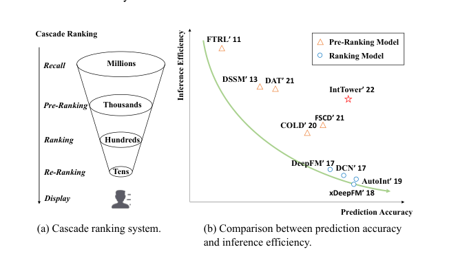
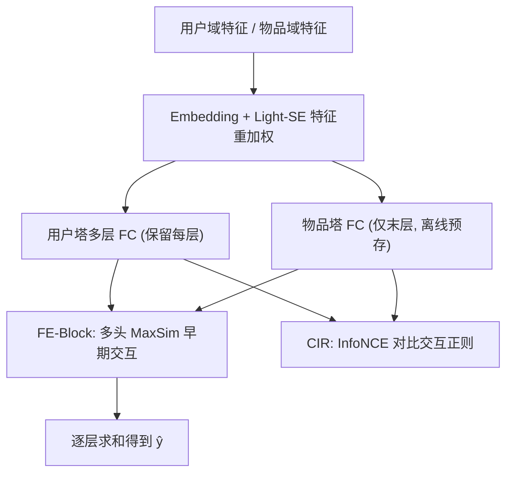

# IntTower: the Next Generation of Two-Tower Model for Pre-Ranking System (面向粗排系统的下一代交互增强双塔模型)

- **会议/期刊**: CIKM 2022 (DLP-KDD Best Paper)
- **作者与机构**: Xiangyang Li, Bo Chen, Huifeng Guo, Ruiming Tang 等（华为诺亚方舟实验室、北京大学、上海交通大学、北京邮电大学）
- **推荐链路定位**: 粗排（Pre-Ranking）
- **研究方向**: CTR/CVR 预估与特征交叉 / 多任务学习与列表级重排（级联一致性）
- **论文原文**: [https://arxiv.org/abs/2210.09890v1](https://arxiv.org/abs/2210.09890v1)
- **开源代码**: [https://github.com/archersama/IntTower](https://github.com/archersama/IntTower)

## TL;DR (1分钟核心速览)

粗排需在数毫秒内为上千候选打分，双塔的「用户-物品解耦」换来 $O(N+kM)$的极低延迟，却把交互推迟到输出层（Late Interaction），精度受限；单塔（COLD/FSCD）虽准但需$O(kN)$ 逐对推理、延迟劣化约 10 倍。本文提出 IntTower：Light-SE 做轻量特征选择，FE-Block 在用户多层表征与物品末层表征间做 parameter-free 的 MaxSim 早期交互，CIR 用 InfoNCE 隐式拉近正样本对。三数据集随机 80/20 划分下 AUC 全面超越 COLD/DAT（MovieLens 0.8974 vs 0.8836，Amazon 0.8696 vs 0.8633），并逼近甚至超过 DCN/AutoInt 等单塔精排模型；工业广告粗排线上 AUC 相对提升 2.08%。

## Background & Motivation (背景与核心矛盾)

- **主流范式**: 现代推荐系统为「召回-粗排-精排-重排」级联架构，粗排夹在中间，候选量为千级，既有精度要求又有 10~20ms 级延迟硬约束；工业主流粗排模型是 DSSM 式双塔，物品向量离线预存、在线只算用户塔。
- **前人局限**: 其一，双塔两路独立前向，用户/物品隐向量直到内积层才相遇，跨塔交互信号（如「用户消费水平 × 商品价格档位」这类关键交叉）被彻底丢弃，DAT 的 Adaptive-Mimic 只是隐式模仿，收益有限。其二，COLD/FSCD 走单塔以求充分交叉，但每个 user-item 对都要一次前向，推理复杂度 $O(kN)$ 无法承受。
- **核心洞察 (Key Insight)**: 精度损失并非来自「解耦」本身，而来自「交互粒度太粗 + 交互时机太晚」——若把交互提前到塔内多层表征、并做成无参数的相似度聚合，则可在仍只缓存物品侧向量的前提下拿到显式交叉收益。
- **本文切入点**: 以「早交互 + 细粒度 + 无参数打分」重构双塔二次打分函数，同时用 Light-SE 与对比正则在特征侧和表征侧补足表达能力。

<figure class="paper-figure" markdown="span">
  <figcaption>图1：多阶段级联排序架构以及模型预测准确率与推理效率的比较。</figcaption>
</figure>

## Method (核心方法设计)

### 1. 整体框架 (Overall Architecture)

输入分用户域特征与物品域特征，两侧各自 embedding 后先经 Light-SE 重加权得到精炼表征，再分别送入多层 FC 塔。用户塔保留**每一层**输出 $\mathbf{h}_u^1..\mathbf{h}_u^L$，物品塔仅取末层$\mathbf{h}_v^L$并投影为$H$个子空间头$\mathbf{M}_v^L$（可离线预存）。FE-Block 在同一子空间内对每个用户层与物品头做 MaxSim 聚合，逐层求和得到最终打分$\hat{y}$；同时末层用户头$\mathbf{M}_u^L$ 与物品头构成正/负对，经 CIR 的 InfoNCE 提供自监督梯度。训练目标为 Logloss + 对比正则，推理时物品头进 faiss 检索、在线只跑一次用户塔，复杂度与双塔同阶。

### 2. 关键设计拆解 (Key Designs)

1. **Light-SE（轻量特征重要性重加权）**：SENET 的双 FC + Sigmoid 在粗排会带来不可忽视的在线开销。本文压缩为单 FC，并把 Sigmoid 换成 Softmax 以显式建模特征间的**相对**重要性：$z_i=\frac{1}{d}\sum_{t=1}^{d}e_i^t$，$\mathbf{k}=\mathrm{softmax}(\mathbf{W}\mathbf{z}+\mathbf{b})$，$\tilde{\mathbf{e}}=[k_i\cdot\mathbf{e}_i]$。Softmax 的归一化使权重之和为 1，避免 Sigmoid 各自独立缩放导致的尺度漂移；参数由$O(m^2/r+m/r)$降至$O(m^2)$ 的单层规模，实测与 SENET 精度相当而参数更少。
2. **FE-Block（细粒度早期交互 + 无参打分）**：把内积 $\hat{y}=\mathbf{h}_u^\top\mathbf{h}_v$换成「多头 MaxSim 逐层求和」。用户第$i$层与物品末层分别投到$H$个子空间：$\mathbf{m}_u^{i,h}=\mathbf{W}_u^{i,h}\mathbf{h}_u^i+\mathbf{b}_u^{i,h}$，随后
$S_{u,v}^{i}=\sum_{h_u=1}^{H}\max_{h_v\in\{1..H\}}\{(\mathbf{m}_u^{i,h_u})^\top\mathbf{m}_v^{L,h_v}\}$，$\hat{y}=\sum_{i=1}^{L}S_{u,v}^{i}$。
   关键在于交互步骤零参数：物品侧多头向量可离线预存，在线仅需一次矩阵乘 + max 归约，故既能像 ColBERT 那样做 token/子空间级晚交互，又不破坏解耦部署；多层求和则让不同深度的语义（浅层原始交叉、深层高阶抽象）都被计分。
3. **CIR 与训练目标**：显式 MaxSim 之外再加隐式约束，把同一样本的用户头与物品头视为正对、批内其他物品为负对：$\mathcal{L}_{cir}=-\frac{1}{Q}\sum_{(u,v)\in Q}\log\frac{\exp(\mathrm{sim}(\mathbf{M}_u^L,\mathbf{M}_v^L)/\tau)}{\sum_{(u',v')\in N}\exp(\mathrm{sim}(\mathbf{M}_u^L,\mathbf{M}_{v'}^L)/\tau)}$。总损失$\mathcal{L}=\mathcal{L}_{ctr}+\lambda_1\mathcal{L}_{cir}+\lambda_2\|\Theta\|_2^2$，负样本即 in-batch 自然负例（免额外采样器）。CIR 迫使同空间内的用户/物品头对齐，缓解 MaxSim 只在子空间内取 max 造成的表征松散。

## Experimental Setup & Evaluation Protocol (实验设置与评估协议)

- **数据集与预处理**: 使用三份公开 CTR 数据，未做 k-core 过滤，直接按样本建模：

| 数据集 | #Users | #Items | #Interactions(Samples) | 稀疏度/密度 | 特征/场景说明 |
| :--- | :---: | :---: | :---: | :---: | :--- |
| MovieLens-1M | 6,040 | 3,952 | 1,000,000 | 5 用户域 + 3 物品域 | 电影评分转点击 |
| Amazon(Electro) | 192,403 | 630,001 | 1,689,188 | 2 用户域 + 4 物品域 | 电商评论转点击，极稀疏 |
| Alibaba | 1,061,768 | 785,597 | 26,557,961 | 9 用户域 + 6 物品域 | 阿里展示广告，规模最大 |

- **数据划分与防穿越 (Splitting Strategy)**: 沿用 DeepFM/AutoInt 的**随机比例划分**，80% 训练 / 20% 测试，未做全局时间戳切分（存在轻度未来信息泄漏风险，属该基准惯例）。
- **排名评测协议 (Ranking Protocol)**: CTR 二分类点估计评估，报告 **AUC / Logloss / RelaImpr**（以 Two-Tower 为基准：$\text{RelaImpr}=(\frac{\text{AUC}_{model}-0.5}{\text{AUC}_{base}-0.5}-1)\times100\%$），并做$p<0.05$ 显著性检验；未涉及负采样排序或 Full-Ranking 协议。
- **对比基线与超参设置**: 基线分两类——粗排（LR、Two-Tower/DSSM、DAT、COLD）与精排（Wide&Deep、DeepFM、DCN、AutoInt）。embedding 维度 $d=32$，隐层$[300,300,128]$、$L=3$，batch 2048，Adam lr=1e-3，默认 3 个 FE-Block、head 数$H=m$、子空间维度 64，每实验重复 10 次取最优。

## Key Experimental Results (实验关键数据)

### 1. 主实验对比 (Main Results)

| 阶段 | 模型 | ML AUC | ML Logloss | Amazon AUC | Amazon Logloss | Alibaba AUC | Alibaba RelaImpr |
| :--- | :--- | :---: | :---: | :---: | :---: | :---: | :---: |
| 粗排 | LR | 0.8501 | 0.4845 | 0.7952 | 0.4677 | 0.6496 | -5.85% |
| 粗排 | Two-Tower | 0.8697 | 0.4559 | 0.8469 | 0.4313 | 0.6579 | 0% |
| 粗排 | DAT | 0.8712 | 0.4556 | 0.8480 | 0.4278 | 0.6598 | 0.56% |
| 粗排 | COLD | 0.8836 | 0.3297 | 0.8633 | 0.3402 | 0.6816 | 14.28% |
| 精排 | Wide&Deep | 0.8820 | 0.3344 | 0.8615 | 0.3409 | 0.6814 | 14.15% |
| 精排 | DeepFM | 0.8920 | 0.3211 | 0.8643 | 0.3405 | 0.6820 | 14.53% |
| 精排 | DCN | **0.8964** | 0.3151 | 0.8665 | 0.3366 | **0.6831** | 15.22% |
| 精排 | AutoInt | 0.8948 | 0.3192 | 0.8686 | 0.3351 | 0.6867 | **17.49%** |
| 粗排 | **IntTower** | **0.8974**★ | **0.3128**★ | **0.8696**★ | **0.3309**★ | 0.6827 | 14.97% |

（★ 表示相对最优粗排基线 $p<0.05$ 显著；IntTower 相对 Two-Tower 的 RelaImpr 分别为 7.49% / 7.91% / 14.97%。）

### 2. 消融实验 (Ablation Study)

原文组件消融以图 6（MovieLens / Amazon）呈现，仅给出趋势；下表合并其方向性结论与表 4 的头数敏感性实验：

| 配置 | ML AUC | Amazon AUC | 结论 |
| :--- | :---: | :---: | :--- |
| IntTower (3×FE-Block, 64/64 head) | 0.8974 | 0.8696 | 完整模型 |
| w/o Light-SE | 下降 | 下降 | 特征加权有效 |
| w/o FE-Block | **显著下降** | **显著下降** | 最关键组件 |
| w/o CIR | 下降 | 下降 | 隐式正则有增益 |
| 以 FC($\mathbf{h}_u^i\Vert\mathbf{h}_v^L$) 替换 FE-Block | 下降 | 下降 | 仍优于双塔，但引入在线参数 |
| 以 SENET 替换 Light-SE | 下降 | AUC 略升 | Light-SE 精度相当、参数更少 |
| head 组合 1/1 | 0.8957 | 0.8669 | 少头欠拟合 |
| head 组合 2/2 | **0.9016** | 0.8672 | MovieLens 最优（数据小易过拟合） |
| head 组合 16/16 | 0.8920 | **0.8705** | Amazon 最优（数据大需高容量） |

### 3. 关键实验发现 (Key Findings)

- **交互粒度的收益可量化且廉价**：仅把内积换成 FE-Block，MovieLens AUC 从 0.8697 升至 0.8974（+2.77pt，RelaImpr +7.49%，与 COLD 的 +3.75% 拉开近一倍），而参数量只从 $5.03\times10^5$增至$5.67\times10^5$、单 epoch 训练 15s→16s，说明精度瓶颈确实在「晚交互」而非模型容量。
- **粗排可以「白嫖」精排精度**：IntTower 的 AUC 已超过 DCN（MovieLens 0.8974>0.8964）与 Wide&Deep/DeepFM，在 Amazon 上超过 AutoInt（0.8696>0.8686），但推理复杂度仍是 $O(N+kM)$；图 5 显示候选集从 1 增至 1000 时其延迟仅略高于双塔，而 DeepFM 高出数个量级——这是级联链路中「粗排吃掉精排收益」的直接证据。
- **头数存在数据规模相关的过拟合拐点**：MovieLens（1M 样本）最优为 2/2 头（0.9016），头数增至 64/64 反降至 0.8974；Amazon（1.7M 样本）则从 1/1 的 0.8669 单调升到 16/16 的 0.8705。子空间维度同为「先升后降」、64 维最优，说明 $H$与$p$ 应随样本量自适应而非固定放大；工业广告线上 8 天日志对比中 IntTower AUC 0.7603 vs 双塔 0.7550（RelaImpr +2.08%），已超过线上精排 DeepFM（0.7591），逼近 EDCN（0.7612）。

## Highlights & Limitations (亮点、对比与审稿批判)

- **与代表作对比 (vs. Prior Work)**: 对比 DSSM/Two-Tower，本文把「塔内独立编码 + 末层内积」升级为「塔间多层早期交互」；对比 DAT，其靠 Adaptive-Mimic 隐式模仿两塔输出、增益仅 0.3~0.6% RelaImpr，而 FE-Block 的显式 MaxSim 达 7~15%；对比 COLD/FSCD 的单塔全交叉，本文以参数无关的交互算子换回约一个数量级的延迟优势。
- **可迁移亮点**: ①「交互步骤零参数 + 物品侧多头向量可预存」是双塔系（召回/粗排）通用范式，可直接移植到用户序列多兴趣双塔；②MaxSim 跨多层求和本质是给不同深度表征分配不同语义粒度的匹配预算，可迁移到多模态图文匹配。
- **审稿级局限批判**: ①评估采用随机 80/20 划分而非时间切分，CTR 场景下存在特征穿越，线上增益（2.08%）远小于离线（7~15%），提示离线数字偏乐观；②FE-Block 对每个用户层都与物品末层做 $H\times H$相似度矩阵，$H$默认等于用户域特征数$m$（Alibaba 上$m=9$），若特征域上百则在线 max 归约开销与显存将不可忽略，论文未给出$H$ 与延迟的联合分析；③Light-SE 用 Softmax 强制权重和为 1，缺失「全部特征都不重要」的表达能力，稀疏特征域下可能失真。

## Rating (四维评分)

- **方法创新性 (Novelty)**: ⭐⭐⭐⭐ （借用 ColBERT 晚交互思想重构双塔打分函数，把「交互」从参数堆叠转为无参算子，思路简洁但理论分析止于复杂度，缺谱/信息论支撑）
- **评估协议与实验扎实度 (Protocol & Experiments)**: ⭐⭐⭐⭐ （三数据集 + 8 个主流基线 + 显著性检验 + 大规模工业线上验证齐备，但随机划分与仅用 AUC/Logloss、未做时间切分与校准分析是明显短板）
- **写作与数学规范度 (Clarity & Rigor)**: ⭐⭐⭐⭐ （三模块划分清晰、公式简洁、复杂度 $O(N+kM)$vs$O(kN)$ 对比到位；消融仅以柱状图呈现缺精确数值表，头数/维度敏感性分析较完整）
- **工业落地与复现价值 (Industrial & Practical Value)**: ⭐⭐⭐⭐⭐ （代码开源，物品向量可预存、交互无参数、参数量与训练耗时相比双塔几乎不变，已在华为广告粗排部署并给出系统架构与线上指标）

