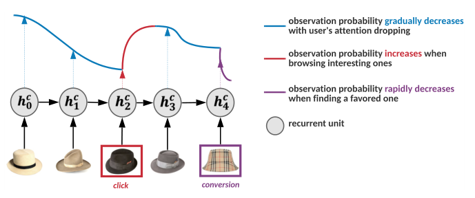
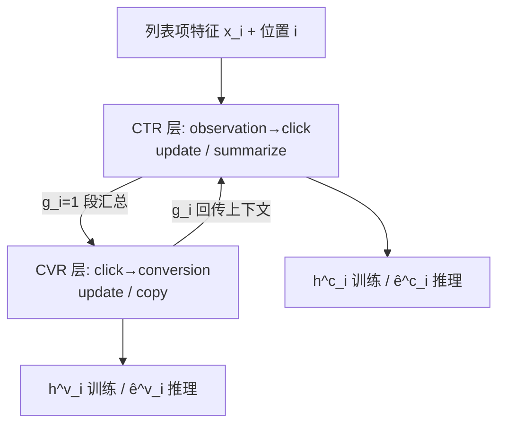
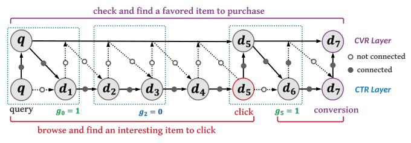

# Multi-Scale User Behavior Network for Entire Space Multi-Task Learning (多尺度用户行为网络驱动的全空间多任务学习)

- **会议/期刊**: CIKM 2022
- **作者与机构**: Jiarui Jin, Xianyu Chen, Weinan Zhang (通讯), Yong Yu 等 — 上海交通大学；Yuanbo Chen, Zaifan Jiang 等 — 阿里巴巴集团
- **推荐链路定位**: 精排（列表级 CTR/CVR 联合打分）
- **研究方向**: CTR/CVR 预估与特征交叉 / 序列与会话推荐
- **论文原文**: [https://arxiv.org/abs/2208.01889v2](https://arxiv.org/abs/2208.01889v2)
- **开源代码**: 暂未开源

## TL;DR (1分钟核心速览)

本文针对现有 entire-space 多任务模型（ESMM 系列、MMoE、DUPN）把 CTR 与 CVR 视为同一时间尺度的缺陷，提出分层循环网络 HEROES：底层 CTR 层建模 observation→click，上层 CVR 层建模 click→conversion，并用门控 $g_i$ 决定信息在层内传递还是跨层汇总；同时用神经 Hawkes 过程改造循环单元，显式刻画历史行为对当前项的“激发/抑制”及指数衰减。在 Criteo/Taobao/Diantao 三个工业数据集的列表级 AUC 上，CVR 相对最佳基线最高提升 11.24%，CTR 最高提升 4.13%，并可借生存分析扩展为无偏 LTR。

## Background & Motivation (背景与核心矛盾)

- **主流范式**: 以 ESMM/ESM2 的行为分解（$P(v)=P(c)\cdot P(v|c)$）与 MMoE/DUPN 的共享特征/专家网络为基础，双塔多任务联合优化 CTR 与 CVR。
- **前人局限一（上下文依赖被忽略）**: 现有方法对每个 item 独立打分，未建模同一列表内“购买帽子后不再点其他帽子”这类前序行为对后续项的激发或抑制作用。
- **前人局限二（多时间尺度被抹平）**: 淘宝数据中点击平均间隔 12.23、购买平均间隔 32.08，点击高频、购买周期性；统一时间尺度建模会让 CVR 分支被大量点击噪声淹没。
- **核心洞察 (Key Insight)**: 全空间行为路径本质是两段不同频率的生存过程——用户持续“观察”直到点击（离开则流失），持续“点击”直到转化；因此不同层应自适应学习自己的时间尺度。
- **本文切入点**: 分层循环 + Hawkes 衰减 + 门控分段，让每层自动找到匹配的时间尺度，并以内在相关性 $\tilde{h}_i$ 作为推理打分。

<figure class="paper-figure" markdown="span">
  <figcaption>图2：用户行为特征示例：(i) 上下文依赖：用户浏览感兴趣物品时发生点击，这可能促进观察；用户找到喜爱物品时发生转化，这可能抑制观察；(ii) 多时间尺度：转化通常发生在用户找到喜欢的已点击物品之后，因此转化发生频率低于点击。</figcaption>
</figure>

## Method (核心方法设计)

### 1. 整体框架 (Overall Architecture)

输入是以 query（曝光列表）为单位组织的列表项特征 $\boldsymbol{x}_q$（item one-hot + 位置$i$），CTR 层与 CVR 层各维护两套状态：内在相关性状态$\tilde{s}_i$（纯 item 特征驱动）与行为相关性状态$s_i$（受上下文激发/抑制）。门控$g_i$作为分段边界检测器：$g_i=0$表示无点击，CTR 层执行 update 继续累积上下文；$g_i=1$表示发生点击，CTR 层执行 summarize 把段内上下文压缩后注入 CVR 层，并重置下一段。训练时用行为相关性$h_i$计算 BCE 损失以吸收上下文信号，推理时改用内在相关性$\tilde{h}_i$打分，从而剥离列表上下文带来的偏差、还原“真实”偏好。整体时间开销为$O(2CI_{\max})$。

### 2. 关键设计拆解 (Key Designs)

1. **Hawkes 化循环单元（多尺度衰减）**: 痛点是对 item 独立建模，无法表达前序行为的激发/抑制。将概念式 $h_i=\tilde{h}_i+\sum_{j\le i}\lambda_j\exp(-\delta_j(t_i-t_j))$落为连续时间状态插值$s^c(t)=\tilde{s}^c_{i+1}+(s^c_{i+1}-\tilde{s}^c_{i+1})\exp(-\delta_{i+1}(t-t_i))$，其中衰减率$\delta_{i+1}=f_\gamma(\mathrm{MLP}(h^c_{i+1}))$、$f_\gamma(x)=\gamma\log(1+e^{x/\gamma})$保证正性。直觉：无论历史影响是增强还是削弱，都会以可学习速率衰减回内在相关性$\tilde{h}_i$，从而实现“尺度自适应”。

2. **门控分层与跨层通道**: 沿用 LSTM 门但按 $g_{i-1},g_i$拆成四种算子（CTR 层 update/summarize，CVR 层 update/copy）。跨层上下文经$\mathbf{s}^c_i=(1-g_{i-1})U^c_{i-1}h^c_{i-1}+g_{i-1}U^r_{i-1}h^v_{i-1}$与$\mathbf{s}^v_i=U^v_{i-1}h^v_{i-1}+g_iW^r_ih^c_i$生成，再用$\mathbf{s}_i$ 计算 forget/input/output/proposal 门。它等价于把“是否点击”变成隐式分段标签，使 CTR 层在段内积累、CVR 层只在被点击的项上更新，避免未点击项污染转化建模。

<figure class="paper-figure" markdown="span">
  <figcaption>图3：门控机制示例：𝑔𝑖= 0 表示在 𝑑𝑖 处无点击，此时上下文信息在 CTR 层通过“观察→点击”传递；𝑔𝑖= 1 表示在 𝑑𝑖 处有点击，此时上下文信息在 CTR 层被汇总，并在 CVR 层进一步通过“点击→转化”传递。</figcaption>
</figure>

3. **训练目标、全空间扩展与复杂度**: 基础为双任务 BCE：$\mathcal{L}=\mathcal{L}_c+\alpha\cdot\mathcal{L}_v$。进一步用生存分析把观察概率写成$P(z=i\mid\boldsymbol{x}_q)=h_i\prod_{\tau<i}(1-h_\tau)$，形成 P.D.F. 损失$\mathcal{L}_{pdf}$与 CDF 损失$\mathcal{L}_{cdf}=\mathcal{L}_{occur}+\mathcal{L}_{non-occur}$（含列表内无点击/无转化的截尾样本），$\mathcal{L}_b=\mathcal{L}_{pdf}+\beta\mathcal{L}_{cdf}$，从而在“有偏点击缺失观察”下估计无偏相关性。损失为列表级软标签监督，无负采样环节；推理需一次前向扫完整条列表，与 LSTM 类序列模型同量级。

## Experimental Setup & Evaluation Protocol (实验设置与评估协议)

- **数据集与预处理**:

| 数据集 | #Users | #Items | #Interactions | 稀疏度/密度 | 特征/场景说明 |
| :--- | :---: | :---: | :---: | :---: | :--- |
| Criteo | 以 userID 聚合 | — | 5.5M 曝光 / 2.3M 点击 / 438K 转化，切为 2.2M 列表 | 点击率≈41.8% | 公开广告流量，按 userID+conversionID 构造序列 query |
| Taobao E-Commerce | 444K | 85M | 3,317K 点击 / 17K 转化，1,614K queries | 转化极稀疏 | 淘宝推荐系统流量日志 |
| Diantao Live Broadcast | 905K | 527K | 44M 日志 / 9,305K queries | 播放>7s 记为点击 | 直播场景；点赞/评论记为购买 |

- **数据划分与防穿越 (Splitting Strategy)**: 按 query 将用户历史序列切为 6:2:2 的训练/验证/测试，测试 query 与训练 query 完全不相交（query 级划分，而非 Leave-One-Out）。
- **排名评测协议 (Ranking Protocol)**: 列表级全列表排序，NDCG@K 中 K 为整个列表长度（未截断）；不使用全库 Full-Ranking，也不做负采样排序；指标另含 AUC、LogLoss。
- **对比基线与超参设置**: 多任务基线 DUPN/ESMM/ESM2/MMoE，序列基线 LSTM/RRN/NARM/STAMP/DRSR/Time-LSTM/NHP（共 11 个）；显著性检验 $p<0.001$；$\alpha$平衡 CTR/CVR 损失，$\gamma=5$，位置偏置实验用 PBM 生成点击且$\tau=1$。

## Key Experimental Results (实验关键数据)

### 1. 主实验对比 (Main Results)

| 模型 | Criteo CTR AUC | Criteo CVR AUC | Taobao CTR AUC | Taobao CVR AUC | Diantao CTR AUC | Diantao CVR AUC |
| :--- | :---: | :---: | :---: | :---: | :---: | :---: |
| ESMM | 0.6476 | 0.8750 | 0.5410 | 0.6443 | 0.6664 | 0.7046 |
| ESM2 | 0.6740 | 0.8798 | 0.5437 | 0.6453 | 0.6742 | 0.7039 |
| MMoE | 0.6779 | 0.8817 | 0.5410 | 0.6537 | 0.6770 | 0.7283 |
| DUPN | 0.7410 | 0.9505 | 0.5777 | 0.6747 | 0.7156 | 0.8232 |
| STAMP | 0.7391 | 0.9406 | 0.5748 | 0.6668 | 0.7123 | 0.8467 |
| Time-LSTM | 0.7602 | 0.9622 | 0.5776 | 0.6745 | 0.7195 | 0.8540 |
| NHP | 0.7428 | 0.9533 | 0.5773 | 0.6743 | 0.7033 | 0.8267 |
| **HEROES** | **0.7870** | **0.9759** | **0.5953** | **0.7503** | **0.7492** | **0.8649** |
| Improv. (vs best base) | +3.52% | +1.42% | +3.06% | +11.24% | +4.13% | +1.28% |

### 2. 消融实验 (Ablation Study)

| 变体 (Criteo) | CTR AUC | CVR AUC | CTR NDCG | CVR NDCG |
| :--- | :---: | :---: | :---: | :---: |
| HEROES−intra (MLP 替代序列) | 0.6764 | 0.8801 | 0.7521 | 0.7327 |
| HEROES−inter (两层独立) | 0.7632 | 0.9682 | 0.7882 | 0.7832 |
| HEROES−unit (标准 LSTM 单元) | 0.7787 | 0.9705 | 0.7832 | 0.8348 |
| **HEROES (完整)** | **0.7870** | **0.9759** | **0.7913** | **0.8551** |

### 3. 关键实验发现 (Key Findings)

1. **序列上下文是最大增益源**: 用 MLP 替换层内循环后 CTR AUC 从 0.7870 崩至 0.6764（−14.1%），CVR NDCG 从 0.8551 降至 0.7327，说明收益核心来自跨项上下文传递而非特征交叉容量。
2. **Hawkes 单元主要提升转化端排序**: 换回标准 LSTM 单元后 CTR AUC 仅降 1.1%，但 CVR NDCG 下降 2.4%（0.8551→0.8348）、Taobao CVR AUC 从 0.7503 掉到 0.7106，验证激发/抑制与 $\tilde{h}/h$ 双状态对稀疏转化信号尤为关键。
3. **跨层通道与去偏的有效性**: 移除跨层通道使 CTR AUC 下降 3.0%，但 CTR NDCG 仅差 0.0031，说明其增益集中在概率校准而非位次；在 PBM 有偏点击下 HEROES+ 的 CTR AUC 0.5735 高于有偏版 0.5643，虽然仍低于无偏 relevance 数据训练的 0.5953，且图 6(a) 显示重排后平均位次最贴近 relevance 曲线，去偏方向正确但未完全复原。

## Highlights & Limitations (亮点、对比与审稿批判)

- **与代表作对比 (vs. Prior Work)**: 相比 ESMM/ESM2 仅做概率分解、不建模序列依赖，HEROES 显式建模列表内依赖；相比 NHP/Time-LSTM 仅用 Hawkes 或时间间隔处理单一行为流，本文把衰减机制嵌入“观察→点击→转化”的双层耦合结构，让每层拥有独立时间尺度；相比 DUPN 的序列化 LSTM，本文增加跨层门控与内在/行为状态分离。
- **可迁移亮点**: (i) “训练用行为相关性、推理用内在相关性”的双状态打分范式，可低成本迁移到任何带上下文污染的曝光日志精排模型；(ii) 用 $g_i=\mathbb{I}[P(c_i)>0.5]$ 把点击信号当作分段标签驱动跨层信息瓶口，可直接复用到多目标级联精排。
- **审稿级局限批判**: (i) 训练需扫描完整曝光列表，Hawkes 递推使训练耗时与 NHP 并列最高（图 5(c)），推理仅与序列基线持平，在线高 QPS 精排下部署成本不低；(ii) 无偏扩展仅在模拟 PBM 点击上验证、无线上 A/B 与长期收益证据，且“CVR 易预测于 CTR”的解释部分依赖数据集构造（购买集中于列表末尾），结论泛化性存疑，代码亦未开源。

## Rating (四维评分)

- **方法创新性 (Novelty)**: ⭐⭐⭐⭐ （Hawkes 过程与门控分层循环的耦合是首次将“多时间尺度”显式参数化，双状态训练/推理分离设计巧思明显）
- **评估协议与实验扎实度 (Protocol & Experiments)**: ⭐⭐⭐⭐ （三个工业数据集、11 个基线、三组消融与位置偏置模拟较完整，但列表级 NDCG 非全库排序、缺线上 A/B）
- **写作与数学规范度 (Clarity & Rigor)**: ⭐⭐⭐⭐ （由概念式 Eq.(6) 到可实现式 Eq.(11) 的推导链条清晰，但 $h$/$\tilde{h}$/$r$ 符号重复承载多义，阅读负担偏重）
- **工业落地与复现价值 (Industrial & Practical Value)**: ⭐⭐⭐ （范式贴合真实曝光列表场景，但未开源、Hawkes 训练开销高且依赖完整列表上下文，落地需额外工程裁剪）

