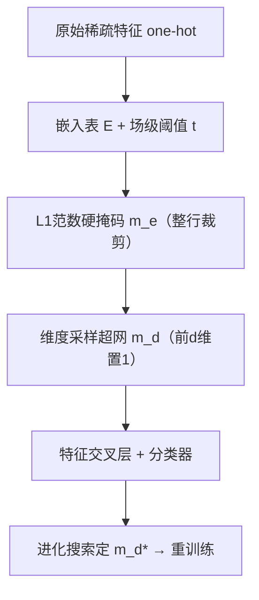
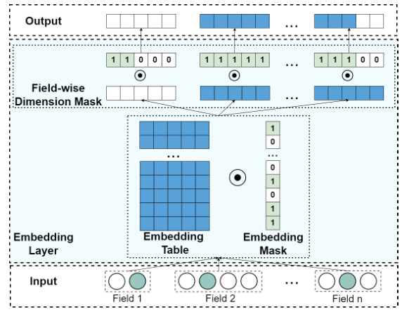

# OptEmbed: Learning Optimal Embedding Table for Click-through Rate Prediction (为 CTR 预测学习最优嵌入表)

- **会议/期刊**: CIKM 2022 (Research Track)
- **作者与机构**: Fuyuan Lyu, Xing Tang, Hong Zhu, Huifeng Guo, Yingxue Zhang, Ruiming Tang, Xue Liu（McGill University & 华为诺亚方舟实验室）
- **推荐链路定位**: 精排（CTR 预估模型的嵌入层，模型无关插件）
- **研究方向**: CTR/CVR 预估与特征交叉 / 冷启动与长尾（嵌入维度弹性分配）
- **论文原文**: [https://arxiv.org/abs/2208.04482v2](https://arxiv.org/abs/2208.04482v2)
- **开源代码**: [https://github.com/fuyuanlyu/OptEmbed](https://github.com/fuyuanlyu/OptEmbed)

## TL;DR (1分钟核心速览)

CTR 模型的嵌入表占据绝大部分参数，但现有工作只能沿"剪冗余行"或"调维度"一个轴优化，且剪枝产物是稀疏矩阵、硬件不友好。本文提出 OptEmbed：用**场级可学习阈值 + L1 范数**整行裁掉冗余嵌入，把场级维度组合视为架构、以**均匀采样超网 + 进化搜索**确定每域维度，最后重训。在 Criteo/Avazu/KDD12（8:1:1 随机划分、AUC/LogLoss）上，压缩 39%–97% 参数的同时 AUC 最高提升 0.15%（显著，$p<0.05$）。

## Background & Motivation (背景与核心矛盾)

- **主流范式**: 通用 CTR 架构 = 嵌入表 $\mathbf{E}\in\mathbb{R}^{|f|\times D}$+ 特征交叉层 + 分类器；ID 类特征数百万取值使$|f|\gg D$，嵌入表主导显存与推断开销。
- **前人局限 1（粒度错配）**: AutoField 仅按特征域剪枝，域内信息量与冗余行混杂，粒度过粗；AutoDim 只搜维度不剪行，冗余嵌入仍在。
- **前人局限 2（部署不友好）**: PEP 对嵌入元素级加软阈值，剪出的是稀疏、参数不连续的张量，推断需额外索引结构，GPU 上反而更慢。
- **核心洞察 (Key Insight)**: 图 3 在 Avazu 上实证——嵌入的 $L_1$ 范数与该特征值出现频次近似线性正相关，因此**范数即重要性代理**；且只有整行裁剪（而非元素裁剪）才能保持"仍是稠密二维张量"这一硬件友好性。
- **本文切入点**: 把"剪行 + 定维"统一为一个可微阈值问题 + 一个一次性（one-shot）架构搜索问题，共享同一个超网。

## Method (核心方法设计)

### 1. 整体框架 (Overall Architecture)

模型无关的三阶段流水线：①**超网训练阶段**，把场级维度掩码 $\mathbf{m}_d$当作架构，每步从$\mathrm{Uniform}(1,D)$采样一个维度$d$，与阈值向量$\mathbf{t}$、嵌入参数$\mathbf{E}$、网络参数$\mathbf{W}$联合训练，得到"面向所有候选架构"的共享超网；②**进化搜索阶段**，固定超网权重，仅在验证集上前向评估候选$\mathbf{m}_d$组合，通过交叉/变异迭代 30 轮选出各域最优维度；③**重训练阶段**，按最终的$\mathbf{m}_e^{*}$、$\mathbf{m}_d^{*}$ 固化嵌入表并从零重训，消除超网里被采样到的多余维度带来的干扰。

<figure class="paper-figure" markdown="span">
  <figcaption>图2：OptEmbed概览。</figcaption>
</figure>

### 2. 关键设计拆解 (Key Designs)

1. **场级可学习阈值硬掩码（可微的结构梯度）**：为避免 PEP 式的元素级稀疏，作者只给每个特征域一个标量阈值 $\mathbf{t}\in\mathbb{R}^{n}$（$n$ 为域数，开销可忽略，且比全场共享阈值稳健、比逐特征阈值不易过拟合），用单位阶跃函数生成行掩码：
   $\mathbf{m}_e = S(L_1(\mathbf{E}) - \mathbf{t}),\quad \hat{\mathbf{E}} = \mathbf{E}\odot\mathbf{m}_e$。
   阶跃函数不可导，用长尾导数估计器替代其梯度（$|x|\le 0.4$时$2-4|x|$，$0.4<|x|\le1$时$0.4$，其余 0），使嵌入梯度分解为"性能梯度 + 结构梯度"两项，被误剪的行在范数与阈值差距小于 1 时仍能通过结构梯度**复活**。另加$\alpha\sum_i \exp(-t_i)$抬升阈值以鼓励更多裁剪；范数取$\beta=1$正是为了让每个元素的梯度互不解耦（$\beta\neq1$时第一项$\left(\sum e_i^\beta\right)^{1/\beta-1}$ 会让全元素互相牵连）。
2. **均匀采样超网（把 $O(D^n)$搜索变成一次性训练）**：场级维度组合数随域数指数爆炸，直接枚举不可行。作者令$\mathbf{m}_d$为"前$d$个元素为 1"的序数掩码，$d\sim\mathrm{Uniform}(1,D)$，则超网训练目标为
   $\min_{\mathbf{E},\mathbf{W},\mathbf{t}}\ \mathbb{E}_{d\sim U(1,D)}\,\mathrm{CE}\left(y, F(\mathbf{E}\odot\mathbf{m}_e\odot\mathbf{m}_d)\right) + \alpha L_s$，
   均匀采样保证所有候选架构被等频训练（无先验偏好），且参数量仅按最大维度 $D$ 预分配，不会像逐架构独立训练那样爆内存。
3. **进化搜索与训练目标**：以验证集 AUC 为适应度，保留 Top-$k$候选，按$n_c=n_m=10$、变异率 0.1 生成子代；搜索全程不训练，只前向，因此总训练时间仍短于 PEP 与 AutoDim。总损失为交叉熵 + 稀疏正则，训练负样本即曝光未点击样本（CTR 原生正负比，无额外负采样），推断时仅需按最终掩码查表，无额外索引开销。

## Experimental Setup & Evaluation Protocol (实验设置与评估协议)

- **数据集与预处理**（原文未逐项披露精确统计，"规模"为公开数据集量级）：

| 数据集 | #特征域 | 特征值规模 | 交互量级 | 预处理 / 场景说明 |
| :--- | :---: | :---: | :---: | :--- |
| Criteo | 26 类别 + 13 数值 | 百万级 | ~4500 万 | 数值特征 $\lfloor\log_2 x\rfloor$ 离散化；`min_count=2` 低频归 OOV |
| Avazu | 24 类别 | 百万级 | ~4000 万 | 去 instance_id；时间戳拆为 hour/weekday/is_weekend；`min_count=2` |
| KDD12 | 11 类别 | 万级 | ~1.5 亿 | 低频归 OOV，`min_count=10` |

- **数据划分与防穿越**: 三数据集统一 `随机 8:1:1 划分`（train/valid/test），**未做全局时间戳切分**——CTR 场景存在未来信息泄漏风险（见局限）。
- **排名评测协议**: CTR 场景无 Full-Ranking 概念，采用逐样本二分类打分，报告 `AUC` 与 `LogLoss`，并以 $0.1\%$AUC 为该领域显著性经验阈值；另报 `Sparsity`$=1-\frac{\#\text{剩余参数}}{|f|\times D}$、单 batch 推断时延与总训练时长。
- **对比基线与超参**: 基线 AutoDim、AutoField、QR（Quotient-Remainder 哈希）、PEP（软阈值剪枝），分别插在 DeepFM / DCN / FNN / IPNN 四种底座上；$d=64$、batch 2048、MLP$[1024,512,256]$、Adam + BN + Xavier；阈值学习率$\{10^{-2},10^{-3},10^{-4}\}$、$\alpha\in\{10^{-4},\dots,10^{-6}\}$网格搜索；显著性用双侧 t 检验$p<0.05$。

## Key Experimental Results (实验关键数据)

### 1. 主实验对比 (Main Results)

| 数据集 | 模型 | Original AUC | AutoDim | AutoField | QR | PEP | **OptEmbed** | Sparsity | Improv. |
| :--- | :--- | :---: | :---: | :---: | :---: | :---: | :---: | :---: | :---: |
| Criteo | DeepFM | 0.8104 | 0.8093 | 0.8101 | 0.8084 | 0.7980 | **0.8105** | 0.9684 | +0.01% |
| Criteo | DCN | 0.8106 | 0.8096 | 0.8108 | 0.8103 | 0.8110 | **0.8113** | 0.8534 | +0.04% |
| Avazu | DeepFM | 0.7884 | 0.7843 | 0.7866 | 0.7762 | 0.7877 | **0.7888*** | 0.3927 | +0.05% |
| Avazu | DCN | 0.7894 | 0.7893 | 0.7887 | 0.7868 | 0.7896 | **0.7901*** | 0.6840 | +0.06% |
| KDD12 | DeepFM | 0.7962 | 0.7886 | 0.7953 | 0.7913 | 0.7957 | **0.7971*** | 0.6183 | +0.11% |
| KDD12 | DCN | 0.8010 | 0.8016 | 0.8011 | 0.7925 | 0.7992 | **0.8021*** | 0.4715 | +0.14% |

（`*` 表示相对最佳基线的双侧 t 检验显著，$p<0.05$；Criteo 上 AUC 不显著但参数压缩最狠。）

### 2. 消融实验 (Ablation Study)

| 设置 | Criteo-DeepFM AUC / Sparsity | Criteo-DCN AUC / Sparsity | Avazu-DeepFM AUC / Sparsity | Avazu-DCN AUC / Sparsity |
| :--- | :---: | :---: | :---: | :---: |
| Original | 0.8104 / — | 0.8106 / — | 0.7884 / — | 0.7894 / — |
| w/o dim search (OptEmbed-E) | 0.8104 / 0.6267 | 0.8110 / 0.6111 | 0.7884 / 0.0000 | 0.7895 / 0.0024 |
| w/o pruning (OptEmbed-D) | 0.8103 / 0.5547 | 0.8110 / 0.7192 | 0.7888 / 0.3927 | 0.7900 / 0.5044 |
| **Full OptEmbed** | **0.8105 / 0.9684** | **0.8113 / 0.8534** | **0.7888 / 0.3927** | **0.7900 / 0.6840** |
| w/o re-training (DCN) | 0.8110 | — | 0.7895 | — |
| w. re-training (DCN) | **0.8113** | — | **0.7900** | — |
| w/o re-training (KDD12-DCN) | 0.8005 | — | — | — |
| w. re-training (KDD12-DCN) | **0.8021** | — | — | — |

### 3. 关键实验发现 (Key Findings)

1. **收益类型随数据集性质切换**：Criteo 上剪枝几乎不掉点但参数压缩 85%–97%（DCN 0.8106→0.8113 同时省 85.3%），属纯"省显存"；KDD12/Avazu 上则是"既涨点又省内存"，KDD12-DCN 以 47.2% 的参数换来 +0.0011 AUC——说明冗余越重、基数越大的数据集，最优嵌入表离原始表越远。
2. **两组件强互补且在 Avazu 上失衡**：Avazu 上仅剪枝（OptEmbed-E）的 sparsity 只有 0.0000 / 0.0024，因为该集以 ID 类特征为主、几乎全部行都信息量高；此时增益几乎全部来自维度搜索（OptEmbed-D 单独的 0.7888/0.7900 已与完整版持平），反之 Criteo 上两组件叠加才把 sparsity 从 0.63 推到 0.97。
3. **重训练是必要收尾且不牺牲效率**：KDD12-DCN 去掉重训掉 0.0016 AUC（全场最大落差），说明超网参数是"为所有候选架构折中"的次优解；而重训后最终表最小，OptEmbed 的**单 batch 推断时延全场最低**，PEP 因稀疏表反而比原始模型更慢——直接印证 Req.3 的工程价值。

## Highlights & Limitations (亮点、对比与审稿批判)

- **与代表作对比 (vs. Prior Work)**: 相对 AutoDim（只搜维度、留冗余行）与 AutoField（只按域剪枝、粒度过粗），本文首次把两者放进同一超网；相对 PEP（元素级软阈值 → 稀疏张量），本文用**行级硬掩码**保证剪完仍是稠密二维表，可直接按缩小后的 `num_embeddings × dim` 部署，这是最本质的差异。
- **可迁移亮点**: ①"$L_1$范数 ≈ 频次 ≈ 重要性"的实证代理，可零成本迁移到任何需要做特征价值评估的召回/粗排嵌入层；②场级阈值向量（仅$n$ 维）+ 长尾导数估计器的"可复活剪枝"，比一次性硬剪更稳，可直接套用到多模态/序列模型的 token 或 slot 精简。
- **审稿级局限批判**: ①划分是随机 8:1:1 而非时间切分，CTR 数据的时间漂移会让 AUC 绝对值偏乐观，也解释了为何提升幅度只有 $10^{-3}$量级；②进化搜索需在验证集上反复前向$T=30$轮，超参（$\alpha$、$lrt$、$k$、$prob$）敏感且未给敏感度曲线，线上冷启动阶段"边搜边服务"的时延代价未被讨论；③KDD12/Avazu 的提升虽标显著，但 0.1% 的经验阈值本身来自小数据评测惯例，工业收益仍需 A/B 验证。

## Rating (四维评分)

- **方法创新性 (Novelty)**: ⭐⭐⭐⭐ （首次把"剪冗余行 + 定场级维度"统一进一个共享超网，行级硬掩码 + 可复活结构梯度是真正新颖的算子组合，理论支撑偏实证而非严格推导）
- **评估协议与实验扎实度 (Protocol & Experiments)**: ⭐⭐⭐⭐ （4 底座 × 3 数据集 × 4 基线的交叉验证很完整，含时延/参数-效果曲线/案例研究；扣分在随机划分与超参敏感度缺失）
- **写作与数学规范度 (Clarity & Rigor)**: ⭐⭐⭐⭐ （三条 Req 的定义把动机形式化得很干净，梯度分解式与 $\beta=1$ 的取舍解释到位；搜索空间与进化算子的复杂度分析偏薄）
- **工业落地与复现价值 (Industrial & Practical Value)**: ⭐⭐⭐⭐⭐ （代码开源、模型无关即插即用、推断时延最低、产物是稠密表，几乎无部署阻力，是本文最强的一项）

