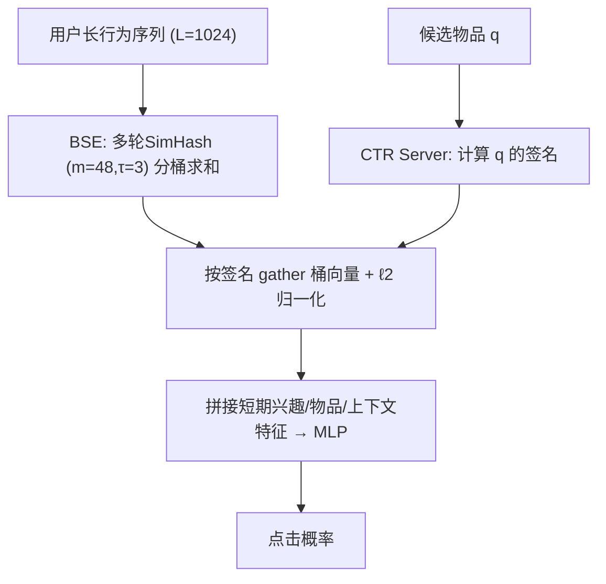
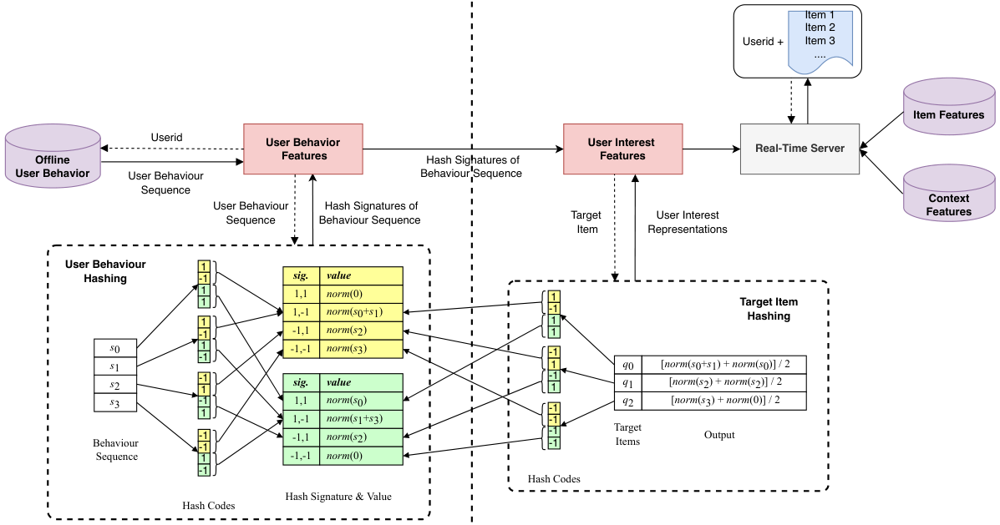

# Sampling Is All You Need on Modeling Long-Term User Behaviors for CTR Prediction (长序列用户行为建模，采样就够了)

- **会议/期刊**: CIKM 2022
- **作者与机构**: Yue Cao, XiaoJiang Zhou, Jiaqi Feng 等（美团）
- **推荐链路定位**: 精排（CTR 模型内的用户兴趣建模模块）
- **研究方向**: CTR预估与特征交叉 / 序列与会话推荐
- **论文原文**: [https://arxiv.org/abs/2205.10249v2](https://arxiv.org/abs/2205.10249v2)
- **开源代码**: 暂未开源

## TL;DR (1分钟核心速览)

长序列行为受在线延迟约束只能截断到近 50 条，两阶段检索（SIM/UBR4CTR/ETA）虽能扩到上千条，但 top-$k$ 检索目标与 CTR 目标不一致、且在用户兴趣多样时产生严重信息损失。本文提出 SDIM：用多轮 SimHash 的碰撞概率直接充当注意力权重，把与候选物品同哈希签名的行为 gather 求和得到用户兴趣，端到端可训练。在 Taobao 与美团工业数据上 AUC 与全序列 target attention 持平（0.8854 / 0.7044），训练提速 5.0×–11.4×，线上升 2.98% CTR。

## Background & Motivation (背景与核心矛盾)

- **主流范式**: DIN 的 target attention 已成工业标配，但复杂度 $O(BLd)$（$B\approx10^3$）迫使系统把行为序列截断到近 50 条；长序列方案要么解耦（MIMN 的 UIC，丢失 target 交互），要么两阶段检索（SIM 类目倒排、UBR4CTR 索引、ETA 的 LSH + Hamming top-$k$）。
- **前人局限**: ① 检索的 top-$k$与 CTR 目标发散，用户行为丰富时召回的$k$条高度同质，兴趣估计反而失真；② 效果与效率难以兼顾——UBR4CTR 推理慢约 4× 无法上线，SIM(hard) 简单但效果差，ETA 仍需$O(BL)$的 Hamming 距离与 top-$k$ 排序。
- **核心洞察 (Key Insight)**: LSH 的"保距性"意味着碰撞频率本身就是相似度的无偏估计，作者证明单签名碰撞概率期望为 $\mathbb{E}[\tilde p_j]=(1-\arccos(\mathbf{q}^\top\mathbf{s}_j)/\pi)^{\tau}$，其曲线与 softmax 目标注意力几乎重合（图 2），因此**无需检索，直接按桶 gather 即等价于在全序列上做注意力**。
- **本文切入点**: 把"检索 top-$k$"换成"哈希分桶采样 + 求和"，同时把与候选无关的行为序列哈希离线化，彻底移除在线延迟。

## Method (核心方法设计)

### 1. 整体框架 (Overall Architecture)

框架拆成两台独立服务器：BSE（Behavior Sequence Encoding）服务器离线/准实时地对用户行为序列做多轮 SimHash，把行为按签名分桶并求和成定长桶向量；CTR 服务器对每个候选物品计算签名，从对应桶中 gather 出向量，经 $\ell_2$ 归一化得到长序列兴趣表征，再与短期兴趣（16/50 条上的标准 target attention）、物品特征、上下文特征拼接后送入 MLP 出分。训练阶段两段是端到端联合优化的（只有在线服务阶段才物理拆分），哈希函数为固定随机高斯投影、不可学习，梯度经由被 gather 中的物品 embedding 回传。

<figure class="paper-figure" markdown="span">
  <figcaption>图1：我们框架的高层概览。它由两个独立的服务器组成：行为序列编码（BSE）服务器和 CTR 服务器。BSE 服务器计算用户行为序列的哈希，CTR 服务器计算候选物品的哈希，并收集与候选物品具有相同哈希签名的行为物品以构成用户兴趣。CTR 服务器包含一个实时 CTR 模型，该模型以用户兴趣特征、物品特征和上下文特征为输入，预测每个候选物品对应的点击概率。</figcaption>
</figure>

### 2. 关键设计拆解 (Key Designs)

1. **哈希采样注意力（用采样替代检索）**：不再算 Hamming 距离选 top-$k$，而是把与候选同签名的所有行为直接求和：$\mathrm{Attn}(\mathbf{q},\mathbf{S})=\frac{1}{m/\tau}\sum_{i=1}^{m/\tau}\ell_2\big(\sum_{j=1}^{L}\tilde p^{(R_i)}_j\mathbf{s}_j\big)$，其中$\tilde p^{(R_i)}_j=\prod_{k=1}^{\tau}\mathbb{I}[h(\mathbf{q},\mathbf{r}_{i,k})=h(\mathbf{s}_j,\mathbf{r}_{i,k})]$。直觉：同签名行为越多，说明其与候选越相似，桶内均值天然完成了"以相似度为权"的加权池化，且是对全序列的无损聚合，不存在 top-$k$ 的截断偏差。

2. **多轮哈希与 $\tau$调节注意力锐度**：单签名易让不相似物品误碰撞，故用$(m,\tau)$-SimHash，$\tau$位签名全一致才算碰撞，期望权重随$\tau$增大而尖锐、注意力熵严格下降。两个极端给出可解释性：$\tau\to\infty$退化为只取同 ID 行为的 SIM(hard)，$\tau=0$退化为 Mean Pooling，因此 SDIM 是二者之间的连续插值，$\tau\in[2,5]$ 为甜区。

3. **训练目标与推理开销**：损失即标准 pointwise 交叉熵 $\mathcal{L}=-\frac{1}{N}\sum_i\big[y_i\log p_i+(1-y_i)\log(1-p_i)\big]$，无负采样、无对比损失，兴趣模块与 CTR 主模型联合反向传播；推理时行为侧哈希与候选无关，$B$退化为 1，CTR 服务器只需算候选的$O(Bm\log d)$，与序列长度$L$完全解耦（对比 DIN$O(BLd)$、ETA$O(BLm+Bkd)$）。

## Experimental Setup & Evaluation Protocol (实验设置与评估协议)

- **数据集与预处理**: 原文未披露 Taobao 的用户/物品精确统计，工业集为美团搜索连续 14 天样本。

| 数据集 | #Users | #Items | #Interactions | 稀疏度/密度 | 特征/场景说明 |
| :--- | :---: | :---: | :---: | :---: | :--- |
| Taobao | 未披露 | 未披露 | 未披露 | — | user/item/cate/behavior/timestamp，另加 is_weekend；短期 16 / 长期 256 |
| Meituan 工业 | 未披露 | 未披露 | 约 10 亿训练样本 | — | 搜索场景 + 约 20 个重要 ID 特征；短期 50 / 长期 1024 |

- **数据划分与防穿越 (Splitting Strategy)**: Taobao 沿用 MIMN/ETA 协议，用第 1 至 $(L-1)$条行为预测第$L$ 条，按时间步 `80%/10%/10%` 划分；工业集用前 14 天训练、后 2 天验证与测试（`全局时间戳切分`）。
- **排名评测协议 (Ranking Protocol)**: 采用 `Sampled/曝光样本上的 Pointwise AUC`（非 Full-Ranking 全库排序），工业场景的候选集规模 $B\approx10^3$；辅以 `Training & Inference Speed` 相对加速比与线上 14 天 A/B（CTR / VBR）。
- **对比基线与超参设置**: DIN（仅短期）、DIN(Long Seq.)（$L$=256/1024 全注意力上界）、DIN(Avg-Pooling)、SIM(hard)、UBR4CTR、ETA；隐藏维度$d=128$，$m=48$，$\tau=3$，显著性用 paired Wilcoxon test（$p<0.05$）。

## Key Experimental Results (实验关键数据)

### 1. 主实验对比 (Main Results)

| 方法 | Taobao AUC↑ | 工业 AUC↑ | T&I 加速比 (Taobao / 工业) |
| :--- | :---: | :---: | :---: |
| DIN (仅短期) | 0.8627* | 0.6652* | 7.4× / 13.5× |
| DIN (Long Seq.) | 0.8848* | **0.7049** | 1.0× / 1.0× |
| DIN (Avg-Pooling) | 0.8669* | 0.6749* | 2.6× / 11.0× |
| SIM (hard) | 0.8692* | 0.6852* | 2.4× / 10.8× |
| UBR4CTR | 0.8752* | 0.6836* | 0.8× / 1.2× |
| ETA | 0.8753* | 0.6906* | 1.8× / 3.7× |
| **SDIM (本文)** | **0.8854** | 0.7044 | **5.0× / 11.4×** |
| Improv. (vs. 最优检索基线 ETA) | **+1.15%** | **+2.00%** | 2.8× / 3.1× |

### 2. 消融与超参实验 (Ablation & Sensitivity)

| 配置 | 具体设置 | 工业 AUC↑ |
| :--- | :--- | :---: |
| $\tau$ 扫描 | 1 / 2 / **3** / 5 / 10 | 0.6911 / 0.7032 / **0.7044** / 0.7034 / 0.6923 |
| $m$扫描 | 24 → 120 |$m>48$ 后曲线饱和，与"无限哈希"期望基线几乎重合 |
| 短序列泛化 | DIN(T=16) → SDIM(T=16) | 0.8627 → 0.8637（2.0× 加速） |
| 线上 A/B | SDIM(T=1024) / SDIM(T=2000) | CTR +2.39% / **+2.98%**，VBR +2.21% / **+2.69%**，延迟仅 +1ms |

### 3. 关键实验发现 (Key Findings)

- **"采样 = 注意力"被双重验证**：SDIM 在 Taobao 上甚至小幅超过全序列 target attention（0.8854 vs. 0.8848），工业集仅相差 0.0005，说明碰撞概率估计在 $m/\tau\ge16$时误差已可忽略，检索式方案（ETA 0.6906）的差距反而暴露了 top-$k$ 的信息损失。
- **$\tau$是"噪声–稀疏"权衡的旋钮**：$\tau=1$时噪声行为涌入（0.6911，-1.3%），$\tau=10$时仅极小部分行为有贡献、对少行为用户不友好（0.6923），$2\le\tau\le5$ 形成稳定平台，说明多轮签名的去噪是性能的关键来源。
- **工程收益远大于离线指标增益**：直接部署 DIN(T=1024) 会使推理时间增加约 50%（+25–30ms）不可接受，而 SDIM(T=2000) 只增加 1ms（主要是 BSE→CTR 的 8KB 桶向量传输），这正是"解耦最耗时部分"的设计价值。

## Highlights & Limitations (亮点、对比与审稿批判)

- **与代表作对比 (vs. Prior Work)**: 与 SIM/UBR4CTR 的两阶段"检索→注意力"相比，SDIM 取消 top-$k$超参与倒排索引，改为无损全序列聚合；与 ETA 同样用 LSH，但 ETA 仍需 Hamming 距离 + top-$k$，SDIM 直接分桶 gather，复杂度从$O(BLm+Bkd)$降到$O(Bm\log d)$；与 MIMN 的解耦相比，SDIM 保留了 target-aware 交互，兴趣从"浅"变"深"。
- **可迁移亮点**: ① "用与 target 无关的离线分桶 + 在线固定长度聚合"这一范式可迁移到任意超长序列场景（广告、直播、内容推荐）以绕开在线延迟；② 把 $\tau$ 作为注意力熵的显式调节器，可在冷启动/少行为用户上按行为量动态设定。
- **审稿级局限批判**: ① 哈希函数为固定随机投影、不可学习，桶的划分完全由数据分布决定，缺少对"任务相关相似度"的自适应能力，且需要把行为 embedding 与其他模型对齐；② 评估仅有 Pointwise AUC 与自家数据集 A/B，缺少开源大样本基准（如 Amazon 长序列）与 Full-Ranking 协议下的验证，泛化性证据偏弱；③ $\tau$与$m$的敏感性分析只在单一工业集上完成，且$m$ 增大时离线哈希与传输成本的增长未量化。

## Rating (四维评分)

- **方法创新性 (Novelty)**: ⭐⭐⭐⭐ （把 LSH 碰撞概率直接解释为注意力权重并给出闭式期望，思想极简但洞察精准，属"简单而正确"的工业型创新）
- **评估协议与实验扎实度 (Protocol & Experiments)**: ⭐⭐⭐⭐ （公开集 + 十亿级工业集 + 14 天线上 A/B + 显著性检验完整，但仅用 Pointwise AUC、无 Full-Ranking 与开源代码）
- **写作与数学规范度 (Clarity & Rigor)**: ⭐⭐⭐⭐ （期望碰撞概率推导与 $\tau$的熵单调性、极端情形分析清晰，复杂度对比表扎实，$\ell_2$ 归一化的选择仅以脚注带过略欠严谨）
- **工业落地与复现价值 (Industrial & Practical Value)**: ⭐⭐⭐⭐⭐ （BSE/CTR 双服务器解耦、8KB/1ms 传输、线上 +2.98% CTR 的完整落地链路，对长序列精排系统可直接借鉴）

