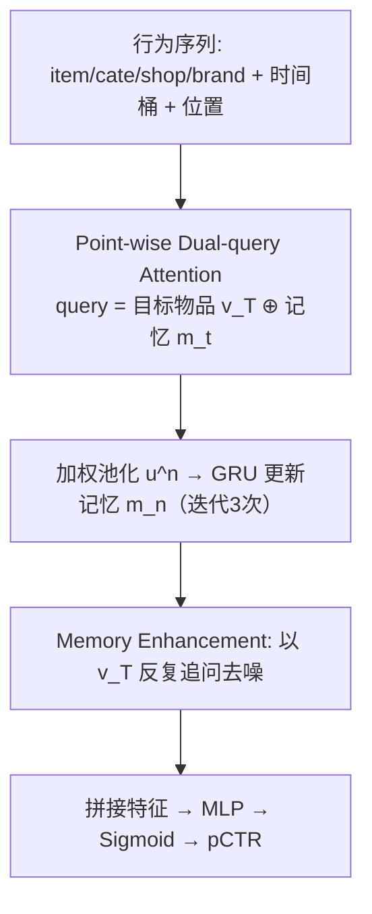
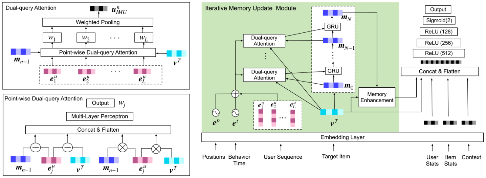

# Sparse Attentive Memory Network for Click-through Rate Prediction with Long Sequences (面向长序列点击率预估的稀疏注意力记忆网络)

- **会议/期刊**: CIKM 2022
- **作者与机构**: Qianying Lin, Wen-Ji Zhou, Yanshi Wang, Qing Da, Qing-Guo Chen, Bing Wang（阿里巴巴）
- **推荐链路定位**: 精排（Ranking，CTR 预估）
- **研究方向**: CTR/CVR 预估与特征交叉 / 序列与会话推荐
- **论文原文**: [https://arxiv.org/abs/2208.04022v2](https://arxiv.org/abs/2208.04022v2)
- **开源代码**: [https://github.com/waldenlqy/SAM](https://github.com/waldenlqy/SAM)

## TL;DR (1分钟核心速览)

长行为序列（千级长度）在精排中面临两个矛盾：self-attention 的 $O(L^2)$内存爆炸，与 DIN/DIEN 只能建模 target–sequence 依赖、无法建模序列内部依赖（DIEN/MIMN 逐条更新还不可并行）。本文把 target item 当 Query、长序列当知识库，提出双查询（target + 记忆向量）的 point-wise 稀疏注意力与 3 次迭代记忆更新，以$O(L\cdot d)$复杂度、$O(1)$ 串行步数同时建模两类依赖。Amazon Books/Movies 全量 AUC 分别达 0.86997/0.88714（较最强基线 +2.08%/+1.81%），工业数据 +0.58%，线上 A/B CTR +7.30%。

## Background & Motivation (背景与核心矛盾)

- **主流范式**: 精排序列建模主流是 DIN 的 target attention（$O(L)$但无序列内依赖）与 SASRec/Transformer 自注意力（有序列内依赖但$O(L^2)$ 内存），以及 DIEN/MIMN 的 GRU 逐条串行更新。
- **前人局限**: ① SASRec 的 $O(L^2)$显存在$L\approx100$即 OOM，且编码阶段完全不知道目标物品，交叉被推迟到网络顶层；② DIEN/MIMN 每条行为一次串行算子（$O(L)$步），MIMN 在$L=50$ 时推理已达 216ms，远超工业 30–80ms 上限。
- **核心洞察 (Key Insight)**: 推荐行为序列并非严格有序，用户存在季节性周期行为，因此串行 RNN 的"逐条递推"不是必需；真正稀缺的是"用一个不断演化的记忆，反复向长序列提问"的能力。
- **本文切入点**: 把精排构造成 QA 任务——target 为 question、序列为 knowledge base，记忆向量随迭代被序列信息唤醒，从而在一次前向中打通 target–sequence 与 intra-sequence 两条依赖链。

## Method (核心方法设计)

### 1. 整体框架 (Overall Architecture)

输入层把 item id/cate/shop/brand 拼成 $\boldsymbol{e}^i_j$，时间戳按相对排序时刻的指数区间$[0,1),[1,2),[2,4),\dots$分桶查表得$\boldsymbol{e}^t_j$，位置按"最近行为恒为 1"的降序编号得$\boldsymbol{e}^p_j$，三者逐元素相加为行为表示$\boldsymbol{e}_j$。随后进入点式双查询注意力：以目标向量$\boldsymbol{v}_T$与当前记忆$\boldsymbol{m}_{t}$共同为 query，逐条打分并加权池化得到用户兴趣$\boldsymbol{u}^n$，再由 GRU 更新记忆；重复 3 次后进入记忆增强模块，用 target 反复"追问"以去噪，最后与其余特征拼接经 MLP + Sigmoid 输出点击概率。全流程无逐条串行算子，支持全序列并行。

<figure class="paper-figure" markdown="span">
  <figcaption>图1：稀疏注意力记忆（SAM）网络架构概览。迭代记忆更新模块（绿色）是我们的主要贡献；双查询注意力的细节见左侧。</figcaption>
</figure>

### 2. 关键设计拆解 (Key Designs)

1. **Point-wise 双查询注意力（PDA）**：DIN 只用 target 查询，注意力只反映"该行为与目标的相关性"，遗漏了序列内部共现结构；本文对每个行为同时拼接与目标、与记忆的差分/乘积四段特征，再做逐点两层 FFN + Sigmoid 打分（非 softmax，故无需全局归一化，天然 $O(L)$ 并行）：
$\boldsymbol{\alpha}_j=[\boldsymbol{e}_j\ominus\boldsymbol{m}_t\,\|\,\boldsymbol{e}_j\ominus\boldsymbol{v}_T\,\|\,\boldsymbol{e}_j\otimes\boldsymbol{m}_t\,\|\,\boldsymbol{e}_j\otimes\boldsymbol{v}_T],\quad a_j=\sigma(\mathbf{W}_2\sigma(\mathbf{W}_1\boldsymbol{\alpha}_j+\boldsymbol{b}_1)+\boldsymbol{b}_2)$
直觉：记忆向量携带"序列中已聚合的其它行为"，使 lime 能被 peppermint+rum 的共现三元组唤醒。

2. **迭代记忆更新（IMU）**：固定槽位记忆在长序列下必然丢信息，FIFO 又不符合推荐的周期行为；本文改为 $O(1)$ 次"整序列扫描"迭代，每轮用注意力权重加权池化整条序列，再用 GRU 的更新门决定遗忘/记忆：
$\boldsymbol{m}_0=\boldsymbol{v}_T,\quad \boldsymbol{u}^n=\sum_{j=1}^{L}a_j\boldsymbol{e}_j,\quad \boldsymbol{m}_n=\mathrm{GRU}(\boldsymbol{u}^n,\boldsymbol{m}_{n-1})$一轮扫描即让记忆吸收全局序列信息，第$n$轮的打分又反过来用记忆修正权重，等价于以$O(1)$次串行步逼近 self-attention 的最大路径长度$O(1)$ 性质。

3. **记忆增强与训练目标**：以 $\boldsymbol{m}_N$为 GRU 初态、每步输入$[\mathbf{W}_u\boldsymbol{u}^{t-1}_{MEM}\|\boldsymbol{v}_T]$反复注入目标，强化目标相关记忆、抑制噪声。总损失为点击交叉熵$\mathcal{L}=-\frac{1}{|\mathcal{D}|}\sum (y\log\hat{y}+(1-y)\log(1-\hat{y}))$；工业训练集正负比 1:2.24（负样本 0.1 采样），无额外 hard negative 构造；推理仅一次前向，$L=1000$ 时 3.6ms。

## Experimental Setup & Evaluation Protocol (实验设置与评估协议)

- **数据集与预处理**:

| 数据集 | #Users | #Items | #Interactions | 稀疏度/密度 | 特征/场景说明 |
| :--- | :---: | :---: | :---: | :---: | :--- |
| Amazon Books | 295,982 | 647,589 | 6,626,872 | 极稀疏 | 无 item 侧信息，序列最长 1000 |
| Amazon Movies | 233,282 | 165,851 | 4,829,693 | 极稀疏 | 同上，用于跨域验证 |
| Industrial | 千万级日活 | 亿级 | 1.68B 训练 / 57M 测试 | 极稀疏 | 电商首页推荐，30 天日志 |

- **数据划分与防穿越**: Amazon 按**行为时间戳 80%/20% 切分**（非 Leave-One-Out）；工业集用前 30 天训练、次日全天测试，严格时间切分防穿越。
- **排名评测协议**: 采用 CTR 场景的 **AUC**（随机点击样本排序高于随机未点击样本的概率），在全量样本上评估而非采样排序；工业集保留 57M 测试点，规模足够支撑 AUC 的稳定比较。
- **对比基线与超参**: 基线覆盖三类——池化类 YouTube DNN、target-attention 类 DIN、串行更新类 DIEN/MIMN、自注意力类 SASRec、两阶段检索类 UBR4CTR。Amazon 嵌入维度 16、MLP 64×32、Adam lr=1e-3、batch=512；工业嵌入 32、GRU 隐层 32、MLP 512×256×128、lr=1e-4。所有结果报告多次运行的 mean±std，SAM 变体在公平设置下移除时间/位置编码。

## Key Experimental Results (实验关键数据)

### 1. 主实验对比 (Main Results)

| 模型 | Books AUC | Movies AUC | Industrial AUC |
| :--- | :---: | :---: | :---: |
| YouTube DNN | 0.83738 | 0.83432 | 0.73534 |
| DIN | 0.85162 | 0.86026 | 0.73749 |
| DIEN | 0.85498 | 0.86542 | 0.73807 |
| SASRec | 0.82144 | 0.83690 | 0.73461 |
| MIMN | 0.85228 | 0.87140 | 0.73678 |
| UBR4CTR | 0.84834 | 0.85957 | 0.73649 |
| SAM 3P（公平版，无时间/位置） | 0.86723 | 0.88352 | 0.74152 |
| **SAM 3P+ts（完整版）** | **0.86997** | **0.88714** | **0.74238** |
| **Improv.（vs 最强基线）** | **+2.08%** | **+1.81%** | **+0.58%** |

等长序列对比（表 2）显示优势与长度无关：$L=50$时 SAM 3P 已在 Books/Movies 取得 0.85662/0.86347，超过 DIEN 的 0.84541 与 MIMN 的 0.85312；$L=1000$ 时 SASRec、DIEN、MIMN 全部 OOM 或不可训练，仅 SAM 仍可扩展。

### 2. 消融实验 (Ablation Study)

| 变体 | Books AUC | Movies AUC | Industrial AUC |
| :--- | :---: | :---: | :---: |
| w/o. attention（= YouTube 池化） | 0.83738 | 0.83432 | 0.73534 |
| w/o. iterative walk（= DIN） | 0.85162 | 0.86026 | 0.73749 |
| dot product（点积替代 FFN 打分） | 0.84885 | 0.85644 | 0.73677 |
| w/o. subtraction op.（仅乘积项） | 0.86491 | 0.87536 | 0.74020 |
| delayed cross（顶层才与 target 交叉） | 0.85343 | 0.86037 | 0.73892 |
| w/o. m.e.（无记忆增强） | 0.86723 | 0.88352 | 0.74152 |
| **full（SAM 3P+ts）** | **0.86997** | **0.88714** | **0.74238** |

### 3. 关键实验发现 (Key Findings)

1. **迭代记忆是最大增量**：从 DIN 式 `w/o. iterative walk`（0.85162/0.86026）到 `w/o. m.e.`（0.86723/0.88352）带来 +1.56/+1.33 个千分点 AUC，与"从池化到 target attention"的增益（+1.42/+1.59）同量级，证明 intra-sequence 建模与 target–sequence 建模同等重要。
2. **底层交叉不可替代**：`delayed cross`（先编码后与 target 交叉，即 SASRec 范式）仅 0.85343/0.86037，几乎回落到 DIN 水平，比完整模型低 1.65/1.68 个千分点，说明把 target 注入到注意力最底层比"顶层拼接"更有效；同时点式 FFN 打分优于 scaled dot-product（0.84885 vs 0.85162），长序列下表达力更强的打分函数更稳；去掉差分项也掉 0.51/1.18 个千分点，多距离度量确有收益。
3. **复杂度换来的效率可落地**：$L=1000$前向仅 3.6ms、训练吞吐接近 DIN；$L=16K$时推理 80ms、峰值显存 16GiB（约 DIN 的 1.6×），而 SASRec 在$L>100$即 OOM。记忆迭代 3 次后 AUC 与注意力分布熵同步饱和（图 5），故$O(1)$ 次更新即可。线上 48 张 A100 支撑 1500 QPS、延迟 <30ms，9 天 A/B 中 CTR +7.30%±0.93%、TCIC +15.36%、CCC +7.19%，长序列同时提升了准确率与多样性。

## Highlights & Limitations (亮点、对比与审稿批判)

- **与代表作对比 (vs. Prior Work)**: 相对 DIN，SAM 多了记忆向量作为第二 query，从而把共现从"行为–目标对"扩展到"行为组合–目标"；相对 SASRec，SAM 把 $O(L^2)$全局自注意力换成$O(L)$的点式稀疏注意力并把 target 交叉下移到底层；相对 MIMN，SAM 抛弃逐条 NTM 读写，用 3 次全序列扫描将串行步数从$O(L)$降到$O(1)$，推理快两个数量级。
- **可迁移亮点**: ① "非严格有序序列无需串行递推"的判断，可指导长序列建模中 RNN/SSM 的必要性评估；② 以指数时间桶 + 降序位置编码构造相对时间语义，成本极低且对跨用户序列长度不一致鲁棒；③ Point-wise Sigmoid 打分替代 softmax 归一化，是长序列下省显存、保并行的通用技巧。
- **审稿级局限批判**: ① 迭代次数固定为 3、且每次都是全序列扫描，$L$ 增至万级时训练样本构造与存储成本（工业侧 45TB 样本、350GB 序列存储）成为隐藏瓶颈；② 记忆中缺乏显式的长尾/低频行为保真机制，超长序列下注意力熵饱和暗示信息被少数高分行为主导，对长尾兴趣的召回能力未做分桶验证；③ 评测仅用 AUC，缺少 GAUC、校准性与冷启动/新用户分层的分析，工业收益的归因（是长序列本身还是记忆结构）未用"等长序列 + DIN"对照完全隔离。

## Rating (四维评分)

- **方法创新性 (Novelty)**: ⭐⭐⭐⭐ （双查询稀疏注意力 + $O(1)$ 次全序列记忆迭代是对 DIN/SASRec/MIMN 三条路线的有效折中，QA 视角的重构清晰且具理论复杂度支撑）
- **评估协议与实验扎实度 (Protocol & Experiments)**: ⭐⭐⭐⭐ （两公开集 + 亿级工业集、mean±std 多次运行、等长序列对照与逐组件消融完整；扣分在于仅 AUC 单指标、缺分层与校准分析）
- **写作与数学规范度 (Clarity & Rigor)**: ⭐⭐⭐⭐ （复杂度/串行步数/最大路径长度的四分表对比极具说服力，公式定义紧凑；记忆初始化为 target 的动机论证稍显经验化）
- **工业落地与复现价值 (Industrial & Practical Value)**: ⭐⭐⭐⭐⭐ （开源代码，48×A100 支撑 1500 QPS、<30ms 延迟、CTR +7.30% 的真实上线结果，附 16K 序列的时延/显存曲线，工程参考价值极高）

