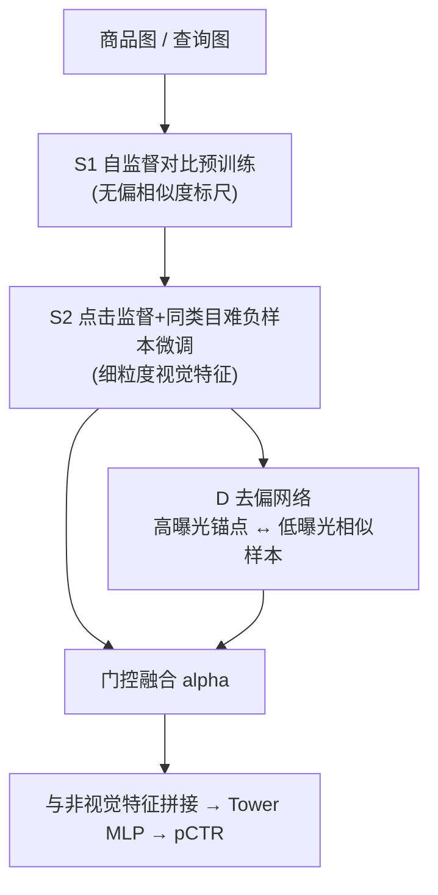
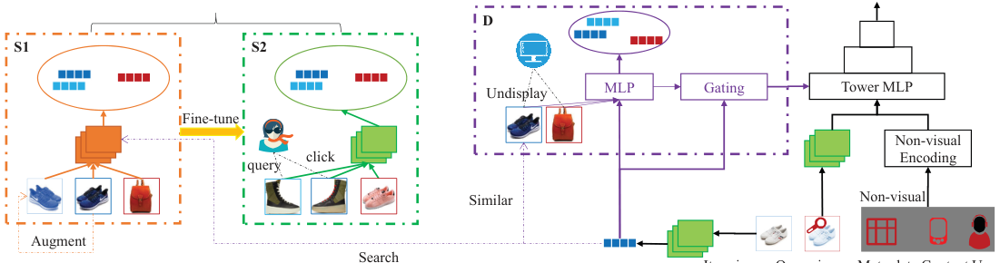

# Visual Encoding and Debiasing for CTR Prediction (面向点击率预估的视觉编码与去偏)

- **会议/期刊**: CIKM 2022
- **作者与机构**: Si Chen, Chen Lin, Wanxian Guan, Jiayi Wei, Xingyuan Bu, He Guo, Hui Li, Xubin Li, Jian Xu, Bo Zheng（阿里巴巴 / 厦门大学）
- **推荐链路定位**: 精排（视觉特征编码 + CTR 预估器）
- **研究方向**: CTR 预估与特征交叉 / 多模态推荐
- **论文原文**: [论文原文链接](https://arxiv.org/abs/2205.04168v1)
- **开源代码**: 暂未开源

## TL;DR (1分钟核心速览)

视觉搜索广告中，商用系统直接用类别分类预训练的 ResNet/VGG 提视觉特征——既粗粒度（分不清风格差异）又带样本选择偏差（低曝光商品正样本稀缺）。本文提出"预训练—微调—去偏"三段式：S1 自监督对比预训练获得无偏表征，S2 用点击信号 + 同类目难负样本做监督对比微调获得细粒度表征，再在 CTR 塔内插入对比去偏网络 D 并用门控融合。十亿级淘宝数据上 AUC 0.7042→0.7518（相对 +6.8%），线上 A/B CTR +4%~5%、RPM +1%~2%。

## Background & Motivation (背景与核心矛盾)

- **主流范式**: 离线用现成 CNN（ResNet/VGG/ViT）在商品类目分类任务上预训练，抽出 $D=512$ 维视觉向量；线上 CTR 预估器把视觉向量与非视觉特征（item ID、店铺、品牌、价格、用户画像、上下文）拼接后喂入 DNN 塔。
- **前人局限 1（粒度）**: 类别标签只能区分"连衣裙 vs 裤子"，无法刻画决定点击的风格/设计细节；实验里 ResNet-C 的同类目率 CR@10 最高（0.8132）但检索命中率 HR 最低（0.2626），正是"粗粒度可分、细粒度不可分"的直接证据。
- **前人局限 2（偏差）**: 若改用点击监督，则广告必须先曝光才可能被点击，低曝光长尾商品正样本极少，表征被头部商品主导（Sample Selection Bias, SSB）。
- **核心洞察 (Key Insight)**: 曝光量 $\neq$ 相关性。无偏的自监督表征可当作"相似度标尺"，用它去配对"高曝光锚点 ↔ 视觉相似但低曝光"的样本，就能在不信任点击标签的前提下校正偏差。
- **本文切入点**: 把"提升粒度"交给点击监督对比微调，把"消除偏差"交给线上对比去偏网络，二者解耦、分阶段处理。

## Method (核心方法设计)

### 1. 整体框架 (Overall Architecture)

离线侧视觉编码器分两阶段：S1 用随机裁剪/颜色抖动/灰度/翻转做增强，在 batch 内以 InfoNCE 做自监督对比，得到无偏但粒度一般的特征；S2 以用户点击图为正样本、以**同类别**图片池为难负样本做监督对比微调，得到细粒度特征。在线侧，商品图先过 S2 得到 $\mathbf{v}^{S2}_p$，同时过一层 MLP 去偏网络得到$\mathbf{v}^{D}_p$；用门控标量$\alpha$加权融合成最终视觉特征，与查询图特征$\mathbf{v}^{S2}_q$、非视觉 embedding 拼接后经 tower MLP 输出点击概率。去偏网络与 CTR 主损失联合端到端训练，推理时仅多一次轻量 MLP 前向。

<figure class="paper-figure" markdown="span">
  <figcaption>图1：所提出的架构。左：离线 Visual Encoder 由两个阶段组成。右：在线 CTR 预测器由去偏网络组成。</figcaption>
</figure>

### 2. 关键设计拆解 (Key Designs)

1. **S2 类别约束难负样本微调（把"类别可分"推向"风格可分"）**: 痛点是无点击不等于不相关，随机负样本太"假"。做法是给每个查询图 $q$取一张真实点击图$i$为正样本，负样本只从与$i$同类别$c_i$的图片池$\mathcal{N}^{S2}_{c_i}$ 中采样：
$\mathcal{L}_{S2}=-\sum_{q\in\mathcal{Q}}\log\frac{\exp g(\mathbf{v}^{S2}_q,\mathbf{v}^{S2}_i)}{\sum_{j\in\mathcal{N}^{S2}_{c_i}\cup\{i\}}\exp g(\mathbf{v}^{S2}_q,\mathbf{v}^{S2}_j)}$，其中$g$ 为余弦相似度。
直觉：同类别负样本迫使模型在极小视觉差异上做判别，恰好对应"风格/设计"这类真正影响点击的维度，且避免了跨类目负样本带来的平凡解。

2. **对比去偏网络 D + 门控融合（在打分前把长尾拉回）**: S2 微调必然引入 SSB。D 为每个锚点图 $p$用**无偏的 S1 特征**检索同类别中近 30 天曝光$<5$的$K=15$张相似图，按相似度概率$Pr(p')=sim(p,p')/\sum_{p'\in\tilde{\mathcal{P}}}sim(p,p')$抽正样本，负样本 batch 内随机；再以$\mathcal{L}_{D}$做对比，使高曝光与低曝光的相似图在特征空间聚拢。融合用自适应门控$\alpha=\sigma(\mathbf{W}^{\top}[\mathbf{v}^{S2}_p,\mathbf{v}^{D}_p])$，$\mathbf{v}_p=\alpha\mathbf{v}^{S2}_p+(1-\alpha)\mathbf{v}^{D}_p$——让模型自己决定"细粒度"与"无偏"的配比，而非硬性替换。

3. **训练目标与推理开销**: $\mathcal{L}_{CTR}=\mathcal{L}_{pred}+\mathcal{L}_{D}$，$\mathcal{L}_{pred}$ 为标准交叉熵。全程无需额外负采样器（对比损失内 batch 负样本即可），S1/S2 离线训练、可离线预计算；线上仅增加一支 3 层 MLP（128-16-128）与一次门控，检索式近邻挖掘完全离线，故满足广告系统的毫秒级时延约束。

## Experimental Setup & Evaluation Protocol (实验设置与评估协议)

| 数据集 | #Users | #Items | #Interactions | 稀疏度/密度 | 特征/场景说明 |
| :--- | :---: | :---: | :---: | :---: | :--- |
| 内部视觉检索集 | — | 数万张图 | 人工标注图对 | — | 跨服装/数码/家具等类目，二值相关性（风格+设计） |
| Taobao 生产 CTR 集 | 未披露 | 0.4B 商品图 | 1B 样本 | 工业级高稀疏 | 训练 2021-07 起 15 天，测试为最后一天次日 |

- **数据划分与防穿越**: CTR 数据采用**全局时间戳切分**（测试集严格取训练末日之后一天），避免未来曝光泄漏；视觉检索集为人工标注的 query–relevant 图对，无时间维度。
- **排名评测协议**: 视觉检索为 `Full-Ranking`（全库按余弦相似度排序，报告 HR、LR@K、CR@K）；CTR 侧为 pointwise **AUC**，并额外按曝光量切 bottom 10% / top 10% 分桶报告，原文未说明负采样比与置信区间。
- **对比基线与超参**: 视觉编码基线 ResNet-C / VGG / ViT（均类别监督）；消融组合 S1、S2、S1+S2、S1+S2+D。骨干 ResNet50，$D=512$，$K=15$，tower MLP 512-256-128，Adagrad lr=0.05。线上为 24 小时 A/B（对照组＝旧版 S2 编码排序）。

## Key Experimental Results (实验关键数据)

### 1. 主实验对比 (Main Results)

视觉检索（Table 1，Full-Ranking）:

| Method | HR | LR@10 | LR@100 | CR@10 | CR@100 |
| :--- | :---: | :---: | :---: | :---: | :---: |
| ResNet-C | 0.2626 | 0.5126 | 0.5123 | **0.8132** | **0.7791** |
| S1 (自监督) | 0.8504 | 0.5001 | 0.5059 | 0.6357 | 0.5524 |
| S2 (点击监督) | 0.8510 | 0.5184 | 0.5174 | 0.7178 | 0.6318 |
| S1+S2 | **0.8825** | **0.5259** | **0.5207** | 0.7540 | 0.6850 |

CTR 预估（Table 2，AUC）:

| Method | Bottom 10% 曝光 | Top 10% 曝光 | Overall | Improv.(Overall) |
| :--- | :---: | :---: | :---: | :---: |
| VGG | 0.6667 | 0.6679 | 0.6779 | -4.0% |
| ViT | 0.7047 | 0.6971 | 0.6981 | -0.9% |
| ResNet-C | 0.7061 | 0.6959 | 0.7042 | 基线 |
| S1 | 0.6874 | 0.6942 | 0.7034 | -0.1% |
| S2 | 0.7340 | 0.7240 | 0.7293 | +3.6% |
| S1+S2 | 0.7673 | 0.7494 | 0.7515 | +6.7% |
| S1+S2+D | **0.7681** | **0.7495** | **0.7518** | **+6.8%** |

线上 A/B：相对旧版（S2 编码）CTR 稳定提升 **4%~5%**，RPM 提升 **1%~2%**，24 小时内曲线平稳。

### 2. 消融实验 (Ablation Study)

| 配置 | Bottom 10% | Overall | $\Delta$ vs 上一行 |
| :--- | :---: | :---: | :---: |
| S1 | 0.6874 | 0.7034 | — |
| S2 | 0.7340 | 0.7293 | +2.59pt |
| S1+S2 | 0.7673 | 0.7515 | +2.22pt |
| S1+S2+D | 0.7681 | 0.7518 | +0.03pt / 长尾 +0.08pt |

### 3. 关键实验发现 (Key Findings)

1. **两阶段是互补而非冗余**：S1 单独几乎不涨（0.7034 vs 0.7042），S2 单独 +0.0251，但"先 S1 再 S2"把增益放大到 +0.0476（0.7518 vs 0.7042）——自监督提供无偏初始化，使点击微调不至于从头部商品主导的坏解出发。
2. **收益高度向长尾倾斜**：bottom 10% 曝光分桶从 0.7061（ResNet-C）升至 0.7681（+0.062），而 top 10% 仅 +0.054，说明"视觉细粒度 + 去偏"主要救的是样本稀缺侧，与论文"accuracy-diversity 困境"的动机吻合。
3. **去偏网络 D 的离线收益近乎可忽略**：overall +0.0003、长尾 +0.0008，远小于 S1→S2 的量级；线上 4%~5% 的 CTR 提升无法完全归因于 D，其价值主要靠 Fig.2 单例（S1+S2 命中的第二名是"热门但不相似"商品，S1+S2+D 纠正）与 A/B 结果支撑，缺乏可分离的定量证据。

## Highlights & Limitations (亮点、对比与审稿批判)

- **与代表作对比 (vs. Prior Work)**: 对比 ResNet-C/VGG/ViT 这类"类别监督一次性预训练"方案，本文首次把**点击信号**用于视觉微调；对比直接点击微调（S2），多了自监督无偏初始化；对比传统 SSB 去偏（IPS/重加权），本文不改损失权重而从**表征几何**上把长尾与头部拉近，可与任意 CTR 塔插拔组合。
- **可迁移亮点**: (1) 用"无偏自监督特征"充当相似度标尺来挖去偏样本对，规避了点击标签自身的偏差传导——可迁移到跨域对齐、冷启动物品表征；(2) 同类别难负样本池是一个零成本、无需 hard-negative mining 训练的实用技巧。
- **审稿级局限批判**: (1) 去偏模块 D 的离线 AUC 增益 +0.0003 且无显著性检验，与其"reduce bias"的主张强度不匹配，作者也未给出 $\alpha$ 的分布或敏感性分析；(2) CTR 评测仅报表征 AUC（pointwise），未报告 full-ranking 或采样排序协议、未给置信区间，与工业排序的真实收益存在落差；(3) 方法强依赖人工类目标签与 30 天曝光统计，新类目/新市场冷启动时相似度标尺会退化；(4) 三阶段离线管线（S1 预训练 → S2 微调 → K 近邻挖掘 → D 联合训练）工程复杂度高，论文未给出训练成本与上线部署细节。

## Rating (四维评分)

- **方法创新性 (Novelty)**: ⭐⭐⭐⭐ （首次明确指认视觉特征提取中的样本选择偏差，并用"无偏相似度标尺 + 门控融合"给出了可插拔的工程化解法）
- **评估协议与实验扎实度 (Protocol & Experiments)**: ⭐⭐⭐ （十亿级工业数据 + 线上 A/B 罕见且有力，但 CTR 侧仅 pointwise AUC、无显著性检验，去偏增益微弱）
- **写作与数学规范度 (Clarity & Rigor)**: ⭐⭐⭐⭐ （三阶段公式定义干净、符号一致，对比损失与门控推导清晰；但缺复杂度与超参敏感性分析）
- **工业落地与复现价值 (Industrial & Practical Value)**: ⭐⭐⭐⭐ （已上线阿里视觉搜索广告、推理仅增一支轻量 MLP，工程价值高；可惜未开源，离线管线细节不足以直接复现）

