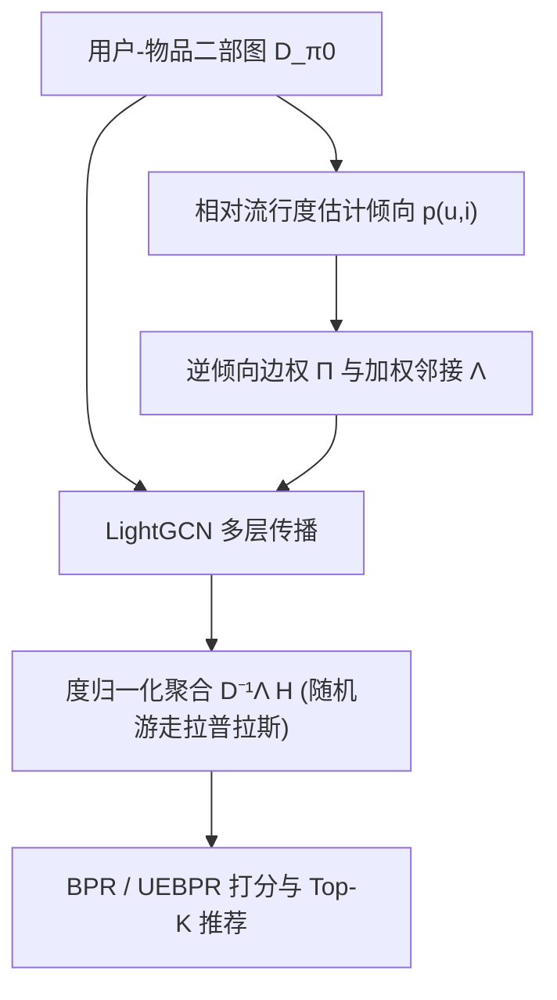
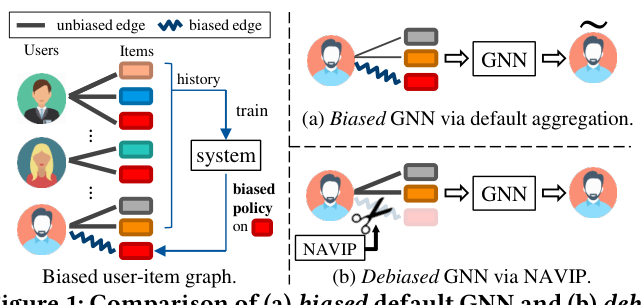

# Debiasing Neighbor Aggregation for Graph Neural Network in Recommender Systems (面向推荐系统图神经网络的邻居聚合去偏)

- **会议/期刊**: CIKM 2022 (31st ACM International Conference on Information and Knowledge Management)
- **作者与机构**: Minseok Kim, Jinoh Oh, Jaeyoung Do, Sungjin Lee (Amazon Alexa AI)
- **推荐链路定位**: 召回 (图召回表征学习)
- **研究方向**: 去偏公平、可信隐私与工业架构 / 图神经网络推荐
- **论文原文**: [https://arxiv.org/abs/2208.08847v1](https://arxiv.org/abs/2208.08847v1)
- **开源代码**: [LightGCN-PyTorch (backbone)](https://github.com/gusye1234/LightGCN-PyTorch)（Navip 本体未单独开源）

## TL;DR (1分钟核心速览)

现有 IPS 去偏只在**损失函数端**（模型输出后）校正曝光偏差，忽略了 GNN 在**邻居聚合阶段**就已把有偏边写进表征。本文提出 Navip：直接把逆倾向分数作为边权嵌入聚合算子，并用度归一的随机游走拉普拉斯替代 LightGCN 的对称归一化。在 Alexa/Yahoo/Movielens 三数据集、1:99 采样排序协议下，预训练模型仅替换聚合方式即可在 Alexa 上取得 NDCG@5 相对 Mean 聚合 **+14.2%**、相对 Propensity 聚合 **+126%** 的提升，且零额外参数、无需重训。

## Background & Motivation (背景与核心矛盾)

- **主流范式**: 以 LightGCN 为代表的图协同过滤用 $h_u^{l}=\sum_{i\in N(u)}h_i^{l-1}/\sqrt{|N(u)||N(i)|}$ 的对称拉普拉斯归一化做多层邻居聚合，靠高阶连通性补足纯 embedding 的不足。
- **前人局限 1**: 日志图 $\mathcal{D}_{\pi_0}$由系统策略$\pi_0$ 产生（只曝光部分物品），聚合时所有边被**等权**对待，热门/被强曝光邻居直接主导用户表征；且偏差随层数传播到没有偏边的用户。
- **前人局限 2**: IPS/SNIPS/UEBPR 等只在 $R(\pi)$目标函数上乘$1/p(Y_{u,i}=1|\pi_0)$，属于"事后校正"——被污染的$h_u,h_i$ 已经生成，误差无法回收。
- **核心洞察 (Key Insight)**: 低倾向边（冷门物品交互）很难是策略推出来的，因而**更能反映真实兴趣**；高倾向边更像是策略响应的产物。因此去偏应当发生在聚合算子里，而非损失里。
- **本文切入点**: 把 IPS 权重当作图上的边权，聚合即"带权随机游走"，一步到位完成"聚合前校正"。

## Method (核心方法设计)

### 1. 整体框架 (Overall Architecture)

输入为去重后的用户-物品二部图；先由物品相对流行度估计每条边的倾向分数 $p(Y_{u,i}=1|\pi_0)$，取其倒数作为边权$\Pi_{u,i}$，构造加权邻接矩阵$\boldsymbol{\Lambda}$；在每层 GNN 中把 LightGCN 的对称归一化替换为加权随机游走的度归一化$\boldsymbol{D}^{-1}\boldsymbol{\Lambda}$，得到去偏的用户/物品表征；最终仍以原来的 BPR / UEBPR 目标训练与打分。由于 Navip 不引入任何可学参数、只改聚合算子，它既可随训练生效，也可**对已预训练模型直接替换聚合方式做推理期去偏**。

<figure class="paper-figure" markdown="span">
  <figcaption>图1：给定有偏用户-物品图时，(a) 有偏默认 GNN 与 (b) 经 Navip 去偏的 GNN 的比较。</figcaption>
</figure>

### 2. 关键设计拆解 (Key Designs)

1. **逆倾向加权邻居聚合算子 (Navip)**：痛点是有偏边被等权聚合 $\to$ 将式 (3) 的均值聚合改为
$$a_u^{l}(\pi)\approx\frac{1}{Z_{\pi_0}(u)}\sum_{i\in N_{\pi_0}(u)}\frac{h_i^{l-1}(\pi)}{p(Y_{u,i}=1|\pi_0)}$$
其中 $Z_{\pi_0}(u)=\sum_{i\in N_{\pi_0}(u)}1/p(Y_{u,i}=1|\pi_0)$。直觉上这等价于在$\mathcal{D}_{\pi_0}$上对无偏策略$\pi$ 的聚合量做重要性采样估计：低倾向邻居被放大、高倾向邻居被压低，无需任何新参数。

2. **度归一化随机游走拉普拉斯 (Numerical Stability)**：直接乘 $1/p$会让邻居权重幅值失控（高倾向物品的$1/p$极小、冷门物品极大，$\sum$不守恒）。Navip 以$\boldsymbol{D}^{-1}\boldsymbol{\Lambda}$（$\boldsymbol{\Lambda}=\begin{bmatrix}0&\boldsymbol{\Pi}\\ \boldsymbol{\Pi}^{\top}&0\end{bmatrix}$，$D_{kk}=\sum_i\Lambda_{ki}$）替代对称归一化，其谱半径保持为 1、训练不震荡；同时"行随机"性质保证多层堆叠后低倾向邻居仍能在$h_u^l$ 中占主导，阻抗偏差沿层传播。

3. **训练目标、负采样与推理开销**：总损失沿用骨干模型（BPR 或 UEBPR），**不做任何目标函数改写**；倾向用相对流行度代理估计 $p(Y_{u,i}=1|\pi_0)=\sqrt{\sum_{u}Y_{u,i}/\max_{l}\sum_{u}Y_{u,l}}$（一次全局统计、$O(|\mathcal{D}|)$）。推理开销与 LightGCN 完全一致（无额外参数、无额外算子），并支持对预训练模型"零训练"热替换聚合函数。

## Experimental Setup & Evaluation Protocol (实验设置与评估协议)

- **数据集与预处理**（按惯例过滤交互数 < 10 的用户与物品）：

| 数据集 | #Users | #Items | #Interactions | 稀疏度/密度 | 特征/场景说明 |
| :--- | :---: | :---: | :---: | :---: | :--- |
| Alexa | 40k | 2.5k | 0.7m | ≈7.0e-3 | 2021 年 8 月单周语音助手真实日志，剔除天气查询等冗余交互 |
| Yahoo | 15k | 1.0k | 0.3m | ≈2.0e-2 | 音乐五星评分二值化，含 5,400 用户随机评 10 首歌的**真实无偏测试集** |
| Movielens | 943 | 1.6k | 0.1m | ≈6.6e-2 | 电影评分二值化，小规模稠密 |

- **数据划分与防穿越 (Splitting Strategy)**: 未采用 Leave-One-Out；Alexa 与 Movielens 因原始数据本身有偏，按 [3,17] 的做法**按物品相对流行度的倒数采样 5% 构造伪无偏测试/验证集**（剩余数据训练）；Yahoo 直接用官方无偏测试集，验证集按同法构造。
- **排名评测协议 (Ranking Protocol)**: `Sampled Ranking`——每个用户 1 个正样本 vs **随机采样 99 个未交互负样本**（1:99），在此 100 候选内排序；指标 HR / NDCG @ $k\in\{5,10,20\}$，未做全库 Full-Ranking。
- **对比基线与超参设置**: 骨干统一为 LightGCN（$d=64$），Adam，lr=0.003，batch=256，100 epochs，报告 10 次重复均值；对比对象为三种聚合（`Mean` / `Propensity` 反向加权 / `Navip`）以及 IPS 强基线 **UEBPR** 的组合；**未报告显著性检验**（如$p<0.05$）。

## Key Experimental Results (实验关键数据)

### 1. 主实验对比 (Main Results)

预训练 LightGCN 仅替换推理期聚合（Table 2）与训练+推理同时替换（Table 3），以及叠加 UEBPR（Table 5）：

| 数据集 | 聚合/训练方案 | HR@5 | HR@20 | NDCG@5 | NDCG@20 |
| :--- | :--- | :---: | :---: | :---: | :---: |
| Alexa | Mean (基线) | 0.266 | 0.498 | 0.190 | 0.256 |
| Alexa | Propensity (反向加权) | 0.153 | 0.410 | 0.096 | 0.167 |
| Alexa | **Navip (仅推理)** | **0.287** | **0.509** | **0.217** | **0.279** |
| Alexa | Navip + UEBPR | **0.301** | **0.538** | **0.220** | **0.287** |
| Yahoo | Mean | 0.145 | 0.397 | 0.093 | 0.163 |
| Yahoo | Propensity | 0.134 | 0.376 | 0.086 | 0.153 |
| Yahoo | **Navip (仅推理)** | **0.148** | **0.408** | **0.095** | **0.167** |
| Yahoo | Navip + UEBPR | **0.153** | **0.411** | **0.098** | **0.170** |
| Movielens | Mean | 0.350 | 0.681 | 0.233 | 0.327 |
| Movielens | Propensity | 0.343 | 0.668 | 0.230 | 0.322 |
| Movielens | **Navip (训练+推理)** | **0.352** | **0.687** | **0.234** | **0.330** |

Improv.%：Alexa 上 Navip(仅推理) 相对 Mean **NDCG@5 +14.2%**、相对 Propensity **+126%**；Yahoo NDCG@5 +2.2%；Movielens HR@20 +0.9%。**注意**：若训练与推理都换成 Navip（Table 3），Alexa 提升收缩至 NDCG@5 +1.1%（0.190→0.192），说明标题中的 14.2% 主要来自"预训练模型 + 推理期重聚合"。

### 2. 消融实验 (Ablation Study)

| 配置 | 含义 | Alexa NDCG@5 | Yahoo NDCG@5 | Movielens HR@20 |
| :--- | :--- | :---: | :---: | :---: |
| w/o 任意加权 (Mean) | 等权聚合 | 0.190 | 0.093 | 0.681 |
| 反向加权 (Propensity) | 高倾向边放大 | 0.096 (-49.5%) | 0.086 (-7.5%) | 0.668 (-1.9%) |
| Navip 仅推理 | 免训练替换聚合 | **0.217** (+14.2%) | **0.095** (+2.2%) | 0.687 (+0.9%) |
| Navip 训练+推理 | 端到端 | 0.192 (+1.1%) | 0.095 (+2.2%) | 0.687 (+0.9%) |
| Navip + UEBPR | 聚合层+损失层双去偏 | **0.220** | **0.098** | 0.693 |

### 3. 关键实验发现 (Key Findings)

1. **加权方向决定性**：把倾向本身当权重（Propensity）会让 Alexa NDCG@5 从 0.190 崩到 0.096（-49.5%），反向证明"高倾向边 ≠ 真实兴趣"，Navip 的 $1/p$ 方向是收益的唯一来源而非归一化技巧。
2. **长尾扶持成立但有头部代价**：Yahoo 尾部 10% 物品 HR@5 由 0.033→0.038、HR@20 由 0.141→0.159；Movielens 尾部 HR@20 由 0.236→0.250；相应头部 Yahoo HR@5 由 0.497 略降至 0.483——即 Navip 用可忽略的头部损失换取尾部显著提升。
3. **与 IPS 呈互补而非替代**：叠加 UEBPR 后 Alexa/Yahoo 双双刷新最好成绩（HR@20 0.538 / 0.411），但 Movielens 上 Navip-only 最好（HR@20 0.699→0.693 反而下降），作者归因于小数据下 IPS 高方差破坏训练目标，提示双去偏需数据规模支撑。

## Highlights & Limitations (亮点、对比与审稿批判)

- **与代表作对比 (vs. Prior Work)**: 相比 LightGCN 的对称归一化，Navip 把归一化从"度数"换成"倾向加权度数"，本质是把随机游走拉普拉斯搬到加权图上；相比 UEBPR 等在**损失端**重加权，Navip 在**算子端**重加权，二者正交可叠加；相比 SNIPS 等方差控制手段，Navip 通过 $Z_{\pi_0}(u)$度归一化天然抑制了$1/p$ 的幅值爆炸。
- **可迁移亮点**: (1) 任何基于邻居聚合的模型（NGCF、PinSage、GAT 变体、异构图聚合）都可把归一化分母替换为 $\sum 1/p$ 实现零参数去偏；(2) "预训练模型 + 推理期替换聚合算子"是一种极低成本的线上 A/B 验证范式。
- **审稿级局限批判**: (1) 倾向分数用**物品相对流行度平方根**这一启发式代理估计，非真实曝光日志或学习式倾向，若曝光策略与流行度弱相关则权重失真；(2) 评测仅 1:99 采样排序、三数据集且 Movielens 仅 943 用户，未做全库 Full-Ranking、未报告显著性检验与置信区间，标题宣称的 14.2% 在端到端训练下退化为约 1%，工程收益需谨慎解读；(3) 未分析多层堆叠时 $1/p$权重在度数极低节点上的方差与冷启动（$|N(u)|$ 极小）表现。

## Rating (四维评分)

- **方法创新性 (Novelty)**: ⭐⭐⭐⭐ （把 IPS 从损失端前移到聚合算子端，并以加权随机游走拉普拉斯给出谱层面的稳定性解释，思路简洁但确有新意）
- **评估协议与实验扎实度 (Protocol & Experiments)**: ⭐⭐⭐ （构造伪无偏测试集与头尾分桶是加分项，但仅 1:99 采样排序、缺显著性检验、端到端收益仅约 1%，证据强度中等）
- **写作与数学规范度 (Clarity & Rigor)**: ⭐⭐⭐⭐ （从重要性采样到矩阵形式的推导链条清晰，符号一致；但式 (8) 中 $Z_{\pi_0}$定义与正文$Z_{\pi}$ 记号混用，细节略糙）
- **工业落地与复现价值 (Industrial & Practical Value)**: ⭐⭐⭐⭐⭐ （零新增参数、零额外推理开销、可对预训练模型直接热替换，且已在 Amazon Alexa 真实日志上验证，落地成本极低）

