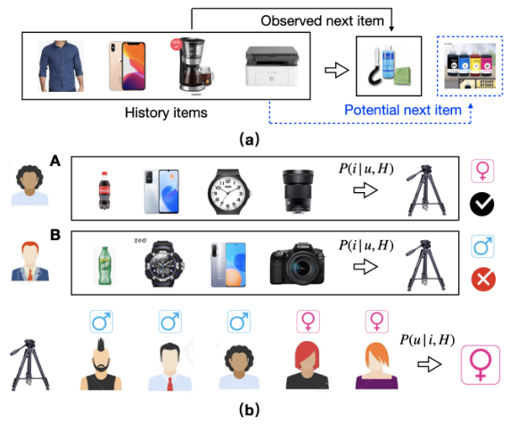
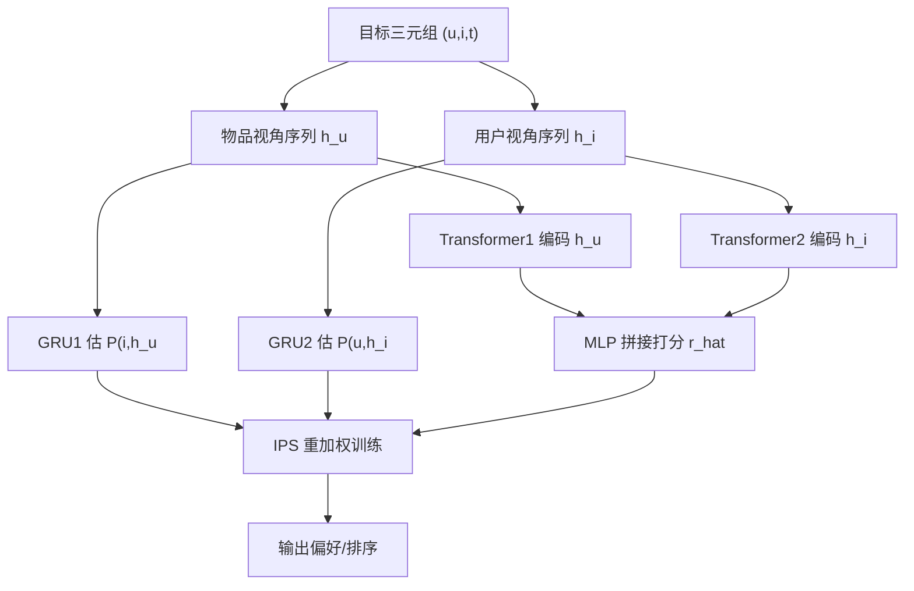
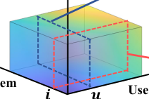

# Dually Enhanced Propensity Score Estimation in Sequential Recommendation (序列推荐中的双增强倾向得分估计)

- **会议/期刊**: CIKM 2022
- **作者与机构**: Chen Xu, Jun Xu, Xu Chen, Zhenghua Dong, Ji-Rong Wen；中国人民大学高瓴人工智能学院、华为诺亚方舟实验室
- **推荐链路定位**: 精排（序列打分）
- **研究方向**: 去偏公平、可信隐私与工业架构 / 序列推荐
- **论文原文**: [论文原文链接](https://arxiv.org/abs/2303.08722v1)
- **开源代码**: [开源代码仓库链接](https://github.com/XuChen0427/Dually-Enhanced-Propensity-Score-Estimation-in-Sequential-Recommendation)

## TL;DR (1分钟核心速览)

序列推荐基于隐式反馈训练，易受曝光/选择偏差影响；现有 IPS 去偏几乎只从物品视角估计 $P(i|u,H)$。本文提出 DEPS：用同一交互数据立方体的物品序列与用户序列，分别建模$P(i,h_u^{<t})$与$P(u,h_i^{<t})$，以双 GRU 估计互补倾向分、双 Transformer 打分，并证明双视角损失无偏且给出方差界。在 4 个数据集的全库排序协议下，NDCG@10/HR@10 最高相对最佳基线提升 30.4%/16.7%，工业 Huawei 数据提升 1.0%/1.8%。

## Background & Motivation (背景与核心矛盾)

- **主流范式**: 序列推荐用 GRU/Transformer 建模用户历史物品序列，并以 IPS 对观测交互重加权，以逼近理想无偏损失。
- **前人局限**: 现有 IPS 只分解 $P(u,i|H)=P(i|u,H)P(u|H)$，聚焦物品视角；非序列 IPS 多用频次先验，难以捕捉时序用户群漂移。
- **核心洞察 (Key Insight)**: 同一 $(u,i,t)$在“用户-物品-时间”数据立方体中有两个视图：用户历史物品序列$h_u^{<t}$与物品历史用户序列$h_i^{<t}$；后者可提供“近期哪类用户更可能接触该物品”的互补信号（如节日促销导致女性用户集中交互）。
- **本文切入点**: 将倾向估计从单一物品视角扩展为物品/用户双视角，并用时间感知因果图与双序列网络实现。

<figure class="paper-figure" markdown="span">
  <figcaption>图 1：(a) 无偏序列推荐的动机示例。(b) 用户预测问题对现有 IPS 方法互补作用的简单示例。</figcaption>
</figure>
图 1：序列推荐偏差与双视角互补动机示例。

## Method (核心方法设计)

### 1. 整体框架 (Overall Architecture)

给定目标三元组 $(u,i,t)$，DEPS 先抽取两条序列：用户$u$的历史物品序列$h_u^{<t}$、物品$i$的历史用户序列$h_i^{<t}$。双 GRU 分别估计物品视角与用户视角的倾向分；双 Transformer 分别编码两条序列并与目标物品/用户嵌入拼接，经 MLP 输出偏好分。训练分两阶段：先用自回归 AR 与 MLM 做无监督初始化，再用双视角 IPS 重加权损失交替优化。推理时仅需双 Transformer 打分，不计算倾向分。

<figure class="paper-figure" markdown="span">
  <figcaption>图 2：序列推荐中的倾向得分估计。(a) 将历史用户-物品交互表示为数据立方体，其中物品和用户可按任意顺序置于轴上；(b) 分别从物品和用户视角构造与目标元组 (u,i,t) 对应的两条交互序列；(c) 使用两个 GRU 估计倾向得分。</figcaption>
</figure>
图 2：双视角序列与双 GRU 倾向估计。

### 2. 关键设计拆解 (Key Designs)

1. **时间感知双视角 IPS（核心去偏）**：因果图中点击是碰撞点，$c_t=r_t\cdot o_{uit}$，观测偏差来自曝光$o_{uit}$。作者将无偏损失写成双视角平均：
$\mathcal{L}_{unbiased}=\alpha\mathcal{L}_u+(1-\alpha)\mathcal{L}_i$，
其中 $\mathcal{L}_u=\sum_{(u,i,c_t)\in D}\frac{\delta(c_t,\hat r_t)}{P(i,h_u^{<t})}$，$\mathcal{L}_i=\sum_{(u,i,c_t)\in D}\frac{\delta(c_t,\hat r_t)}{P(u,h_i^{<t})}$。定理 1 证明二者期望均等于理想损失，故平均仍无偏；直觉是物品视角校正“物品被曝光”，用户视角校正“某类用户被曝光”。

2. **双 GRU 倾向估计与 Clip 方差控制**：倾向分用全库 softmax 参数化，例如
$\tilde P(i,h_u^{<t})=\max\{\frac{\exp(e_i^\top y_{i_{l(u,t)}})}{\sum_{i'\in I}\exp(e_{i'}^\top y_{i_{l(u,t)}})},M\}$，
用户视角对称。Clip 下界 $M$将单样本方差约束为$(\frac1M-1)\delta^2(r_t,\hat r_t)$，且双视角平均不增加额外方差；$M$过大偏差大、过小方差大，实验中约在$[0.01,0.05]$ 较优。

3. **双 Transformer 打分与两阶段训练**：打分器为
$\hat r=\sigma(\mathrm{MLP}([e(h_u^{<t})\|e_i]\|[e(h_i^{<t})\|e_u]))$，
其中 $e(h_u^{<t})$为 Transformer1 对用户物品序列的均值池化，$e(h_i^{<t})$为 Transformer2 对物品用户序列的均值池化。Stage-1 优化$\mathcal{L}_{AR_u}+\mathcal{L}_{AR_i}+\lambda_p(\mathcal{L}_{MLM_u}+\mathcal{L}_{MLM_i})$初始化；Stage-2 以$\mathcal{L}_{unbiased}$ 为主，并交替加入 AR 损失稳定训练。未显式额外负采样，倾向 softmax 在全用户/物品上归一化；推理只跑双 Transformer，但训练需双 GRU+双 Transformer，开销约为普通序列模型两倍。

## Experimental Setup & Evaluation Protocol (实验设置与评估协议)

- **数据集与预处理**: MIND、Amazon-Beauty、Amazon-Digital-Music 均按 `5-core` 过滤；Huawei 为华为音乐 1 个月采样日志。

| 数据集 | #Users | #Items | #Interactions | 稀疏度/密度 | 特征/场景说明 |
| :--- | :---: | :---: | :---: | :---: | :--- |
| MIND | 13,863 | 2,464 | 59,228 | 99.82% | 新闻推荐 |
| Amazon-Beauty | 24,411 | 32,371 | 94,641 | 99.98% | 美妆评论交互 |
| Amazon-Digital-Music | 4,424 | 5,365 | 32,314 | 99.86% | 数字音乐评论 |
| Huawei | 1,997 | 17,490 | 245,564 | 99.29% | 工业音乐服务日志 |

- **数据划分与防穿越**: 按时间取前 50% 交互训练；后 50% 以逆概率 $m_i/\max_{j\in I}m_j$ 重采样，20% 验证、30% 测试，缓解热门物品支配无偏测试。
- **排名评测协议**: 无偏 `Full-Ranking`（全库未交互物品排序），报告 NDCG@5/10/20 与 HR@5/10/20；显著性用 t-test，$p<0.05$ 标 `*`。
- **对比基线与超参**: 序列基线 STAMP/DIN/BERT4Rec/FPMC/GRU4Rec+/BST/LightSANs；去偏基线 UIR/CPR/UBPR/DICE/USR。嵌入 $d\in\{64,128,256\}$，学习率$10^{-3}\sim10^{-4}$，$M\in[0.01,0.2]$，$\alpha\in[0.4,0.6]$，$\lambda_p=0.5$，Transformer 2–4 层，dropout 0.1–0.5。

## Key Experimental Results (实验关键数据)

### 1. 主实验对比 (Main Results)

| 数据集 | 指标 | GRU4Rec+ | BERT4Rec | BST | LightSANs | UIR | CPR | DICE | USR | DEPS | Improv. |
| :--- | :--- | ---: | ---: | ---: | ---: | ---: | ---: | ---: | ---: | ---: | ---: |
| MIND | NDCG@10 | .1306 | .1277 | .1233 | .1650 | .0823 | .0847 | .0861 | .0955 | **.1728** | 4.7% |
| MIND | HR@10 | .2918 | .2922 | .2825 | .3692 | .1909 | .1898 | .2030 | .2194 | **.3961** | 7.3% |
| Beauty | NDCG@10 | .1438 | .1333 | .1548 | .1661 | .1603 | .1465 | .1645 | .1429 | **.1830** | 10.2% |
| Beauty | HR@10 | .3555 | .3166 | .3679 | .3696 | .3836 | .3176 | .3834 | .3435 | **.4175** | 8.8% |
| Music | NDCG@10 | .0961 | .1771 | .1976 | .2192 | .0912 | .2121 | .1432 | .1222 | **.2766** | 30.4% |
| Music | HR@10 | .3025 | .4249 | .4902 | .4737 | .2437 | .5014 | .3361 | .3305 | **.5852** | 16.7% |
| Huawei | NDCG@10 | .1163 | .1352 | .1125 | .1323 | .0634 | .1489 | .0767 | .1042 | **.1503** | 1.0% |
| Huawei | HR@10 | .5833 | .6242 | .5625 | .6315 | .3569 | .6730 | .4155 | .5552 | **.6852** | 1.8% |

### 2. 消融实验 (Ablation Study)

| 变体 | NDCG@10 | NDCG@20 | HR@10 | HR@20 |
| :--- | ---: | ---: | ---: | ---: |
| w/o $h_u^{<t}$ | .2720 | .3192 | .5467 | .7115 |
| w/o $h_i^{<t}$ | .2541 | .3035 | .5383 | .7253 |
| w/o stage-1 | .2423 | .2869 | .5082 | .6869 |
| DEPS | **.2766** | **.3273** | **.5852** | **.7747** |

### 3. 关键实验发现 (Key Findings)

- 主实验中 Music 的 NDCG@10 提升 30.4%、Beauty 提升 10.2%，显著高于 MIND 的 4.7%，说明双视角对“用户群随时间漂移”明显的品类收益更大。
- 消融中去掉用户序列 $h_i^{<t}$ 使 NDCG@10 从 .2766 降至 .2541（-8.1%），去掉 stage-1 降至 .2423（-12.4%），证明双序列与无监督初始化均是关键。
- 与频次型非序列 IPS 相比，DEPS 的 NDCG@10 .2766 高于 Item-User-Pro .2665；替换底层模型 GRU4Rec+/FPMC 仍提升（NDCG@10 .0961→.1219、.1799→.1858），说明时序倾向估计与框架均可迁移。

## Highlights & Limitations (亮点、对比与审稿批判)

- **与代表作对比 (vs. Prior Work)**: USR 仅从物品视角估计序列 IPS；UIR/UBPR 依赖启发式或非序列倾向；DICE 侧重静态用户社区去偏。DEPS 的本质增量是用同一数据立方体的双序列做时序互补 IPS，并给出无偏性与方差界。
- **可迁移亮点**: 双视角序列编码可迁移到跨域/多场景推荐；Clip 倾向分可作为通用方差控制模块嵌入其他 IPS 训练。
- **审稿级局限批判**: 双 GRU+双 Transformer 使训练成本近两倍，且倾向 softmax 在全用户/物品上归一化，大规模系统开销敏感；工业 Huawei 上 NDCG@5 甚至 -1.0%，提升仅 1–2%，收益依赖数据分布与 $M$/$\alpha$ 调参，且缺少线上 A/B 与位置、展示等混杂因素建模。

## Rating (四维评分)

- **方法创新性 (Novelty)**: ⭐⭐⭐⭐ （双视角时序 IPS 与无偏/方差理论较新颖，但仍是 IPS 框架内的结构性扩展）
- **评估协议与实验扎实度 (Protocol & Experiments)**: ⭐⭐⭐⭐ （四数据集、重采样无偏测试、消融与显著性完整，但工业提升较小且无线上验证）
- **写作与数学规范度 (Clarity & Rigor)**: ⭐⭐⭐⭐ （因果图、定理与算法清晰，符号略密，倾向估计与打分模块边界明确）
- **工业落地与复现价值 (Industrial & Practical Value)**: ⭐⭐⭐ （代码开源、model-agnostic 有价值，但双序列训练开销与超参敏感度限制大规模部署）

