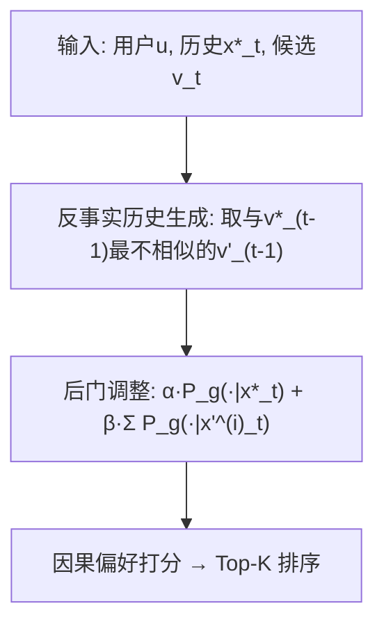
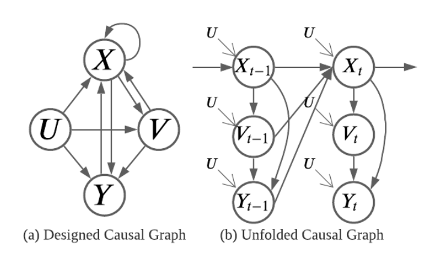

# Dynamic Causal Collaborative Filtering (动态因果协同过滤)

- **会议/期刊**: CIKM 2022
- **作者与机构**: Shuyuan Xu, Juntao Tan, Zuohui Fu, Jianchao Ji, Yongfeng Zhang (Rutgers University); Shelby Heinecke (Salesforce Research)
- **推荐链路定位**: 精排（可插拔到任意打分模型的后处理式因果重加权）
- **研究方向**: 去偏公平、可信推荐 / 序列推荐
- **论文原文**: [https://arxiv.org/abs/2208.11094v1](https://arxiv.org/abs/2208.11094v1)
- **开源代码**: 暂未开源

## TL;DR (1分钟核心速览)

针对因果推荐普遍采用有向无环图（DAG）建模、无法刻画"推荐→反馈→再推荐"闭环这一痛点，本文设计含环因果图并用马尔可夫过程证明被动用户必然落入内容同质化的**吸收态**，进而提出 ∂CCF：按后门调整估计 $P(y_t|u,do(v_t))$，并用与当前推荐物品最不相似的反事实历史做期望加权。在 Movielens-1m / Amazon-Electronics 的三阶段时序切分、100 负采样 + 无偏校正排序协议下，内容多样性衰减$\Delta_{12}$ 平均降低 7.2%（最大 25.4%），精度基本持平。

## Background & Motivation (背景与核心矛盾)

- **主流范式**: 因果推荐（IPS/CausE/DICE/MACR 等）以因果图为核心工具，几乎全部假设图为 DAG，通过后门调整、反事实约束或解耦表征来消除流行度偏置、提升鲁棒性。
- **前人局限**: (1) DAG 只是数据生成的**静态快照**，无法表达反馈环中历史 $X$被推荐结果$V$与反馈$Y$ 反复改写的过程，因而无法诊断"越推越窄"的动力学；(2) 以精度为唯一目标的因果去偏模型（如 DICE）并不等价于抑制回声室，实验中其内容多样性衰减反而高于基模型。
- **核心洞察 (Key Insight)**: 若把交互历史按"相似性分组"函数 $A:\mathcal{I}\to\mathcal{C}$压缩为长度$m$的组序列，用户-系统交互就构成状态数为$d^m$的马尔可夫链；只被动接受推荐的用户（Type 1）的转移矩阵含$d$个吸收态，$\lim_{k\to\infty}P^k$ 使全部历史坍缩到同一组——这就是回声室的数学形态。
- **本文切入点**: 不做随机推荐牺牲精度，而是在反事实世界里让用户"主动探索"与当前推荐最不相似的物品，用因果期望把这种探索注入打分。

## Method (核心方法设计)

### 1. 整体框架 (Overall Architecture)

模型对每个训练/打分三元组 $(u,v_t,y_t)$先做**时序展开**：把含环图中$t-1$时刻的观测交互$(v^*_{t-1},y^*_{t-1})$替换为反事实交互，生成$n$条反事实历史$x_t^{\prime(i)}$；随后在$\{U,X_t\}$满足后门准则的展开图上做后门调整，用事实概率$\alpha$与反事实概率$\beta$的皮尔逊式加权把基模型打分$P_g(y_t|u,v_t,\cdot)$混合成去环后的因果分$\hat{y}_t$。整个模块是 model-agnostic 的：GRU4Rec/STAMP/NCR 等序列打分器原封不动，只改打分的期望化方式与训练样本构造。

### 2. 关键设计拆解 (Key Designs)

1. **含环因果图与后门调整估计（把 DAG 变成时序可展开的有环图）**：图中除 $\{U,X\}\to V$、$\{U,X,V\}\to Y$外，关键边是$\{U,X,V,Y\}\to X$——交互结果写回历史，形成$X\to X$、$X\to V\to X$、$X\to Y\to X$、$X\to V\to Y\to X$四个环。由于$U$阻断$Y_t\leftarrow U\to V_t$、$X_t$阻断$Y_t\leftarrow X_t\to V_t$，可识别出
 $P(y_t|u,do(v_t))=\sum_{x_t}P(y_t|u,v_t,x_t)P(x_t|u)$。
 与传统 CF 的差别全在 $P(x_t|u)$：观测数据里$P(x^*_t|u)=1$、$P(x'_t|u)=0$，但反事实地看$x'_t$ 未必不可能发生，故必须外推。

2. **最小相似度反事实历史（在隐空间做"强制探索"）**：按反事实推理的最小改动原则，只替换 $t-1$时刻一条交互：$x'_t\leftarrow x^*_{t-1},v'_{t-1},y'_{t-1}$，并在所有候选中取
 $v'_{t-1}=\arg\min_{v}\ \mathrm{Similarity}(v,v^*_{t-1})$，
 即 embedding 点积最小者。物理直觉：环的放大效应来自"推荐与历史同组物品"，用最远邻替换恰好切断 $V\to X$ 的同质化通道，且替换只作用于隐藏训练样本、不改变线上真实曝光。

3. **训练目标、负采样与推理开销**：$P(\tilde{x}_t|u)$取分段均匀分布（事实$\alpha$、每条反事实$\beta$，$\alpha+n\beta=1$），最终打分为
 $\hat{y}_t=\alpha P_g(y_t|u,v_t,x^*_t)+\beta\sum_{i=1}^{n}P_g(y_t|u,v_t,x_t^{\prime(i)})$。
 损失沿用基模型原损失（只把 $P_g$换成$\hat{y}_t$），无额外负采样；理论训练/推理代价随$n$线性增长（默认$n=9$，即每条样本过模型 10 次），这是本文最实在的工程包袱。

<figure class="paper-figure" markdown="span">
  <figcaption>图1：在因果图中，𝑈表示用户，𝑉表示曝光物品，𝑋表示用户交互历史，𝑌表示偏好得分。(a) 为我们设计的因果图，更多细节见第3.1节。(b) 为时间展开因果图，其指导所提框架的设计。我们以𝑈作为外生变量重新组织因果图，使其更清晰。更多细节见第4节。</figcaption>
</figure>

## Experimental Setup & Evaluation Protocol (实验设置与评估协议)

- **数据集与预处理**: 评分 ≥4 记为 like、≤3 记为 dislike；仅用 ID 特征（无多模态）。

| 数据集 | #Users | #Items | #Interactions | 稀疏度 | 特征/场景说明 |
| :--- | :---: | :---: | :---: | :---: | :--- |
| Movielens-1m | 6,040 | 3,706 | 1,000,209 | 4.47% | 电影评分，含 2000 年时间戳 |
| Amazon Electronics | 33,602 | 16,448 | 788,143 | 0.143% | 长时序电商评论（1996–2018） |

- **数据划分与防穿越 (Splitting Strategy)**: **全局时间戳切分**为 Phase1/2/3（ML-1m 切点 2000-07-31 与 2000-11-20；Electronics 切点 2010-12-31 与 2015-06-30），每个 Phase 内部再做 `Leave-One-Out` 训练/验证/测试。基模型先在 Phase1 训练以固定初始多样性，再分别在 Phase2/3 训练并比较多样性变化 $\Delta_{12},\Delta_{13}$（越小越好）。
- **排名评测协议 (Ranking Protocol)**: 每个测试用户随机采 100 个负样本（含 dislike 与未交互）做 **Sampled Ranking**，同时报告无偏校正排序得到的 **u_nDCG@10 / u_Hit@10**；召回/排序指标为 nDCG@10、Hit@10。
- **对比基线与超参设置**: 6 个基线（MMR 重排 + IPS / CausE / CCF / DICE / MACR 五个因果模型），分别外挂到 GRU4Rec、STAMP、NCR 三种底座；$d=64$、两层 MLP、学习率 1e-3、L2 1e-6、历史长度 10、$n=9$、$\alpha=0.3$。未报告显著性检验。

## Key Experimental Results (实验关键数据)

### 1. 主实验对比 (Main Results)

GRU4Rec 底座、Phase2 无偏排序与回声室指标（$\Delta$ 越低越好）：

| 方法 | ML u_nDCG@10 | ML $\Delta_{12}$| ML$\Delta_{13}$| Elec u_nDCG@10 | Elec$\Delta_{12}$| Elec$\Delta_{13}$ |
| :--- | :---: | :---: | :---: | :---: | :---: | :---: |
| Original | 0.1939 | 0.996 | 1.174 | 0.0816 | 6.270 | 7.205 |
| MMR | 0.1925 | 0.971 | 1.179 | 0.0820 | 6.138 | 7.178 |
| IPS | 0.1919 | 0.956 | **1.079** | 0.0788 | 6.783 | 7.275 |
| CausE | 0.1954 | 1.244 | 1.352 | 0.0829 | 6.395 | **7.154** |
| CCF | 0.1972 | 1.262 | 1.342 | 0.0846 | 6.832 | 7.421 |
| DICE | 0.1986 | 1.244 | 1.349 | **0.0885** | 7.052 | 7.630 |
| MACR | **0.2009** | 1.167 | 1.255 | 0.0808 | 6.163 | 7.218 |
| **∂CCF** | 0.1817 | **0.743** | **0.979** | 0.0826 | **5.388** | 7.199 |
| Improv. ($\Delta_{12}$) | -6.3% | **-25.4%** | -16.6% | +1.2% | **-14.1%** | -0.1% |

### 2. 消融与长期满意度 (Ablation & Long-term Satisfaction)

原文无标准 `w/o` 消融（$n=0$或$\alpha=1$ 即退化回基模型），改用全观测矩阵数据集 KuaiRec 的**累计满意度 / 交互轮数**做长期效应的"消融式"验证：

| 底座模型 | Original CS / Len | CCF CS / Len | DICE CS / Len | MACR CS / Len | **∂CCF CS / Len** |
| :--- | :---: | :---: | :---: | :---: | :---: |
| GRU4Rec | 1.333 / 26 | 2.577 / 43 | 1.994 / 36 | 2.960 / 38 | **3.597 / 54** |
| STAMP | 2.987 / 46 | 3.152 / 38 | 2.859 / 44 | 3.036 / 52 | **3.219 / 58** |
| NCR | 2.519 / 49 | 2.534 / 49 | 2.830 / 52 | 3.107 / 37 | **2.998 / 57** |

### 3. 关键实验发现 (Key Findings)

1. **"去偏" ≠ "去回声室"**：DICE、MACR 这类以精度为目标的因果去偏把 ML-1m 的 $\Delta_{12}$反而抬到 1.244 / 1.167（基模型 0.996），而 ∂CCF 压到 0.743；12 个（数据集×阶段×底座）设置中 ∂CCF 拿下 9 个多样性最优，平均$\Delta$ 降 7.2%，最大 25.4%。
2. **精度代价极小且非单向**：GRU4Rec/ML-1m 的 u_nDCG 从 0.1939 略降至 0.1817，但 NCR/Electronics 上从 0.0722 升至 0.0784（**+8.6%**），全体平均约 +1%；说明适度反事实噪声正则化了表示。代价是采样 nDCG 最优仍被 DICE(0.5372) 与 MACR(0.2009) 占据。
3. **长期收益远大于单轮精度**：KuaiRec 上 GRU4Rec 的累计满意度 1.333→3.597（2.7×），交互轮数 26→54（2.1×）；印证理论——单轮高满意度恰恰是回声室的"诱饵"，会在长期把用户推出系统。参数上 $n$过大会稀释每条反事实的概率$\beta$引入噪声，$\alpha\to 1$则完全退化回基模型，默认$(n,\alpha)=(9,0.3)$ 是精度—多样性的拐点。

## Highlights & Limitations (亮点、对比与审稿批判)

- **与代表作对比 (vs. Prior Work)**: vs. **CCF**：同为反事实协同过滤，但 CCF 仍是 DAG + 静态反事实约束，无环、无动力学分析；本文把反事实挂到时间展开的环上，并用马尔可夫吸收态给出"何时出现回声室"的判据。vs. **DICE/MACR**：两者解耦用户兴趣与从众/流行度来提精度，不建模历史被推荐反写的环，实验证明其对内容同质化无效甚至有害。vs. **MMR**：MMR 靠列表级相似度惩罚做精度-多样性折中，精度掉约 1%；∂CCF 从因果层面切断环，精度基本不掉。
- **可迁移亮点**: (1) 用"最不相似邻居替换一条历史"生成反事实样本，可零成本迁移到任何序列/会话推荐的训练增广；(2) 将"多样性衰减 $\Delta$ 的时序差分"作为回声室的在线监控指标，比单点多样性更贴合反馈环。
- **审稿级局限批判**: (1) **推理不可行性**：每个候选需过 $n+1$次模型，$n=9$时线上打分成本近乎 ×10，只适合离线或候选集极小的精排，论文未给复杂度/延迟实测；(2) **反事实构造自举循环**：$v'$的"最不相似"由基模型自己学到的 embedding 决定，而这些表示本身已被回声室污染，可能把长尾噪声当成探索信号；$\alpha,n$ 敏感且无自适应方案。此外，回声室评估仅用 item embedding 平均欧氏距离的变化，KuaiRec 的满意度与退出机制均为人为设定，缺乏真实 A/B 证据。

## Rating (四维评分)

- **方法创新性 (Novelty)**: ⭐⭐⭐⭐ （首次把反馈环写成可识别、可展开的有环因果图，并用马尔可夫吸收态给出回声室的形式化条件，理论—算法闭环完整）
- **评估协议与实验扎实度 (Protocol & Experiments)**: ⭐⭐⭐ （三阶段时序切分 + 无偏校正排序设计合理，但仅两个公开数据集、100 负采样、无显著性检验、无标准消融表）
- **写作与数学规范度 (Clarity & Rigor)**: ⭐⭐⭐⭐ （因果图与后门准则推导干净，转移矩阵与吸收态证明清晰；部分符号在正文与表中切换略松）
- **工业落地与复现价值 (Industrial & Practical Value)**: ⭐⭐ （无开源代码，$n+1$倍前向开销与启发式反事实构造使其难以直接上线，但其"$\Delta$ 监控 + 训练期反事实增广"思路可作为离线去同质化组件复用）

