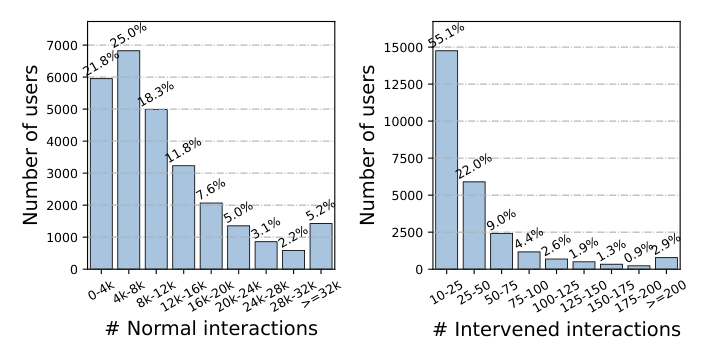
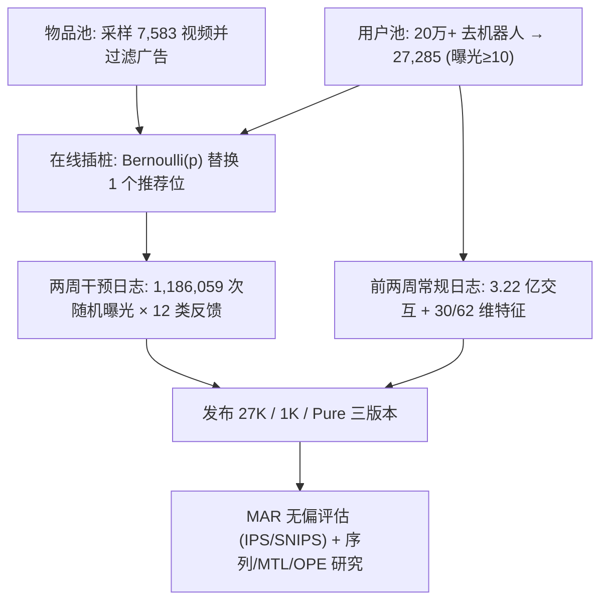

# KuaiRand: An Unbiased Sequential Recommendation Dataset with Randomly Exposed Videos (含随机曝光视频的无偏序列推荐数据集)

- **会议/期刊**: CIKM 2022 (Resource Paper, 6 页)
- **作者与机构**: Chongming Gao, Shijun Li, Yuan Zhang, Jiawei Chen, Biao Li, Wenqiang Lei, Peng Jiang, Xiangnan He（USTC / 快手 / 浙大 / 川大）
- **推荐链路定位**: 数据基准层（服务于召回/精排/重排的离线评估与 OPE）
- **研究方向**: 去偏、可信与工业架构 / 序列推荐
- **论文原文**: [arXiv:2208.08696v2](https://arxiv.org/abs/2208.08696v2)
- **开源代码**: 暂未开源（数据集主页 [kuairand.com](https://kuairand.com)）

## TL;DR (1分钟核心速览)

真实推荐日志是 MNAR（非随机缺失）的，曝光偏差使离线指标与线上 A/B 长期不一致。本文在快手 App 上用 Bernoulli 概率**无感替换**推荐位中的 1 个视频为全局均匀采样视频，持续两周，采集到 27,285 名真实用户、7,583 个候选视频、**1,186,059 次随机曝光交互**，每条形如 12 类反馈（点击/点赞/不感兴趣/播放时长等），并附带前两周 3.22 亿条常规交互与 30/62 维用户/物品特征。随机位曝光倾向 $\pi_0$ 已知，因此首次可在十万级候选池上做真正的 MAR 无偏全库排序与 IPS 离线 A/B。

## Background & Motivation (背景与核心矛盾)

- **主流范式**: 学术界几乎全部在曝光策略产生的 MNAR 日志上训练与评测，用 Precision/NDCG 或负采样排序衡量模型。
- **前人局限**: ①传统指标只统计"已曝光"样本，对海量未曝光用户-物品对无任何信息，模型越好反而可能越"错"；②OPE 方差爆炸，用户模拟器引入额外假设误差。
- **核心洞察 (Key Insight)**: 唯一根治手段是采集缺失随机（MAR）数据——对均匀采样物品征询真实反馈，此时缺失机制与潜在偏好独立，经验风险即无偏。
- **本文切入点**: 已有 MAR 数据集全不达标——Yahoo!R3/Coat 仅 5.4 万/4,640 条打分且**无时间戳、无特征**；OpenBandit 虽有 269 万点击但**仅 80 个物品、删除了用户 ID**；Yahoo!R6 同样无 ID。本文用"无感插桩"在工业级 APP 上补齐规模、ID、特征、时间戳四个缺口。

<figure class="paper-figure" markdown="span">
  <figcaption>图 3：用户按正常交互次数（即接收常规推荐）与干预交互次数（即曝光于随机视频）的分布。</figcaption>
</figure>

## Method (核心方法设计)

### 1. 整体框架 (Overall Architecture)

采集分三步闭环：先固定物品池 $\mathcal{I}_r$（采样 7,583 个视频并剔除广告等垃圾内容）与用户池（20 万+ 真实用户去机器人，最终保留随机曝光 ≥10 次的 27,285 人）；随后分两个时间窗——4.08–4.21 只记录常规推荐日志（3.22 亿交互）作为历史序列，4.22–5.08 在每次下发列表时以固定概率$p$触发干预，从$\mathcal{I}_r$ 均匀抽 1 个视频**替换**列表中的一个原有推荐位，用户无感知；最后对齐用户/物品 ID，记录 12 类反馈并发布 27K / 1K / Pure 三个版本。

### 2. 关键设计拆解 (Key Designs)

1. **无感随机替换（Stealth Intervention）**：直接给用户推随机列表会引发抗拒与"实验者效应"，且破坏上下文；本文只替换**一个**位置，保留列表其余部分与原场景。由于随机位不经过排序模型，其曝光倾向可解析写出 $\pi_0(a\mid x)=p/|\mathcal{I}_r|$，从而$\hat{V}_{\mathrm{IPS}}(\pi)=\frac{1}{n}\sum_{t}\frac{\pi(a_t\mid x_t)}{\pi_0(a_t\mid x_t)}r_t$ 中的分母已知且恒定，IPS/SNIPS 估计不再需要额外的倾向模型。这是本数据集区别于所有"事后加权"去偏工作的物理根基。
2. **Pure 版本：训练-测试物品空间对齐**：27K 版本文档中正常日志涉及 3,200 万+ 视频 ID，而随机池只有 7,583 个，直接混用会让评估候选里塞满训练中从未出现的冷门物品，稀释偏差信号。Pure 版本定义 $\mathcal{D}_{\text{Pure}}=\{(u,i,t)\in\mathcal{D}_{27K}: i\in\mathcal{I}_r\}$，用户仍是全量 27,285，物品压到 7,551，与随机池几乎完全重合，使"训练在 MNAR、测试在 MAR"成为干净的对照实验。
3. **训练目标、负采样与评估开销**：本文为资源论文，不定义模型损失；其价值在于提供可复用协议——训练侧沿用常规日志的 BPR/交叉熵与任意负采样，测试侧**免负采样**，对 7,583 个候选做 Full-Ranking，并以 12 路反馈（点击、点赞、收藏、关注、评论、不感兴趣、播放时长、完播等）构造多目标标签。单次全库打分为 7,583 路内积，GPU 上毫秒级，成本远低于 OPE 的蒙特卡洛采样。

## Experimental Setup & Evaluation Protocol (实验设置与评估协议)

- **数据集与预处理**: 核心统计如下（随机曝光量取自随机策略分支）：

| 数据集 | #Users | #Items(随机池) | #随机曝光交互 | 用户/物品特征 | 时间戳 | 反馈信号 |
| :--- | :---: | :---: | :---: | :---: | :---: | :--- |
| Yahoo!R3 (随机部分) | 5,400 | 1,000 | 54,000 | 7 / 0 | ✗ | 评分 1–5 |
| Coat (随机部分) | 290 | 300 | 4,640 | 4 / 4 | ✗ | 评分 1–5 |
| Yahoo!R6B | 无 ID | 652 | 27,777,695 | 136 / 0 | ✓ | 点击 |
| OpenBandit (随机策略) | 无 ID | 80 | 2,691,861 | 4 / 4 | ✓ | 点击 |
| **KuaiRand-27K** | **27,285** | **7,583** | **1,186,059** | **30 / 62** | **✓** | **12 类** |

- **数据划分与防穿越 (Splitting Strategy)**: 严格**全局时间戳切分**——前两周（4.08–4.21）常规日志作训练/历史，后两周（4.22–5.08）干预日志作测试；两窗口完全不重叠，天然杜绝未来交互泄漏，且同一用户在两个窗口均有记录，可做用户内（within-user）配对比较。
- **排名评测协议 (Ranking Protocol)**: 随机池为均匀采样，故支持无偏 **Full-Ranking（7,583 个候选全排序）**，禁止 Sampled 负采样——一旦采样，MAR 性质即被破坏，偏差重新引入。
- **对比基线与超参设置**: **原文未提供任何模型主实验、无基线、无 Embedding 维度与显著性检验**，这是资源论文的固有定位；作者仅列出可支撑的方向（去偏、OPE、交互式推荐、长序列行为建模、多任务学习）。

## Key Experimental Results (实验关键数据)

### 1. 主实验对比 (Main Results)

原文无模型精度表，其"主结果"即上表的资源能力对比：

| 对比维度 | 最强前人 | KuaiRand | 相对规模 |
| :--- | :--- | :--- | :---: |
| 随机曝光交互量 | Yahoo!R3: 54,000 | **1,186,059** | **×21.96** |
| 随机曝光交互量 | Coat: 4,640 | **1,186,059** | **×255.6** |
| 随机候选物品数 | OpenBandit: 80 | **7,583** | **×94.8** |
| 反馈信号数 | Yahoo!R6B: 1 | **12** | **×12.0** |

### 2. 版本对照（原文无消融，以三版本统计替代）

| 版本 | #Users | #Items | 总交互 | 随机占比 | 设计用途 |
| :--- | :---: | :---: | :---: | :---: | :--- |
| 27K | 27,285 | 32,038,725 | 322,278,385 | 0.37% | 大规模常规序列训练 |
| 1K | 1,000 | 4,369,953 | 11,713,045 | 0.37% | 低成本原型验证 |
| **Pure** | **27,285** | **7,551** | **1,436,609** | **82.6%** | **无偏训练+评估对齐** |
| Pure w/o 随机曝光（推算） | 27,285 | 7,551 | 250,550 | 0% | 纯 MNAR 对照组 |

### 3. 关键实验发现 (Key Findings)

1. **规模优势集中在"候选池"而非"交互量"**：OpenBandit 有 269 万随机点击（是本文的 2.27 倍），但仅 80 个物品且删除了用户 ID，无法构造序列与全库排序；本文以 7,583 候选（×94.8）换来真正可做 Full-Ranking 的评估场景，这是量变到质变的关键。
2. **用户级稀疏仍是 IPS 的致命瓶颈**：平均每用户仅 43.5 次随机曝光，图 3 显示 55.1% 用户落在 10–25 次区间，单用户 IPS 方差极大，必须用 SNIPS 或跨用户层级收缩，否则无偏估计的置信区间会大到失去判别力。
3. **Pure 版本是"对照实验"的必要条件**：其随机交互占 82.6%、正常交互仅 250,550（17.4%），使训练信号与测试候选同分布；若误用 27K 版本，3,200 万物品空间会让 7,583 个测试候选全部沦为长尾冷启动，评估结论会被物品冷启动效应污染。

## Highlights & Limitations (亮点、对比与审稿批判)

- **与代表作对比 (vs. Prior Work)**: 相比 Yahoo!R3/Coat 的"问卷式打分"，本文用线上插桩获得**真实行为 + 时间戳 + 序列**；相比 OpenBandit 的"bandit 日志"，本文保留用户 ID 与 12 类反馈，可直接做序列建模；相比 Gao et al. 的全观测数据集，本文避免了高密度带来的热门物品偏置。
- **可迁移亮点**: ①"单槽位替换 + 常数插入概率"是一种极低成本、可解析倾向的工业级 MAR 采集模板，任何有推荐位的产品都可复刻；②Pure 版本"裁剪物品空间使训练/测试同分布"的思路，可直接迁移到任何需要构造无偏对照集的场景。
- **审稿级局限批判**: ①插入概率 $p$出于商业保密未公开，外部研究者无法复现精确 propensity，IPS 只能算相对值，且 15 条策略的$p$ 是否一致未说明；②7,583 个视频本身是"先采样后固定"的物品池，仍存在物品层面的选择偏差（如偏向活跃/新发布视频），并非全库 MAR；③替换掉一个原推荐位会引入位置与列表上下文扰动，未量化；④仅两周窗口、无官方划分脚本与模型 baseline，"无偏"结论缺少可复现的验证闭环。

## Rating (四维评分)

- **方法创新性 (Novelty)**: ⭐⭐⭐⭐ （无算法创新，但"无感单槽插桩 + 已知常数倾向"的数据采集范式在大规模短视频场景属首次落地，方法学价值高于多数增量模型）
- **评估协议与实验扎实度 (Protocol & Experiments)**: ⭐⭐⭐ （时间戳切分与 Full-Ranking 协议干净，但零模型 baseline、零显著性检验、插入概率不公开，可复现性打折）
- **写作与数学规范度 (Clarity & Rigor)**: ⭐⭐⭐⭐ （采集流程、版本差异、与四个前人数据集的逐项对比交代清晰；但未给出 IPS/SNIPS 的显式公式与方差分析，理论侧偏薄）
- **工业落地与复现价值 (Industrial & Practical Value)**: ⭐⭐⭐⭐⭐ （百万级真实随机曝光 + 12 类反馈 + 30/62 维特征，是当前去偏与 OPE 研究最稀缺的基础设施，直接可支撑长序列与十任务级 MTL 研究）

