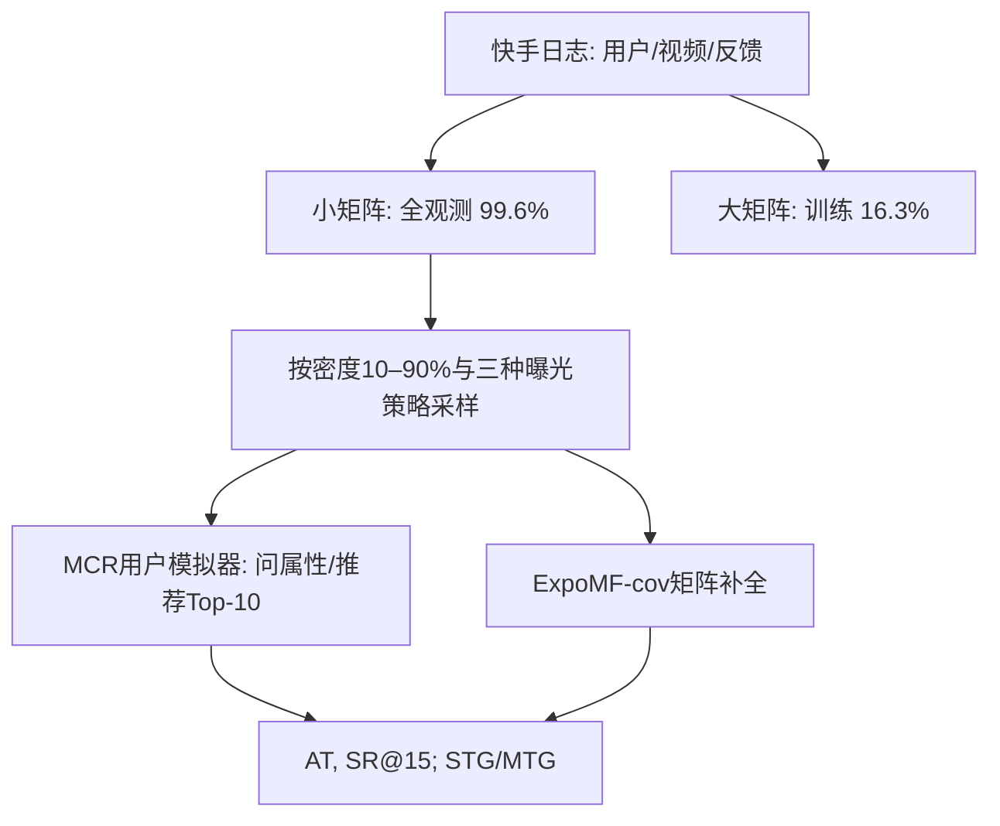
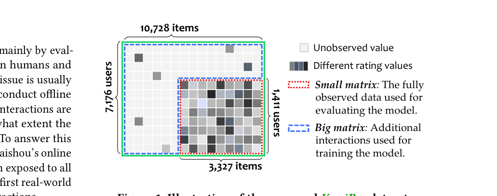

# KuaiRec: A Fully-observed Dataset and Insights for Evaluating Recommender Systems (KuaiRec：面向推荐系统评估的全观测数据集与洞见)

- **会议/期刊**: CIKM 2022
- **作者与机构**: Chongming Gao, Shijun Li, Wenqiang Lei, Jiawei Chen, Biao Li, Peng Jiang, Xiangnan He, Jiaxin Mao, Tat-Seng Chua；USTC、四川大学、浙江大学、快手、人大、NUS
- **推荐链路定位**: 离线评估基准 / 用户模拟评测
- **研究方向**: 去偏公平、可信隐私与工业架构 / 对话推荐与智能体仿真
- **论文原文**: [论文原文链接](https://arxiv.org/abs/2202.10842v3)
- **开源代码**: [开源代码仓库链接](https://github.com/xiwenchao/fully_observed_demo)

## TL;DR (1分钟核心速览)

本文直面离线推荐评估因数据稀疏与曝光偏差而不可信的问题，发布快手全观测数据集 KuaiRec（1,411 用户×3,327 视频，密度 99.6%），并系统控制密度、均匀/正向/流行曝光与矩阵补全，在 MCR 的 STG/MTG 协议下发现方法排序会随数据密度和曝光策略显著变化，补全仅能部分修复 SR@15 排序。

## Background & Motivation (背景与核心矛盾)

- **主流范式**: A/B 测试可信但昂贵；离线评估依赖部分观测日志，CRS 常用稀疏日志训练用户模拟器。
- **前人局限**: Yahoo!/Coat 的 MCAR 数据仍极稀疏、方差大；缺失值非随机缺失，流行度/正向选择偏差贯穿数据生成。
- **核心洞察 (Key Insight)**: 方法排名会随数据密度和曝光策略漂移，矩阵补全只能局部缓解，无法替代全观测真值。
- **本文切入点**: 用快手全观测小矩阵作可信测试床，大矩阵作训练集，并合成可控部分曝光数据隔离密度与偏差效应。

## Method (核心方法设计)

### 1. 整体框架 (Overall Architecture)

KuaiRec 由全观测小矩阵与大矩阵组成：小矩阵几乎覆盖全部用户-视频反馈，用于评估；大矩阵含更多用户/视频且剔除小矩阵交互，用于训练。原始观看行为按观看时长二值化，再按 10%–90% 密度与三种曝光策略采样，构建部分观测测试集。评测采用多轮对话推荐（MCR）：每轮问属性或推荐 Top-10，用户模拟器依据采样矩阵反馈，统计 AT 与 SR@15；另用 ExpoMF-cov 补全缺失值，检验是否能恢复真实排序。

### 2. 关键设计拆解 (Key Designs)

1. **全观测小矩阵与训练隔离**：前人缺全观测真值，难以判断缺失交互影响。本文用 15 天在线插入曝光补齐 1,411×3,327 矩阵至 99.6%，正样本定义为 $y_{ui}=\mathbb{I}(t_{ui}>2d_i)$，大矩阵严格剔除小矩阵交互，避免训练-测试穿越；KS 检验 p 值均高于 5% 拒绝水平，说明用户/视频分布具代表性。  
<figure class="paper-figure" markdown="span">
  <figcaption>图 1：所提出的 KuaiRec 数据集示意图。</figcaption>
</figure>  
图 1：小矩阵用于全观测评估，大矩阵用于训练且与测试交互隔离。

2. **可控部分曝光合成**：为分离密度与偏差，从小矩阵按 {10%,20%,...,90%} 无放回采样。均匀随机模拟 MAR；正向曝光按大矩阵正向比例采样，模拟选择偏差；流行曝光按 Zipf 分布 $P(k)=\frac{1/k^{s}}{\sum_{n=1}^{N}1/n^{s}}$，取$s=0.5,N=3327$。同一真值矩阵只改暴露机制，可直接观察评测排序漂移。

3. **STG/MTG 用户模拟与补全检验**：STG 只有单一目标物品，MTG 允许多个真值物品，推荐 Top-K 命中任一即成功，问属性时任一真值含该标签即正反馈，成功后移除已接受物品。本文不提出新排序损失；CRS 统一用 FM 在 big matrix 训练，评测不做全库负采样排序，推理为最多 15 轮、每轮 Top-10 的对话式重排；补全是离线一次性成本。  
<figure class="paper-figure" markdown="span">
  <figcaption>图 2：CRS 与模拟/真实用户在模型开发/服务阶段的交互。</figcaption>
</figure>  
图 2：CRS 与模拟/真实用户在模型开发与服务阶段的交互。

## Experimental Setup & Evaluation Protocol (实验设置与评估协议)

- **数据集与预处理**:

| 数据集 | #Users | #Items | #Interactions | 密度 | 特征/用途 |
| :--- | :---: | :---: | :---: | :---: | :--- |
| Small matrix | 1,411 | 3,327 | 4,676,570 | 99.6% | 30 用户特征、31 视频标签、社交关系；可信评估 |
| Big matrix | 7,176 | 10,728 | 12,530,806 | 16.3% | 56 物品特征（含 45 日统计）；训练 |

- **数据划分与防穿越**: 非 Leave-One-Out/比例划分；小矩阵全观测作测试真值，大矩阵剔除全部小矩阵交互后训练；再用 10%–90% 密度采样构造部分观测测试集，重复 10 次取平均。
- **排名评测协议**: 非传统 Full-Ranking/Sampled Ranking；MCR 对话式 Top-K（K=10）接受判定，STG 单目标、MTG 多目标，最大 15 轮，指标为 AT 与 SR@15，每个正样本对应一次对话。
- **对比基线与超参**: Max Entropy、Abs Greedy、CRM、EAR，以及 Random、PopRec、PosRec、AttrAskRec；统一 FM 推荐引擎；Zipf $s=0.5$、$N=3327$；未报告显著性检验，仅 10 次平均。

## Key Experimental Results (实验关键数据)

### 1. 主实验对比 (Main Results)

原文图 4/5 为 AT/SR 曲线，未列完整数值表；可量化主结果为表 3 的“排序不一致采样集数量”，前→后为矩阵补全前后，越低越好。

| 方法 | Random AT | Random SR@15 | Pop AT | Pop SR@15 | Pos AT | Pos SR@15 |
| :--- | :---: | :---: | :---: | :---: | :---: | :---: |
| EAR | 9→9 | 7→5 (↓28.6%) | 9→9 | 7→6 | 9→9 | 6→5 |
| CRM | 9→9 | **5→0 (↓100%)** | 9→9 | 4→4 | 9→9 | 3→3 |
| Abs Greedy | 4→7 | 3→0 | 7→8 | 3→4 | 6→7 | 3→3 |
| Max Entropy | 5→9 | **0→0** | 9→9 | **0→0** | 9→9 | **0→0** |
| Random | 5→9 | 3→8 (↑) | 9→9 | 9→8 | 9→9 | 8→8 |
| PopRec | 1→0 | 1→0 | 3→2 | 3→2 | 1→0 | 0→2 |
| PosRec | 5→9 | 2→8 (↑) | 9→9 | 8→8 | 8→8 | 8→8 |
| AttrAskRec | 6→8 | 7→5 (↓28.6%) | 7→8 | 7→6 | 7→8 | 6→5 |

### 2. 消融实验 (Ablation Study)

论文无模块级消融，以下为因素分析：

| 因素/设置 | 对比 | 关键现象 |
| :--- | :--- | :--- |
| 曝光策略 | Uniform vs Positivity vs Popularity | 均匀暴露下 STG 排序较稳；正向/流行暴露使 PosRec、PopRec 性能随密度反转 |
| 数据密度 | 10%→90%→全观测 | STG 均匀采样近似稳定；MTG 即使均匀随机，AT/SR 排序仍明显变化 |
| STG vs MTG | 单目标 vs 多目标 | MTG 下 Max Entropy 的 SR@15 最优；AttrAskRec 在高密度转好；CRM 提问率 81.7% vs MaxEntropy 66.5% |
| 矩阵补全 | ExpoMF-cov 前/后 | SR 不一致数局部下降，AT 多数仍 9/9；Random 场景 EAR 7→5、CRM 5→0，但 Random/PosRec 反而 3→8、2→8 |

### 3. 关键实验发现 (Key Findings)

1. **曝光偏差与密度会重排方法结论**：表 3 中 AT 在三种曝光下多数方法为 9/9 不一致；MTG 即使均匀随机，SR 曲线随密度变化，说明稀疏离线评测不可直接外推。
2. **矩阵补全只修复部分 SR 排序**：Random 下 EAR 7→5、CRM 5→0、AttrAskRec 7→5；但 Popularity/Positivity 下多数仍 7→6、6→5，AT 几乎不降，且 Random/PosRec 的 SR 3→8、2→8 变差。
3. **用户模拟目标决定结论**：STG 下 MaxEntropy 与 EAR 较稳；MTG 下 MaxEntropy SR@15 最优，提问在高密度更有效，CRM 81.7% 提问率高于 MaxEntropy 66.5%，表明多目标评估更贴近真实且会改变基线排名。

## Highlights & Limitations (亮点、对比与审稿批判)

- **与代表作对比 (vs. Prior Work)**: 相比 Yahoo!/Coat 的稀疏 MCAR 数据，KuaiRec 以 99.6% 密度提供全观测真值；相比 Open Bandit 仅 80 物品，覆盖 3,327 视频；相比稀疏日志上的 CRS 用户模拟，本文直接控制密度与曝光机制。
- **可迁移亮点**: “全观测小矩阵评估 + 大矩阵训练隔离”可迁移到推荐评测基准；均匀/正向/流行三策略采样可复用为偏差压力测试；MTG 多目标协议比 STG 更贴近多兴趣场景。
- **审稿级局限批判**: 仅来自快手短视频单一平台，用户/物品规模有限且高密度小矩阵仍可能含流行偏差；矩阵补全只试 PMF/ExpoMF/ExpoMF-cov，未覆盖图补全或生成式补全；MTG 模拟器仍基于标签与二元反馈，未验证自然语言 CRS。

## Rating (四维评分)

- **方法创新性 (Novelty)**: ⭐⭐⭐⭐ （首个真实百万级全观测推荐数据集，评测控制变量设计有开创性）
- **评估协议与实验扎实度 (Protocol & Experiments)**: ⭐⭐⭐⭐ （密度×曝光×STG/MTG×补全较系统，重复10次；但缺显著性检验且仅限CRS）
- **写作与数学规范度 (Clarity & Rigor)**: ⭐⭐⭐⭐ （数据构造、采样公式与协议清晰；主结果多为曲线，量化表较少）
- **工业落地与复现价值 (Industrial & Practical Value)**: ⭐⭐⭐⭐ （数据与评测 pipeline 开源，适合去偏/用户模拟基准；平台特化与补全成本需注意）

