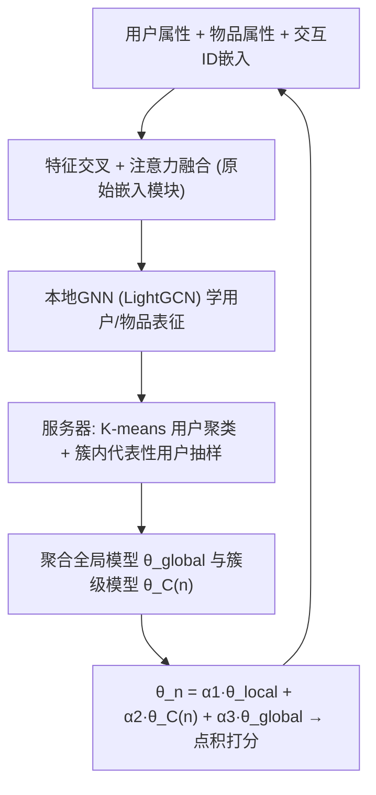
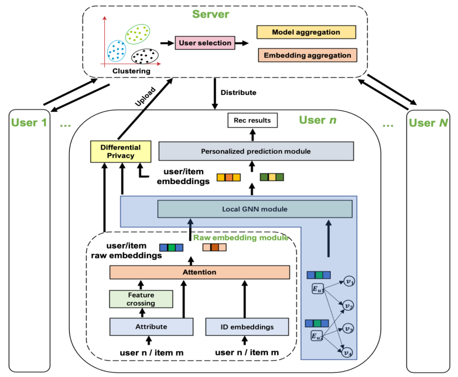

# Personalized Federated Recommendation via Joint Representation Learning, User Clustering, and Model Adaptation (基于联合表征学习、用户聚类与模型自适应的个性化联邦推荐)

- **会议/期刊**: CIKM 2022 (Short Paper, 5 pages)
- **作者与机构**: Sichun Luo, Yuanzhang Xiao, Linqi Song（香港城市大学 CS 系 / 深圳研究院；夏威夷大学）
- **推荐链路定位**: 召回/打分（端到端联邦训练）
- **研究方向**: 去偏公平、可信隐私与工业架构 / 图神经网络推荐
- **论文原文**: [https://arxiv.org/abs/2208.09375v1](https://arxiv.org/abs/2208.09375v1)
- **开源代码**: 暂未开源

## TL;DR (1分钟核心速览)

联邦推荐以"传模型不传数据"保护隐私，但现有 FedAvg 类方案对所有用户下发**同一个全局模型**，无法适配用户属性与本地数据的非 IID 异质性；且每轮需与**全体用户**通信，带宽开销高。本文提出 PerFedRec：用联邦 GNN 将属性与协同信号联合学出用户表征，据此对用户**聚类**，再把「用户本地微调模型 + 簇级联邦模型 + 全局模型」按权重线性组合成个性化模型，并在每簇内按簇规模抽样代表性用户参与聚合以压缩通信。在 MovieLens-100K / Yelp / Amazon-Kindle 的 Leave-One-Out + 100 负采样排序协议下，HR@10 较 FedAvg 平均提升 29.47%、NDCG@10 平均提升 57.67%。

## Background & Motivation (背景与核心矛盾)

- **主流范式**: 联邦协同过滤 / 联邦矩阵分解 / 联邦 GNN（如 FedGNN）沿用 FedAvg，在服务器端对各客户端上传的模型做参数平均后统一下发。
- **前人局限 ①**: 全局共享单一模型，忽略用户属性与本地交互分布的异质性（non-IID），个性化不足；FedAvg 在 MovieLens 上 HR@10 仅 0.4475，远低于集中式的 0.6532。
- **前人局限 ②**: 每轮必须与全部 $N$ 个用户交换模型与嵌入，在带宽受限、时延敏感场景（自动驾驶策略推荐、移动众包）开销不可接受。
- **核心洞察 (Key Insight)**: GNN 学出的用户表征同时蕴含属性与高阶协同信息，因此**表征本身即可作为聚类依据**；一旦划分出行为相近的用户簇，簇内共享一个模型就能在"个性化"与"参数共享"之间取得折中。
- **本文切入点**: 把表征学习、用户聚类、模型自适应从"三步独立"改为**联合进行**，并配合簇内代表性用户抽样，兼顾个性化精度与通信成本。

## Method (核心方法设计)

### 1. 整体框架 (Overall Architecture)

框架分为用户侧本地推荐网络与服务器侧聚类聚合器。用户侧先由**原始嵌入模块**把属性经线性层与特征交叉层得到属性嵌入，再用注意力与协同 ID 嵌入融合；融合后的嵌入送入**本地 GNN**（LightGCN 可插拔）产出用户/物品表征；最后由**个性化预测模块**把本地模型、簇级模型、全局模型加权组合成 $\theta_n^t$ 并做点积打分。服务器侧接收加密的用户/物品嵌入与模型，用 K-means 对用户聚类、按簇规模抽样代表性用户、再分别聚合全局模型与簇级模型下发。用户在本地用 BPR 式损失训练并回传，形成"本地训练→上传→聚类/聚合→个性化组合"的闭环。

<figure class="paper-figure" markdown="span">
  <figcaption>图 1：所提出的个性化联邦推荐框架示意图。</figcaption>
</figure>

### 2. 关键设计拆解 (Key Designs)

1. **属性–协同注意力融合与特征交叉 (Raw Embedding)**：痛点在于纯 ID 嵌入无法利用用户画像/物品属性，而简单拼接又会让低区分度特征淹没协同信号。做法是先对属性做多层特征交叉 $x_{l+1}=x_0x_l^{\top}w_l+b_l+x_l$ 显式捕获属性内部高阶交互，再以注意力加权融合属性特征与原 ID 嵌入：
   $\mathbf{E}^{att}_{u,n}=\sum_{i}\frac{\exp(\tanh(W_i x_i+b_i))}{\sum_{i'}\exp(\tanh(W_{i'}x_{i'}+b_{i'}))}x_i$。直觉：注意力让模型按用户自适应地决定"信属性多少、信协同多少"，为后续聚类提供判别性更强的表征。

2. **三级个性化模型组合 (Model Adaptation)**：痛点在于单一全局模型无法覆盖异质用户，但完全本地训练又因数据稀疏而过拟合。本文把用户 $n$在$t$ 轮的模型写成三层线性插值：
   $\theta_n^t=\alpha_{n,1}\theta_{local,n}^t+\alpha_{n,2}\theta_{C(n)}^t+\alpha_{n,3}\theta_{global}^t$，
   其中 $C(n)$为用户所属簇。$\alpha$可取超参（实验取$1/3$）或可学习。直觉：全局项提供冷启动与稀疏用户的泛化底座，簇级项注入同质群体的共性偏好，本地项保留个体残差。

3. **训练目标、负采样与通信优化**：各用户本地以 BPR/排序损失训练，负样本来自未交互物品；物品嵌入全局共享并迭代更新，用户嵌入因隐私**仅存本地**、经服务器以加密 ID 中转互换。服务器每轮**每簇按簇规模比例抽样**少量代表性用户参与聚合（而非随机抽全体），把通信量从 $O(N)$降至$O(K\cdot s)$；由于聚类在联合表征上进行，被抽样的代表用户能较好近似整簇梯度方向。

## Experimental Setup & Evaluation Protocol (实验设置与评估协议)

- **数据集与预处理**: 三个真实数据集，未额外做 $k$-core 过滤，稀疏度差异显著：

| 数据集 | #Users | #Items | #Interactions | 稀疏度 | 特征/场景说明 |
| :--- | :---: | :---: | :---: | :---: | :--- |
| MovieLens-100K | 943 | 1,682 | 100,000 | 93.70% | 电影评分，含用户/物品属性 |
| Yelp | 5,224 | 7,741 | 123,024 | 99.70% | 商户点评，稀疏 |
| Amazon-Kindle | 7,650 | 9,173 | 137,124 | 99.80% | 电子书评论，**无外部特征** |

- **数据划分与防穿越 (Splitting Strategy)**: `Leave-One-Out`——每用户最后一条交互测试、倒数第二条验证、其余训练。
- **排名评测协议 (Ranking Protocol)**: `Sampled Ranking`——为每个测试正样本随机采样 **100 个未交互物品**共同排序，报告 HR@K / NDCG@K（K=10, 20），**非 Full-Ranking**。
- **对比基线与超参设置**: 仅 2 个基线（Central 集中式上界、FedAvg/FedGNN）；GNN 用 LightGCN，嵌入维度 $d=64$，学习率 0.01，每轮参与用户 128，$\alpha_{n,\cdot}=1/3$，结果取 5 次运行均值。

## Key Experimental Results (实验关键数据)

### 1. 主实验对比 (Main Results)

| 数据集 | 模型 | HR@10 | NDCG@10 | HR@20 | NDCG@20 |
| :--- | :--- | :---: | :---: | :---: | :---: |
| MovieLens | Central | **0.6532** | 0.4337 | **0.8165** | **0.4740** |
| | FedAvg | 0.4475 | 0.2462 | 0.6405 | 0.2954 |
| | **PerFedRec** | 0.6119 | **0.4409** | 0.7402 | 0.4707 |
| | Improv. | +36.74% | +79.08% | +15.57% | +59.34% |
| Yelp | Central | **0.6497** | **0.4099** | **0.8168** | **0.4531** |
| | FedAvg | 0.4422 | 0.2487 | 0.6437 | 0.3000 |
| | **PerFedRec** | 0.6058 | 0.4040 | 0.7151 | 0.4317 |
| | Improv. | +36.99% | +62.44% | +11.09% | +43.90% |
| Kindle | Central | **0.6382** | **0.4102** | **0.7742** | **0.4448** |
| | FedAvg | 0.3936 | 0.2366 | 0.5218 | 0.2701 |
| | **PerFedRec** | 0.4514 | 0.3111 | 0.5548 | 0.3379 |
| | Improv. | +14.68% | +31.49% | +6.32% | +25.10% |

### 2. 消融实验 (Ablation Study)

| 变体 (MovieLens) | HR@10 | NDCG@10 | HR@20 | NDCG@20 |
| :--- | :---: | :---: | :---: | :---: |
| PerFedRec-Var.1 (无个性化组合) | 0.4464 | 0.2497 | 0.6405 | 0.2965 |
| PerFedRec-Var.2 (无属性特征) | 0.6087 | 0.4340 | 0.7381 | 0.4677 |
| PerFedRec-Var.3 (无用户聚类) | 0.6102 | 0.4453 | 0.7359 | 0.4766 |
| **PerFedRec (Full)** | **0.6119** | 0.4409 | **0.7402** | 0.4707 |

簇数敏感性（MovieLens）：$K{=}5$时 HR@10 0.6119 / NDCG@10 0.4409；$K{=}10$时 0.6214 / 0.4492（最优）；$K{=}20$ 时 0.6087 / 0.4404。

### 3. 关键实验发现 (Key Findings)

1. **个性化组合是绝对主增益来源**：移除三级模型组合后 HR@10 从 0.6119 跌至 0.4464（−37%），甚至回落到 FedAvg 水平，说明簇级/本地模型的插值是"联邦下逼近集中式"的关键，而非 GNN 本身。
2. **聚类几乎"零成本"**：去掉用户聚类（Var.3）后 HR@10 仅降 0.0017、NDCG@20 反而略升（0.4766 vs 0.4707），即聚类主要贡献的是**通信压缩**而非精度，可用于解释"个性化主要靠本地+全局两层"。
3. **属性特征的收益与稀疏度/特征可得性强相关**：在含属性的 MovieLens 上去掉属性仅损失 NDCG@10 0.0069，但在**无外部特征的 Kindle** 上整体提升骤降至 HR@10 +14.68%（远低于另两数据集的 36%+），说明当属性缺失时个性化只能依赖协同信号，泛化天花板明显。

## Highlights & Limitations (亮点、对比与审稿批判)

- **与代表作对比 (vs. Prior Work)**: 与 FedGNN/FedAvg 相比，本质差异是"**一对多**"——不再下发单一全局模型，而是全局+簇级+本地三级叠加；与经典个性化联邦（如 clustered FL）相比，本文的聚类依据是**GNN 联合学出的用户表征**而非独立特征，因此聚类与推荐目标一致。
- **可迁移亮点**: ① "簇内按规模比例抽样代表用户"是在精度几乎无损前提下压通信的通用技巧，可移植到大模型联邦微调；② 以联合表征做聚类、再以聚类结果反哺模型聚合的闭环，可迁移到多场景/多业务线联邦建模。
- **审稿级局限批判**: ① **基线极弱且单一**——仅 Central 与 FedAvg 两个对照，缺少 FedProx、Clustered-FL、pFedMe 等个性化联邦基线，且无显著性检验；② 评测采用 **100 负采样排序而非 Full-Ranking**，NDCG 绝对值易被高估，且未报告方差；③ 通信节省只有定性描述，**未给出收敛轮数/上传字节数的定量曲线**，而这是该文的核心卖点之一；④ 三数据集稀疏度差异大但 Kindle 明显掉队，却未做进一步的分桶归因分析。

## Rating (四维评分)

- **方法创新性 (Novelty)**: ⭐⭐⭐ （把"联合表征→聚类→三级模型插值"串成闭环思路清晰，但各组件均为已有技术的组合，缺少理论或收敛性分析）
- **评估协议与实验扎实度 (Protocol & Experiments)**: ⭐⭐ （仅 2 个基线、采样排序而非全库排序、无显著性检验、无通信量定量曲线，短论文实验规模偏薄）
- **写作与数学规范度 (Clarity & Rigor)**: ⭐⭐⭐ （公式与符号定义清楚，注意力/特征交叉公式完整，但目标函数未显式写出，通信复杂度分析缺失）
- **工业落地与复现价值 (Industrial & Practical Value)**: ⭐⭐⭐ （隐私约束下的簇内抽样聚合极具工程价值，但无开源代码、隐私保护仍依赖加密 ID 中转的工程实现细节未展开）

