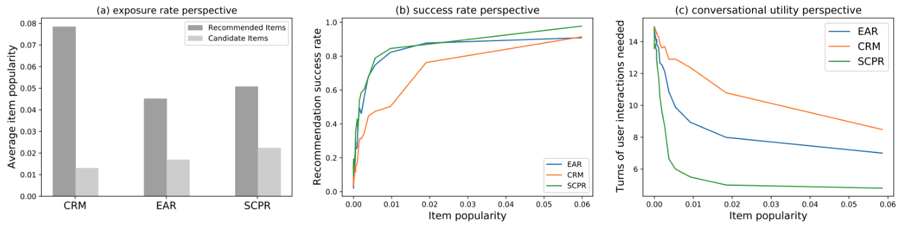
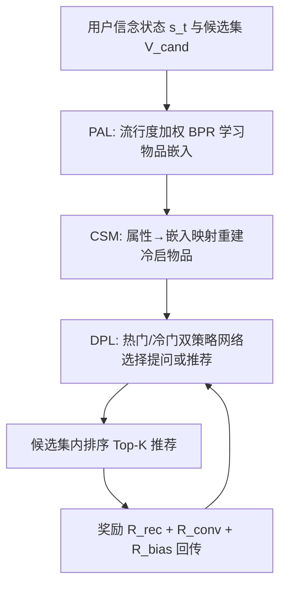

# Quantifying and Mitigating Popularity Bias in Conversational Recommender Systems (对话推荐系统中流行度偏差的量化与缓解)

- **会议/期刊**: CIKM 2022
- **作者与机构**: Allen Lin, Jianling Wang, Ziwei Zhu, James Caverlee（Texas A&M University；George Mason University）
- **推荐链路定位**: 重排（多轮对话后候选集内排序）+ 对话策略决策
- **研究方向**: 去偏公平、可信隐私与工业架构 / 对话推荐与智能体仿真
- **论文原文**: [https://arxiv.org/abs/2208.03298v2](https://arxiv.org/abs/2208.03298v2)
- **开源代码**: 暂未开源

## TL;DR (1分钟核心速览)

本文首次系统研究对话推荐系统（CRS）中的流行度偏差：在 SAUR 多轮提问设定下，从曝光率、推荐成功率、对话效用三视角给出可计算偏差指标 PER/PSR/PCU，并诊断出「热门物品嵌入范数膨胀、冷启物品随机初始化、最大熵策略跳过低熵热门属性」三条根因。作者提出模型无关的三阶段去偏框架 PAL+CSM+DPL，在 Yelp/Lastfm 的候选集内全排序协议下平均降低偏差 42.5%，同时整体成功率提升 12.3%，平均对话轮数基本不变。

## Background & Motivation (背景与核心矛盾)

- **主流范式**: CRS 采用 System Ask–User Responds 设定，策略网络逐轮选择属性提问，信念状态 $s_t=[(a_1,p_1),\dots,(a_t,p_t)]$收缩候选集$V_{cand}$，再由推荐组件在候选集内排序。
- **前人局限**: 其一，传统静态推荐的流行度去偏（如 Popcorn 的 HitL 偏差）依赖属性级流行度定义，无法覆盖交互频次定义且只改奖励函数；其二，CRS 的偏差会在「策略提问—偏好建模—候选排序」闭环中被逐级放大，单一环节纠偏会失效。
- **核心洞察 (Key Insight)**: 三个数据现象——推荐列表平均流行度可达候选集的 8 倍（图1a）；流行度与成功率强正相关（图1b）；冷门物品需要更多轮对话才可能被命中（图1c）。根因是热门物品在训练中被反向传播更新更频繁，导致嵌入范数更大（图3），从而评分天然更高。
- **本文切入点**: 不修改 CRS 架构，而是在「嵌入学习—冷启重建—策略训练」三处插入可插拔的去偏算子。

<figure class="paper-figure" markdown="span">
  <figcaption>图1：CRSs 中流行度偏差不同视角的证据</figcaption>
</figure>

## Method (核心方法设计)

### 1. 整体框架 (Overall Architecture)

框架严格按序执行：先在推荐组件上用 PAL 训练流行度感知的 BPR 目标，得到热门/冷门物品更均衡的嵌入；随后用温启物品的 one-hot 属性向量训练属性→嵌入映射网络 $f_\theta$，为测试集中零交互的冷启物品重建嵌入；最后在热门子集$D_1$（流行度 >80 分位）与冷门子集$D_2$（<20 分位）上分别训练两个策略网络，推理时按目标物品流行度是否高于 25 分位切换。三阶段共享同一推荐器与对话环境，偏差通过$R_{bias}$ 奖励显式回传至策略优化，形成「表征去偏 → 冷启补全 → 决策去偏」闭环。

### 2. 关键设计拆解 (Key Designs)

1. **PAL 流行度感知聚焦学习**：痛点在于 BPR 的全局最优被高频热门样本主导，冷门物品嵌入欠拟合且范数偏小。本文将样本损失按 $1/e^{n_1 p_i}$降权、对物品嵌入范数施加$e^{n_2 p_i}$的流行度相关正则：$\mathcal{L}_{bpr}=\frac{1}{e^{n_1 p_i}}\left[-\ln\sigma(\hat{y}_{uv})-\ln\sigma(-\hat{y}_{uv'})\right]+e^{n_2 p_i}\|\mathbf{v}\|^2+\lambda\|\boldsymbol{\theta}\|^2$，其中$p_i$ 为物品流行度。直觉是「压热门梯度、放大冷门梯度、重罚热门范数」，从而削弱范数—评分—曝光的因果链；正则只作用于物品嵌入，避免用户/属性嵌入收缩导致不收敛。
2. **CSM 冷启嵌入属性映射重建**：CRS 中每个物品都有预定义属性，但零交互物品嵌入仍为随机初始化，评分无意义。本文在温启集 $V^+$上训练前馈映射：$\min_\theta\sum_{i\in V^+}\|f_\theta(\mathbf{e}^{onehot}_i)-\mathbf{e}^{item}_i\|^2+\lambda\|\theta\|^2$，再令$\mathbf{e}^{item}_{i^-}=f_\theta(\mathbf{e}^{onehot}_{i^-})$。该「以属性为桥」的迁移无需任何冷启交互，即可让冷启物品获得与同类温启物品可比的语义方向。
3. **DPL 双策略学习与训练目标**：最大熵预训练会跳过取值分布集中的属性（如 genre 中 Action 占多数），使策略误判用户只爱热门属性。本文将数据按流行度切分为 $D_1/D_2$各训一个两层策略网络，并以 REINFORCE 优化$R_n=\sum_{n=1}^{N}\gamma^n\left(w_{rec}R^{rec}_n+w_{conv}R^{conv}_n+w_{bias}R^{bias}_n\right)$，其中$R^{bias}_n$直接取第$n$轮的曝光偏差$E_n$。训练负采样沿用 BPR 的单负样本均匀采样；推理时仅需一次候选集内打分与策略前向，开销与基线同阶。

## Experimental Setup & Evaluation Protocol (实验设置与评估协议)

- **数据集与预处理**: 仅保留评论数 ≥10 的用户以缓解稀疏；Yelp 采用与 EAR/SCPR 相同的层级属性预处理。

| 数据集 | #Users | #Items | #Interactions | 稀疏度/密度 | 特征/场景说明 |
| :--- | :---: | :---: | :---: | :---: | :--- |
| Yelp | 27,675 | 70,311 | 1,368,606 | 0.0007 | 590 个层级属性，5 轮对话，枚举式提问 |
| Lastfm | 1,801 | 7,432 | 76,693 | 0.0057 | 33 个属性，15 轮对话，二元提问 |

- **数据划分与防穿越 (Splitting Strategy)**: 用户-物品交互按 **7:2:1 比例随机划分**训练/验证/测试；未采用全局时间戳切分，因此存在轻度未来交互泄漏风险，但 CRS 评估依赖离线用户模拟器，时间切分并非该领域惯例。
- **排名评测协议 (Ranking Protocol)**: 采用 **候选集内全排序 (Candidate-Set Full Ranking)**：候选集由当前信念状态精确匹配所有已提问属性生成，模型对 $V_{cand}$全量打分取 Top-K，不做负采样。指标含$SR@t$、平均轮数$AT$，以及头部/尾部成功率$HSR/TSR$；偏差指标为 PER、PSR（Gini）、PCU：
  $PER=\frac{1}{|I|}\sum_{(u,i)\in I}\frac{1}{N}\sum_{n=1}^{N}\rho(\hat{V}_{u,n})P(\hat{V}_{u,n})$，
  $PSR=1-2\int_0^1 SR(V_{sort})\,dV_{sort}$，
  $PCU=\frac{1}{T}\left[\frac{1}{|V_{unpop}|}\sum_{v\in V_{unpop}}U_{turn}(v)-\frac{1}{|V_{pop}|}\sum_{v\in V_{pop}}U_{turn}(v)\right]$。
- **对比基线与超参设置**: 基线含规则策略 MaxEnt、CRM、EAR、SCPR 及属性级去偏方法 Popcorn；嵌入维度沿用各基线默认；PAL 网格搜索得 $n_1=7,n_2=8$，DPL 折扣因子$\gamma=0.7$，显著性检验$p<0.01$。

## Key Experimental Results (实验关键数据)

### 1. 主实验对比 (Main Results)

| 方法 | Lastfm PER↓ | PSR↓ | PCU↓ | SR↑ | TSR↑ | Yelp PER↓ | PSR↓ | PCU↓ | SR↑ | TSR↑ |
| :--- | :---: | :---: | :---: | :---: | :---: | :---: | :---: | :---: | :---: | :---: |
| Popcorn | 3.19 | .448 | .146 | .396 | .104 | 4.26 | .195 | .255 | .637 | .358 |
| MaxEnt | 3.99 | .503 | .172 | .286 | .068 | 2.83 | .110 | .132 | .507 | .424 |
| MaxEnt + Debias | 1.92 | .417 | .077 | .311 | .102 | 2.29 | **.058** | **.029** | .509 | .459 |
| CRM | 4.16 | .474 | .148 | .324 | .089 | 4.81 | .253 | .347 | .604 | .228 |
| CRM + Debias | **1.24** | .331 | **.072** | .438 | .162 | 3.84 | .103 | .163 | .633 | .402 |
| EAR | 2.71 | .552 | .224 | .421 | .061 | 4.99 | .269 | .402 | .629 | .295 |
| EAR + Debias | **1.11** | **.318** | .119 | .479 | .187 | 3.71 | .141 | .170 | .647 | .422 |
| SCPR | 5.79 | .440 | .281 | .457 | .109 | 5.97 | .281 | .440 | .631 | .301 |
| SCPR + Debias | 3.61 | .322 | .142 | **.546** | **.216** | 4.39 | .179 | .257 | **.667** | **.501** |

SCPR+Debias 相对原始 SCPR：Lastfm 的 PER/PSR/PCU 分别下降 **37.7%/26.8%/49.5%**，SR/TSR 提升 **19.5%/98.2%**；Yelp 的 PER/PSR/PCU 下降 **26.5%/36.3%/41.6%**，TSR 提升 **66.4%**。全基线平均偏差下降 42.5%、成功率提升 12.3%。

### 2. 消融实验 (Ablation Study)

Lastfm 上逐阶段移除（-）结果：

| 变体 | PER↓ | PSR↓ | PCU↓ | SR↑ | HSR↑ | TSR↑ |
| :--- | :---: | :---: | :---: | :---: | :---: | :---: |
| EAR 原始 | 2.71 | .552 | .224 | .421 | .742 | .061 |
| EAR + 全部 | **1.11** | **.318** | **.119** | .479 | .711 | **.187** |
| EAR − PAL | 1.31 | .325 | .166 | .445 | .689 | .171 |
| EAR − CSM | 1.21 | .439 | .204 | **.516** | **.814** | .110 |
| EAR − DPL | 1.23 | .338 | .145 | .459 | .709 | .166 |
| SCPR 原始 | 5.79 | .440 | .281 | .457 | .793 | .109 |
| SCPR + 全部 | **3.61** | **.322** | **.142** | **.546** | **.839** | **.216** |
| SCPR − PAL | 5.05 | .373 | .205 | .458 | .761 | .160 |
| SCPR − CSM | 4.43 | .469 | .275 | .495 | .831 | .097 |
| SCPR − DPL | 4.19 | .422 | .257 | .484 | .805 | .156 |

### 3. 关键实验发现 (Key Findings)

1. **CSM 是「偏差—精度」跷跷板的主开关**：移除 CSM 后 EAR 的 SR 从 .479 升至 .516、HSR 达 .814，但 TSR 从 .187 崩至 .110、PSR 从 .318 恶化到 .439——冷启物品被重建后与目标热门物品「同样合格」，挤占了 Top-K 名额并拉长对话，说明冷启补全必然以头部精度换取尾部公平。
2. **DPL 在知识图谱约束下收益更大**：SCPR 移除 DPL 使 PCU 从 .142 升至 .257、SR 降 6.2 个点；而 EAR 移除 DPL 仅使 PCU 升至 .145、SR 降 2.0 个点。原因在于 SCPR 的 KG 大幅压缩了策略动作空间，双策略对「冷门属性路径」的纠偏更可感。
3. **PAL 对冷门表征的增益可独立验证**：图4 的 item-level AUC 显示，应用框架后冷门物品 AUC 在 EAR/CRM/SCPR 与两数据集上一致上升；连热门物品 AUC 也上升（CRM 最明显），因为热门内部流行度方差同样巨大，按 $p_i$ 重加权避免了模型只拟合极少数超热门物品。

## Highlights & Limitations (亮点、对比与审稿批判)

- **与代表作对比 (vs. Prior Work)**: Popcorn 仅用属性级流行度改奖励，无法处理交互频次定义与表征层偏差；EAR/SCPR 关注偏好 elicitation 效率却默认推荐器无偏；本文首次把「表征范数膨胀 + 冷启随机初始化 + 策略属性跳过」串成统一因果链，并以模型无关插件方式同时作用于三类基线。
- **可迁移亮点**: ① 用 $1/e^{n_1p_i}$损失加权 +$e^{n_2p_i}\|\mathbf{v}\|^2$ 范数正则做「轻量去偏」，可直接套到任意 BPR/Softmax 召回；② 以属性 one-hot → 嵌入的回归映射补全零交互物品，适用于电商/内容侧冷启。
- **审稿级局限批判**: ① 三阶段串行重训（推荐器→映射网络→双策略）带来约 3 倍训练开销，且 DPL 需按流行度阈值切分数据，阈值 80/20/25 分位缺乏敏感性分析；② 评估完全依赖离线用户模拟器与两个数据集，候选集由属性精确匹配生成，远比真实工业全库召回简单，且 PCU 依赖固定最大轮数 $T$归一化，跨数据集可比性存疑；③ 奖励权重$w_{rec},w_{conv},w_{bias}$ 手工设定，未报告方差或置信区间，Yelp 上 MaxEnt+Debias 的 SR 仅从 .507 微升至 .509，统计显著性叙述偏弱。

## Rating (四维评分)

- **方法创新性 (Novelty)**: ⭐⭐⭐⭐ （首个系统化 CRS 流行度偏差研究，三视角指标与「范数膨胀」根因诊断有实证支撑，但 PAL/CSM/DPL 均为已有技术的组合式改造，缺少理论界）
- **评估协议与实验扎实度 (Protocol & Experiments)**: ⭐⭐⭐⭐ （两数据集 × 四基线 × 三偏差指标 + 逐阶段消融 + item-level AUC 交叉验证较完整，但随机划分、无时间切分、无在线 A/B 与阈值敏感性分析）
- **写作与数学规范度 (Clarity & Rigor)**: ⭐⭐⭐⭐ （三阶段动机—算子—公式链条清晰，PER 从属性级推广到交互频次级的推导合理；部分公式排版有笔误，PCU/PSR 的统计性质未加证明）
- **工业落地与复现价值 (Industrial & Practical Value)**: ⭐⭐⭐⭐ （模型无关、可插拔，PAL/CSM 改造成本低；但 DPL 需双策略在线切换与三阶段重训，且代码未开源，复现门槛中等）

