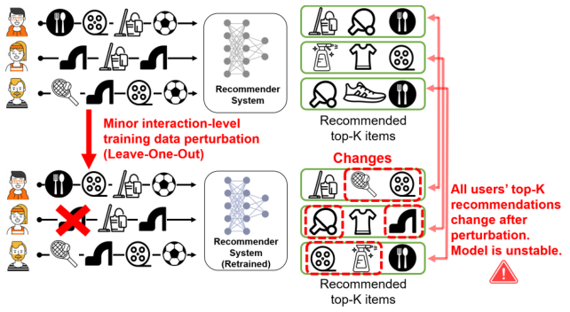
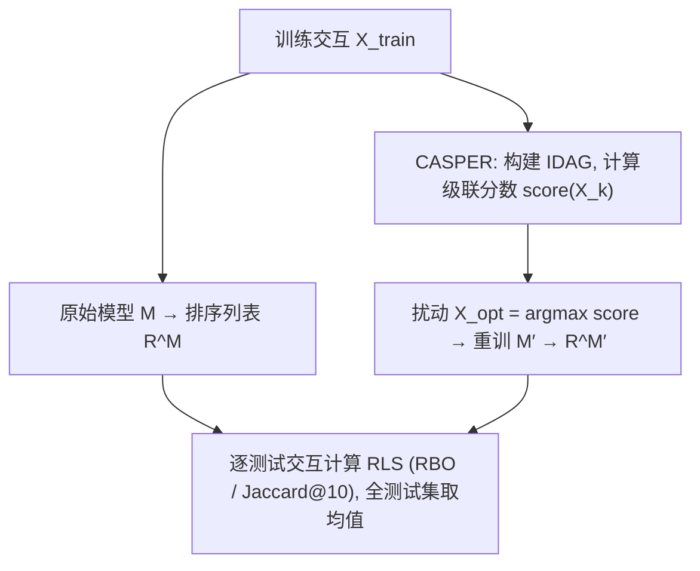
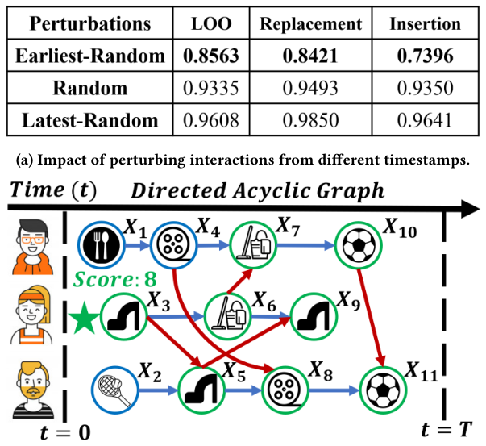

# Rank List Sensitivity of Recommender Systems to Interaction Perturbations (推荐系统排序列表对交互扰动的敏感性)

- **会议/期刊**: CIKM 2022 (31st ACM International Conference on Information and Knowledge Management)
- **作者与机构**: Sejoon Oh, Berk Ustun, Julian McAuley, Srijan Kumar (Georgia Tech / UCSD)
- **推荐链路定位**: 排序阶段（全库排序）+ 模型可靠性评测（非精度提升）
- **研究方向**: 去偏公平、可信隐私与工业架构 / 序列推荐
- **论文原文**: [https://arxiv.org/abs/2201.12686v3](https://arxiv.org/abs/2201.12686v3)
- **开源代码**: [https://github.com/srijankr/casper](https://github.com/srijankr/casper)

## TL;DR (1分钟核心速览)

推荐系统长期只用 MRR/Recall 衡量 ground-truth 物品的位置，从不追问“排序列表本身有多稳”。本文提出 **Rank List Sensitivity (RLS)**，用 RBO 与 top-K Jaccard 比较“扰动前/扰动后重训模型”为**同一个测试交互**生成的两条完整排序列表；并提出 **CASPER**，在交互级依赖 DAG 上选取“后代数最大”的交互做留一/替换/插入扰动。在 4 个数据集、4 个序列模型、**Full-Ranking** 协议下，仅扰动百万分之一条交互即令 RBO 从 1.0 跌至 0.52–0.96；CASPER 在 LatentCross 上比最强基线再降 10.0%（置换扰动下相对降低 30.3%），且低 MRR 用户受损最重。

## Background & Motivation (背景与核心矛盾)

- **主流范式**: 序列推荐以 next-item 预测训练，模型选择只看 MRR/Recall@K —— 即“真值物品排在第几”，对列表其余 $|I|-1$ 个物品的次序完全不约束。
- **前人局限**: ① 推荐系统扰动研究（LOKI、S-attack、PoisonRec、CF-attack）几乎全是 **targeted**（只把某个目标物品顶上去）或 user/item 级扰动，无法刻画“全局排序列表”的稳定性；② 分类任务中的 multiplicity/leave-one-out 稳定性研究（Marx、Black & Fredrikson）无法直接迁移——交互是离散、带时间依赖的序列。
- **核心洞察 (Key Insight)**: 训练按时间序切 mini-batch，早期交互的参数偏移会被后续 batch 逐轮放大（**级联效应 cascading effect**）；而损失只把真值物品拉高，其余位置由参数自由决定。因此**一条无关用户的交互被删，就足以重排所有人的列表**，而 MRR/Recall 几乎纹丝不动（图 3(b) 中前后差值 <0.01）。
- **本文切入点**: 先把“稳定性”变成可量化指标（RLS），再把它变成可优化的搜索问题（找最坏的单点扰动）。

<figure class="paper-figure" markdown="span">
  <figcaption>图1：训练数据中的微小变化（例如，留一扰动）可能使推荐系统对所有个体用户输出截然不同的推荐。</figcaption>
</figure>

## Method (核心方法设计)

### 1. 整体框架 (Overall Architecture)

两阶段闭环：**测量**——用固定随机种子/初始化训练模型 $M$，得到每个测试交互的排序列表$R^M_{X_k}$；对训练集施加一次交互级扰动后重训$M'$，得到$R^{M'}_{X_k}$；逐测试交互计算相似度并取均值即 RLS。**寻优**——CASPER 插在“选择哪条交互被扰动”这一环节：以全部训练交互为节点构建交互依赖 DAG，用后代数量近似该交互的级联影响，选分数最高者扰动，全程不需模型参数或梯度，仅需知道最大序列长度$L$。

### 2. 关键设计拆解 (Key Designs)

1. **RLS 度量（RBO + top-K Jaccard）**：痛点在于 MRR/Recall 的差值对“列表被整体重排”完全不敏感。解法是直接比较两条列表：
$RLS = \frac{1}{|X_{test}|}\sum_{X_k\in X_{test}} sim(R^{M}_{X_k}, R^{M'}_{X_k})$，
其中 $RBO(A,B) = (1-p)\sum_{d=1}^{|I|} p^{d-1}\frac{|A[1:d]\cap B[1:d]|}{d}$（$p=0.9$），对列表前段加权，能捕捉全序变化；Jaccard 只看 top-10 集合重叠、计算更快，适合工业侧快速体检。两指标与随机洗牌的基准值（RBO≈0.5）对比即可判断“变化是否有意义”。

2. **IDAG 与级联分数（CASPER 的核心算子）**：暴力枚举每条交互都要重训一次，不可行。解法是构图近似：节点为训练交互，若两条交互属于**同一用户**或**同一物品**的相邻行为（时间戳严格递增，同时间戳不连边）则加一条有向边，出度 ≤2，构成 DAG。定义
$score(X_k) = |Desc(X_k)|,\qquad X_{opt} = \arg\max_{X_k\in X_{train}} score(X_k)$，
即“若扰动 $X_k$，有多少条下游交互会被波及”。只需对入度为 0 的节点做 BFS（父节点分数必然更高），复杂度$O(Z|U|L)$，$Z$ 为零入度节点数。物理直觉：图上的可达性正是 mini-batch 时间序参数传播的离散近似。

3. **扰动算子与训练/推理开销**：支持 LOO 删除、item replacement、insertion 三种最小扰动；替换时新物品可选随机/最流行/**最不流行**——实验证明最不流行物品造成的 embedding 偏移最大、级联最猛。总开销 $O(\mathcal{T}(\Theta)+N_{test}|I|+Z|U|L)$，即在原模型一次训练之外多加一次重训与一次全库打分，随交互数**近线性**增长（图 8(b)：$10^4\to10^6$ 条仍线性）。不引入新损失函数，训练目标与原模型一致（next-item 交叉熵，负采样沿用各自官方实现）。

<figure class="paper-figure" markdown="span">
  <figcaption>图4：(a) 扰动训练数据中不同位置交互后的平均 RBO 分数。Earliest-Random 扰动产生的 RBO 低于 Random 和 Latest-Random 扰动。(b) 对应图1中交互数据的一个 IDAG。蓝色和红色边分别表示共享用户和共享物品的相邻交互。绿色节点（交互）显示交互𝑋3的所有后代（包括其自身）。𝑋3 的级联得分为 8，即其后代数量。</figcaption>
</figure>

## Experimental Setup & Evaluation Protocol (实验设置与评估协议)

- **数据集与预处理**（过滤交互数 <10 的用户）：

| 数据集 | #Users | #Items | #Interactions | 稀疏度/密度 | 特征/场景说明 |
| :--- | :---: | :---: | :---: | :---: | :--- |
| LastFM | 980 | 1,000 | 1,293,103 | 1.32 次/对（高重复） | 音乐播放历史 |
| Foursquare | 2,106 | 5,597 | 192,602 | 1.63% | POI 签到 |
| Wikipedia | 1,914 | 1,000 | 142,143 | 7.43% | 页面编辑记录 |
| Reddit | 4,675 | 953 | 134,489 | 3.02% | 子版块发帖 |

- **数据划分与防穿越**: **每用户按时间序比例划分**，前 90% 交互训练、后 10% 测试；四种数据集均自带真实时间戳（作者刻意避开 Amazon/MovieLens，因为评论时间远滞后于真实行为）。
- **排名评测协议**: **Full-Ranking**（真值物品在全部 $|I|$个物品中的排名），MRR 与 Recall@10 衡量精度；RBO（$p=0.9$）与 Jaccard@10 衡量稳定性。关键控制：同一 run 内$M$与$M'$ 固定随机种子与初始化，**排除训练随机性**，差异只来自数据扰动。
- **对比基线与超参**: 模型 LSTM / TiSASRec / JODIE / LatentCross；扰动基线 Random、Earliest-Random、Latest-Random、TracIn（梯度影响估计）、Rev.Adv.（双层优化假用户，适配为 random/earliest 两版）。$d=128$、lr=0.001、max epoch=50、序列长度 50，所有结果多次重复取均值，时间戳启发式对比用 Wilcoxon signed-rank 检验（$p<0.05$）。注意 LOKI/S-attack/PoisonRec 等因只支持 user/item 级或多模态/MF 模型而被排除。

## Key Experimental Results (实验关键数据)

### 1. 主实验对比 (Main Results)

Foursquare、留一（LOO）扰动下的 RBO（**越低越不稳定 = 扰动越强**，加粗为列最优）：

| 扰动方法 | LSTM | TiSASRec | JODIE | LatentCross |
| :--- | :---: | :---: | :---: | :---: |
| Random | 0.7799 | 0.9117 | 0.8316 | 0.9335 |
| Earliest-Random | 0.7876 | 0.8776 | 0.8211 | 0.8563 |
| Latest-Random | 0.7763 | 0.8515 | 0.8420 | 0.9608 |
| TracIn | 0.7733 | 0.8545 | 0.8713 | 0.9625 |
| Rev.Adv. (earliest) | 0.7787 | 0.8911 | **0.7185** | 0.7403 |
| **CASPER** | **0.7709** | **0.8450** | 0.7896 | **0.6662** |
| Improv.（相对最优基线） | −0.3% | −0.8% | +9.9%（次优） | **−10.0%** |

替换（replacement）扰动下 CASPER 的目标物品策略对比：

| 方法 | JODIE | LatentCross |
| :--- | :---: | :---: |
| Random | 0.9414 | 0.9493 |
| Rev.Adv. (earliest) | 0.8257 | 0.7449 |
| CASPER (random) | 0.6691 | 0.6065 |
| CASPER (popular) | 0.6114 | 0.5435 |
| **CASPER (unpopular)** | **0.5228** | **0.5193** |

### 2. 消融实验 (Ablation Study)

对“级联打分”与“替换策略”两组核心组件做拆解（Foursquare，RBO ↓）：

| 变体 | LatentCross (LOO) | JODIE (LOO) |
| :--- | :---: | :---: |
| w/o IDAG，仅时间启发式（Earliest-Random） | 0.8563 | 0.8211 |
| w/o 时间方向性（Random） | 0.9335 | 0.8316 |
| w/o 图结构、改用梯度影响（TracIn） | 0.9625 | 0.8713 |
| 替换目标 = 随机 | 0.6065 | 0.6691 |
| 替换目标 = 最流行 | 0.5435 | 0.6114 |
| **完整 CASPER（替换目标 = 最不流行）** | **0.5193** | **0.5228** |

### 3. 关键实验发现 (Key Findings)

1. **准确率指标彻底掩盖了不稳定性**：扰动前后 MRR/Recall 差异接近于 0，但 RBO 从 1.0 掉到 0.67–0.96（最差情形逼近随机洗牌的 0.5）。这意味着“多个精度等价模型给出互相冲突的推荐”是常态，模型选择必须引入 RLS 这类 beyond-accuracy 指标。
2. **级联方向性可被定量验证**：LatentCross 上 Earliest-Random (0.8563) < Random (0.9335) < Latest-Random (0.9608)，早期交互扰动伤害最大，反向印证“参数偏移经 mini-batch 逐轮放大”；而 CASPER 进一步把 RBO 压到 0.6662，说明图上的后代数确实是级联强度的有效代理。
3. **稳定性存在系统性用户不公平**：按 MRR 分成高/中/低三组后，**低 MRR 用户的 top-10 Jaccard 在所有扰动方法、所有数据集下都最低**，且 CASPER 对其降幅最大。即“模型本来推荐不准的用户，推荐结果也最容易被别人的一条噪声交互推翻”，构成一种此前未被报告的用户侧公平性风险。

## Highlights & Limitations (亮点、对比与审稿批判)

- **与代表作对比 (vs. Prior Work)**: 与 PoisonRec/LOKI/S-attack 等 **targeted 攻击**不同，本文关注 **untargeted 全列表稳定性**且扰动粒度为单条交互；与 TracIn 的梯度影响估计相比，CASPER 只需训练数据与序列长度（gray-box），无需保存梯度、无需可微假设，因而对 JODIE/LatentCross 这类长程记忆模型效果显著更优。
- **可迁移亮点**: ① IDAG 的“后代数”是一个极轻量的**数据侧影响力度量**，可迁移到训练样本价值评估/去噪采样；② 把“训练两次 + 比列表”作为上线前的模型体检流程，成本仅为一次重训，工程上完全可接受。
- **审稿级局限批判**: ① CASPER 的级联前提是**按时间序 mini-batch 训练**，作者自承对非时序训练范式可能是次优解；② 每个扰动都要完整重训一次，且 RBO 需对 $|I|$全库计算（$N_{test}|I|$），在工业级千万物品场景仍偏贵；③ 实验仅 4 个小规模公开数据集（最大 129 万交互）、仅 1 条交互扰动，未覆盖多扰动组合、重排序（reordering）扰动与线上 A/B 验证；④ 论文只诊断不治疗，未给出提升稳定性的训练正则方案。

## Rating (四维评分)

- **方法创新性 (Novelty)**: ⭐⭐⭐⭐ （首次把“排序列表稳定性”形式化为 RLS 度量，并用 IDAG 后代数给出免梯度、免重训的最坏扰动搜索，问题定义本身即贡献）
- **评估协议与实验扎实度 (Protocol & Experiments)**: ⭐⭐⭐⭐ （4 数据集 × 4 模型 × 3 类扰动 × 全库排序，严格控制训练随机性并做 Wilcoxon 检验；扣分在数据集规模偏小、缺少线上验证）
- **写作与数学规范度 (Clarity & Rigor)**: ⭐⭐⭐⭐ （RBO/Jaccard 与 IDAG 定义清晰，时间/空间复杂度分析完整到 $O(\mathcal{T}(\Theta)+N_{test}|I|+Z|U|L)$，并把“为何不用 MRR 差值”讲透）
- **工业落地与复现价值 (Industrial & Practical Value)**: ⭐⭐⭐⭐ （代码数据全开源，流程仅需一次额外重训，适合作为上线前稳定性回归测试；但全库 RBO 计算与重训成本限制其在超大规模场景的直接使用）

